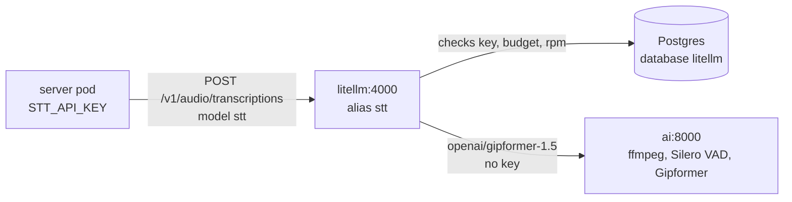

# The `ai` provider and the STT gateway: implementation plan

> **For agentic workers:** REQUIRED SUB-SKILL: Use superpowers:subagent-driven-development (recommended) or superpowers:executing-plans to implement this plan task-by-task. Steps use checkbox (`- [ ]`) syntax for tracking.

**Goal:** A Go service `ai` that serves OpenAI's `POST /v1/audio/transcriptions` with the self-hosted Gipformer 1.5 model, reachable inside each stack through the LiteLLM alias `stt` and a virtual key `server-stt` with a daily budget in audio seconds.

**Architecture:** `ai` spools the upload to a temp file, ffmpeg decodes its first audio track to float32 mono 16 kHz, Silero VAD splits speech into pieces of at most 20 s, and one shared sherpa-onnx `OfflineRecognizer` decodes the pieces in one batch. LiteLLM treats `ai` as an `openai/` backend. The chart runs `ai` next to LiteLLM in each stack; compose runs it in the local dev and prod stacks.

**Tech Stack:** Go 1.27 with cgo, `github.com/k2-fsa/sherpa-onnx-go` v1.13.8, ffmpeg, Silero VAD, Helm chart `infra/stack` with helm-unittest, LiteLLM v1.108.0, Argo CD Image Updater, docker compose.

**Spec:** `docs/superpowers/specs/2026-11-09-ai-stt-gateway-design.md`

## Global Constraints

- Go `1.27.2` in `go.mod`; build image `golang:1.27.3-trixie`; runtime `debian:trixie-slim`; amd64 only.
- sherpa-onnx Go binding pinned at `v1.13.8`.
- Model: `g-group-ai-lab/gipformer1.5-68M-rnnt` at revision `dd9227dcd8705c13f33bdbe59728d546ab94480f`, fp32 files `encoder.onnx`, `decoder.onnx`, `joiner.onnx`, `tokens.txt`. Never the fine-tuned zaic weights, never zaic or competition data.
- Recognizer config: transducer, `greedy_search`, sample rate 16000, feature dim 80, provider `cpu`.
- VAD constants: threshold 0.5, min silence 0.5 s, min speech 0.25 s, window 512, max speech 20 s.
- Every `AI_*` variable is required; no defaults in Go, the Dockerfile, compose or the chart. A missing one stops the process with its name.
- Values: `AI_ADDR=:8000`, `AI_STT_MODELS=gipformer-1.5=/models/gipformer-1.5`, `AI_VAD_MODEL=/models/silero_vad.onnx`, `AI_NUM_THREADS=4`, `AI_MAX_CONCURRENT=2`, `AI_MAX_UPLOAD_MB=100`, `AI_MAX_AUDIO_SECONDS=300`.
- Transcripts are never logged.
- LiteLLM: alias `stt`, model string `openai/gipformer-1.5`, `api_base: http://ai:8000/v1`, `input_cost_per_second: 0.000001`. Key `server-stt`, `models: ["stt"]`, `max_budget = dailySeconds / 1e6`, `budget_duration: 1d`, `rpm_limit`. dev 3600 s and 10 rpm, prod 36000 s and 60 rpm.
- Local ports: `ai-dev` on `127.0.0.1:56491`, `ai-prod` on `127.0.0.1:56490`.
- Commit messages: one short line, no body needed, **no `Co-Authored-By` trailer** (the user's standing rule for shopnexus repos).
- Prose that lands in a file (README, docs pages, code comments, commit messages) goes through the `humanizing-writing` skill and its checker before it is committed (the user's CLAUDE.md). Specs and plans do not.
- Creating the GitHub repo, pushing, tagging and making the package public are outward-facing: ask the user before each.

## Review Focus

1. A phone mp4 with its `moov` atom at the end (ffmpeg's default mp4 output) must decode; piping would fail. Test: Task 2, `TestDecodeMP4WithMoovAtTheEnd`.
2. A multipart body where `file` comes before `model` (LiteLLM's field order is not documented) must work. Test: Task 4, `TestFileBeforeModel`.
3. A video with music or silence and no speech must give 200 and `{"text": ""}`, not an error. Test: Task 3, `TestSilenceGivesEmptyText`.
4. Audio longer than `AI_MAX_AUDIO_SECONDS` must give 413 `too_long` and must not decode the whole file. Test: Task 2, `TestDecodeStopsAfterTheLimit`.
5. A client that disconnects mid-request must leave no temp file and must not be logged as a server failure. Test: Task 4, `TestClientGoneLeavesNoTempFile`.

---

## File structure

New repo `/home/beanbocchi/shopnexus/ai` (later `github.com/shopnexus/ai`, submodule `ai/`):

| File | Responsibility |
|---|---|
| `go.mod`, `go.sum` | module `github.com/shopnexus/ai` |
| `config.go`, `config_test.go` | `AI_*` variables → `Config` |
| `openai.go`, `openai_test.go` | HTTP handlers: multipart, validation, OpenAI errors, the log line |
| `main.go` | wiring, graceful shutdown |
| `speech/decode.go`, `speech/decode_test.go` | ffmpeg → `[]float32`, `ErrUnsupportedMedia`, `ErrTooLong` |
| `speech/transcriber.go` | `Transcriber`: models, VAD, slots, `Transcribe` |
| `speech/transcriber_model_test.go` | integration tests, build tag `model` |
| `scripts/fetch-assets.sh`, `scripts/assets.sha256` | download and check models and test clips |
| `Dockerfile`, `.dockerignore` | build, models, testwavs, test, runtime stages |
| `.github/workflows/build.yml` | the server's workflow |
| `README.md`, `.gitignore` | |

Umbrella repo `/home/beanbocchi/shopnexus`:

| File | Change |
|---|---|
| `.gitmodules`, `ai` | new submodule |
| `README.md` | the `ai` row in the submodule table |
| `docker-compose.yml` | `x-ai`, `ai-dev`, `ai-prod` |
| `infra/stack/values.yaml`, `values-dev.yaml`, `values-prod.yaml` | `images.ai`, `ai.*`, `litellm.stt.*` |
| `infra/stack/templates/ai.yaml` | Deployment and Service `ai` |
| `infra/stack/templates/litellm.yaml` | alias `stt`, key `server-stt` |
| `infra/stack/tests/ai_test.yaml`, `litellm_test.yaml` | chart tests |
| `infra/argocd/stacks.yaml`, `infra/check.sh` | Image Updater entries and their check |
| `infra/cmd/seal/main.go`, `main_test.go`, `infra/stack/secrets/example.env` | `STT_API_KEY` |
| `docs/web/src/content/docs/{en,vi}/operations/cluster/llm-gateway.mdx` | the gateway page |

---

### Task 1: Repo skeleton and configuration

**Files:**
- Create: `ai/go.mod`, `ai/.gitignore`, `ai/config.go`, `ai/config_test.go`

**Interfaces:**
- Produces: `type Config struct { Addr string; STTModels map[string]string; VADModel string; NumThreads, MaxConcurrent, MaxUploadMB, MaxAudioSeconds int }` and `func loadConfig(getenv func(string) string) (Config, error)` in package `main`.

- [ ] **Step 1: Create the repo and module**

```bash
mkdir -p /home/beanbocchi/shopnexus/ai && cd /home/beanbocchi/shopnexus/ai
git init -b main
go mod init github.com/shopnexus/ai
go mod edit -go=1.27.2
printf 'tmp/\n/ai\n' > .gitignore
```

- [ ] **Step 2: Write the failing test** `ai/config_test.go`

```go
package main

import (
	"maps"
	"strings"
	"testing"
)

func env(over map[string]string) func(string) string {
	base := map[string]string{
		"AI_ADDR":              ":8000",
		"AI_STT_MODELS":        "gipformer-1.5=/models/gipformer-1.5",
		"AI_VAD_MODEL":         "/models/silero_vad.onnx",
		"AI_NUM_THREADS":       "4",
		"AI_MAX_CONCURRENT":    "2",
		"AI_MAX_UPLOAD_MB":     "100",
		"AI_MAX_AUDIO_SECONDS": "300",
	}
	maps.Copy(base, over)
	return func(k string) string { return base[k] }
}

func TestLoadConfig(t *testing.T) {
	c, err := loadConfig(env(nil))
	if err != nil {
		t.Fatal(err)
	}
	if c.Addr != ":8000" || c.VADModel != "/models/silero_vad.onnx" {
		t.Errorf("Addr, VADModel = %q, %q", c.Addr, c.VADModel)
	}
	if c.NumThreads != 4 || c.MaxConcurrent != 2 || c.MaxUploadMB != 100 || c.MaxAudioSeconds != 300 {
		t.Errorf("numbers = %d %d %d %d", c.NumThreads, c.MaxConcurrent, c.MaxUploadMB, c.MaxAudioSeconds)
	}
	if want := map[string]string{"gipformer-1.5": "/models/gipformer-1.5"}; !maps.Equal(c.STTModels, want) {
		t.Errorf("STTModels = %v, want %v", c.STTModels, want)
	}
}

func TestLoadConfigNamesEveryMissingVariable(t *testing.T) {
	_, err := loadConfig(env(map[string]string{"AI_ADDR": "", "AI_MAX_UPLOAD_MB": ""}))
	if err == nil {
		t.Fatal("no error")
	}
	for _, name := range []string{"AI_ADDR", "AI_MAX_UPLOAD_MB"} {
		if !strings.Contains(err.Error(), name) {
			t.Errorf("error %q does not name %s", err, name)
		}
	}
}

func TestLoadConfigRefusesBadValues(t *testing.T) {
	for name, over := range map[string]map[string]string{
		"zero threads":      {"AI_NUM_THREADS": "0"},
		"word for a number": {"AI_MAX_CONCURRENT": "two"},
		"model without dir": {"AI_STT_MODELS": "gipformer-1.5"},
		"empty model name":  {"AI_STT_MODELS": "=/models/x"},
		"duplicate model":   {"AI_STT_MODELS": "a=/x,a=/y"},
	} {
		t.Run(name, func(t *testing.T) {
			if _, err := loadConfig(env(over)); err == nil {
				t.Error("no error")
			}
		})
	}
}

func TestLoadConfigReadsSeveralModels(t *testing.T) {
	c, err := loadConfig(env(map[string]string{"AI_STT_MODELS": " a=/x , b=/y "}))
	if err != nil {
		t.Fatal(err)
	}
	if want := map[string]string{"a": "/x", "b": "/y"}; !maps.Equal(c.STTModels, want) {
		t.Errorf("STTModels = %v, want %v", c.STTModels, want)
	}
}
```

- [ ] **Step 3: Run it and see it fail**

Run: `cd /home/beanbocchi/shopnexus/ai && go test ./...`
Expected: FAIL, `undefined: loadConfig`.

- [ ] **Step 4: Write `ai/config.go`**

```go
package main

import (
	"errors"
	"fmt"
	"strconv"
	"strings"
)

// Config holds the service's settings. Every variable is required: the image,
// compose and the chart set them all.
type Config struct {
	Addr            string            // AI_ADDR
	STTModels       map[string]string // AI_STT_MODELS: name=dir pairs, comma-separated
	VADModel        string            // AI_VAD_MODEL: path of silero_vad.onnx
	NumThreads      int               // AI_NUM_THREADS: onnxruntime threads per decode
	MaxConcurrent   int               // AI_MAX_CONCURRENT: requests decoding at once
	MaxUploadMB     int               // AI_MAX_UPLOAD_MB
	MaxAudioSeconds int               // AI_MAX_AUDIO_SECONDS
}

func loadConfig(getenv func(string) string) (Config, error) {
	var missing, bad []string
	str := func(name string) string {
		v := strings.TrimSpace(getenv(name))
		if v == "" {
			missing = append(missing, name)
		}
		return v
	}
	positive := func(name string) int {
		v := str(name)
		if v == "" {
			return 0
		}
		n, err := strconv.Atoi(v)
		if err != nil || n < 1 {
			bad = append(bad, fmt.Sprintf("%s=%q is not a positive integer", name, v))
		}
		return n
	}

	var c Config
	c.Addr = str("AI_ADDR")
	if v := str("AI_STT_MODELS"); v != "" {
		m, err := parseModels(v)
		if err != nil {
			bad = append(bad, "AI_STT_MODELS: "+err.Error())
		}
		c.STTModels = m
	}
	c.VADModel = str("AI_VAD_MODEL")
	c.NumThreads = positive("AI_NUM_THREADS")
	c.MaxConcurrent = positive("AI_MAX_CONCURRENT")
	c.MaxUploadMB = positive("AI_MAX_UPLOAD_MB")
	c.MaxAudioSeconds = positive("AI_MAX_AUDIO_SECONDS")

	var errs []error
	if len(missing) > 0 {
		errs = append(errs, fmt.Errorf("missing %s", strings.Join(missing, ", ")))
	}
	for _, b := range bad {
		errs = append(errs, errors.New(b))
	}
	return c, errors.Join(errs...)
}

// parseModels reads "name=dir,name=dir".
func parseModels(v string) (map[string]string, error) {
	m := map[string]string{}
	for _, pair := range strings.Split(v, ",") {
		name, dir, ok := strings.Cut(strings.TrimSpace(pair), "=")
		name, dir = strings.TrimSpace(name), strings.TrimSpace(dir)
		if !ok || name == "" || dir == "" {
			return nil, fmt.Errorf("%q is not name=dir", pair)
		}
		if _, dup := m[name]; dup {
			return nil, fmt.Errorf("model %q is listed twice", name)
		}
		m[name] = dir
	}
	return m, nil
}
```

- [ ] **Step 5: Run the tests**

Run: `go test ./...`
Expected: PASS.

- [ ] **Step 6: Commit**

```bash
git add go.mod .gitignore config.go config_test.go
git commit -m "feat: the AI_ variables, all required"
```

---

### Task 2: Decode any file to 16 kHz samples with ffmpeg

**Files:**
- Create: `ai/speech/decode.go`, `ai/speech/decode_test.go`

**Interfaces:**
- Produces, package `github.com/shopnexus/ai/speech`:
  - `const SampleRate = 16000`
  - `var ErrUnsupportedMedia, ErrTooLong error`
  - `func Decode(ctx context.Context, path string, maxSeconds int) ([]float32, error)`

ffmpeg must be on `PATH` for these tests (`ffmpeg -version`).

- [ ] **Step 1: Write the failing test** `ai/speech/decode_test.go`

```go
package speech

import (
	"context"
	"errors"
	"os"
	"os/exec"
	"path/filepath"
	"testing"
)

// gen runs ffmpeg with args and returns the path of the file it wrote, the
// last argument, under t.TempDir().
func gen(t *testing.T, name string, args ...string) string {
	t.Helper()
	out := filepath.Join(t.TempDir(), name)
	cmd := exec.Command("ffmpeg", append(append([]string{"-nostdin", "-v", "error", "-y"}, args...), out)...)
	if b, err := cmd.CombinedOutput(); err != nil {
		t.Fatalf("ffmpeg %v: %v\n%s", args, err, b)
	}
	return out
}

func near(t *testing.T, got, want int) {
	t.Helper()
	if d := got - want; d < -want/50 || d > want/50 {
		t.Errorf("samples = %d, want %d ±2%%", got, want)
	}
}

func TestDecodeWAV(t *testing.T) {
	f := gen(t, "a.wav", "-f", "lavfi", "-i", "sine=frequency=440:sample_rate=16000:duration=2")
	s, err := Decode(context.Background(), f, 10)
	if err != nil {
		t.Fatal(err)
	}
	near(t, len(s), 2*SampleRate)
	var peak float32
	for _, v := range s {
		peak = max(peak, v)
	}
	if peak < 0.05 {
		t.Errorf("peak = %v, the tone is missing", peak)
	}
}

func TestDecodeResamplesStereo48k(t *testing.T) {
	f := gen(t, "a.wav", "-f", "lavfi", "-i", "sine=frequency=440:sample_rate=48000:duration=2", "-ac", "2")
	s, err := Decode(context.Background(), f, 10)
	if err != nil {
		t.Fatal(err)
	}
	near(t, len(s), 2*SampleRate)
}

func TestDecodeM4A(t *testing.T) {
	f := gen(t, "a.m4a", "-f", "lavfi", "-i", "sine=duration=2", "-c:a", "aac")
	s, err := Decode(context.Background(), f, 10)
	if err != nil {
		t.Fatal(err)
	}
	near(t, len(s), 2*SampleRate)
}

// ffmpeg writes the moov atom at the end of an mp4 unless told +faststart,
// as many phones do. Reading such a file needs a seekable input.
func TestDecodeMP4WithMoovAtTheEnd(t *testing.T) {
	f := gen(t, "a.mp4",
		"-f", "lavfi", "-i", "color=c=black:s=64x64:r=10:d=2",
		"-f", "lavfi", "-i", "sine=duration=2",
		"-shortest", "-c:v", "mpeg4", "-c:a", "aac")
	s, err := Decode(context.Background(), f, 10)
	if err != nil {
		t.Fatal(err)
	}
	near(t, len(s), 2*SampleRate)
}

func TestDecodeMP4WithoutSound(t *testing.T) {
	f := gen(t, "a.mp4", "-f", "lavfi", "-i", "color=c=black:s=64x64:r=10:d=2", "-c:v", "mpeg4")
	if _, err := Decode(context.Background(), f, 10); !errors.Is(err, ErrUnsupportedMedia) {
		t.Errorf("err = %v, want ErrUnsupportedMedia", err)
	}
}

func TestDecodeGarbage(t *testing.T) {
	f := filepath.Join(t.TempDir(), "a.mp4")
	if err := os.WriteFile(f, []byte("not a media file at all"), 0o600); err != nil {
		t.Fatal(err)
	}
	if _, err := Decode(context.Background(), f, 10); !errors.Is(err, ErrUnsupportedMedia) {
		t.Errorf("err = %v, want ErrUnsupportedMedia", err)
	}
}

func TestDecodeAcceptsExactlyTheLimit(t *testing.T) {
	f := gen(t, "a.wav", "-f", "lavfi", "-i", "sine=sample_rate=16000:duration=3")
	s, err := Decode(context.Background(), f, 3)
	if err != nil {
		t.Fatal(err)
	}
	if len(s) != 3*SampleRate {
		t.Errorf("samples = %d, want %d", len(s), 3*SampleRate)
	}
}

// ffmpeg reads one second past the limit and stops, so a long file costs no
// more than the limit to refuse.
func TestDecodeStopsAfterTheLimit(t *testing.T) {
	f := gen(t, "a.wav", "-f", "lavfi", "-i", "sine=sample_rate=16000:duration=60")
	if _, err := Decode(context.Background(), f, 3); !errors.Is(err, ErrTooLong) {
		t.Errorf("err = %v, want ErrTooLong", err)
	}
}

func TestDecodeHonoursCancel(t *testing.T) {
	f := gen(t, "a.wav", "-f", "lavfi", "-i", "sine=sample_rate=16000:duration=2")
	ctx, cancel := context.WithCancel(context.Background())
	cancel()
	if _, err := Decode(ctx, f, 10); !errors.Is(err, context.Canceled) {
		t.Errorf("err = %v, want context.Canceled", err)
	}
}
```

- [ ] **Step 2: Run it and see it fail**

Run: `go test ./speech/`
Expected: FAIL, `undefined: Decode`.

- [ ] **Step 3: Write `ai/speech/decode.go`**

```go
// Package speech turns an audio or video file into text with a self-hosted
// model.
package speech

import (
	"bytes"
	"context"
	"encoding/binary"
	"errors"
	"fmt"
	"math"
	"os/exec"
	"strconv"
	"strings"
)

// SampleRate is what Gipformer and Silero VAD take.
const SampleRate = 16000

var (
	// ErrUnsupportedMedia: ffmpeg cannot read the file, or it has no audio track.
	ErrUnsupportedMedia = errors.New("ffmpeg cannot read an audio track from the file")
	// ErrTooLong: the audio is longer than the limit.
	ErrTooLong = errors.New("the audio is longer than the limit")
)

// Decode reads the first audio track of the file at path as float32 mono
// samples at 16 kHz. It takes a path, not a stream: an mp4 with its moov atom
// at the end needs a seekable input. ffmpeg stops one second past maxSeconds,
// and anything longer than maxSeconds is ErrTooLong.
func Decode(ctx context.Context, path string, maxSeconds int) ([]float32, error) {
	stderr := &capped{max: 2048}
	cmd := exec.CommandContext(ctx, "ffmpeg", "-nostdin", "-v", "error",
		"-i", path, "-map", "a:0", "-vn", "-ac", "1", "-ar", strconv.Itoa(SampleRate),
		"-t", strconv.Itoa(maxSeconds+1), "-f", "f32le", "pipe:1")
	cmd.Stderr = stderr
	out, err := cmd.Output()
	if err != nil {
		if ctx.Err() != nil {
			return nil, ctx.Err()
		}
		var exit *exec.ExitError
		if errors.As(err, &exit) && exit.Exited() {
			return nil, fmt.Errorf("%w: %s", ErrUnsupportedMedia, strings.TrimSpace(stderr.String()))
		}
		return nil, fmt.Errorf("ffmpeg: %w: %s", err, strings.TrimSpace(stderr.String()))
	}
	n := len(out) / 4
	if n > maxSeconds*SampleRate {
		return nil, ErrTooLong
	}
	samples := make([]float32, n)
	for i := range samples {
		samples[i] = math.Float32frombits(binary.LittleEndian.Uint32(out[4*i:]))
	}
	return samples, nil
}

// capped keeps the first max bytes written to it, so a garbage file cannot
// fill memory with ffmpeg's complaints.
type capped struct {
	bytes.Buffer
	max int
}

func (c *capped) Write(p []byte) (int, error) {
	if room := c.max - c.Len(); room > 0 {
		c.Buffer.Write(p[:min(len(p), room)])
	}
	return len(p), nil
}
```

- [ ] **Step 4: Run the tests**

Run: `go test ./speech/`
Expected: PASS.

- [ ] **Step 5: Commit**

```bash
git add speech/decode.go speech/decode_test.go
git commit -m "feat: decode any audio or video file to 16 kHz samples with ffmpeg"
```

---

### Task 3: Transcriber (VAD, Gipformer, slots) and the test assets

**Files:**
- Create: `ai/scripts/fetch-assets.sh`, `ai/scripts/assets.sha256`, `ai/speech/transcriber.go`, `ai/speech/transcriber_model_test.go`
- Modify: `ai/go.mod`, `ai/go.sum`

**Interfaces:**
- Consumes: `Decode`, `SampleRate`, `ErrTooLong` from Task 2.
- Produces, package `speech`:
  - `type Config struct { Models map[string]string; VADModel string; NumThreads, MaxConcurrent, MaxAudioSeconds int }`
  - `type Result struct { Text string; AudioSeconds, SpeechSeconds float64; Pieces int }`
  - `var ErrUnknownModel error`
  - `func New(c Config) (*Transcriber, error)`
  - `func (t *Transcriber) HasModel(name string) bool`
  - `func (t *Transcriber) Models() []string` (sorted)
  - `func (t *Transcriber) Transcribe(ctx context.Context, model, path string) (Result, error)`
  - `func (t *Transcriber) Close()`
- `fetch-assets.sh models <dir>` writes `<dir>/gipformer-1.5/{encoder,decoder,joiner}.onnx`, `<dir>/gipformer-1.5/tokens.txt`, `<dir>/silero_vad.onnx`. `fetch-assets.sh testwavs <dir>` writes `<dir>/{0,1,2}.wav`.

- [ ] **Step 1: Write `ai/scripts/assets.sha256`**

The hashes were read from Hugging Face's LFS metadata at the pinned revisions and from the files on 2026-11-09.

```
96b3c83c9c39afc4421f8fd2914d26b53ae837e56788a7bd5aece61580937c36  models/gipformer-1.5/encoder.onnx
ea584ee86d6f74191f934f8b950013adcb2c33483785aa8b1b44fff3a7b30069  models/gipformer-1.5/decoder.onnx
d146a1cff4a0060d7031e5eb91295773661bc52c356c952dd1e2759e60ffa94d  models/gipformer-1.5/joiner.onnx
f536d03c2e95ebd2930cf0abec88e823bd17d3c1933da7ae6a82db3b80605e15  models/gipformer-1.5/tokens.txt
9e2449e1087496d8d4caba907f23e0bd3f78d91fa552479bb9c23ac09cbb1fd6  models/silero_vad.onnx
8df4b0109649125ea0c8415bd10a23ad3dc9aa393432021c815a0bafba04cfd7  testwavs/0.wav
6d3a8d713f59b821f32c889d24e66368e7f684d7e143bb49532fd2b59d9c6437  testwavs/1.wav
8e6821f71b608ec9fa947571af7f631cad1f9d45b22287e22e70e7411c62b802  testwavs/2.wav
```

- [ ] **Step 2: Write `ai/scripts/fetch-assets.sh`** and make it executable (`chmod +x`)

```sh
#!/bin/sh
# Downloads the model files the image ships, or the clips the integration
# tests read, and checks each against assets.sha256.
#   fetch-assets.sh models <dir>
#   fetch-assets.sh testwavs <dir>
# The clips come from sherpa-onnx's Vietnamese model repo, which took them from
# nguyenvulebinh/wav2vec2-base-vietnamese-250h (CC BY-NC 4.0). They are only
# downloaded for tests: never committed, never in the runtime image.
set -eu
kind=${1:?models or testwavs}
dir=${2:?target directory}
here=$(cd "$(dirname "$0")" && pwd)

GIPFORMER=https://huggingface.co/g-group-ai-lab/gipformer1.5-68M-rnnt/resolve/dd9227dcd8705c13f33bdbe59728d546ab94480f
SILERO=https://github.com/k2-fsa/sherpa-onnx/releases/download/asr-models/silero_vad.onnx
WAVS=https://huggingface.co/csukuangfj/sherpa-onnx-zipformer-vi-2025-04-20/resolve/0fc3fea3ccd9c50b439755fa8a6aba546cb3a7d4/test_wavs

mkdir -p "$dir"
cd "$dir"
case $kind in
models)
	mkdir -p gipformer-1.5
	for f in encoder.onnx decoder.onnx joiner.onnx tokens.txt; do
		curl -fsSL -o "gipformer-1.5/$f" "$GIPFORMER/$f"
	done
	curl -fsSL -o silero_vad.onnx "$SILERO"
	;;
testwavs)
	for f in 0.wav 1.wav 2.wav; do
		curl -fsSL -o "$f" "$WAVS/$f"
	done
	;;
*)
	echo "usage: $0 models|testwavs <dir>" >&2
	exit 2
	;;
esac
grep " $kind/" "$here/assets.sha256" | sed "s| $kind/| |" | sha256sum -c --quiet -
```

- [ ] **Step 3: Fetch the assets locally**

```bash
cd /home/beanbocchi/shopnexus/ai
scripts/fetch-assets.sh models tmp/models
scripts/fetch-assets.sh testwavs tmp/testwavs
```
Expected: exits 0 with no output (sha256sum `--quiet` prints only failures). `tmp/` is git-ignored.

- [ ] **Step 4: Add the binding**

```bash
go get github.com/k2-fsa/sherpa-onnx-go@v1.13.8
```

- [ ] **Step 5: Write the failing test** `ai/speech/transcriber_model_test.go`

```go
//go:build model

// These tests load the real model. Run them with
//   AI_TEST_MODELS=tmp/models AI_TEST_WAVS=tmp/testwavs go test -race -tags model ./...
// where the two folders come from scripts/fetch-assets.sh.
package speech

import (
	"context"
	"errors"
	"os"
	"os/exec"
	"path/filepath"
	"strconv"
	"strings"
	"sync"
	"testing"
	"time"
)

func dirFromEnv(t *testing.T, name string) string {
	t.Helper()
	v := os.Getenv(name)
	if v == "" {
		t.Fatalf("set %s (see the comment at the top of this file)", name)
	}
	abs, err := filepath.Abs(v)
	if err != nil {
		t.Fatal(err)
	}
	return abs
}

func newTranscriber(t *testing.T, maxConcurrent, maxSeconds int) *Transcriber {
	t.Helper()
	models := dirFromEnv(t, "AI_TEST_MODELS")
	tr, err := New(Config{
		Models:          map[string]string{"gipformer-1.5": filepath.Join(models, "gipformer-1.5")},
		VADModel:        filepath.Join(models, "silero_vad.onnx"),
		NumThreads:      2,
		MaxConcurrent:   maxConcurrent,
		MaxAudioSeconds: maxSeconds,
	})
	if err != nil {
		t.Fatal(err)
	}
	t.Cleanup(tr.Close)
	return tr
}

func wav(t *testing.T, name string) string {
	return filepath.Join(dirFromEnv(t, "AI_TEST_WAVS"), name)
}

// What base Gipformer 1.5 heard in the three clips on 2026-11-09:
//   0.wav  rồi cũng hỗ trợ cho lâu lâu cũng cho gạo cho này kia
//   1.wav  những nơi đã khống chế được căn bệnh
//   2.wav  âm lượng tivi giảm
var keywords = map[string][]string{
	"0.wav": {"hỗ trợ", "gạo"},
	"1.wav": {"khống chế", "căn bệnh"},
	"2.wav": {"âm lượng", "tivi"},
}

func hasAll(t *testing.T, text string, words []string) {
	t.Helper()
	for _, w := range words {
		if !strings.Contains(text, w) {
			t.Errorf("text %q lacks %q", text, w)
		}
	}
}

// long writes the three clips twice and 0.wav and 1.wav once more, 1.5 s of
// silence after each, about 32 s in all, as an mp4 with a black picture.
func long(t *testing.T) string {
	t.Helper()
	dir := t.TempDir()
	out := filepath.Join(dir, "long.mp4")
	args := []string{"-nostdin", "-v", "error", "-y"}
	order := []string{"0.wav", "1.wav", "2.wav", "0.wav", "1.wav", "2.wav", "0.wav", "1.wav"}
	for _, f := range order {
		args = append(args, "-i", wav(t, f))
	}
	args = append(args, "-f", "lavfi", "-t", "1.5", "-i", "anullsrc=r=16000:cl=mono",
		"-f", "lavfi", "-i", "color=c=black:s=64x64:r=10")
	silence := len(order)
	var filter strings.Builder
	for i := range order {
		filter.WriteString("[" + strconv.Itoa(i) + "][" + strconv.Itoa(silence) + "]")
	}
	filter.WriteString("concat=n=" + strconv.Itoa(2*len(order)) + ":v=0:a=1[a]")
	args = append(args, "-filter_complex", filter.String(), "-map", "[a]", "-map", strconv.Itoa(silence+1)+":v",
		"-shortest", "-c:v", "mpeg4", "-c:a", "aac", out)
	if b, err := exec.Command("ffmpeg", args...).CombinedOutput(); err != nil {
		t.Fatalf("ffmpeg: %v\n%s", err, b)
	}
	return out
}

func TestTranscribeEachClip(t *testing.T) {
	tr := newTranscriber(t, 1, 300)
	for name, words := range keywords {
		t.Run(name, func(t *testing.T) {
			r, err := tr.Transcribe(context.Background(), "gipformer-1.5", wav(t, name))
			if err != nil {
				t.Fatal(err)
			}
			if r.Text != strings.ToLower(r.Text) {
				t.Errorf("text %q is not lower case", r.Text)
			}
			hasAll(t, r.Text, words)
			if r.Pieces != 1 {
				t.Errorf("pieces = %d, want 1", r.Pieces)
			}
		})
	}
}

func TestLongVideoIsSplitAtSilences(t *testing.T) {
	tr := newTranscriber(t, 1, 300)
	r, err := tr.Transcribe(context.Background(), "gipformer-1.5", long(t))
	if err != nil {
		t.Fatal(err)
	}
	if r.Pieces < 6 {
		t.Errorf("pieces = %d, want at least 6", r.Pieces)
	}
	if r.AudioSeconds < 30 || r.AudioSeconds > 34 {
		t.Errorf("audio seconds = %v, want about 32", r.AudioSeconds)
	}
	if r.SpeechSeconds <= 0 || r.SpeechSeconds >= r.AudioSeconds {
		t.Errorf("speech seconds = %v of %v", r.SpeechSeconds, r.AudioSeconds)
	}
	for _, words := range keywords {
		hasAll(t, r.Text, words)
	}
}

func TestSilenceGivesEmptyText(t *testing.T) {
	tr := newTranscriber(t, 1, 300)
	f := filepath.Join(t.TempDir(), "silence.mp4")
	if b, err := exec.Command("ffmpeg", "-nostdin", "-v", "error", "-y",
		"-f", "lavfi", "-i", "anullsrc=r=16000:cl=mono:d=3", "-c:a", "aac", f).CombinedOutput(); err != nil {
		t.Fatalf("ffmpeg: %v\n%s", err, b)
	}
	r, err := tr.Transcribe(context.Background(), "gipformer-1.5", f)
	if err != nil {
		t.Fatal(err)
	}
	if r.Text != "" || r.Pieces != 0 {
		t.Errorf("result = %+v, want no text and no pieces", r)
	}
}

func TestUnknownModel(t *testing.T) {
	tr := newTranscriber(t, 1, 300)
	if tr.HasModel("whisper-1") {
		t.Error("HasModel(whisper-1) = true")
	}
	if _, err := tr.Transcribe(context.Background(), "whisper-1", wav(t, "0.wav")); !errors.Is(err, ErrUnknownModel) {
		t.Errorf("err = %v, want ErrUnknownModel", err)
	}
}

func TestTooLong(t *testing.T) {
	tr := newTranscriber(t, 1, 10)
	if _, err := tr.Transcribe(context.Background(), "gipformer-1.5", long(t)); !errors.Is(err, ErrTooLong) {
		t.Errorf("err = %v, want ErrTooLong", err)
	}
}

// A request waits for a free slot until its client gives up.
func TestWaitsForASlot(t *testing.T) {
	tr := newTranscriber(t, 1, 300)
	tr.slots <- struct{}{} // the only slot is taken
	ctx, cancel := context.WithTimeout(context.Background(), 100*time.Millisecond)
	defer cancel()
	if _, err := tr.Transcribe(ctx, "gipformer-1.5", wav(t, "0.wav")); !errors.Is(err, context.DeadlineExceeded) {
		t.Errorf("err = %v, want context.DeadlineExceeded", err)
	}
	<-tr.slots
}

// One recognizer serves every request. Run with -race.
func TestConcurrentRequestsAgree(t *testing.T) {
	tr := newTranscriber(t, 4, 300)
	f := long(t)
	want, err := tr.Transcribe(context.Background(), "gipformer-1.5", f)
	if err != nil {
		t.Fatal(err)
	}
	var wg sync.WaitGroup
	for range 8 {
		wg.Go(func() {
			for range 2 {
				got, err := tr.Transcribe(context.Background(), "gipformer-1.5", f)
				if err != nil {
					t.Error(err)
					return
				}
				if got.Text != want.Text {
					t.Errorf("concurrent text %q, want %q", got.Text, want.Text)
				}
			}
		})
	}
	wg.Wait()
}
```

- [ ] **Step 6: Run it and see it fail**

Run: `AI_TEST_MODELS=tmp/models AI_TEST_WAVS=tmp/testwavs go test -tags model ./speech/`
Expected: FAIL, `undefined: New` (and `Config`, `Transcriber`, `ErrUnknownModel`).

- [ ] **Step 7: Write `ai/speech/transcriber.go`**

```go
package speech

import (
	"context"
	"errors"
	"fmt"
	"os"
	"path/filepath"
	"slices"
	"strings"

	sherpa "github.com/k2-fsa/sherpa-onnx-go/sherpa_onnx"
)

// ErrUnknownModel: the request names a model the service does not have.
var ErrUnknownModel = errors.New("unknown model")

// Config of a Transcriber.
type Config struct {
	// Models maps a model name to a folder holding encoder.onnx, decoder.onnx,
	// joiner.onnx and tokens.txt of a transducer such as Gipformer.
	Models          map[string]string
	VADModel        string // path of silero_vad.onnx
	NumThreads      int
	MaxConcurrent   int
	MaxAudioSeconds int
}

// Result of one transcription.
type Result struct {
	Text          string
	AudioSeconds  float64 // length of the decoded audio
	SpeechSeconds float64 // length of the pieces VAD found
	Pieces        int
}

// Silero VAD settings. Pieces end at a silence of 0.5 s or at 20 s, whichever
// comes first; Gipformer was trained on clips of that length.
const (
	vadThreshold   = 0.5
	vadMinSilence  = 0.5
	vadMinSpeech   = 0.25
	vadWindow      = 512
	vadMaxSpeech   = 20
	vadBufferInSec = 60
)

// Transcriber turns files into text. It is safe for concurrent use: one
// recognizer per model serves every request, and at most MaxConcurrent
// requests decode at once.
type Transcriber struct {
	recognizers map[string]*sherpa.OfflineRecognizer
	vad         sherpa.VadModelConfig
	maxSeconds  int
	slots       chan struct{}
}

// New loads every model. It fails when a file is missing or a model does
// not load.
func New(c Config) (*Transcriber, error) {
	t := &Transcriber{
		recognizers: map[string]*sherpa.OfflineRecognizer{},
		maxSeconds:  c.MaxAudioSeconds,
		slots:       make(chan struct{}, c.MaxConcurrent),
	}
	t.vad = sherpa.VadModelConfig{SampleRate: SampleRate, NumThreads: 1, Provider: "cpu"}
	t.vad.SileroVad = sherpa.SileroVadModelConfig{
		Model:              c.VADModel,
		Threshold:          vadThreshold,
		MinSilenceDuration: vadMinSilence,
		MinSpeechDuration:  vadMinSpeech,
		WindowSize:         vadWindow,
		MaxSpeechDuration:  vadMaxSpeech,
	}
	if err := exists(c.VADModel); err != nil {
		return nil, err
	}
	probe := sherpa.NewVoiceActivityDetector(&t.vad, vadBufferInSec)
	if probe == nil {
		return nil, fmt.Errorf("cannot load the VAD model %s", c.VADModel)
	}
	sherpa.DeleteVoiceActivityDetector(probe)

	for name, dir := range c.Models {
		files := map[string]string{}
		for _, f := range []string{"encoder.onnx", "decoder.onnx", "joiner.onnx", "tokens.txt"} {
			files[f] = filepath.Join(dir, f)
			if err := exists(files[f]); err != nil {
				t.Close()
				return nil, fmt.Errorf("model %s: %w", name, err)
			}
		}
		cfg := sherpa.OfflineRecognizerConfig{DecodingMethod: "greedy_search"}
		cfg.FeatConfig = sherpa.FeatureConfig{SampleRate: SampleRate, FeatureDim: 80}
		cfg.ModelConfig.Transducer = sherpa.OfflineTransducerModelConfig{
			Encoder: files["encoder.onnx"], Decoder: files["decoder.onnx"], Joiner: files["joiner.onnx"],
		}
		cfg.ModelConfig.Tokens = files["tokens.txt"]
		cfg.ModelConfig.NumThreads = c.NumThreads
		cfg.ModelConfig.Provider = "cpu"
		r := sherpa.NewOfflineRecognizer(&cfg)
		if r == nil {
			t.Close()
			return nil, fmt.Errorf("model %s: cannot load it from %s", name, dir)
		}
		t.recognizers[name] = r
	}
	return t, nil
}

func exists(path string) error {
	if _, err := os.Stat(path); err != nil {
		return fmt.Errorf("missing %s: %w", path, err)
	}
	return nil
}

// HasModel reports whether name is one of the loaded models.
func (t *Transcriber) HasModel(name string) bool {
	_, ok := t.recognizers[name]
	return ok
}

// Models lists the loaded model names, sorted.
func (t *Transcriber) Models() []string {
	names := make([]string, 0, len(t.recognizers))
	for n := range t.recognizers {
		names = append(names, n)
	}
	slices.Sort(names)
	return names
}

// Transcribe decodes the file at path and returns its text in lower case.
// It waits for a free slot while ctx lasts.
func (t *Transcriber) Transcribe(ctx context.Context, model, path string) (Result, error) {
	rec, ok := t.recognizers[model]
	if !ok {
		return Result{}, fmt.Errorf("%w %q", ErrUnknownModel, model)
	}
	select {
	case t.slots <- struct{}{}:
	case <-ctx.Done():
		return Result{}, ctx.Err()
	}
	defer func() { <-t.slots }()

	samples, err := Decode(ctx, path, t.maxSeconds)
	if err != nil {
		return Result{}, err
	}
	pieces, err := t.split(samples)
	if err != nil {
		return Result{}, err
	}
	res := Result{AudioSeconds: float64(len(samples)) / SampleRate, Pieces: len(pieces)}
	if len(pieces) == 0 {
		return res, nil
	}

	streams := make([]*sherpa.OfflineStream, len(pieces))
	for i, p := range pieces {
		streams[i] = sherpa.NewOfflineStream(rec)
		streams[i].AcceptWaveform(SampleRate, p)
		res.SpeechSeconds += float64(len(p)) / SampleRate
	}
	defer func() {
		for _, s := range streams {
			sherpa.DeleteOfflineStream(s)
		}
	}()
	rec.DecodeStreams(streams)
	texts := make([]string, len(streams))
	for i, s := range streams {
		texts[i] = s.GetResult().Text
	}
	res.Text = strings.Join(strings.Fields(strings.ToLower(strings.Join(texts, " "))), " ")
	return res, nil
}

// split returns the speech in samples as pieces of at most vadMaxSpeech
// seconds, in order. A VAD is stateful, so every call makes its own.
func (t *Transcriber) split(samples []float32) ([][]float32, error) {
	if len(samples) == 0 {
		return nil, nil
	}
	vad := sherpa.NewVoiceActivityDetector(&t.vad, vadBufferInSec)
	if vad == nil {
		return nil, errors.New("cannot create the VAD")
	}
	defer sherpa.DeleteVoiceActivityDetector(vad)
	var pieces [][]float32
	drain := func() {
		for !vad.IsEmpty() {
			pieces = append(pieces, vad.Front().Samples)
			vad.Pop()
		}
	}
	for i := 0; i < len(samples); i += vadWindow {
		vad.AcceptWaveform(samples[i:min(i+vadWindow, len(samples))])
		drain()
	}
	vad.Flush()
	drain()
	return pieces, nil
}

// Close frees the models.
func (t *Transcriber) Close() {
	for name, r := range t.recognizers {
		sherpa.DeleteOfflineRecognizer(r)
		delete(t.recognizers, name)
	}
}
```

- [ ] **Step 8: Run the integration tests with the race detector**

Run: `AI_TEST_MODELS=tmp/models AI_TEST_WAVS=tmp/testwavs go test -race -tags model ./speech/ -v -run 'Transcribe|Long|Silence|Unknown|TooLong|Slot|Concurrent'`
Expected: PASS for all seven. If `TestConcurrentRequestsAgree` fails or `-race` reports a race inside the binding, stop and tell the user: the spec's fallback is a pool of `MaxConcurrent` recognizers per model.

- [ ] **Step 9: Run the unit tests without the tag**

Run: `go test ./...`
Expected: PASS (the model tests are excluded without `-tags model`).

- [ ] **Step 10: Commit**

```bash
git add go.mod go.sum scripts speech/transcriber.go speech/transcriber_model_test.go
git commit -m "feat: transcribe with Silero VAD and Gipformer through sherpa-onnx"
```

---

### Task 4: The OpenAI-compatible HTTP API

**Files:**
- Create: `ai/openai.go`, `ai/openai_test.go`

**Interfaces:**
- Consumes: `speech.Result`, `speech.ErrUnsupportedMedia`, `speech.ErrTooLong`, `speech.ErrUnknownModel`.
- Produces, package `main`:
  - `type transcriber interface { HasModel(name string) bool; Transcribe(ctx context.Context, model, path string) (speech.Result, error) }`
  - `func newHandler(t transcriber, maxUploadBytes int64, log *slog.Logger) http.Handler`

- [ ] **Step 1: Write the failing test** `ai/openai_test.go`

```go
package main

import (
	"bytes"
	"context"
	"encoding/json"
	"errors"
	"io"
	"log/slog"
	"mime/multipart"
	"net/http"
	"net/http/httptest"
	"os"
	"strings"
	"testing"

	"github.com/shopnexus/ai/speech"
)

type fake struct {
	result   speech.Result
	err      error
	called   bool
	model    string
	upload   []byte // what the file at path held during the call
	path     string
	onCall   func()
}

func (f *fake) HasModel(name string) bool { return name == "gipformer-1.5" }

func (f *fake) Transcribe(ctx context.Context, model, path string) (speech.Result, error) {
	f.called, f.model, f.path = true, model, path
	f.upload, _ = os.ReadFile(path)
	if f.onCall != nil {
		f.onCall()
	}
	if err := ctx.Err(); err != nil {
		return speech.Result{}, err
	}
	return f.result, f.err
}

type part struct{ name, value string; file bool }

func body(t *testing.T, parts ...part) (*bytes.Buffer, string) {
	t.Helper()
	var b bytes.Buffer
	w := multipart.NewWriter(&b)
	for _, p := range parts {
		var err error
		if p.file {
			var fw io.Writer
			fw, err = w.CreateFormFile(p.name, "clip.mp4")
			if err == nil {
				_, err = fw.Write([]byte(p.value))
			}
		} else {
			err = w.WriteField(p.name, p.value)
		}
		if err != nil {
			t.Fatal(err)
		}
	}
	if err := w.Close(); err != nil {
		t.Fatal(err)
	}
	return &b, w.FormDataContentType()
}

func call(t *testing.T, f *fake, limit int64, parts ...part) *httptest.ResponseRecorder {
	t.Helper()
	b, ct := body(t, parts...)
	req := httptest.NewRequest(http.MethodPost, "/v1/audio/transcriptions", b)
	req.Header.Set("Content-Type", ct)
	rec := httptest.NewRecorder()
	newHandler(f, limit, slog.New(slog.DiscardHandler)).ServeHTTP(rec, req)
	return rec
}

var (
	file  = part{name: "file", value: "fake mp4 bytes", file: true}
	model = part{name: "model", value: "gipformer-1.5"}
)

type apiError struct {
	Error struct{ Message, Type, Code string } `json:"error"`
}

func wantError(t *testing.T, rec *httptest.ResponseRecorder, status int, code string) {
	t.Helper()
	if rec.Code != status {
		t.Errorf("status = %d, want %d; body %s", rec.Code, status, rec.Body)
	}
	var e apiError
	if err := json.Unmarshal(rec.Body.Bytes(), &e); err != nil {
		t.Fatalf("body %q is not an OpenAI error: %v", rec.Body, err)
	}
	if e.Error.Code != code || e.Error.Message == "" {
		t.Errorf("error = %+v, want code %s", e.Error, code)
	}
	wantType := "invalid_request_error"
	if status >= 500 {
		wantType = "server_error"
	}
	if e.Error.Type != wantType {
		t.Errorf("type = %q, want %q", e.Error.Type, wantType)
	}
}

func TestJSONResponse(t *testing.T) {
	f := &fake{result: speech.Result{Text: "âm lượng tivi giảm", AudioSeconds: 41.2}}
	rec := call(t, f, 1<<20, model, file)
	if rec.Code != 200 {
		t.Fatalf("status = %d; body %s", rec.Code, rec.Body)
	}
	if ct := rec.Header().Get("Content-Type"); ct != "application/json" {
		t.Errorf("Content-Type = %q", ct)
	}
	var got struct {
		Text  string
		Usage struct{ Type string; Seconds int }
	}
	if err := json.Unmarshal(rec.Body.Bytes(), &got); err != nil {
		t.Fatal(err)
	}
	if got.Text != "âm lượng tivi giảm" || got.Usage.Type != "duration" || got.Usage.Seconds != 42 {
		t.Errorf("body = %+v", got)
	}
	if f.model != "gipformer-1.5" || string(f.upload) != "fake mp4 bytes" {
		t.Errorf("transcriber got model %q and file %q", f.model, f.upload)
	}
	if _, err := os.Stat(f.path); !errors.Is(err, os.ErrNotExist) {
		t.Errorf("temp file %s is still there", f.path)
	}
}

func TestTextResponse(t *testing.T) {
	f := &fake{result: speech.Result{Text: "âm lượng tivi giảm", AudioSeconds: 2}}
	rec := call(t, f, 1<<20, file, model, part{name: "response_format", value: "text"})
	if rec.Code != 200 || rec.Body.String() != "âm lượng tivi giảm" {
		t.Errorf("status %d, body %q", rec.Code, rec.Body)
	}
	if ct := rec.Header().Get("Content-Type"); ct != "text/plain; charset=utf-8" {
		t.Errorf("Content-Type = %q", ct)
	}
}

func TestNoSpeechIsAnEmptyText(t *testing.T) {
	rec := call(t, &fake{result: speech.Result{AudioSeconds: 3}}, 1<<20, model, file)
	if rec.Code != 200 || !strings.Contains(rec.Body.String(), `"text":""`) {
		t.Errorf("status %d, body %s", rec.Code, rec.Body)
	}
}

// LiteLLM's field order is not documented; the file may come first.
func TestFileBeforeModel(t *testing.T) {
	f := &fake{result: speech.Result{Text: "x", AudioSeconds: 1}}
	if rec := call(t, f, 1<<20, file, model); rec.Code != 200 {
		t.Errorf("status = %d; body %s", rec.Code, rec.Body)
	}
}

func TestOtherOpenAIFieldsAreIgnored(t *testing.T) {
	f := &fake{result: speech.Result{Text: "x", AudioSeconds: 1}}
	rec := call(t, f, 1<<20, model, file,
		part{name: "prompt", value: "giá"}, part{name: "temperature", value: "0"}, part{name: "language", value: "vi"})
	if rec.Code != 200 {
		t.Errorf("status = %d; body %s", rec.Code, rec.Body)
	}
}

func TestRequestErrors(t *testing.T) {
	for name, tc := range map[string]struct {
		parts  []part
		status int
		code   string
	}{
		"no file":             {[]part{model}, 400, "invalid_request"},
		"no model":            {[]part{file}, 400, "invalid_request"},
		"english":             {[]part{model, file, {name: "language", value: "en"}}, 400, "invalid_request"},
		"srt":                 {[]part{model, file, {name: "response_format", value: "srt"}}, 400, "invalid_request"},
		"two files":           {[]part{model, file, file}, 400, "invalid_request"},
		"unknown model":       {[]part{{name: "model", value: "whisper-1"}, file}, 404, "model_not_found"},
	} {
		t.Run(name, func(t *testing.T) {
			f := &fake{}
			wantError(t, call(t, f, 1<<20, tc.parts...), tc.status, tc.code)
			if f.called {
				t.Error("the transcriber was called")
			}
		})
	}
}

func TestTranscriberErrors(t *testing.T) {
	for name, tc := range map[string]struct {
		err    error
		status int
		code   string
	}{
		"unreadable": {speech.ErrUnsupportedMedia, 400, "unsupported_media"},
		"too long":   {speech.ErrTooLong, 413, "too_long"},
		"broken":     {errors.New("onnxruntime exploded"), 500, "internal_error"},
	} {
		t.Run(name, func(t *testing.T) {
			rec := call(t, &fake{err: tc.err}, 1<<20, model, file)
			wantError(t, rec, tc.status, tc.code)
			if strings.Contains(rec.Body.String(), "onnxruntime") {
				t.Errorf("internal detail leaked: %s", rec.Body)
			}
		})
	}
}

func TestBodyOverTheLimit(t *testing.T) {
	big := part{name: "file", value: strings.Repeat("x", 4096), file: true}
	f := &fake{}
	wantError(t, call(t, f, 1024, model, big), 413, "too_large")
	if f.called {
		t.Error("the transcriber was called")
	}
}

func TestNotMultipart(t *testing.T) {
	req := httptest.NewRequest(http.MethodPost, "/v1/audio/transcriptions", strings.NewReader(`{"model":"gipformer-1.5"}`))
	req.Header.Set("Content-Type", "application/json")
	rec := httptest.NewRecorder()
	newHandler(&fake{}, 1<<20, slog.New(slog.DiscardHandler)).ServeHTTP(rec, req)
	wantError(t, rec, 400, "invalid_request")
}

func TestClientGoneLeavesNoTempFile(t *testing.T) {
	b, ct := body(t, model, file)
	ctx, cancel := context.WithCancel(context.Background())
	req := httptest.NewRequestWithContext(ctx, http.MethodPost, "/v1/audio/transcriptions", b)
	req.Header.Set("Content-Type", ct)
	f := &fake{onCall: cancel}
	var logs bytes.Buffer
	rec := httptest.NewRecorder()
	newHandler(f, 1<<20, slog.New(slog.NewJSONHandler(&logs, nil))).ServeHTTP(rec, req)
	if _, err := os.Stat(f.path); !errors.Is(err, os.ErrNotExist) {
		t.Errorf("temp file %s is still there", f.path)
	}
	if strings.Contains(logs.String(), `"level":"ERROR"`) {
		t.Errorf("a client that left was logged as an error: %s", logs.String())
	}
}

func TestProbes(t *testing.T) {
	h := newHandler(&fake{}, 1<<20, slog.New(slog.DiscardHandler))
	for _, p := range []string{"/healthz", "/readyz"} {
		rec := httptest.NewRecorder()
		h.ServeHTTP(rec, httptest.NewRequest(http.MethodGet, p, nil))
		if rec.Code != 200 {
			t.Errorf("%s = %d", p, rec.Code)
		}
	}
}

func TestTranscriptIsNeverLogged(t *testing.T) {
	var logs bytes.Buffer
	b, ct := body(t, model, file)
	req := httptest.NewRequest(http.MethodPost, "/v1/audio/transcriptions", b)
	req.Header.Set("Content-Type", ct)
	f := &fake{result: speech.Result{Text: "số điện thoại của tôi", AudioSeconds: 2, SpeechSeconds: 1.5, Pieces: 1}}
	newHandler(f, 1<<20, slog.New(slog.NewJSONHandler(&logs, nil))).ServeHTTP(httptest.NewRecorder(), req)
	if strings.Contains(logs.String(), "điện thoại") {
		t.Errorf("the transcript is in the log: %s", logs.String())
	}
	for _, k := range []string{`"model":"gipformer-1.5"`, `"audio_s":2`, `"pieces":1`, `"status":200`} {
		if !strings.Contains(logs.String(), k) {
			t.Errorf("log lacks %s: %s", k, logs.String())
		}
	}
}
```

- [ ] **Step 2: Run it and see it fail**

Run: `go test ./ -run 'Response|Speech|File|Fields|Errors|Limit|Multipart|Client|Probes|Logged'`
Expected: FAIL, `undefined: newHandler`.

- [ ] **Step 3: Write `ai/openai.go`**

```go
package main

import (
	"context"
	"encoding/json"
	"errors"
	"fmt"
	"io"
	"log/slog"
	"math"
	"mime/multipart"
	"net/http"
	"os"
	"time"

	"github.com/shopnexus/ai/speech"
)

type transcriber interface {
	HasModel(name string) bool
	Transcribe(ctx context.Context, model, path string) (speech.Result, error)
}

type handler struct {
	t         transcriber
	maxUpload int64
	log       *slog.Logger
}

// newHandler serves OpenAI's POST /v1/audio/transcriptions and the probes.
func newHandler(t transcriber, maxUploadBytes int64, log *slog.Logger) http.Handler {
	h := &handler{t: t, maxUpload: maxUploadBytes, log: log}
	mux := http.NewServeMux()
	mux.HandleFunc("POST /v1/audio/transcriptions", h.transcriptions)
	ok := func(w http.ResponseWriter, _ *http.Request) { w.WriteHeader(http.StatusOK) }
	mux.HandleFunc("GET /healthz", ok) // the process runs
	mux.HandleFunc("GET /readyz", ok)  // the server listens only after every model loaded
	return mux
}

type form struct {
	file           string // temp file holding the upload; "" when absent
	bytes          int64
	model          string
	language       string
	responseFormat string
}

// apiError is a reply in OpenAI's error shape.
type apiError struct {
	status  int
	code    string
	message string
}

func (h *handler) transcriptions(w http.ResponseWriter, r *http.Request) {
	start := time.Now()
	r.Body = http.MaxBytesReader(w, r.Body, h.maxUpload)
	f, err := readForm(r)
	defer func() {
		if f.file != "" {
			os.Remove(f.file)
		}
	}()
	attrs := []any{"model", f.model, "bytes", f.bytes}

	fail := func(e apiError, cause error) {
		writeError(w, e)
		level := slog.LevelInfo
		if e.status >= 500 {
			level = slog.LevelError
		}
		h.log.Log(r.Context(), level, "transcription", append(attrs,
			"status", e.status, "code", e.code, "err", errString(cause), "ms", time.Since(start).Milliseconds())...)
	}

	if err != nil {
		if r.Context().Err() != nil {
			h.clientGone(attrs, start)
			return
		}
		var tooBig *http.MaxBytesError
		if errors.As(err, &tooBig) {
			fail(apiError{http.StatusRequestEntityTooLarge, "too_large", fmt.Sprintf("the file is larger than %d MB", h.maxUpload>>20)}, err)
			return
		}
		fail(apiError{http.StatusBadRequest, "invalid_request", err.Error()}, err)
		return
	}
	switch {
	case f.file == "":
		fail(apiError{http.StatusBadRequest, "invalid_request", "file is required"}, nil)
		return
	case f.model == "":
		fail(apiError{http.StatusBadRequest, "invalid_request", "model is required"}, nil)
		return
	case f.language != "" && f.language != "vi":
		fail(apiError{http.StatusBadRequest, "invalid_request", "language must be empty or vi"}, nil)
		return
	case f.responseFormat != "" && f.responseFormat != "json" && f.responseFormat != "text":
		fail(apiError{http.StatusBadRequest, "invalid_request", "response_format must be json or text"}, nil)
		return
	case !h.t.HasModel(f.model):
		fail(apiError{http.StatusNotFound, "model_not_found", fmt.Sprintf("the model %q does not exist", f.model)}, nil)
		return
	}

	res, err := h.t.Transcribe(r.Context(), f.model, f.file)
	if err != nil {
		switch {
		case r.Context().Err() != nil:
			h.clientGone(attrs, start)
		case errors.Is(err, speech.ErrUnsupportedMedia):
			fail(apiError{http.StatusBadRequest, "unsupported_media", "the file has no audio track ffmpeg can read"}, err)
		case errors.Is(err, speech.ErrTooLong):
			fail(apiError{http.StatusRequestEntityTooLarge, "too_long", "the audio is longer than the limit"}, err)
		default:
			fail(apiError{http.StatusInternalServerError, "internal_error", "transcription failed"}, err)
		}
		return
	}

	if f.responseFormat == "text" {
		w.Header().Set("Content-Type", "text/plain; charset=utf-8")
		io.WriteString(w, res.Text)
	} else {
		w.Header().Set("Content-Type", "application/json")
		json.NewEncoder(w).Encode(map[string]any{
			"text":  res.Text,
			"usage": map[string]any{"type": "duration", "seconds": int(math.Ceil(res.AudioSeconds))},
		})
	}
	// Never the text: it is what a person said.
	h.log.Info("transcription", append(attrs,
		"status", http.StatusOK, "audio_s", res.AudioSeconds, "speech_s", res.SpeechSeconds,
		"pieces", res.Pieces, "ms", time.Since(start).Milliseconds())...)
}

func (h *handler) clientGone(attrs []any, start time.Time) {
	h.log.Info("transcription", append(attrs, "status", 499, "code", "client_gone", "ms", time.Since(start).Milliseconds())...)
}

// readForm streams the multipart body: the file part goes to a temp file, the
// text fields it knows are read, anything else is skipped. The returned form
// names the temp file even on error, so the caller can remove it.
func readForm(r *http.Request) (form, error) {
	var f form
	mr, err := r.MultipartReader()
	if err != nil {
		return f, errors.New("the body must be multipart/form-data")
	}
	for {
		p, err := mr.NextPart()
		if errors.Is(err, io.EOF) {
			return f, nil
		}
		if err != nil {
			return f, err
		}
		switch p.FormName() {
		case "file":
			if f.file != "" {
				return f, errors.New("send one file")
			}
			f.file, f.bytes, err = spool(p)
		case "model":
			f.model, err = field(p)
		case "language":
			f.language, err = field(p)
		case "response_format":
			f.responseFormat, err = field(p)
		default:
			_, err = io.Copy(io.Discard, p)
		}
		if err != nil {
			return f, err
		}
	}
}

func spool(p *multipart.Part) (string, int64, error) {
	tmp, err := os.CreateTemp("", "ai-upload-*")
	if err != nil {
		return "", 0, err
	}
	n, err := io.Copy(tmp, p)
	if cerr := tmp.Close(); err == nil {
		err = cerr
	}
	return tmp.Name(), n, err
}

func field(p *multipart.Part) (string, error) {
	b, err := io.ReadAll(io.LimitReader(p, 256))
	return string(b), err
}

func writeError(w http.ResponseWriter, e apiError) {
	typ := "invalid_request_error"
	if e.status >= 500 {
		typ = "server_error"
	}
	w.Header().Set("Content-Type", "application/json")
	w.WriteHeader(e.status)
	json.NewEncoder(w).Encode(map[string]any{
		"error": map[string]string{"message": e.message, "type": typ, "code": e.code},
	})
}

func errString(err error) string {
	if err == nil {
		return ""
	}
	return err.Error()
}
```

Note on `spool`: when the body hits the limit mid-file, `io.Copy` returns the `*http.MaxBytesError` and the temp file name is still returned, so the deferred `os.Remove` cleans it up.

- [ ] **Step 4: Run the tests**

Run: `go test ./...`
Expected: PASS.

- [ ] **Step 5: Commit**

```bash
git add openai.go openai_test.go
git commit -m "feat: OpenAI's POST /v1/audio/transcriptions"
```

---

### Task 5: `main.go` and a local run

**Files:**
- Create: `ai/main.go`

**Interfaces:**
- Consumes: `loadConfig` (Task 1), `speech.New`, `(*Transcriber).Models`, `Close` (Task 3), `newHandler` (Task 4).

- [ ] **Step 1: Write `ai/main.go`**

```go
// Command ai serves self-hosted models behind OpenAI's API, for LiteLLM to
// route to. Today: speech to text with Gipformer.
package main

import (
	"context"
	"errors"
	"log/slog"
	"net/http"
	"os"
	"os/signal"
	"syscall"
	"time"

	"github.com/shopnexus/ai/speech"
)

func main() {
	log := slog.New(slog.NewJSONHandler(os.Stdout, nil))
	if err := run(log); err != nil {
		log.Error("ai stopped", "err", err)
		os.Exit(1)
	}
}

func run(log *slog.Logger) error {
	cfg, err := loadConfig(os.Getenv)
	if err != nil {
		return err
	}
	t, err := speech.New(speech.Config{
		Models:          cfg.STTModels,
		VADModel:        cfg.VADModel,
		NumThreads:      cfg.NumThreads,
		MaxConcurrent:   cfg.MaxConcurrent,
		MaxAudioSeconds: cfg.MaxAudioSeconds,
	})
	if err != nil {
		return err
	}
	defer t.Close()

	srv := &http.Server{
		Addr:              cfg.Addr,
		Handler:           newHandler(t, int64(cfg.MaxUploadMB)<<20, log),
		ReadHeaderTimeout: 10 * time.Second,
	}
	ctx, stop := signal.NotifyContext(context.Background(), syscall.SIGINT, syscall.SIGTERM)
	defer stop()
	done := make(chan error, 1)
	go func() {
		<-ctx.Done()
		// Requests in flight get 30 s to finish; Kubernetes waits as long by default.
		sctx, cancel := context.WithTimeout(context.Background(), 30*time.Second)
		defer cancel()
		done <- srv.Shutdown(sctx)
	}()

	log.Info("listening", "addr", cfg.Addr, "models", t.Models())
	if err := srv.ListenAndServe(); !errors.Is(err, http.ErrServerClosed) {
		return err
	}
	return <-done
}
```

- [ ] **Step 2: Build and check the missing-variable message**

Run: `go build -o ai . && ./ai; echo "exit $?"`
Expected: a JSON line with `"err":"missing AI_ADDR, AI_STT_MODELS, AI_VAD_MODEL, AI_NUM_THREADS, AI_MAX_CONCURRENT, AI_MAX_UPLOAD_MB, AI_MAX_AUDIO_SECONDS"` and `exit 1`.

- [ ] **Step 3: Run it against the local models**

```bash
AI_ADDR=127.0.0.1:8000 AI_STT_MODELS=gipformer-1.5=tmp/models/gipformer-1.5 \
AI_VAD_MODEL=tmp/models/silero_vad.onnx AI_NUM_THREADS=4 AI_MAX_CONCURRENT=2 \
AI_MAX_UPLOAD_MB=100 AI_MAX_AUDIO_SECONDS=300 ./ai &
sleep 3
curl -s -F file=@tmp/testwavs/1.wav -F model=gipformer-1.5 http://127.0.0.1:8000/v1/audio/transcriptions; echo
curl -s -F file=@tmp/testwavs/2.wav -F model=gipformer-1.5 -F response_format=text http://127.0.0.1:8000/v1/audio/transcriptions; echo
curl -s -F file=@tmp/testwavs/2.wav -F model=whisper-1 http://127.0.0.1:8000/v1/audio/transcriptions; echo
kill %1
```
Expected, in order:
```
{"text":"những nơi đã khống chế được căn bệnh","usage":{"seconds":3,"type":"duration"}}
âm lượng tivi giảm
{"error":{"code":"model_not_found","message":"the model \"whisper-1\" does not exist","type":"invalid_request_error"}}
```
and one JSON log line per request with no transcript in it.

- [ ] **Step 4: Run every test once more**

Run: `go vet ./... && go test ./... && AI_TEST_MODELS=tmp/models AI_TEST_WAVS=tmp/testwavs go test -race -tags model ./...`
Expected: PASS.

- [ ] **Step 5: Commit**

```bash
git add main.go
git commit -m "feat: the ai command, with graceful shutdown"
```

---

### Task 6: Image, CI and README

**Files:**
- Create: `ai/Dockerfile`, `ai/.dockerignore`, `ai/.github/workflows/build.yml`, `ai/README.md`

- [ ] **Step 1: Write `ai/.dockerignore`**

```
.git
tmp
ai
```

- [ ] **Step 2: Write `ai/Dockerfile`**

```dockerfile
# The runtime stage copies a file from the test stage, so every test, unit and
# integration, runs on every build.

FROM golang:1.27.3-trixie AS build
WORKDIR /src
COPY go.mod go.sum ./
RUN go mod download
COPY . .
# sherpa-onnx's Go binding links its shared libraries with cgo.
RUN CGO_ENABLED=1 go build -trimpath -ldflags="-s -w" -o /out/ai . \
 && mkdir -p /out/lib \
 && lib="$(go list -m -f '{{.Dir}}' github.com/k2-fsa/sherpa-onnx-go-linux)/lib/x86_64-unknown-linux-gnu" \
 && cp "$lib/libsherpa-onnx-c-api.so" "$lib/libonnxruntime.so" /out/lib/

FROM debian:trixie-slim AS fetch
RUN apt-get update && apt-get install -y --no-install-recommends ca-certificates curl \
 && rm -rf /var/lib/apt/lists/*
COPY scripts/ /scripts/

FROM fetch AS models
RUN /scripts/fetch-assets.sh models /models

FROM fetch AS testwavs
RUN /scripts/fetch-assets.sh testwavs /testwavs

FROM build AS test
RUN apt-get update && apt-get install -y --no-install-recommends ffmpeg \
 && rm -rf /var/lib/apt/lists/* \
 && cp /out/lib/*.so /usr/local/lib/ && ldconfig
COPY --from=models /models /models
COPY --from=testwavs /testwavs /testwavs
RUN go vet ./... \
 && AI_TEST_MODELS=/models AI_TEST_WAVS=/testwavs go test -race -tags model ./... \
 && touch /tests-passed

FROM debian:trixie-slim
RUN apt-get update && apt-get install -y --no-install-recommends ffmpeg \
 && rm -rf /var/lib/apt/lists/*
COPY --from=build /out/lib/ /usr/local/lib/
RUN ldconfig
COPY --from=models /models /models
COPY --from=build /out/ai /usr/local/bin/ai
COPY --from=test /tests-passed /tests-passed
USER 65532:65532
EXPOSE 8000
ENTRYPOINT ["/usr/local/bin/ai"]
```

- [ ] **Step 3: Build the image**

Run: `cd /home/beanbocchi/shopnexus/ai && docker build -t shopnexus-ai:local .`
Expected: the build succeeds; the test stage prints `ok github.com/shopnexus/ai` and `ok github.com/shopnexus/ai/speech`. Then `docker image ls shopnexus-ai:local` shows the size; note it for the README (expect roughly 500 MB to 700 MB).

- [ ] **Step 4: Run the image**

```bash
docker run --rm -d --name ai-check -p 127.0.0.1:8000:8000 \
  -e AI_ADDR=:8000 -e AI_STT_MODELS=gipformer-1.5=/models/gipformer-1.5 \
  -e AI_VAD_MODEL=/models/silero_vad.onnx -e AI_NUM_THREADS=4 -e AI_MAX_CONCURRENT=2 \
  -e AI_MAX_UPLOAD_MB=100 -e AI_MAX_AUDIO_SECONDS=300 shopnexus-ai:local
sleep 3
curl -s -o /dev/null -w '%{http_code}\n' http://127.0.0.1:8000/readyz
curl -s -F file=@tmp/testwavs/0.wav -F model=gipformer-1.5 http://127.0.0.1:8000/v1/audio/transcriptions; echo
docker stats --no-stream ai-check
docker stop ai-check
```
Expected: `200`, then `{"text":"rồi cũng hỗ trợ cho lâu lâu cũng cho gạo cho này kia",...}`. Note the memory from `docker stats`.

- [ ] **Step 5: Write `ai/.github/workflows/build.yml`**

Copy `/home/beanbocchi/shopnexus/server/.github/workflows/build.yml` byte for byte:

```bash
mkdir -p .github/workflows
cp /home/beanbocchi/shopnexus/server/.github/workflows/build.yml .github/workflows/build.yml
```
It builds `ghcr.io/${{ github.repository }}`, which is `ghcr.io/shopnexus/ai` once the repo exists.

- [ ] **Step 6: Write `ai/README.md`**

Draft the content below, then run the `humanizing-writing` skill and its checker on it and apply its fixes before committing. Replace `<size>` and `<rss>` with the numbers from Steps 3 and 4.

````markdown
# ai

ShopNexus's own provider of self-hosted models. It serves OpenAI's API so that
the stack's LiteLLM can route an alias to it like any other provider. The
server never calls it directly in the cluster; it calls LiteLLM.

Today it does speech to text with Gipformer 1.5
(`g-group-ai-lab/gipformer1.5-68M-rnnt`, MIT), a 68.6M-parameter Vietnamese
Zipformer transducer, on CPU through sherpa-onnx.

## API

`POST /v1/audio/transcriptions`, multipart:

| Field | |
|---|---|
| `file` | required; any audio or video file ffmpeg reads |
| `model` | required; a name from `AI_STT_MODELS` (`gipformer-1.5`) |
| `language` | empty or `vi` |
| `response_format` | `json` (default) or `text` |

Other OpenAI fields are ignored. `json` answers
`{"text": "...", "usage": {"type": "duration", "seconds": 42}}`. The text is
lower case without punctuation. Audio with no speech gives `{"text": ""}`.

Errors use OpenAI's shape, `{"error": {"message", "type", "code"}}`:

| HTTP | `code` | when |
|---|---|---|
| 400 | `invalid_request` | a field is missing or has a value the service does not take |
| 404 | `model_not_found` | `model` is not in `AI_STT_MODELS` |
| 400 | `unsupported_media` | ffmpeg finds no audio track it can read |
| 413 | `too_large` | the body is over `AI_MAX_UPLOAD_MB` |
| 413 | `too_long` | the audio is over `AI_MAX_AUDIO_SECONDS` |
| 500 | `internal_error` | ffmpeg or the model failed |

`GET /healthz` and `GET /readyz` answer 200. The server listens only after
every model has loaded.

The service has no authentication. In the cluster only pods of the same stack
reach it, and it has no Ingress.

## How a request runs

The upload goes to a temporary file, because an mp4 from a phone often keeps
its index at the end and ffmpeg has to seek. ffmpeg decodes the first audio
track to 16 kHz mono. Silero VAD cuts the speech into pieces at silences, none
longer than 20 s, and the recognizer decodes all pieces in one batch. One
recognizer per model serves every request; `AI_MAX_CONCURRENT` requests decode
at once and the rest wait.

Transcripts never go to the log. Each request logs one line with the model,
the size, the audio and speech seconds, the piece count, the time and the
status.

## Configuration

Every variable is required. The image sets none.

| Variable | Meaning | Chart and compose |
|---|---|---|
| `AI_ADDR` | listen address | `:8000` |
| `AI_STT_MODELS` | `name=dir` pairs, comma-separated | `gipformer-1.5=/models/gipformer-1.5` |
| `AI_VAD_MODEL` | path of `silero_vad.onnx` | `/models/silero_vad.onnx` |
| `AI_NUM_THREADS` | onnxruntime threads per decode | `4` |
| `AI_MAX_CONCURRENT` | requests decoding at once | `2` |
| `AI_MAX_UPLOAD_MB` | largest file | `100` |
| `AI_MAX_AUDIO_SECONDS` | longest audio | `300` |

## Image

`ghcr.io/shopnexus/ai`, about <size>. It holds the model files at a pinned
revision, checked against `scripts/assets.sha256`, and ffmpeg. One idle
container uses about <rss> of memory.

A push to `main` builds `:main` and `:sha-<commit>`. A `vX.Y.Z` tag adds
`X.Y.Z` to the image already built for that commit. Every test runs inside
the build.

## Development

Needs Go with cgo (gcc) and ffmpeg.

```bash
scripts/fetch-assets.sh models tmp/models
scripts/fetch-assets.sh testwavs tmp/testwavs
go test ./...                                                       # no model
AI_TEST_MODELS=tmp/models AI_TEST_WAVS=tmp/testwavs go test -race -tags model ./...
docker build -t shopnexus-ai:local .
```

The test clips come from sherpa-onnx's Vietnamese model repo, which took them
from `nguyenvulebinh/wav2vec2-base-vietnamese-250h` (CC BY-NC 4.0). They are
downloaded for tests only; the repo and the runtime image do not contain them.
````

- [ ] **Step 7: Commit** (message through `humanizing-writing` first)

```bash
git add Dockerfile .dockerignore .github README.md
git commit -m "build: the image, its CI and the README"
```

---

### Task 7: Publish the repo and make it a submodule

Each push, repo creation and visibility change here is outward-facing. Ask the user before each one.

- [ ] **Step 1: Ask, then create the GitHub repo**

Ask the user: "Create the public repo github.com/shopnexus/ai and push main?" On yes:
```bash
cd /home/beanbocchi/shopnexus/ai
gh repo create shopnexus/ai --public --description "ShopNexus's self-hosted models behind OpenAI's API" --source . --remote origin --push
```
Expected: the repo exists and `main` is pushed.

- [ ] **Step 2: Wait for the build**

Run: `gh run watch --repo shopnexus/ai --exit-status $(gh run list --repo shopnexus/ai --workflow build.yml --limit 1 --json databaseId -q '.[0].databaseId')`
Expected: success. If it fails, read `gh run view --log-failed` and fix in the `ai` repo.

- [ ] **Step 3: Ask, then make the package public**

The cluster pulls without credentials, like the other four images. GitHub's REST API cannot change a container package's visibility, so ask the user to open `https://github.com/orgs/shopnexus/packages/container/ai/settings` and set it to Public. Then check from a clean state:
Run: `docker logout ghcr.io >/dev/null 2>&1; docker pull ghcr.io/shopnexus/ai:main`
Expected: the pull succeeds.

- [ ] **Step 4: Ask, then tag v0.1.0 for prod**

prod follows semver tags, and `values-prod.yaml` will pin `0.1.0`.
```bash
git tag v0.1.0 && git push origin v0.1.0
```
Wait for the release job as in Step 2 (`--workflow build.yml`, the newest run). Expected: `ghcr.io/shopnexus/ai:0.1.0` exists (`docker manifest inspect ghcr.io/shopnexus/ai:0.1.0`).

- [ ] **Step 5: Add the submodule to the umbrella repo**

```bash
cd /home/beanbocchi/shopnexus
git submodule add https://github.com/shopnexus/ai.git ai
```
Expected: git says it is adding the existing repo at `ai` to the index; `.gitmodules` gains `[submodule "ai"]` with `path = ai` and `url = https://github.com/shopnexus/ai.git`.

- [ ] **Step 6: Add the row to `README.md`**

In the submodule table at the top of `/home/beanbocchi/shopnexus/README.md`, add a row in alphabetical position (before `app`, or wherever the table's order puts it):
```markdown
| `ai`      | `shopnexus/ai`          | Self-hosted models behind OpenAI's API (Go) |
```
Run the `humanizing-writing` checker on the changed README section.

- [ ] **Step 7: Commit (do not push yet)**

```bash
git add .gitmodules ai README.md
git commit -m "chore: the ai submodule"
```

---

### Task 8: Run `ai` in the local compose stacks

**Files:**
- Modify: `/home/beanbocchi/shopnexus/docker-compose.yml`

- [ ] **Step 1: Add the shared block** after the `x-server-image` block

```yaml
# The stack's own provider of self-hosted models (submodule ai). In the
# cluster LiteLLM's alias stt calls it; locally the server will call it
# directly, as it calls the upstream LLM.
x-ai: &ai
  image: shopnexus-ai:local
  build: ./ai
  environment:
    AI_ADDR: ":8000"
    AI_STT_MODELS: gipformer-1.5=/models/gipformer-1.5
    AI_VAD_MODEL: /models/silero_vad.onnx
    AI_NUM_THREADS: "4"
    AI_MAX_CONCURRENT: "2"
    AI_MAX_UPLOAD_MB: "100"
    AI_MAX_AUDIO_SECONDS: "300"
  restart: unless-stopped
```

- [ ] **Step 2: Add the two services**

Under `# ── dev ──`, next to the other dev services (before `proxy-dev`):
```yaml
  ai-dev:
    <<: [*dev, *ai]
    ports: ["127.0.0.1:56491:8000"]
```
Under `# ── prod ──` (before `proxy-prod`):
```yaml
  ai-prod:
    <<: [*prod, *ai]
    ports: ["127.0.0.1:56490:8000"]
```

- [ ] **Step 3: Note the ports in the header comment**

In the comment table at the top of `docker-compose.yml`, after the `s3` row, add:
```
#   ai         http://127.0.0.1:56491                     http://127.0.0.1:56490
```

- [ ] **Step 4: Check the file and run the prod service**

```bash
cd /home/beanbocchi/shopnexus
docker compose --profile dev --profile prod config --quiet
docker compose --profile prod up -d --build ai-prod
sleep 5
curl -s -F file=@ai/tmp/testwavs/2.wav -F model=gipformer-1.5 http://127.0.0.1:56490/v1/audio/transcriptions; echo
docker compose --profile prod stop ai-prod
```
Expected: `config` prints nothing and exits 0; the curl prints `{"text":"âm lượng tivi giảm","usage":{"seconds":2,"type":"duration"}}`.

- [ ] **Step 5: Commit**

```bash
git add docker-compose.yml
git commit -m "build: ai in the local dev and prod stacks"
```

---

### Task 9: `ai` in the chart and in Image Updater

**Files:**
- Create: `infra/stack/templates/ai.yaml`, `infra/stack/tests/ai_test.yaml`
- Modify: `infra/stack/values.yaml`, `infra/stack/values-prod.yaml`, `infra/argocd/stacks.yaml`, `infra/check.sh`

**Interfaces:**
- Produces: Service `ai` on port 8000 in each stack namespace (Task 10's `api_base`).

- [ ] **Step 1: Write the failing chart test** `infra/stack/tests/ai_test.yaml`

```yaml
suite: ai
templates: [ai.yaml]
release: { namespace: shopnexus-prod }
tests:
  - it: runs the pinned image in prod with every AI_ variable from values
    template: ai.yaml
    documentIndex: 0
    values: [../values-prod.yaml, values-test.yaml]
    asserts:
      - isKind:
          of: Deployment
      - equal:
          path: metadata.annotations["argocd.argoproj.io/sync-wave"]
          value: "2"
      - equal:
          path: spec.template.spec.containers[0].image
          value: ghcr.io/shopnexus/ai:0.1.0
      - contains:
          path: spec.template.spec.containers[0].env
          content: { name: AI_ADDR, value: ":8000" }
      - contains:
          path: spec.template.spec.containers[0].env
          content: { name: AI_STT_MODELS, value: gipformer-1.5=/models/gipformer-1.5 }
      - contains:
          path: spec.template.spec.containers[0].env
          content: { name: AI_VAD_MODEL, value: /models/silero_vad.onnx }
      - contains:
          path: spec.template.spec.containers[0].env
          content: { name: AI_NUM_THREADS, value: "4" }
      - contains:
          path: spec.template.spec.containers[0].env
          content: { name: AI_MAX_CONCURRENT, value: "2" }
      - contains:
          path: spec.template.spec.containers[0].env
          content: { name: AI_MAX_UPLOAD_MB, value: "100" }
      - contains:
          path: spec.template.spec.containers[0].env
          content: { name: AI_MAX_AUDIO_SECONDS, value: "300" }
      - equal:
          path: spec.template.spec.containers[0].startupProbe.httpGet.path
          value: /readyz
      - equal:
          path: spec.template.spec.containers[0].readinessProbe.httpGet.path
          value: /readyz
      - equal:
          path: spec.template.spec.containers[0].livenessProbe.httpGet.path
          value: /healthz
      - equal:
          path: spec.template.spec.containers[0].volumeMounts[0].mountPath
          value: /tmp
  - it: follows main in dev
    template: ai.yaml
    documentIndex: 0
    values: [../values-dev.yaml, values-test.yaml]
    asserts:
      - equal:
          path: spec.template.spec.containers[0].image
          value: ghcr.io/shopnexus/ai:main
  - it: is reachable in the stack as ai:8000
    template: ai.yaml
    documentIndex: 1
    values: [../values-prod.yaml, values-test.yaml]
    asserts:
      - isKind:
          of: Service
      - equal:
          path: metadata.name
          value: ai
      - equal:
          path: spec.ports[0].port
          value: 8000
```

- [ ] **Step 2: Run it and see it fail**

Run: `cd /home/beanbocchi/shopnexus/infra && helm unittest stack -f 'tests/ai_test.yaml'`
Expected: FAIL (the template does not exist).

- [ ] **Step 3: Add the values**

In `infra/stack/values.yaml`, under `images:` after `console`:
```yaml
  ai: { repository: ghcr.io/shopnexus/ai, tag: main }
```
and a new block after `lgtm:`:
```yaml
# The stack's provider of self-hosted models (repo shopnexus/ai). LiteLLM's
# alias stt calls it; nothing outside the stack reaches it.
ai:
  numThreads: 4
  maxConcurrent: 2
  maxUploadMB: 100
  maxAudioSeconds: 300
```
In `infra/stack/values-prod.yaml`, under `images:` after `console`:
```yaml
  ai: { repository: ghcr.io/shopnexus/ai, tag: 0.1.0 }
```

- [ ] **Step 4: Write `infra/stack/templates/ai.yaml`**

```yaml
{{- /* The stack's provider of self-hosted models (repo shopnexus/ai). LiteLLM's
       alias stt calls it; from-stack lets LiteLLM in, and it has no Ingress. */ -}}
apiVersion: apps/v1
kind: Deployment
metadata:
  name: ai
  labels: {{- include "sn.labels" . | nindent 4 }}
  annotations: {{- include "sn.wave" "2" | nindent 4 }}
spec:
  replicas: 1
  selector:
    matchLabels: { app.kubernetes.io/name: ai }
  template:
    metadata:
      labels: {{- include "sn.podLabels" (dict "root" . "name" "ai") | nindent 8 }}
    spec:
      affinity:
        {{- include "sn.preferRole" "app" | nindent 8 }}
      containers:
        - name: ai
          image: {{ include "sn.image" .Values.images.ai }}
          env:
            - { name: AI_ADDR, value: ":8000" }
            - { name: AI_STT_MODELS, value: gipformer-1.5=/models/gipformer-1.5 }
            - { name: AI_VAD_MODEL, value: /models/silero_vad.onnx }
            - { name: AI_NUM_THREADS, value: {{ required "ai.numThreads is required" .Values.ai.numThreads | toString | quote }} }
            - { name: AI_MAX_CONCURRENT, value: {{ required "ai.maxConcurrent is required" .Values.ai.maxConcurrent | toString | quote }} }
            - { name: AI_MAX_UPLOAD_MB, value: {{ required "ai.maxUploadMB is required" .Values.ai.maxUploadMB | toString | quote }} }
            - { name: AI_MAX_AUDIO_SECONDS, value: {{ required "ai.maxAudioSeconds is required" .Values.ai.maxAudioSeconds | toString | quote }} }
          ports:
            - { name: http, containerPort: 8000 }
          # Loading the model takes a few seconds; the server listens after it.
          startupProbe:
            httpGet: { path: /readyz, port: http }
            periodSeconds: 2
            failureThreshold: 60
          readinessProbe:
            httpGet: { path: /readyz, port: http }
            periodSeconds: 10
          livenessProbe:
            httpGet: { path: /healthz, port: http }
            periodSeconds: 20
          # Uploads wait in /tmp while they decode.
          volumeMounts:
            - { name: tmp, mountPath: /tmp }
          resources:
            requests: { cpu: "1", memory: 1Gi }
            limits: { memory: 2Gi }
      volumes:
        - name: tmp
          emptyDir: {}
---
apiVersion: v1
kind: Service
metadata:
  name: ai
  labels: {{- include "sn.labels" . | nindent 4 }}
spec:
  selector: { app.kubernetes.io/name: ai }
  ports:
    - { name: http, port: 8000, targetPort: http }
```

- [ ] **Step 5: Run the chart test**

Run: `helm unittest stack -f 'tests/ai_test.yaml'`
Expected: PASS.

- [ ] **Step 6: Add `ai` to Image Updater**

In `infra/argocd/stacks.yaml`, add as the first line of the `stack-dev` images list:
```yaml
        - { alias: ai, imageName: "ghcr.io/shopnexus/ai:main", commonUpdateSettings: { updateStrategy: digest }, manifestTargets: { helm: { name: images.ai.repository, tag: images.ai.tag } } }
```
and as the first line of the `stack-prod` images list:
```yaml
        - { alias: ai, imageName: "ghcr.io/shopnexus/ai", commonUpdateSettings: { updateStrategy: semver }, manifestTargets: { helm: { name: images.ai.repository, tag: images.ai.tag } } }
```
Putting `ai` first keeps `images[0]` meaningful for the strategy checks in `check.sh` (digest in dev, semver in prod).

- [ ] **Step 7: Update the alias check in `infra/check.sh`**

Change `"console docs server website "` in the `stack-$s images` line to `"ai console docs server website "`.

- [ ] **Step 8: Run every infra check**

Run: `infra/check.sh`
Expected: `all checks passed`. The snapshot tests under `stack/tests/__snapshot__` do not cover `ai.yaml`; if any existing snapshot changes, read the diff before updating it with `helm unittest -u stack`.

- [ ] **Step 9: Commit**

```bash
git add infra/stack/templates/ai.yaml infra/stack/tests/ai_test.yaml infra/stack/values.yaml infra/stack/values-prod.yaml infra/argocd/stacks.yaml infra/check.sh
git commit -m "feat(infra): run ai in each stack and roll it with Image Updater"
```

---

### Task 10: The `stt` alias, the `server-stt` key and `STT_API_KEY`

**Files:**
- Modify: `infra/stack/templates/litellm.yaml`, `infra/stack/values.yaml`, `infra/stack/values-dev.yaml`, `infra/stack/values-prod.yaml`, `infra/stack/tests/litellm_test.yaml`, `infra/cmd/seal/main.go`, `infra/cmd/seal/main_test.go`, `infra/stack/secrets/example.env`

**Interfaces:**
- Consumes: Service `ai:8000` (Task 9).
- Produces: secret key `STT_API_KEY` in `server-secrets` (read by the server in part 2).

- [ ] **Step 1: Write the failing chart tests**

Append to `tests:` in `infra/stack/tests/litellm_test.yaml`:
```yaml
  # The alias stt sends speech to the stack's own ai service. Budgets count
  # money; at 1e-6 per second, 1 of budget is 1M seconds of audio.
  - it: maps the alias stt to the ai service at 1e-6 a second
    template: litellm.yaml
    documentIndex: 0
    values: [../values-prod.yaml, values-test.yaml]
    asserts:
      - matchRegex:
          path: data["config.yaml"]
          pattern: "model_name: stt\\n"
      - matchRegex:
          path: data["config.yaml"]
          pattern: "model: openai/gipformer-1.5\\n"
      - matchRegex:
          path: data["config.yaml"]
          pattern: "api_base: http://ai:8000/v1\\n"
      - matchRegex:
          path: data["config.yaml"]
          pattern: "mode: audio_transcription\\n"
      - matchRegex:
          path: data["config.yaml"]
          pattern: "input_cost_per_second: 0.000001\\n"
  - it: gives prod's server-stt key 10 hours of audio a day at 60 a minute
    template: litellm.yaml
    documentIndex: 3
    values: [../values-prod.yaml, values-test.yaml]
    asserts:
      - contains:
          path: spec.template.spec.containers[0].env
          content: { name: STT_MAX_BUDGET, value: "0.036" }
      - contains:
          path: spec.template.spec.containers[0].env
          content: { name: STT_RPM_LIMIT, value: "60" }
      - contains:
          path: spec.template.spec.containers[0].env
          content:
            name: STT_KEY
            valueFrom: { secretKeyRef: { name: server-secrets, key: STT_API_KEY } }
      - matchRegex:
          path: spec.template.spec.containers[0].args[0]
          pattern: 'upsert server-stt .*\\"models\\":\[\\"stt\\"\]'
  - it: gives dev's server-stt key 1 hour of audio a day at 10 a minute
    template: litellm.yaml
    documentIndex: 3
    values: [../values-dev.yaml, values-test.yaml]
    asserts:
      - contains:
          path: spec.template.spec.containers[0].env
          content: { name: STT_MAX_BUDGET, value: "0.0036" }
      - contains:
          path: spec.template.spec.containers[0].env
          content: { name: STT_RPM_LIMIT, value: "10" }
```

- [ ] **Step 2: Run them and see them fail**

Run: `cd /home/beanbocchi/shopnexus/infra && helm unittest stack -f 'tests/litellm_test.yaml'`
Expected: the three new tests FAIL, the old ones PASS.

- [ ] **Step 3: Add the values**

In `infra/stack/values.yaml`, replace the `litellm:` block's comment and body with:
```yaml
# The stack's LiteLLM. The server calls it under two aliases: "search", one
# model of the upstream OpenAI-compatible API, and "stt", speech to text on
# the stack's ai service. Budgets count money: every token is priced at 1e-6,
# so 1 of budget is 1M tokens, and every second of audio at 1e-6, so 1 of
# budget is 1M seconds.
litellm:
  model: claude-haiku-5-5
  apiBase: http://host.k3d.internal:8317/v1   # cli-proxy-api on the host
  dailyTokens: 0   # set per stack
  tpmLimit: 0      # set per stack
  stt:
    model: openai/gipformer-1.5   # LiteLLM's model string, provider prefix included
    apiBase: http://ai:8000/v1
    dailySeconds: 0   # set per stack
    rpmLimit: 0       # set per stack
```
In `infra/stack/values-dev.yaml`, under `litellm:`:
```yaml
  stt:
    dailySeconds: 3600
    rpmLimit: 10
```
In `infra/stack/values-prod.yaml`, under `litellm:`:
```yaml
  stt:
    dailySeconds: 36000
    rpmLimit: 60
```

- [ ] **Step 4: Add the alias** in `sn.litellmConfig` of `infra/stack/templates/litellm.yaml`

Replace the top comment and the `model_list:` block with:
```yaml
{{- /* The stack's LiteLLM: the alias "search" over the upstream API, the alias
       "stt" over the stack's ai service, and a virtual key for each with a
       daily budget. */ -}}
{{- define "sn.litellmConfig" -}}
model_list:
  - model_name: search
    litellm_params:
      model: openai/{{ required "litellm.model is required" .Values.litellm.model }}
      api_base: {{ required "litellm.apiBase is required" .Values.litellm.apiBase }}
      api_key: os.environ/LLM_UPSTREAM_API_KEY
    # Budgets count money; at 1e-6 per token, 1 of budget is 1M tokens.
    model_info:
      input_cost_per_token: 0.000001
      output_cost_per_token: 0.000001
  - model_name: stt
    litellm_params:
      model: {{ required "litellm.stt.model is required" .Values.litellm.stt.model }}
      api_base: {{ required "litellm.stt.apiBase is required" .Values.litellm.stt.apiBase }}
      api_key: none   # ai has no authentication; only the stack reaches it
    # At 1e-6 per second of audio, 1 of budget is 1M seconds.
    model_info:
      mode: audio_transcription
      input_cost_per_second: 0.000001
```
(the `general_settings:` and `litellm_settings:` parts stay as they are).

- [ ] **Step 5: Add the key to the Job** in the same file

Replace the Job's comment with:
```yaml
# Makes the server's two virtual keys exist with this stack's budgets: updates
# each when it exists, creates it with the sealed value when it does not.
```
Add to the container's `env:` after `TPM_LIMIT`:
```yaml
            - name: STT_KEY
              valueFrom: { secretKeyRef: { name: server-secrets, key: STT_API_KEY } }
            - { name: STT_MAX_BUDGET, value: {{ divf (required "litellm.stt.dailySeconds is required" .Values.litellm.stt.dailySeconds) 1000000 | toString | quote }} }
            - { name: STT_RPM_LIMIT, value: {{ required "litellm.stt.rpmLimit is required" .Values.litellm.stt.rpmLimit | int | toString | quote }} }
```
Replace the whole `args:` script with:
```yaml
          args:
            - |
              call() { curl -s -o /tmp/out -w '%{http_code}' -X POST "http://litellm:4000/key/$1" \
                -H "Authorization: Bearer $MASTER_KEY" -H 'Content-Type: application/json' -d "$body"; }
              upsert() {
                body=$2
                code=$(call update)
                if [ "$code" != 200 ]; then code=$(call generate); fi
                # The response holds the key, so only its status is logged.
                echo "litellm key $1: HTTP $code"
                [ "$code" = 200 ] || { grep -o '"message":"[^"]*"' /tmp/out; exit 1; }
              }
              upsert server "{\"key\":\"$SERVER_KEY\",\"key_alias\":\"server\",\"models\":[\"search\"],\"max_budget\":$MAX_BUDGET,\"budget_duration\":\"1d\",\"tpm_limit\":$TPM_LIMIT}"
              upsert server-stt "{\"key\":\"$STT_KEY\",\"key_alias\":\"server-stt\",\"models\":[\"stt\"],\"max_budget\":$STT_MAX_BUDGET,\"budget_duration\":\"1d\",\"rpm_limit\":$STT_RPM_LIMIT}"
```

- [ ] **Step 6: Run the chart tests**

Run: `helm unittest stack -f 'tests/litellm_test.yaml'`
Expected: PASS, old and new. If the `matchRegex` on `args[0]` fails only on escaping, print the rendered script with `helm template shopnexus stack -f stack/values-prod.yaml --set secretsDir=tests/secrets -s templates/litellm.yaml` and adjust the pattern to the literal text; the behaviour under test is that `upsert server-stt` sends `"models":["stt"]`.

- [ ] **Step 7: Write the failing seal test**

In `infra/cmd/seal/main_test.go`, in `TestSealKeepsItsKeys`, add `"STT_API_KEY"` to the list of keys that must appear:
```go
	for _, k := range []string{"JWT_PRIVATE_KEY", "CONSOLE_KEY", "RESTATE_IDENTITY_KEY", "LLM_API_KEY", "STT_API_KEY", "private.pem", "LITELLM_MASTER_KEY"} {
```
Run: `go -C infra test ./cmd/seal/ -run TestSealKeepsItsKeys`
Expected: FAIL, `no STT_API_KEY in`.

- [ ] **Step 8: Generate and seal `STT_API_KEY`**

In `infra/cmd/seal/main.go`, add to the generated keys after `LLM_API_KEY`:
```go
		{"STT_API_KEY", "sk-", 24}, // the server's speech-to-text key in LiteLLM
```
and add `"STT_API_KEY"` to the `server-secrets` pick:
```go
			"OBJECT_STORE_ACCESS_KEY", "OBJECT_STORE_SECRET_KEY", "LLM_API_KEY", "STT_API_KEY", "FCM_CREDENTIALS")},
```
In `infra/stack/secrets/example.env`, change the list in the top comment so it ends with `LITELLM_MASTER_KEY, LITELLM_DB_PASSWORD, LLM_API_KEY (the server's virtual key in LiteLLM) and STT_API_KEY (its speech-to-text key).`

Run: `go -C infra test ./...`
Expected: PASS (the seal tests pull `/envgen` from the server image on GHCR, as in CI).

- [ ] **Step 9: Run every infra check**

Run: `infra/check.sh`
Expected: `all checks passed`.

- [ ] **Step 10: Commit**

```bash
git add infra/stack/templates/litellm.yaml infra/stack/values.yaml infra/stack/values-dev.yaml infra/stack/values-prod.yaml infra/stack/tests/litellm_test.yaml infra/cmd/seal infra/stack/secrets/example.env
git commit -m "feat(infra): the LiteLLM alias stt and the server-stt key"
```

---

### Task 11: The gateway docs

**Files:**
- Modify: `docs/web/src/content/docs/en/operations/cluster/llm-gateway.mdx`, `docs/web/src/content/docs/vi/operations/cluster/llm-gateway.mdx` (in the `docs` submodule)

Draft each change, then run the `humanizing-writing` skill and its checker on the changed prose (both languages) before committing. Keep the page's existing voice: short declarative sentences, concrete names, no marketing words. The Vietnamese page mirrors the English one section for section; translate, keeping code, names and numbers identical.

- [ ] **Step 1: Front matter and intro (en)**

- `description:` becomes `The LiteLLM gateway in each stack, its daily budgets, the ai service behind speech to text, and how to change a model, a budget or an alias.`
- `updated:` becomes `2026-11-09`.
- After the paragraph that starts "The server knows one model name", replace it with: "The server knows two model names: `search` for reading a query, and `stt` for speech to text. The model and the provider behind each name are LiteLLM configuration in `infra/stack/values.yaml`, and changing them needs no new server image."

- [ ] **Step 2: Request path**

Add a second mermaid diagram after the first one in "Request path":
````markdown

````
Replace the YAML block of the config with the new `model_list` from Task 10 Step 4 (both entries, then `litellm_settings: drop_params: true`), and add after the paragraph explaining `openai/`: "For `stt`, `litellm.stt.model` is the full model string, prefix included, and `api_key: none` because `ai` has no authentication. Only pods of the stack reach it."

- [ ] **Step 3: Budget model**

Add rows to the table:
```markdown
| `litellm.stt.dailySeconds` (audio seconds per day) | 3600 | 36000 |
| `max_budget` on the `server-stt` key | 0.0036 | 0.036 |
| `litellm.stt.rpmLimit` (requests per minute) | 10 | 60 |
```
and add after the table: "Speech is priced per second of audio at `0.000001`, so 1 unit of budget is 1,000,000 seconds. The `server-stt` key is limited to `models: [\"stt\"]` and the `server` key to `models: [\"search\"]`, so a flood of audio cannot spend the search budget."
Then add the outcome of Task 12 Step 6: either "A test on the local cluster sent 32 s of audio; the key's spend rose by 0.000032." or, if the spend did not move, "LiteLLM does not count the seconds of this backend: a test on the local cluster sent 32 s of audio and the key's spend stayed at 0. The seconds budget does nothing, and `rpm_limit` is the only cap."

- [ ] **Step 4: The key hook**

The Job now manages two keys. Change the mermaid labels `log: litellm key: HTTP 200` to `log: litellm key server: HTTP 200`, add the sentence "It runs the same flow twice, first for `server`, then for `server-stt` with `STT_API_KEY`, `models: [\"stt\"]`, `max_budget` from `litellm.stt.dailySeconds` and `rpm_limit` from `litellm.stt.rpmLimit`.", and change every `litellm key: HTTP 200` in the page (the "Change a budget" steps too) to the two lines `litellm key server: HTTP 200` and `litellm key server-stt: HTTP 200`.

- [ ] **Step 5: Secrets**

Change "generates three of the four values" to "generates four of the five values" and add the row:
```markdown
| `STT_API_KEY` | `server-secrets` | `STT_API_KEY` | the server (from part 2 of the STT work), the `litellm-key` Job |
```
Write the reader-facing text without the plan's "part 2" wording: "the server, once it transcribes listing videos".

- [ ] **Step 6: New section "Speech to text and the ai service"** before "Change the model or the provider"

```markdown
## Speech to text and the ai service

Each stack runs `ai` (repo `shopnexus/ai`), a Deployment and a Service on port
8000 with no Ingress. It serves OpenAI's `POST /v1/audio/transcriptions` with
Gipformer 1.5, a 68.6M-parameter Vietnamese model, on CPU. It takes any audio
or video file ffmpeg reads, up to 100 MB and 300 s of audio
(`ai.maxUploadMB`, `ai.maxAudioSeconds`), cuts the speech at silences into
pieces of at most 20 s, and answers lower-case text without punctuation.

Two requests decode at once (`ai.maxConcurrent`); the others wait. The pod
asks for 1 CPU and 1 GiB and may use 2 GiB.

The server does not call `stt` yet. The listing-video feature will.

To send `stt` to another provider, set `litellm.stt.model` to that provider's
LiteLLM model string (for example `groq/whisper-large-v3`), drop or change
`litellm.stt.apiBase`, and add the provider's key to `litellm-secrets` and to
the `stt` entry in `infra/stack/templates/litellm.yaml`. The server keeps
asking for `stt`.

`ai`'s logs hold one line per request without the transcript:

    kubectl -n shopnexus-dev logs deploy/ai
```

- [ ] **Step 7: "Add a second model alias"**

Rename to "Add another model alias" and change "The chart has one alias. A second one" to "The chart has two aliases. Another one".

- [ ] **Step 8: Mirror every change in the vi page and build the docs**

Run: `cd /home/beanbocchi/shopnexus/docs/web && ls package.json && bun install --frozen-lockfile && bun run build`
Expected: the build passes. (If `docs/web` uses another script name, read `package.json` and run its build script.)

- [ ] **Step 9: Commit in the docs submodule**

```bash
cd /home/beanbocchi/shopnexus/docs
git add web/src/content/docs/en/operations/cluster/llm-gateway.mdx web/src/content/docs/vi/operations/cluster/llm-gateway.mdx
git commit -m "docs: the stt alias, the server-stt key and the ai service"
```

---

### Task 12: Roll out to the local cluster and verify

All of this touches the shared cluster and the remote repos. Ask the user before pushing.

- [ ] **Step 1: Seal the new key for both stacks**

```bash
cd /home/beanbocchi/shopnexus
go -C infra run ./cmd/seal dev
go -C infra run ./cmd/seal prod
git status --short infra/stack/secrets
```
Expected: `infra/stack/secrets/dev/*.yaml` and `prod/*.yaml` changed (the `server-secrets` SealedSecret gains `STT_API_KEY`).

- [ ] **Step 2: Commit, bump the docs submodule, ask, push**

```bash
git add infra/stack/secrets docs
git commit -m "chore: seal STT_API_KEY and move docs to the gateway update"
```
Ask the user: "Push the umbrella repo's main and the docs submodule to GitHub? Argo CD will roll ai and the new LiteLLM config to dev and prod." On yes: `git -C docs push && git push`.

- [ ] **Step 3: Wait for the rollout**

```bash
kubectl -n shopnexus-dev rollout status deploy/ai --timeout=10m
kubectl -n shopnexus-prod rollout status deploy/ai --timeout=10m
kubectl -n shopnexus-dev logs job/litellm-key
kubectl -n shopnexus-prod logs job/litellm-key
```
Expected: both rollouts complete; each Job log ends with `litellm key server: HTTP 200` and `litellm key server-stt: HTTP 200`.

- [ ] **Step 4: Transcribe through LiteLLM**

```bash
kubectl -n shopnexus-dev port-forward svc/litellm 4000:4000 &
sleep 2
stt=$(kubectl -n shopnexus-dev get secret server-secrets -o jsonpath='{.data.STT_API_KEY}' | base64 -d)
curl -s http://localhost:4000/v1/audio/transcriptions -H "Authorization: Bearer $stt" \
  -F file=@ai/tmp/testwavs/1.wav -F model=stt; echo
ffmpeg -v error -y -f lavfi -i color=c=black:s=64x64:r=10 -i ai/tmp/testwavs/2.wav -shortest -c:v mpeg4 -c:a aac tmp/clip.mp4
curl -s http://localhost:4000/v1/audio/transcriptions -H "Authorization: Bearer $stt" \
  -F file=@tmp/clip.mp4 -F model=stt; echo
kubectl -n shopnexus-dev logs deploy/ai --tail=5
```
Expected: `{"text":"những nơi đã khống chế được căn bệnh",...}` and `{"text":"âm lượng tivi giảm",...}`. The `ai` log lines show `"model":"gipformer-1.5"`. If `ai` answered 404 `model_not_found`, the log shows which model name LiteLLM sent; set `litellm.stt.model` so LiteLLM sends `gipformer-1.5` (for example `hosted_vllm/gipformer-1.5`), re-run the chart tests, push, and repeat.

- [ ] **Step 5: Check the keys keep to their aliases**

```bash
srv=$(kubectl -n shopnexus-dev get secret server-secrets -o jsonpath='{.data.LLM_API_KEY}' | base64 -d)
curl -s -o /dev/null -w '%{http_code}\n' http://localhost:4000/v1/audio/transcriptions -H "Authorization: Bearer $srv" -F file=@ai/tmp/testwavs/2.wav -F model=stt
curl -s -o /dev/null -w '%{http_code}\n' http://localhost:4000/v1/chat/completions -H "Authorization: Bearer $stt" -H 'Content-Type: application/json' -d '{"model":"search","messages":[{"role":"user","content":"hi"}]}'
```
Expected: two non-200 refusals for the model (LiteLLM answers 401 or 403 for a model outside the key's list; record which).

- [ ] **Step 6: Check the spend counts seconds**

```bash
master=$(kubectl -n shopnexus-dev get secret litellm-secrets -o jsonpath='{.data.LITELLM_MASTER_KEY}' | base64 -d)
curl -s "http://localhost:4000/key/info?key=$stt" -H "Authorization: Bearer $master" | grep -o '"spend":[^,]*'
```
Expected: the spend grew by about `0.000005` (2.4 s + about 1.6 s of audio, rounded up per request to 3 + 2 seconds) per the two calls. Record the number either way; Task 11 Step 3 needs the outcome. If it is 0, the seconds budget does nothing and the docs say so (Task 11 Step 3's second sentence); tell the user.

- [ ] **Step 7: Measure memory and adjust**

```bash
kubectl -n shopnexus-dev top pod -l app.kubernetes.io/name=ai
```
Send four of the long transcriptions at once (the 32 s mp4 from Task 3's test, written by hand with the same ffmpeg command, or `tmp/clip.mp4` in a loop) and read `top` again. If the peak is above 1.5 GiB or below 0.5 GiB, change `requests`/`limits` in `infra/stack/templates/ai.yaml` to about 1.3 times the peak (limit) and the idle use (request), run `infra/check.sh`, commit `fix(infra): ai's memory from a measured peak`, and push after asking.

- [ ] **Step 8: Finish the docs**

Update the Task 11 sentences that depend on Steps 5 and 6 (the refusal code, the spend outcome), commit in `docs`, bump the submodule in the umbrella, ask, push.

- [ ] **Step 9: Stop the port-forward**

Run: `kill %1`

---

## Self-review notes

- Spec coverage: contract and errors (Task 4), pipeline and VAD (Tasks 2, 3), concurrency and its fallback (Task 3 Step 8), configuration (Task 1), logs without transcripts (Task 4 test), image with pinned hashes and a test stage (Tasks 3, 6), CI (Task 6), repo and package (Task 7), chart, probes, emptyDir and resources (Task 9), Image Updater (Task 9), alias, key, values, seal (Task 10), compose (Task 8), docs (Tasks 6, 11), cluster checks and the seconds risk (Task 12).
- Placeholder scan: none. Names used across tasks (`loadConfig`, `speech.New`, `Config`, `Result`, `HasModel`, `Models`, `Transcribe`, `Close`, `Decode`, `ErrUnsupportedMedia`, `ErrTooLong`, `ErrUnknownModel`, `newHandler`, `STT_API_KEY`, `litellm.stt.*`, `ai.*`) match their definitions.
