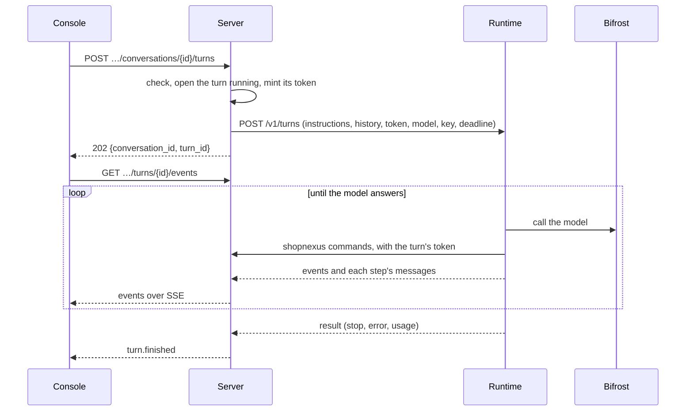

A question opens a turn. A turn is one run of the agent over the chat's history, and resuming it runs it again where it ended. The server stores every message and every event. The runtime keeps nothing of a turn but the chat's workspace. <Req id="UC-MOD-08" />

## Steps

<Steps>
<Step title="The server takes the question">
The server checks the console session and reads the picked console agent, the Console assistant when none is picked. It checks that the member may open the chat and that they sent at most 30 questions and steers in the last minute. It cleans the question of control and zero-width characters; a question empty after that is refused. A question has at most 8000 characters. It then reads the agent's route in Bifrost: its model and its virtual key. [Limits and failures](/en/agent/limits#before-the-turn-opens) lists each refusal.
</Step>

<Step title="The turn opens">
The turn opens `running`, under the chat's lock, so a chat has at most one running turn. It holds the member who asked, the agent and its model, a copy of the agent's capabilities, and a deadline (60 seconds unless the agent sets another). The server mints a turn token for it and stores only its hash. The token works while the turn runs and until its deadline passes.
</Step>

<Step title="The server writes the message">
The question joins the history with a context the model reads in front of it: the time, and on the chat's first turn or when another member asks, the member's name, role and id. The first turn also names the record the chat is about. When changes the agent asked for were decided since its last turn, the context says what became of each ([Changes and approvals](/en/agent/approvals#what-the-agent-learns)). The context is stored with the message, so every later turn reads the same text.
</Step>

<Step title="The server starts the run">
The server sends the runtime the chat's id, the turn's id, the system prompt, the whole history, the token, the model, the key and the deadline. The system prompt is the agent's instructions, the console's conventions and the list of commands the turn may call ([Commands and capabilities](/en/agent/tools#the-command-list)).

If the runtime refuses the run or cannot be reached, the server deletes the turn and the console gets `503 agent_unavailable`. Once the runtime takes it, the question is stored and the console gets `202 {conversation_id, turn_id}`.
</Step>

<Step title="The runtime runs the loop">
The runtime restores the chat's workspace, starts the sandbox and calls the model. It runs the commands the model asks for and calls the model again with their results, until the model answers without a command. There is no step limit: the deadline and a loop check end a runaway turn. [The runtime and its sandbox](/en/agent/runtime) covers this part.
</Step>

<Step title="The run streams back">
The runtime streams the run to the server as server-sent events: text and reasoning as they arrive, each command and its result, and each finished step with the messages it added. The server stores a step's messages in the history as it comes, so a turn that breaks later keeps every finished step. It stores each event for the console too, gathering text for 200 ms into one event so a fast model does not write a row per token.
</Step>

<Step title="The console follows">
The console opens `GET /v1/console/agent/turns/{id}/events`. The server replays the stored events, then sends new ones as they come, each with its sequence number as the event's id. A reloaded page asks from the last number it saw with `Last-Event-ID`. After 15 quiet seconds the server sends a keep-alive and reads the table again, in case a notice was missed. The stream ends after `turn.finished` or `turn.paused`, or 10 seconds after the turn stopped running with nothing new. Closing the tab ends only the stream; the turn goes on.
</Step>

<Step title="The result closes the turn">
The runtime's last event carries why the run stopped, any error, and the tokens used (input, output and cached). The server writes the turn's status from it and sends `turn.paused` or `turn.finished`. A stream that ends without a result fails the turn.
</Step>
</Steps>

## The events

| Event | Sent when |
|---|---|
| `turn.started` | The run started, with the agent and the model. |
| `turn.resumed` | A member resumed the turn; `by` names them. |
| `text.delta`, `reasoning.delta` | The model writes its answer or its reasoning. |
| `tool.started`, `tool.finished` | A command starts and ends, with its input, its output and whether it failed. |
| `step`, `step.failed` | A step ended, with the messages it added, or a model call failed. |
| `approval` | The agent asked for a change, or a member decided one. |
| `steer` | A member wrote to the running turn. |
| `turn.pausing` | A member pressed Pause. |
| `turn.paused`, `turn.finished` | The run ended, with the status, the stop reason, any error and the usage. |

## How a turn ends

<Statuses
  items={[
    { name: "SUCCEEDED", tone: "brand", desc: "The run ended without an error. The stop reason says whether the model answered, its answer was cut short, it went round in circles or the chat is full." },
    { name: "PAUSED", tone: "info", desc: "A member pressed Pause; the commands running finished first." },
    { name: "STOPPED", tone: "info", desc: "A member pressed Stop now; the model call and the commands were cut." },
    { name: "FAILED", tone: "neutral", desc: "A model call failed, the budget is spent, the runtime's stream broke or the server lost it." },
    { name: "TIMED_OUT", tone: "neutral", desc: "The turn's deadline passed; the finished steps stay." },
  ]}
/>

The chat takes a new question once its turn is no longer running. The latest turn of a chat can be resumed; [Pause, stop, steer and resume](/en/agent/control#resume) says how, and [Limits and failures](/en/agent/limits#how-a-turn-ends) which endings the console offers it for.

## Retries

Opening a chat and sending a question take an optional `Idempotency-Key` header. A key the member already used answers with what its first call made, and no second run starts. Two racing requests with the same key both get the first one's turn. <Req id="NFR-IDEM-01" />

## Lost turns

Each server replica follows the runs it started. When a replica stops, it cancels them; the runtime ends each run as its stream closes, and the turn fails with "the server stopped while the turn ran". Every minute, the server fails turns still running a minute past their deadline, such as those of a replica that died. Either way the finished steps stay, and the turn can be resumed.
