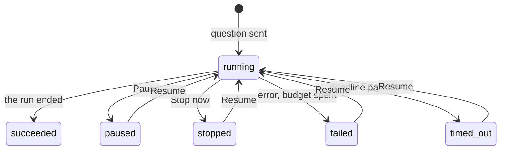

While a turn runs, the ask box's send button becomes **Pause**, and Esc pauses too. Once pressed it becomes **Stop now** until the turn has ended. Typing a line while the turn runs sends it to the turn as a steer. A turn that paused or was stopped shows how many commands it ran, with **Resume**. <Req id="UC-MOD-08" /> <Req id="FR-MOD-03" />

Every control goes to the server, which passes it to the runtime for the turn running in that chat. The control names the turn, so one meant for a turn that already ended never reaches the next. Any member who may open the chat may control its turn.

## Controls

| Control | Endpoint | Effect |
|---|---|---|
| **Pause** | `POST …/turns/{id}/pause` | The runtime checks before each model call, so the commands running finish first and every command keeps its result. The turn ends `paused`. |
| **Stop now** | `POST …/turns/{id}/stop` | At once: the model call in flight is cut and the commands running are killed. The model reads that a staff member stopped the turn. It ends `stopped`. |
| Typing while it runs | `POST …/turns/{id}/steer {text}` | The message joins the history before the next model call. |
| **Resume** | `POST …/turns/{id}/resume` | Runs the chat's latest turn again from the history it left. |

Pause, Stop now and steer need a running turn. Resume needs the chat's latest turn, not running. A control the turn's state does not take, or one that reaches the runtime after the turn ended there, is `409 agent_turn_state`.

## Steering

A steer has at most 4000 characters and counts against the same limit as questions: 30 a minute per member. The model reads it as a user message with the context "Written while you worked", which names the writer when another member sent it. The turn's stream shows the steer at once, and the console marks it sent until a step carries it.

A steer that arrives while the model is writing its answer is not lost: the turn goes on, and the model is called again with it. Once an answer finds no steer waiting, the turn takes no more. A turn that ends another way (stopped, past its deadline, an error) drops the steers still waiting; the console shows that no step carried them, and the member can send the text again as a question.

## Resume

Resume runs the latest turn again under the same id, as if it had never stopped. The server mints a new token and a new deadline, and the turn takes the agent's capabilities as they are now. When a member decided changes the agent asked for since the turn ended, a message saying what became of each joins the history first. The runtime then goes on from the history as stored, which may end with commands' results the model has not read yet. The stream sends `turn.resumed` with the member who pressed it.

If the runtime refuses the resumed run, the turn goes back to the state it was in.

Resume is also how a turn goes on after its approvals were decided: approving a change does not wake the turn by itself. A new question works as well, since its context carries the decisions too.
