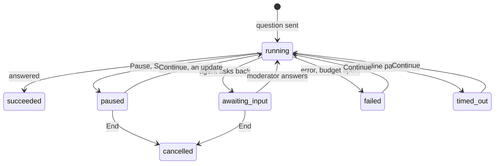

While a turn runs, the ask box's send button becomes **Pause** (Esc pauses too); once pressed, it becomes **Stop now** until the run has stopped. A paused turn shows "Paused after 3 steps" with **End** and **Continue**. Typing in the ask box while the turn runs sends an update. Each control is a request to the server, which writes it to `agent_turn_inputs` with a rising sequence number, under the turn's row lock so inputs commit in order and a poll never skips one. The agent reads them about once a second through `GET /agent/turns/{id}/control?after=<seq>` on the MCP port, with the MCP token. The answer lists the new inputs and whether the turn is still running; a turn that is gone or has ended answers `running: false`, and the agent stops.

## Controls

| Control | Endpoint | Effect |
|---|---|---|
| **Pause** | `POST …/turns/{id}/pause` | Takes effect before the next model call. The call in flight and the tools it asked for finish, so every tool call keeps its result. |
| **Stop now** | `POST …/turns/{id}/stop` | Aborts the model call in flight at once; the segment ends `PAUSED` with reason `stop_now`. An MCP call already running on the server runs to its end. |
| Typing in the ask box | `POST …/turns/{id}/steer {text}` | Adds a message "Update from the member: …" before the next model call. A paused turn continues at once. |
| **Continue** | `POST …/turns/{id}/continue` | Resumes a paused turn, or a failed turn that can continue, under the same id and with no new message. |
| **End** | `POST …/turns/{id}/end` | Cancels a paused turn or one waiting for answers; the turn becomes `cancelled`. |

Pause and Stop now need a `running` turn; a control the turn's state does not take is `409 agent_turn_state`. A control sent before a segment started has a sequence number at or below `control_after`, so that segment does not receive it.

## Updates while running

An update counts against the same limit as questions, 30 a minute per moderator. Each update shows as waiting until the agent reads it. On reading it, the agent writes a `steer.read` event naming the open step, and the console shows before which step the update was read. An update received but not yet given to the model stays in the checkpoint's `pending_steers`, so the next segment still reads it, each `steer_id` exactly once. An update the turn finished without reading can be sent again as a new question.

## Questions from the agent

When a question is unclear, the model calls `ask_user` with questions, each with options to pick one or several of. The segment ends `AWAITING_INPUT`, and the `clarify` event carries the questions. The moderator answers through `POST …/turns/{id}/input {answers}`, which maps each question's id to one option's id or a list of them. The server checks the answers against `pending_ask` in the checkpoint: every answer must name a question and its options, a single-choice question takes one, and at least one is given, or the answer is `agent_answers_invalid`. It then starts a `resume` segment with the answers written out as text.

## Continuing

A `resume` segment starts from the checkpoint: the Strands messages as they stood, plus an "interrupted" result for any tool call left without one. The server sets the turn `running` under its row lock with a new segment start, then starts the segment and writes `turn.resumed {by}`, where `by` is `continue`, `steer` or `input`. If the agent refuses the segment, the turn goes back to the state it was in. The console reopens the stream from the last sequence number it saw.

Continue works on a paused turn, and on a failed or timed out turn that is the chat's latest, wrote something, and failed with a code that allows it; see [Limits and failures](/en/agent/limits#error-codes).
