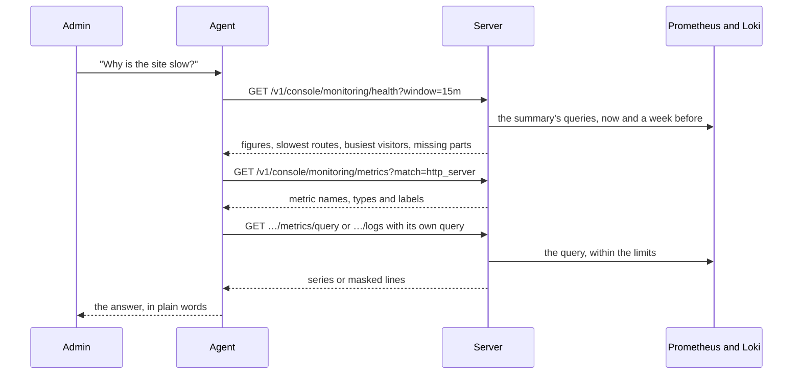

An admin asks the agent why the system is slow, or whether someone is calling it far more than usual. The agent answers from the same Prometheus and Loki that hold the stack's own telemetry ([Monitoring](/en/operations/monitoring)). It reads them only through four console endpoints, under the `monitoring.read` capability. <Req id="UC-MOD-13" /> <Req id="FR-MOD-07" />

The server runs every query, so the limits and the masking live in one place, and the agent's sandbox keeps no network path to Prometheus or Loki. The agent writes its own PromQL and LogQL; the server limits what a query may cost rather than which questions it may ask. <Req id="ADR-0007" />

## Who may ask

Only an admin's turn reads monitoring. The four operations are marked for admins in the API description, so a moderator's turn leaves them out: its prompt does not list them and the server refuses them with 403 `agent_operation_forbidden`, though the agent holds the capability. A turn keeps the member's role from the start of its run. An admin turns the capability off for an agent in its settings like any other.

## The flow

1. The agent starts with the health summary over a window of 5 minutes, 15 minutes, 1 hour, 6 hours or 24 hours.
2. When it needs more, and does not yet know a metric's name, it lists the metrics that exist, with their type, help text and labels (A1).
3. It writes PromQL or LogQL for the question and runs it. A query the source refuses comes back with the source's own message, so the agent can fix it and try again (E1).
4. It answers with what it saw. Nothing in the system changes.

## The health summary

The summary gives each figure as it is now and as it was over the same window a week before, so "slow" has a baseline.

| Part | What it holds |
|---|---|
| API | requests per second, the share that failed with a 5xx, p95 latency; live streams and health checks are left out |
| Slow routes | the five slowest routes by p95 that had at least five requests, with their rate and error share |
| Rate limited | requests per second the rate limiter refused |
| Database | the most connections in use at once, the pool's maximum, and time spent waiting for a connection |
| Outbound | the five slowest hosts the server calls, with their rate and error share |
| Restate | the five slowest durable handlers that ran at least five times |
| Instances | CPU cores, memory and the memory limit of each server process |
| Visitors | the five busiest callers with their client, country and share of all requests |

A visitor is the hashed key the rate limiter uses: an account, a console member, a guest's device or a bot. The summary never shows an IP address.

Each part comes from its own queries, and the summary lists the PromQL and LogQL it ran so the agent can build on them. When a source does not answer, the summary still returns the parts it could read and names the rest under `missing` (A2). When neither Prometheus nor Loki answers, or the stack has none configured, every monitoring call is 503 `monitoring_unavailable` (E2).

## Limits on a query

| Limit | Value |
|---|---|
| Range | at most 24 hours; a longer one is 422 `monitoring_query_invalid` |
| Step | at least 15 seconds and at least the range divided by 250, so a series has at most 250 points; a smaller step is raised |
| Series | at most 100 per answer; the rest are cut and `truncated` is set |
| Log lines | 100 by default, at most 500; `truncated` says more matched |
| Log range | 1 hour when the query gives none |
| Metric list | at most 300 metrics per answer, a histogram once |
| Query time | 15 seconds; a query that runs longer is refused with a message to narrow it |
| Query text | at most 4,000 characters |

A query without a range is read at one moment, its end, which is now unless the agent names another.

## What a log line shows

Log lines and log labels are masked before they reach the agent. <Req id="NFR-PRIV-02" />

- Email addresses become `<email>` and Vietnamese phone numbers `<phone>`.
- Bearer tokens, JWTs and the platform's own token formats become `<token>`.
- The value after `password`, `secret`, `token`, `api_key`, `otp` or `code` becomes `<masked>`.
- A line longer than 2,000 characters is cut.

Fields that only add noise, such as the line's observed time or its severity number, are dropped. Trace ids and hashed visitors stay, so the agent can follow one request or one caller.

## Detection is not the agent's job

The agent explains what it is asked about. Spotting a flood or an outage as it happens is the job of the [alerts](/en/operations/monitoring#alerts), which Grafana evaluates whether anyone asks or not.
