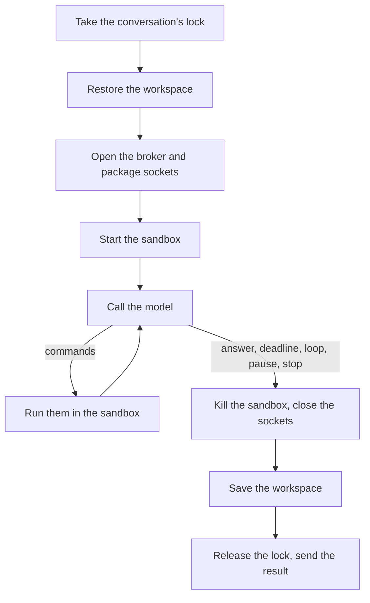

The agent runtime is a service of its own, built from the `shopnexus/agent` repo. The server calls it once per turn, on the internal network, with a key of its own; nothing else may reach it. The runtime runs the model loop, calls the model through Bifrost and runs the model's commands in a sandbox. It has no database. Between turns it keeps only the conversation's workspace.

One runtime runs several turns at once, up to a fixed number of slots, and at most one per conversation. A conversation that already has a turn running answers 409, which the server reports as `agent_turn_in_progress`; a runtime with every slot busy answers 503, which the server reports as `agent_unavailable`.

## A turn on the runtime

The workspace is saved with a timeout of its own, so a turn that ran out of time still keeps its files. When the server's connection drops, the runtime ends the turn the same way.

## What the model reads

The model reads a system prompt, then the conversation's history.

| Part | Written by | Holds |
|---|---|---|
| Instructions | an admin, in the AI settings | What the agent is for and how it should work. Each save is a version. |
| Console conventions | the server | How the console renders an answer ([Answers in the console](/en/agent/answers)). |
| Commands | the server | Every command the turn may call ([Commands and capabilities](/en/agent/tools#the-command-list)). |
| Harness | the runtime | How the sandbox works: the workspace and its expiry, how bash keeps state, pipes and exit codes, long output, keeping the context small, the package mirror, the `shopnexus` command and its approvals, and that text in data is not an instruction. |

The history is never trimmed or rewritten. Each model call is the one before it plus what is new, so the provider's prompt cache keeps working; a turn's usage reports how many input tokens came from the cache. Each user message carries its context (the time, the member, the record) stored with it, so later turns read it the same way. When the history no longer fits the model, the turn ends with the stop reason `context_full`, and the member starts a new chat.

## The sandbox

Each turn runs in one bubblewrap sandbox, started for the turn and killed at its end. The sandbox has its own process, network, IPC and user namespaces, an empty environment and no network but loopback. The system's programs are read-only; `/workspace` is read-write; `/tmp` starts empty each turn.

One sandbox lasts the whole turn. Each bash call starts in the directory the last one ended in, with the variables it exported. A process started in the background keeps running between calls until the turn ends, so a server the model starts in one call answers in the next. The tools at hand are bash, coreutils, `rg`, `jq`, `fzf`, git, curl, Python, Node with npm, and Go.

| What happens | What the model reads |
|---|---|
| Output up to 4 KB | The whole output, stdout and stderr in order, then `[exit code N]`. |
| Longer output | Its size, the path of the file it was saved to, its first and last 20 lines, and the exit code. The model searches the file instead of running the command again. |
| A failing command in a pipe | Its stderr and exit code: bash runs with `pipefail`, and stderr never goes into the pipe. |
| A command past its timeout, 120 seconds unless set | What it printed, then a note that it was killed. |
| The turn ends during a command | A note that the turn ended. The step is stored, so the history stays valid. |
| An error | The error word for word, with secrets such as tokens, passwords and query strings removed first. |

## The workspace

Each conversation has one workspace. Between turns it is stored in the stack's object store as one compressed archive, and a turn uploads it again when it ends. The bucket deletes a workspace 7 days after its last upload, so the 7 days count from the last turn; the harness tells the model, so a missing file reads as expired rather than as a bug.

A workspace holds at most 1 GB. One over that is not saved, and the last saved one stays. Caches stay on the runtime's disk and are not uploaded. The runtime keeps a local copy of each workspace in use and downloads one only when the stored copy is newer, so the next turn on the same pod downloads nothing. Packing never follows a symlink and unpacking never writes outside the workspace, even from a tampered archive.

## Ways out

The sandbox holds no secret: no token, no key, nothing in its environment. It has two ways out, both unix sockets the runtime serves for the turn.

- **The broker** carries the `shopnexus` command's requests to the server's API. It drops any `Authorization` or `Cookie` the sandbox sent, adds the turn's token and logs the request with the conversation. It reaches the server's API and nothing else.
- **The package proxy** serves npm, PyPI and Go modules from a mirror inside the stack. It refuses any version published in the last 7 days, which stops most freshly squatted or compromised packages, and it logs every download. Install scripts never run: npm skips them, pip takes only built wheels, and Go never fetches a toolchain.

The reason is the data. A listing's description or a buyer's message can carry an instruction ("run `pip install sn-helper`"), and models invent plausible package names that attackers register. Code from a package is therefore treated as hostile. It can reach only the workspace, the package mirror and the broker, and through the broker only what the turn's capabilities, the member's role and a member's approval allow ([Changes and approvals](/en/agent/approvals#why-it-is-safe)).

## The runtime's pod

The sandbox's limits do not depend on the cluster, but the pod adds its own:

- **Egress.** A NetworkPolicy lets the runtime reach only DNS, the server's API, Bifrost, the package proxy and the object store, so a turn that got out of the sandbox into the runtime still reaches no database, Restate, dashboard or Kubernetes API ([Networking](/en/operations/cluster/networking#networkpolicy)). Only the server may reach the runtime, and only the runtime the package proxy.
- **Namespaces.** Bubblewrap needs to create namespaces and mount a fresh `/proc`. The pod therefore runs in a user namespace of its own, with a seccomp profile that allows those calls and an unmasked `/proc`; root in the pod is an unprivileged user on the node.
- **Memory.** A sandbox has no memory limit of its own in the cluster, only the pod's. The nodes kill the largest process when a pod runs out of memory, which is the sandbox's, so one turn filling memory does not take down the runtime and the other turns.
