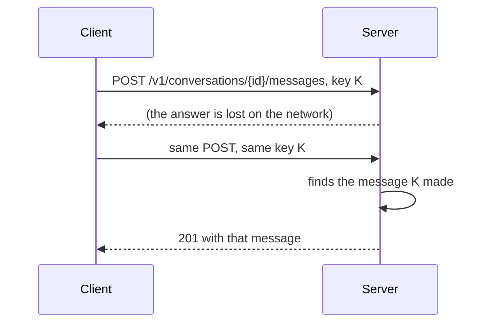

An endpoint that starts a durable flow takes an `Idempotency-Key` header, a UUID. The key becomes the request key of the row the request creates or moves. A repeated key finds that row and answers with the first request's result, so a tap retried after a timeout gets the same answer, and no second listing, message or order appears. <Req id="NFR-IDEM-01" />

```http
Idempotency-Key: 0192a4e1-7b3c-7d2e-9f10-5a6b7c8d9e0f
```



## Rules for the client

- Make a new UUID for each user action.
- Reuse the same key when retrying that action, whether the retry is automatic or the user taps again after an error.
- Never share a key between two different actions. The server answers a repeated key with the first result, whatever the new body says.

A missing or malformed key on an endpoint that requires one is 400 `invalid_request`.

## Scope

A key belongs to the caller. Another account's key never finds the row, so two people cannot collide on a key. Sign-in claims the key on the new session, and a sign-up's retry answers `is_new: true` again. An email code claims it on the code it mails, per address.

A deal's moves keep their key too. A move the caller's key already made answers with the deal as it is now, without moving it again.

## Which endpoints take it

The spec marks each one.

| Area | Endpoints that require it |
|---|---|
| Sign-in and identity | `POST /v1/auth/sign-in`, `POST /v1/auth/email-codes`, `POST /v1/auth/sessions/current/reauthenticate`, `POST /v1/accounts/me/identities`, `POST /v1/accounts/me/email-codes` |
| Listings | `POST /v1/listings`, `POST /v1/listings/{id}/photo-copies`, `POST /v1/listing-reads` |
| Orders | `POST /v1/orders/{order_id}/shipment`, `POST /v1/orders/{order_id}/confirm` |
| Chat and help | `POST /v1/conversations`, `POST /v1/conversations/{id}/messages`, `POST /v1/support/tickets`, `POST /v1/feedback`, `POST /v1/addresses` |
| Console | a staff reply to a support ticket |

Two deal endpoints take the key as optional, because app versions from before send none: `POST /v1/deals/{id}/cod` and `POST /v1/orders/{order_id}/cancel`. Without a key every request moves on its own. The console agent's creates (a conversation, a question, a steer, a skill) take it as optional too.

`PUT /v1/listings/{id}` takes no key: an edit writes the whole listing, so a retry writes the same content again. Endpoints without the header dedupe by what they write, such as one save per person and listing.
