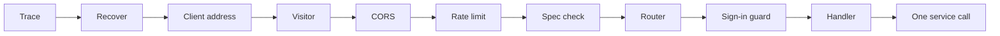

The HTTP API is OpenAPI first. A feature's design starts in the spec in the server repository, and the code is written to satisfy it. The app generates its client from the same spec, and the docs [playground](/en/api/playground) shows it.

The server embeds the spec, so the binary always carries the contract it checks against. Shape rules (required fields, lengths, formats, enums) live only in the spec. Business rules live in the modules. Tests keep the registered routes and the spec's operations the same set, and the end-to-end suite meets every status code the spec declares. <Req id="NFR-API-01" />

## What a request passes through

1. **Trace** opens the span and, after the request, writes the access log line with the status and the trace ID. A request that panicked still logs its 500.
2. **Client address** is worked out once, trusting forwarded headers only from known proxies.
3. **Visitor** notes which client called (app, website, console or bot) for the usage dashboards. A guest is a daily hash of the address, so no address reaches the logs.
4. **Rate limit** counts the request against its route's tier (below).
5. **Spec check** validates path and query parameters, headers and the JSON body against the operation, and fills query defaults. A route the spec has but this server does not mount, such as a dev route in production, is a plain 404.
6. **Sign-in guard** on a signed-in route checks the token and the account, then the per-caller rate limit applies.
7. The **handler** calls one service method and writes the result or the [error](/en/api/errors).

## Conventions

- Every route starts with `/v1`. A breaking change would add `/v2` beside it, because installed apps stay on old versions for months.
- JSON uses `snake_case`, unknown fields are rejected and a body is capped at 1 MB.
- IDs are UUIDv7, so they sort by creation time.
- `/healthz` and `/readyz` sit outside `/v1`. Readiness checks Postgres and Restate.
- An endpoint that starts a durable flow takes an [`Idempotency-Key`](/en/api/idempotency).
- Lists page by cursor, newest first ([Pagination](/en/api/pagination)).

## Rate limits

Every route has a tier. The spec names it on the operation; without one, a GET is `read` and every other method `write`, so a new route is limited from the start. Each request counts once by address and, once the caller is known, once by account or console member. An IPv6 /64 counts as one address. Carrier NAT puts many phones on one address, so the address limits are the looser ones.

| Tier | Per address | Per caller | Used by |
|---|---|---|---|
| `read` | 50/s, burst 1,000 | 20/s, burst 400 | GET by default |
| `write` | 10/s, burst 200 | 5/s, burst 100 | other methods by default |
| `auth` | 1/s, burst 60 | 1 per 5 s, burst 10 | sign-in, reauthentication, console login |
| `code` | 1 per 10 s, burst 10 | 1 per 30 s, burst 5 | the two endpoints that mail a code |
| `costly` | 1/s, burst 30 | 1 per 2 s, burst 20 | link previews, listing reads, price guides, carrier quotes and pickups, Chợ Tốt linking and imports |
| `telemetry` | 2/s, burst 60 | none | client event reports |
| `exempt` | none | none | health checks, carrier webhooks, the dashboards' sign-in check |

A guest search with a query also counts against `guest-search`, 2/s with a burst of 30 per address. Past a limit the answer is 429 `rate_limited` with `details.retry_after`, the seconds until the next try.

Each server process keeps its counters in memory, so three replicas let an address through about three times as fast. These limits stop floods and loops. Rules that must hold exactly, such as code-send quotas, login lockout and read quotas, are kept in Postgres or Restate by their module and answer their own codes.

## Shapes the generated client can read

The app generates its client from the spec, so the spec keeps to the shapes its generator reads as written: a choice between schemas has a discriminator, no schema the app reaches is a map of any values, and operations the app does not call are tagged `internal` (or `websocket` for the socket) so its client leaves them out.

## Languages

A client writes its own sentences from codes and numbers wherever it can: error codes, field codes, photo refusal codes, the numbers of a scam signal. The server's text stays beside each code for older clients.

Where the server writes text into a response (notices, category names, search chips, scam signals, default quick replies, spec labels), it follows the request's `Accept-Language`. It writes Vietnamese or English, Vietnamese when the header names neither, and adds `Vary: Accept-Language`. A sign-in records the language for that account's pushes and mail. Region names stay Vietnamese, and so does anything stored or sent to a model.
