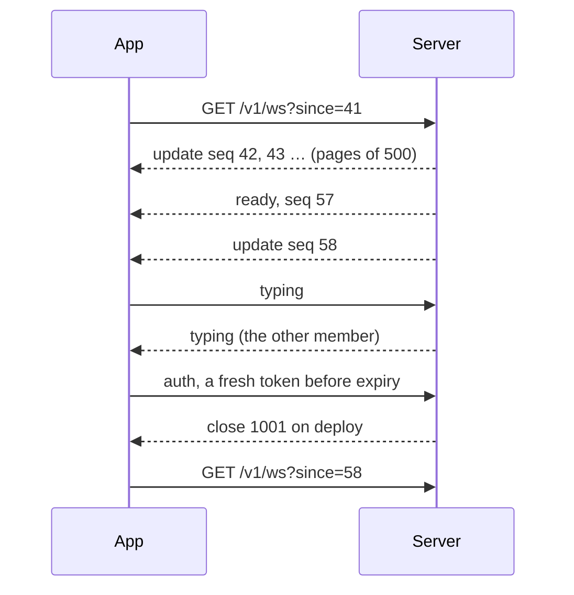

`GET /v1/ws` is a WebSocket that tells an open app or website what changed for the signed-in account: a new message, a read, a deal move, a notification <Req id="FR-DEAL-01" />. Updates carry IDs only. The app reloads what it shows, usually one screen call, and ignores updates that touch nothing on screen.

Pushes to a closed app travel on their own channel; see [Notifications](/en/architecture/notifications).

## The update log

Each account has an update log. Every change that concerns the account appends an update with the next **seq**, a counter that runs 1, 2, 3 with no gap. The update is written in the same transaction as the change, so a change that rolls back leaves no update and no hole, and updates become visible in seq order.

The socket is a window on that log. Because the app remembers the last seq it saw, a reconnect resumes exactly where it stopped: no reload of everything after a network blip or a server deploy.

The log keeps updates for 30 days.

## Connecting

The app sends its access token as `Authorization: Bearer <token>`. A browser cannot set that header on a WebSocket, so the website offers the token as subprotocols instead, `new WebSocket(url, ["bearer", token])`, and the server selects `bearer`. The server never reads a token from the query string, which proxies log.

A request with an `Origin` header must come from one of the website's origins or the API's own host; any other origin is 403. The Android app sends no `Origin` and is not checked.

A missing or bad token is 401 before the upgrade.

## The protocol

All frames are JSON text, at most 4 KB.



**On connect** the server sends every update after `since`, in seq order, then `{"type":"ready","seq":N}`. Without `since` it starts from now. If the log no longer holds the update after `since` (older than 30 days), or `since` is ahead of the log, it sends `{"type":"reset","seq":N}` instead of the updates: the app reloads everything and keeps `N`.

**After ready** each change arrives as one frame, in seq order, with no duplicate and no gap:

```json
{"type":"update","seq":58,"kind":"message","conversation_id":"0192…","message_id":"0192…"}
```

The app stores the last seq it handled and passes it as `since` next time.

### Update kinds

| Kind | IDs | Logged when | For |
|---|---|---|---|
| `message` | `conversation_id`, `message_id` | a message is written or its status changes | every member once it is sent; only the sender while it is processing or after it failed |
| `read` | `conversation_id` | a read marker moves forward; a conversation is marked unread or that mark is cleared | the other member for a marker move; the member themselves for the unread mark |
| `deal` | `deal_id` | each save of a deal: a move, a COD order, any change to its order | buyer and seller |
| `notification` | `notification_id` | a notice is added, or an unread one is bumped | its recipient |
| `scam_warning` | `conversation_id` | a scam warning is raised, grows or is dismissed | the warned member |
| `listing_read` | `listing_read_id` | an AI read of a video or photo starts or saves a step | the account reading |
| `ticket` | `conversation_id` | a support ticket is created, gets its first message, is resolved or reopened | the ticket's owner |

Opening a deal logs nothing; its first update comes with the first move.

### Frames from the app

- `{"type":"typing","conversation_id":…}` tells the other member the app's user is typing. At most one per 3 seconds per conversation goes through. Typing is never logged, so a missed one is simply gone. A frame for a conversation the sender may not write to (not a member, or a block) is dropped in silence.
- `{"type":"auth","token":…}` hands over a refreshed access token. Access tokens live 15 minutes <Req id="NFR-SEC-01" />, and the socket closes at the token's expiry unless the app sends a newer token of the same account first.

A connection may send 10 frames at once and then one a second.

### Close codes

| Code | Means | The app should |
|---|---|---|
| 1001 | the server is shutting down | reconnect at once with its seq; another instance picks it up and nothing is lost |
| 4001 | the token expired, is invalid or belongs to another account | refresh the token, then reconnect |
| 4003 | the account is suspended, checked at connect and at each `auth` | not reconnect |
| 1008 | a frame that is not JSON text, has an unknown type, or breaks the frame rate | fix the client |
| 1009 | a frame over 4 KB | fix the client |

The server pings every 25 seconds and closes a connection whose pong takes longer than 10.

## Without a socket

`GET /v1/updates?since=` reads the same log over REST: up to 500 updates after `since`, the current seq, `reset` and `has_more`. An app that cannot hold a socket open, or wants to catch up before opening one, uses it.

Outside production, `POST /v1/dev/updates` appends a made-up update to the caller's own log, so a client can test that an update reaches its socket.

## How delivery works

Writing an update also rings a bell that every server instance hears once the transaction commits. Each instance's hub hands the ring to the open sockets of that account. The log is the truth; the ring only says something new is there.

A ring can be missed, and the log covers every way it can be:

- **A slow socket.** Each connection queues at most 16 rings. A full queue marks it behind, and it reads the log from the last seq it sent.
- **A lost listener.** When the hub's listening connection drops and reopens, every socket on that instance reads the log.
- **A silent failure.** Once a minute the hub rings a probe to itself. If the probe does not come back, every socket on that instance reads the log. A ring lost this way costs at most about two minutes.

Sockets do not poll the log on a timer: at 10,000 open apps that would be hundreds of queries a second for nothing.

The socket also keeps the account's "last active" time: it is written at connect and close, and once a minute for every account with an open socket. The chat view and the seller page show it.
