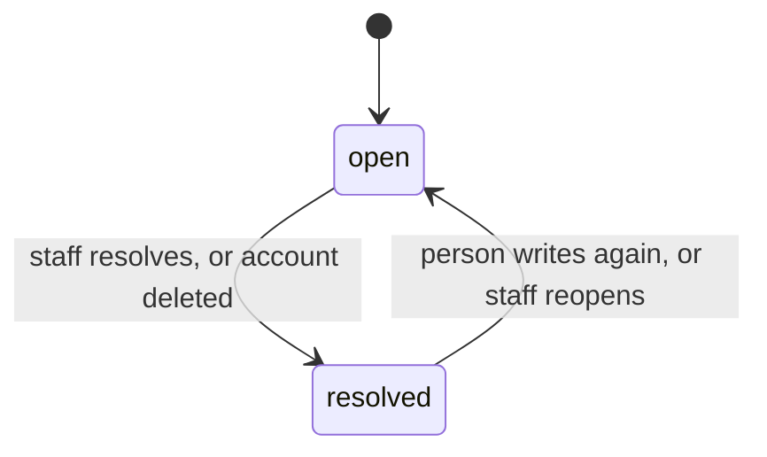
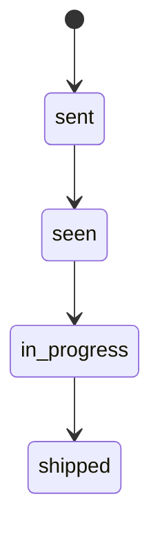
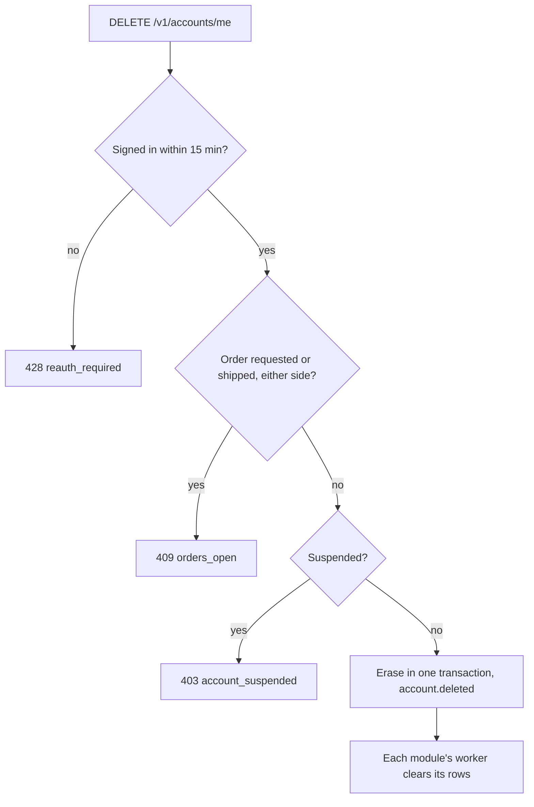

What a person keeps about themselves, how they talk to ShopNexus, and how they leave. Identities are on [Sign-in](/en/architecture/sign-in).

## Profile and away mode

`PATCH /v1/accounts/me` changes any of `display_name`, `bio` (up to 200 characters, public), `avatar_upload_id` (`null` removes it) and `away_until` <Req id="FR-ACC-03" />. It writes `account.updated`; a broken rule is 422 `invalid_account` with a field per rule.

Away mode lasts until `away_until`, at most 30 days ahead; `null` ends it. A past end reads as not away, so nothing has to clear it. While it is in force, every view of the person carries it, from the listing's seller line to chat. Listings stay in search.

## Address book

Up to 10 addresses per account, each with a name, a Vietnamese mobile, a street, a commune and a kind. Another person's address answers `address_not_found`.

- The kind (`home`, `work`, `other`) tells the shipper when to deliver. A COD order copies it, and a carrier shipment passes it on as a note, for example that a company address takes parcels in office hours.
- One address is the default. The first one always is. `is_default: true` on add or edit, or `POST /v1/addresses/{id}/default`, moves it in the same request. Nothing takes the default away; deleting it promotes the newest remaining address.
- `POST /v1/addresses` needs an `Idempotency-Key` and runs without Restate: a repeated key returns the address the first request added, even at the cap <Req id="NFR-IDEM-01" />.
- Add, set-default and delete lock the account, which holds the cap and the single default. An edit that loses a race is `try_again`. Orders keep their own copy of the recipient, so a delete just removes the row.

## Support tickets

A ticket is a question for ShopNexus, and each one is its own chat between the person and the system account ShopNexus <Req id="FR-MOD-04" />. Nobody can sign in as ShopNexus, and it cannot be suspended, erased, blocked or reported (409 `account_is_system`). The messages live in [chat](/en/architecture/chat).

| Kind | When |
|---|---|
| `not_received` | the buyer's order is shipped, or the system completed it less than 7 days ago; one ticket per order |
| `carrier_request` | a carrier ShopNexus lacks, 1 to 50 characters; requests for one carrier are counted together |
| `other` | anything else; needs a first message |

`POST /v1/support/tickets` runs a durable flow under the request key:

1. Read the account (a suspended one may still ask), the day's count and, for an order, the order. Past 10 tickets in 24 hours: 429 `too_many_tickets`, and nothing is opened.
2. Open the support chat, then insert the ticket, which refers to it. If the insert finds a ticket the key or the order already has, the flow drops the new chat and returns that ticket.
3. Send the first message through chat; it may have no text. If chat refuses it (a photo that is not the person's upload), the flow withdraws the ticket and its chat, and a retry gets the same refusal.

Staff answer from the [console](/en/architecture/console) as ShopNexus, and each reply records the member. Support's worker follows `message.sent` to reopen a ticket and track who wrote last, which the console shows as waiting for a reply. Resolving a `carrier_request` first sends a note that the carrier was recorded. Resolving a resolved ticket or reopening an open one changes nothing and answers 200.

## Feedback

Feedback is what a person tells ShopNexus; it needs no answer. A question is a ticket of kind `other`.

`POST /v1/feedback` takes a mood (1 to 5), a kind (`bug`, `idea`, `praise`), up to 1,000 characters, up to 3 screenshots, the device (optional), the screen, and whether ShopNexus may follow up. It needs a mood or a text (422 `invalid_feedback`). It runs without Restate under the request key, at most 20 in 24 hours (429 `too_many_feedback`). `GET /v1/feedback` lists the newest 100.

Staff set the status, reply once, heart, and group duplicates under one root. A group shares its status, note and shipped version. Moving to `in_progress` or `shipped` emits `feedback.moved` and the first reply `feedback.replied`; each becomes a push, never a mail. Every staff action is audited.

## Deleting the account

`DELETE /v1/accounts/me` is served by a small module of its own, because deal depends on account and account cannot ask deal about orders.

A suspension blocks the deletion, so nobody sheds one by leaving.

The account row stays as a tombstone, because orders, reviews and messages point to it, with no name, bio or avatar. The same transaction deletes the identities, email codes, addresses, blocks and follows, and revokes every session. The phone or email can then sign up as a new account.

On `account.deleted`, each module clears its own rows, and running twice changes nothing:

- catalog deletes unsold listings and drafts; deal ends open deals and cancels requested orders;
- discovery, notifications, assist and chat delete saves, history, notices, push tokens and reply helpers;
- support resolves open tickets, feedback deletes the feedback, trust withdraws unresolved reports;
- a year later, deal blanks the recipient name, phone and street of the orders the account bought.

Races:

- A write that keeps rows of the caller (an address, a save, a report) checks the account row in its transaction; after the erase it refuses with `session_revoked`, so no new row outlives the deletion.
- A COD request that slips in after the order check is cancelled by deal's worker like any other.
- A sign-in that found the identity before the erase answers `try_again`; the retry signs up a new account.

Others see the person as deleted on accounts, chat and reviews, and the reviews still count. Replying to or following them is 409 `account_deleted`; their seller page is 404.
