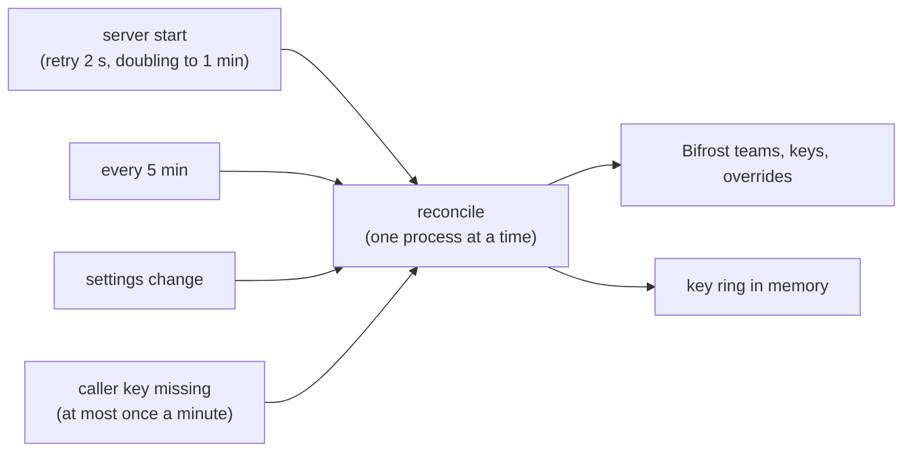

The server uses two kinds of model. Remote models (chat models and the text embedding model) are reached only through Bifrost, the stack's AI gateway. Self-hosted models (speech to text, photo vectors and video frames) run on CPU inside the server binary as module ai. Nothing in the server calls a model provider directly.

## Who calls what

An **agent** is one purpose that calls a model. A **caller** is one part of the code that uses an agent, and has its own key and rate limits. Budgets belong to agents.

| Agent | Callers | Used for |
|---|---|---|
| `search` | `server-search` | Reading a search query into filters and boosts ([Search and discovery](/en/architecture/search-and-discovery)). |
| `embed-text` | `server-embed-index`, `server-embed-search` | Text vectors: listings as they are indexed; queries and the price guide's draft. |
| `listing-read` | `server-assist` | Reading a video, photo or Chợ Tốt listing into a draft, and filling Chợ Tốt imports ([Listing reads](/en/architecture/assist)). |
| `scam-check` | `server-trust` | Classifying a chat window for scam signals ([Trust](/en/architecture/trust)). |
| `console-agent` | `console-agent` | The console assistant, which runs apart and gets its key per run ([Agent setup](/en/agent/setup)). |

Module ai serves the rest:

| Model | Used by |
|---|---|
| Speech to text (Vietnamese, with voice activity detection) | The video read, when the phone sent no transcript. |
| Video frames (ffmpeg, picks sharp frames) | The video read. |
| Photo vectors (SigLIP 2) | Listing photo vectors, photo search, the price guide. |

## Module ai

Module ai is a Restate service with three handlers. `Transcribe` takes an object store key and returns the text. `Frames` takes a key and returns the duration and at most 8 frames, each with its time and sharpness. `EmbedImages` takes JPEG, PNG or WebP images and returns their vectors. Callers reach it through Restate, so the call can land on another process.

A handler never retries itself and records nothing in its journal. A refusal comes back to the caller as a typed reason: unreadable, no object at the key, too short, too long, or any other bad input. A model or ffmpeg failure, or the service not being reachable, comes back as a plain error, and the caller's own step retries it.

One binary runs in three roles:

- **all**, used by Docker Compose: every module and module ai in one process.
- **api**, the cluster's main server: every module, but no model loaded.
- **ai**, the cluster's model server: loads the models and serves only module ai and health checks. It opens no database.

The models, about 5 GB, are not in the image. Each stack downloads them into a volume at start, checking each file's checksum.

### A kind of vector turned off

Text vectors and photo vectors can each be switched off. With a kind off, listings get no vectors of that kind, query and price comparisons leave it out, and a photo search answers 503 `search_unavailable`, as when the photo model fails. Each stored vector records the model that made it, so a new model treats the old vectors as missing until a reindex.

## The gateway

Every remote call goes to Bifrost's OpenAI-compatible chat or embeddings endpoint with the caller's virtual key, a model named `provider/model` and the agent's fallbacks. Bifrost tries the fallbacks when the model fails, checks the key's rate limits and the team's budget, and logs each call's cost.

| What | Owner |
|---|---|
| Providers, their URLs and API keys | Infra: Bifrost's config file and secrets. A new provider or key is an infra change. |
| Agents, models, fallbacks, prices, tags, budgets, callers and their limits | The server's database, edited in the console. |
| Teams, virtual keys, budgets and pricing overrides inside Bifrost | Written only by the server's reconciler. |
| Measured spend and call logs | Bifrost, which the server reads. |

The operator's view (deployment, config file, secrets, network, metrics) is on [Bifrost gateway](/en/operations/cluster/llm-gateway).

### The reconciler

The reconciler writes the server's policy into Bifrost through its admin API:

- Each agent becomes a **team** named after its slug, with the monthly budget. Budgets reset on the 1st of each month, UTC. Teams are never deleted, as agents are not.
- Each caller becomes a **virtual key** named after it, in its agent's team, allowed only the agent's model and fallbacks, with its rate limits per minute. A leaked key can call nothing else. A key of a disabled agent is turned off.
- Each model price becomes a **pricing override**, which Bifrost uses to cost each call.
- A key or override the server made that nothing names any more is deleted. Objects the server did not make are left alone. Each stack has its own Bifrost, so two stacks never share one.

It runs under a database lock, so two replicas never write at once. It goes on past an object Bifrost fails, and it always ends by loading the keys Bifrost has into the server's key ring.

### Keys

Bifrost makes the key values. No caller key is stored in git, a secret or the server's database; the server reads them from Bifrost into memory.

- A key the ring has comes back at once. One older than 5 minutes starts a refresh in the background, so a call never waits on Bifrost's admin API for a key it has.
- A caller the ring lacks waits for a read (at most one every 10 s) and asks for a reconcile. A failed read is not tried again for 5 s.
- When Bifrost refuses the key itself (unknown, turned off, or not allowed that model or provider), the ring reads again, at most every 10 s, and the call runs once more if the key changed. A provider's own 401 or 403 passes through.

## AI settings

Admins change the AI policy in the console under `/v1/console/settings/*`. Providers are read-only there.

- **Models** are named `provider/model_id`. An agent's model and each fallback must have a price (`ai_model_unpriced` 422) and carry the agent's required tags (`ai_model_lacks_tags` 422). An embedding agent takes no fallback, because another model's vectors live in another space (`ai_agent_invalid` 422). Choosing a new model drops the old one's extra request options, such as a provider pin.
- **Tags** are eight: the types Chat and Embedding, and the capabilities Vision, Tool use, Long context, Reasoning, Structured output and Multilingual.
- **Prices** are USD per token for input, output, cache read and cache write; an empty cache price means the input price. The model list shows each model's price beside the provider catalog's list price, and the model picker reads that catalog.
- **Agents** are `app` or `console`. Five are seeded: the console assistant, scam check, listing read, search and search embeddings, with budgets of 100 USD a month for the assistant and 30 for the others. An app agent changes only its model, fallbacks, limits, budget and callers' limits (`ai_agent_app_fixed` 422 otherwise). Only a console agent has tools and instructions; each change of instructions saves a new version.
- **Callers' limits** change requests and tokens per minute; the request names every caller of the agent once. A new console agent gets one caller, named after its slug.
- **Provider health** comes from the last hour of calls: `unknown` with none; `down` when Bifrost marks the provider in error or at least half of at least 5 calls failed; `degraded` from 5% of at least 20; else `ok`.
- **Spend** is read from Bifrost's logs: each UTC day's total and spend by agent, for a range of at most 366 days (`ai_spend_range_invalid` 422). Bifrost's totals may trail by about a minute. Each agent also shows the budget spent this month and when it resets, or nothing when Bifrost cannot be read.

A change saves the database row first, checking its write ID (`try_again` 409 when someone else changed it), records it in the console audit log in the same transaction, then reconciles. If Bifrost cannot be reached, the answer is `ai_gateway_unavailable` 503, the row stays, and the next periodic reconcile applies it. A request Bifrost refuses is `ai_gateway_refused` 422. A create sent again finds its own agent and reconciles instead of answering `ai_agent_taken`.

## When a model or a budget fails

A spent budget, or a spent provider credit, is Bifrost's 402. For the server's code it is a passing failure, like a rate limit, not a refused request. There is one budget per agent and no global cap, warning threshold or per-person budget. The server's readiness check looks at neither Bifrost nor module ai.

| Caller | On failure |
|---|---|
| Search query reading | The model gets 4 seconds. On any error, search uses the raw words alone, with no chips or boosts. A query read in the last 7 days comes from the cache. |
| Listing text vectors | Refused input is logged and skipped. A spent budget leaves the listing without a text vector and tries again 6 hours later. Other errors are retried. |
| Photo search | The photo model failing, or photo vectors off, is 503 `search_unavailable`. |
| Price guide | A failed vector model leaves its side out of the comparison. |
| Listing reads | Up to 3 attempts a step within the 2-minute deadline, then `unavailable`. A refused request is `unavailable` at once. |
| Scam check | A refusal, or a classify step past 3 attempts and 10 minutes, skips the check. |
| Console assistant | Each run gets the key, model, fallbacks and prices from the server; an agent with an unpriced model is refused. A spent budget ends the run and the console says the month's budget is spent ([Limits and failures](/en/agent/limits)). |
