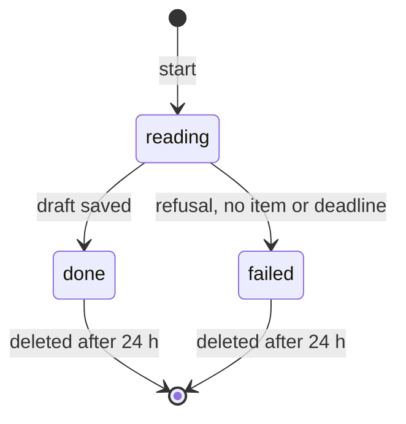
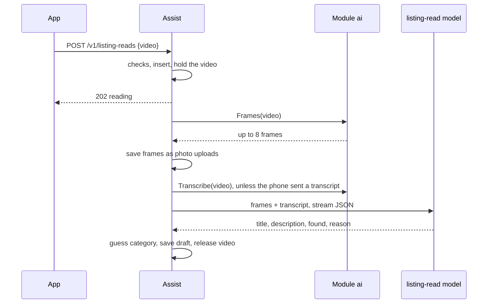
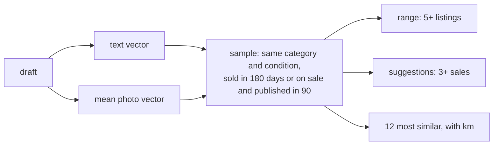
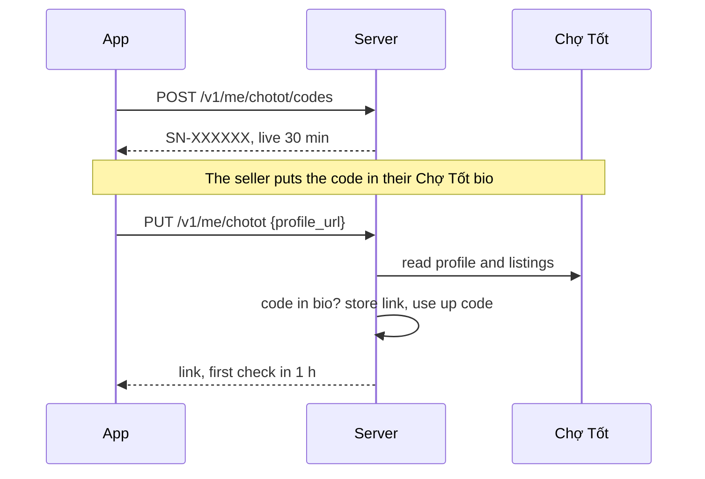

The assist module holds what AI does for the person using the app. It reads what a seller already has (a video or one photo) into a listing draft, and it prices a draft on request. The seller always checks the draft and posts it with the normal listing post, so a read never publishes anything. This is the AI part of <Req id="UC-LST-01" /> and <Req id="FR-LST-01" />. Scam detection is moderation and lives in [trust](/en/architecture/trust).

Which model runs each step, and what happens when one fails or runs out of budget, is on [AI layer](/en/architecture/ai).

## Starting a read

The client sends `POST /v1/listing-reads` with exactly one source, `video` or `photo`, and an `Idempotency-Key`. The server answers 202 with the read in the state `reading`, and a background flow does the rest. No source or two sources is `invalid_request` 400. Chợ Tốt listings come over through the profile link at the end of this page.

Every start runs the same checks:

- A suspended account is refused, and so is one without a phone (`phone_required`, <Req id="BR-ACC-03" />). A read exists to post a listing, so it follows the same rule.
- Each account has a cap per source in 24 hours: 30 video reads and 60 photo reads. Over the cap is `read_limit_reached` 429. The count runs under a lock on the account and the source, so parallel starts cannot pass it.
- A repeated `Idempotency-Key` answers the first read.

`GET /v1/listing-reads/{id}` gives one view for every source; another account's read or an expired one is `listing_read_not_found` 404. Each save sends the account a `listing_read` update so open screens reload. The row is deleted 24 hours after the start, and frames the seller did not post expire with their uploads.

| Failure | Sources | Meaning |
|---|---|---|
| `unreadable` | video, photo | No picture could be read, or the photo is no longer a waiting upload. |
| `video_too_short`, `video_too_long` | video | Under 3 s or over 35 s. |
| `no_item` | video, photo | The model found no single item for sale; its reason, a Vietnamese sentence, goes to the seller. |
| `unavailable` | video, photo | The models did not answer in time. The seller can try again. |

## Deadline and retries

Each read has 2 minutes from its start. Every model step gets at most 3 attempts within the time left, and the flow saves the read after each step. A step that runs out of time, or would start after the deadline, fails the read with `unavailable`. A model that refuses the request itself (a 4xx other than a spent budget or a rate limit) fails it with `unavailable` at once. An answer that is not the expected JSON counts as a model error and is retried.

Where a step reads private input (a transcript), the fetch and the model call run in one step, so only the result enters the flow's journal.

## Video read

1. The start holds the video upload so nothing else can use it. A video another flow holds is `invalid_upload`, and the row is deleted again.
2. **Frames.** Module ai picks up to 8 sharp frames. Each becomes a waiting photo upload of the seller, so the draft posts like photos the app uploaded.
3. **Fill.** The speech is the phone's transcript when the client sent one, else module ai's speech to text. The model gets the frames at 768 px and the transcript, and streams JSON: the subject, whether there is an item, a title, a description and, without an item, a reason.
4. A "no item" reply is asked once more. A second one, or an empty title, fails the read with `no_item`.
5. Catalog guesses the category from the title and description; a failed guess leaves it for the seller.
6. Every end, success or failure, releases the video before it saves.

A video without audio, or speech to text that refuses or fails, is read without speech, since the frames already gave the model something to read.

The draft is condition `used`, with no specs, no price and offers off. The title is cut at 70 characters and the description at 1,500. Its photos are the sharpest frame first, then the others in time order, 6 at most. The description only restates what the seller said and never names a brand the seller did not name.

A phone's transcript is at most 1,000 characters and is taken as the seller's own words. It is never logged, returned or journaled: it waits up to 10 minutes for the read row, moves into it, and is cleared when the read ends.

## Photo read

The photo read reads one photo, the app's cover: one image, no speech to text. The start checks that it is the caller's own waiting photo upload (else `invalid_upload` 422). The read holds nothing, because the listing post uses the photo. One model step at 768 px fills the draft, which keeps that photo and cuts the description at 300 characters. The description says only what the photo shows and never names a brand or a fault. A photo no longer waiting when the step runs is `unreadable`, without calling the model.

## Watching a read

`GET /v1/listing-reads/{id}/events` is a server-sent event stream: event `read` with the read, event `text` with the title and description as the model writes them (at most every 100 ms), and `read` again when it ends. The text crosses processes on a Postgres notification channel. Each message holds the whole text so far, so a lost one costs nothing. The stream sends a keep-alive every 15 s and closes at the latest 30 s after the read's deadline.

## Price guide

`POST /v1/price-guides` prices any draft for the app's price step, with or without a read; the reads never price a draft themselves. It takes the draft's title, category, condition, specs, description, commune and up to 3 photos, answers 200 and stores nothing. The checks run before any model: `account_suspended` 403, `invalid_listing` 422 (not a subcategory, unknown commune), `invalid_upload` 422 (a photo that is not the caller's waiting upload). It has no cap and sits in the costly rate limit tier.

- A sale counts by its sale date, so a listing deleted after it sold still prices.
- "Giá thị trường" is the range's median with the median days to sale. "Bán nhanh" is the median price and days of the sales that sold at least that fast, shown only when below the market price.
- The 12 most similar listings come with their distance from the draft's commune. One gone since, or of a seller blocked either way, is not listed, but its price counts.
- `watchers` counts the search watches a listing like this would match (see [Search and discovery](/en/architecture/search-and-discovery)).

A vector model that fails leaves its side out. A sample that fails gives a guide without a comparison; the watchers still answer.

## Chợ Tốt profile link

A seller can link their Chợ Tốt profile and bring its listings over. ShopNexus only reads Chợ Tốt: the profile's name, avatar and bio, and its newest 200 listings on sale.

- **Proof.** The code is `SN-` plus six characters without 0, O, 1, I or L, one per account. Linking checks, in order: `invalid_profile_url` 422, `code_expired` 422, `chotot_profile_not_found` 404, `chotot_unavailable` 503, `code_not_found` 422 (case, spaces, dashes and underscores aside). The last carries the profile's name and avatar so the app can show which profile it read.
- **One account per profile.** A link replaces any link of the account and of the profile, so proving the code moves the profile; the other account's imports stay and stop following. Relinking the same profile keeps its settings.
- **Settings.** `auto_import`, `follow_updates` and `remind_hide` start on and change with `PATCH`. `DELETE` unlinks; the background checks stop at their next run.
- **The list.** `GET /v1/me/chotot/ads` reads Chợ Tốt each call and marks each listing `imported`, `importing`, `unsupported` (real estate, or no item or photos found), `already_here` (one of the seller's listings on sale has the same price and title words) or `importable`. `room` is what the cap of 20 listings on sale leaves.

### Imports

`POST /v1/me/chotot/imports` takes 1 to 20 listing IDs and answers 202; the app polls the seller's listings. One row per account and Chợ Tốt listing is the dedupe key, so a retry needs no `Idempotency-Key`: a listed import, a draft under 30 days, an unsupported one or one importing under an hour answers as it is; a skipped or stale one starts again.

Each import checks that the link still names its profile (`not_yours`) and that the seller may post (status, phone, cap). It then fills the draft:

- The server decodes only the listing's subject, body, price, category name, photo URLs and item parameters, never the seller's name, phone, address or coordinates. Fetching the listing and the model call run in one step, so the listing's text never enters the flow's journal.
- The model writes the title and description from the text alone, with three attempts. Anything that still looks like a Vietnamese phone number is taken out of the description.
- The price is the listing's own, kept between 10,000 and 1,000,000,000 đồng. The condition comes from Chợ Tốt's "Tình trạng", or else is `used` marked for review. The item parameters become the category's specs.
- The commune is the seller's default address, else their newest listing's.

It then copies the first 10 photos into the seller's uploads. A photo is fetched only from Chợ Tốt's image host, without redirects, at most 15 MB, and only if its first bytes say JPEG, PNG or WebP. A missing or non-image photo is skipped; one the host does not answer gets two tries. Last, it posts through catalog with the import's ID as the idempotency key.

A post refused as `invalid_listing` keeps the import as a draft with the fields to review, its photos kept for 30 days; the seller finishes it with `POST /v1/me/chotot/ads/{list_id}/listing`. Any other refusal skips it.

### Background checks

Each link is checked every hour plus up to 10 minutes of jitter; while Chợ Tốt does not answer, the gap doubles up to 8 hours.

- With `follow_updates`, a copy whose Chợ Tốt price changed is repriced. A copy whose listing is gone is hidden and marked `ad_gone`, but only when Chợ Tốt says so for that listing alone (at most 20 asked per check).
- With `auto_import`, newer listings are imported one by one, as many as the cap allows, and the seller gets a `chotot_link.imported` update.

On `listing.sold`, with `remind_hide`, the seller is reminded to hide the listing on Chợ Tốt (`chotot_import.sold`). `listing.updated` empties the import's review list, `listing.deleted` makes the listing importable again, and `account.deleted` removes the account's code, link and imports.
