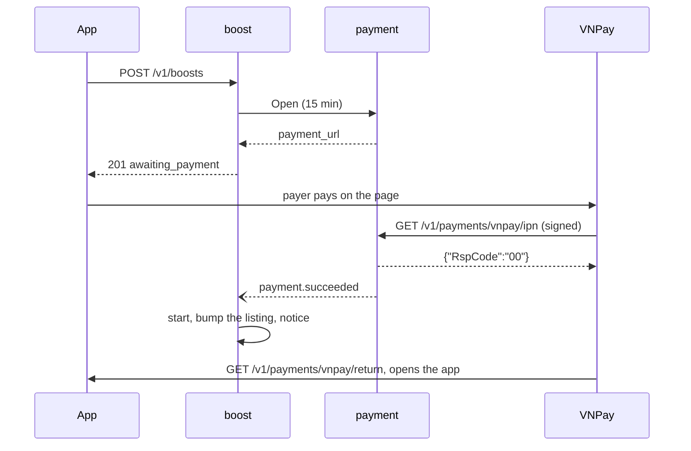

A <Term id="boost">boost</Term> is the first thing a seller pays ShopNexus for (<Req id="UC-LST-03" />). Money between a buyer and a seller still never passes through the platform (<Req id="BR-DEAL-01" />). A boost is a separate sale from ShopNexus to the seller, paid once per purchase through a payment gateway, with no wallet or balance (<Req id="ADR-0006" />).

Two modules share the work:

- **payment** keeps one row per purchase and talks to the gateway: the payment page, the gateway's notification (IPN), the return page, expiry and refunds. It knows a payment's product only as a name and an ID, so a later product such as a seller plan uses the same module.
- **boost** keeps the packages, the purchases and their timers, and asks catalog to move the listing. It opens a payment through payment's service and hears what became of it through `payment.*` events.

## Packages

`GET /v1/boost-packages` lists the packages, shortest first, and `available`, which is false when the server takes no payments (<Req id="BR-LST-04" />). The prices come from `BOOST_PACKAGES`, today 3 days for 15.000 ₫ and 7 days for 29.000 ₫. A package's ID is its days, such as `3d`. A boost keeps the days and price it was bought at, so a price change never touches a running package.

## Buying

`POST /v1/boosts` takes `listing_id`, `package` and an `Idempotency-Key`. It checks, in this order (<Req id="BR-LST-05" />):

| Check | Error |
|---|---|
| The server takes payments | 503 `payment_unavailable` |
| The package exists | 422 `unknown_boost_package` |
| The account may write | 403 `account_suspended` |
| The account has a phone | 403 `phone_required` |
| The listing is the caller's and not deleted | 404 `listing_not_found` |
| The listing is on sale | 409 `listing_not_boostable` |
| No package runs on the listing | 409 `boost_active`, with `details.boost_id` |

Then it opens a payment for the price and saves the boost as `awaiting_payment`, answering 201 with `payment_url` and `payment_expires_at`. The app opens `payment_url` in the browser.

A repeated key answers 200 with the boost the first call made. A listing has at most one boost awaiting payment or running, which a partial unique index holds. A second purchase of the same package while one awaits payment answers 200 with that boost, so the seller picks the payment up again. A purchase of another package cancels the waiting one and takes its place. If the cancelled one's payment lands later, it is refunded.

The seller's listing view and Tin của bạn carry `boostable`: true when a purchase now would pass every check above. The boost service works it out with the purchase's own checks, so the app never repeats the rule.

## Paying

Only two things mark a payment paid: an IPN whose signature checks, or the gateway's own answer when the server asks it (`querydr`). The return page never does by itself (<Req id="NFR-SEC-02" />). The IPN checks the HMAC-SHA512 signature and the terminal, finds the payment by its reference (the payment ID without hyphens), compares the amount, and records the result once. A repeated IPN changes nothing (<Req id="NFR-IDEM-02" />). It answers VNPay in VNPay's own codes:

| `RspCode` | When |
|---|---|
| `00` | Recorded |
| `01` | No payment has that reference |
| `02` | The payment already has its result |
| `04` | The amount differs from the payment's |
| `97` | The signature does not check |
| `99` | Anything else; VNPay sends again |

The return page shows the result in the payer's language and opens the app at `shopnexus://boost/{id}`. When it says paid while the payment is still pending, the server asks VNPay first and records only what VNPay answers.

A payment lives 15 minutes, and VNPay's page refuses it after that too. On opening, payment schedules a delayed Restate call. If the payment is still pending then, the server asks VNPay once: a payment VNPay knows as paid is recorded, otherwise it is expired. A cancel or a bank's refusal fails the payment at once. Either way the boost closes as `expired` or `failed` and the seller gets a notice.

## Starting and bumping

On `payment.succeeded` boost asks catalog to bump the listing. If the listing is still on sale, the boost becomes `active` with its first bump done, `ends_at` set to the start plus its days, and the next tick 24 hours on. Each listing keeps `bumped_at`, and the newest order sorts by `fresh_at`, the later of `published_at` and `bumped_at`. `published_at` never changes, so a card shows the posted time with a "Được đẩy" mark.

These lists sort by `fresh_at`:

- search and category pages sorted newest;
- Home's For you, whose streams are each newest first, and Recently viewed;
- a seller's public listings.

Relevance, nearby and price sorts do not move. A bump is not a publication: watched searches and followers hear nothing.

Each tick is a delayed Restate call keyed by the boost and the tick's time. The next tick is sent before the current one is saved, so a crash loses none, and a repeat with the same key is dropped. A tick bumps the listing only while it is on sale. A hidden, reserved or held listing skips that day, and the package gets no extra day for it (<Req id="BR-LST-06" />). The tick at `ends_at` ends the boost and notifies the seller.

## Refunds

There is no refund for days lost to a hidden or sold listing. A payment is refunded in full, automatically, only when it landed and the package cannot start (<Req id="BR-LST-07" />):

- the listing is no longer on sale when the payment lands;
- the payment lands after its boost expired, failed or was replaced.

Boost marks the purchase `refunding` and calls payment's `Refund`, a durable flow that marks the payment `refunding`, asks VNPay for a full refund (`vnp_TransactionType` 02), then records it `refunded`. A refund VNPay has already taken counts as done. On `payment.refunded` the boost becomes `refunded` and the seller is told the amount.

## Statuses

| Boost | Meaning |
|---|---|
| `awaiting_payment` | The seller has 15 minutes to pay at `payment_url` |
| `active` | Paid and running |
| `ended` | Ran its days |
| `failed` | The payer cancelled or the bank refused |
| `expired` | Not paid within 15 minutes |
| `cancelled` | Replaced by a purchase of another package before payment |
| `refunding`, `refunded` | Paid but could not start; the money is on its way back, or back |

A payment is `pending`, `paid`, `failed`, `expired`, `refunding` or `refunded`. A payment that failed or expired may still turn `paid` when the money arrives late; the boost then refunds it.

## Notices

The seller gets one notice per boost, updated in place: `boost_started`, `boost_ended`, `boost_failed`, `boost_expired` and `boost_refunded`. They sit with the listing notices, push under that switch, and never go by mail.

## The fake gateway

With `PAYMENT_VNPAY=fake` the payment page is the server's own `GET /v1/dev/payments/{id}`, with Pay and Cancel buttons. A button posts to the same path, which builds the callback VNPay would send, signed as VNPay signs it, and hands it to the IPN code in process. It then redirects to the return page with the same query. The fake knows no payment when asked and takes every refund. `APP_ENV=prod` refuses it. Dev stacks and tests run the fake, so every flow is tested without a merchant contract.

## Console

`GET /v1/console/listings/{id}/boosts` lists a listing's boosts with their payments, newest first, for staff with `listings.read`. The console only reads; there is no manual refund yet, so a refund VNPay refuses stays `refunding` and is logged.

## Settings

| Variable | What it sets |
|---|---|
| `PAYMENT_VNPAY` | `live`, `fake` or `off`. Off sells no boost. |
| `API_PUBLIC_URL` | The server's public origin, for VNPay's return URL and the fake's page |
| `VNPAY_TMN_CODE`, `VNPAY_PAY_URL`, `VNPAY_API_URL`, `VNPAY_SERVER_IP` | The terminal, the payment page, the merchant API and the address the server calls it from; live only |
| `VNPAY_HASH_SECRET` | The terminal's checksum secret, live only, sealed in `server-secrets` and never logged |
| `BOOST_PACKAGES` | The packages as `days:price` pairs, shortest first |

VNPay's IPN URL is set on the terminal at VNPay as `https://api.<domain>/v1/payments/vnpay/ipn`.
