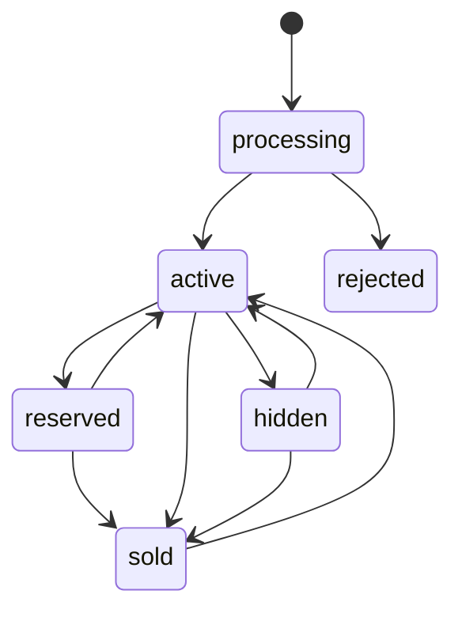

The catalog module owns listings, the category tree and the regions of Vietnam. A listing is one item at one price, sold C2C with cash on delivery. The product rules for a listing are in [Listings](/en/marketplace/listings).

## Listing lifecycle

Drafts stay on the phone. The server receives a complete listing, which starts in processing while its photos are made.

Any status can also go to deleted. Active and reserved listings are public. An edit that adds a photo, or an edit of a rejected listing, sends the listing back to processing.

A listing is reserved while an order's parcel is on its way, and it records which order holds it. The deal module reserves, releases and sells listings, and each of those calls can be repeated safely, because a durable flow may run them again.

## Posting and editing

Posting and editing run as Restate flows, keyed by the seller and the request's `Idempotency-Key`, so a retried tap posts one listing. A post checks the account, then the cap of 20 listings in processing, active, hidden or rejected, then the fields, and reports every bad field at once. After the post, a publish flow waits for the media module to process each photo: all ready makes the listing active, one failure makes it rejected with the reason kept on that photo.

Every change writes an event in the same transaction (`listing.published`, `listing.updated`, `listing.sold` and so on). The deal, search and notification modules react to them; see [Events](/en/architecture/events).

## Categories and regions

The category tree has 9 roots, each with subcategories and a last "Khác" entry, and a listing must name a subcategory. Regions are the 34 provinces and 3,321 communes after the 2025 merger, each commune with one point used to measure distance. A price is whole đồng from 10,000 to 1,000,000,000; the ceiling catches a price typed with extra zeros.
