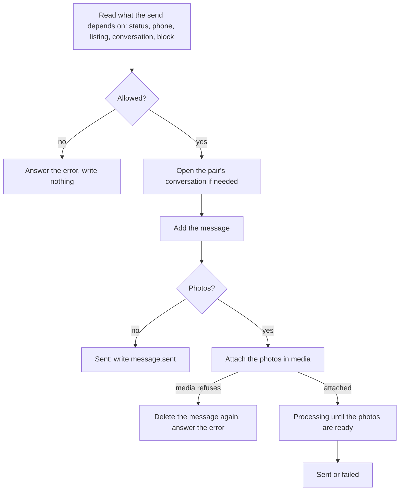
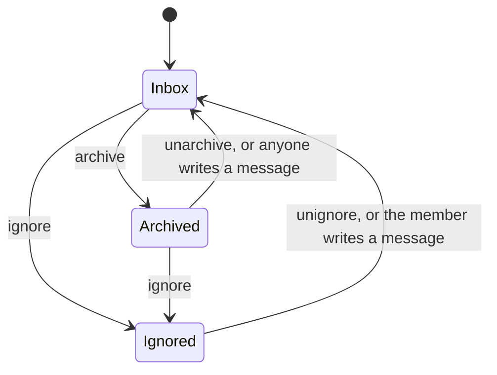

The chat module holds conversations and their messages <Req id="FR-DEAL-01" />. Two people share exactly one conversation, whatever their roles: the same thread carries their talk about every listing and every deal between them, both ways. The screen module joins the pair's deals into the chat view; chat itself never calls the deal module.

A conversation has one of two kinds:

- **pair**: the one chat of two people. Only one exists per pair.
- **support**: one support ticket's chat between a person and ShopNexus <Req id="FR-MOD-04" />. A person has any number of these. See [Support chats](#support-chats).

## Who may message whom

<KeyRules>
- A conversation starts from someone else's listing that is on sale. The opener needs a phone on the account <Req id="BR-ACC-03" />.
- A block stands both ways: neither person may message the other, open a conversation with them, follow them or open a deal on their listings <Req id="BR-ACC-01" />.
- A suspended account cannot write, except in its own support chats.
- Nobody writes to an account that was deleted.
</KeyRules>

Opening is `POST /v1/conversations` with the listing and the first message. If the pair already has a conversation, it is reused and the message lands there. A deal opened on a listing also opens the pair's conversation, so a conversation can exist before anyone types.

Text and photo counts are checked first (422 `invalid_message` with fields). The rest run in a fixed order, and the first one that fails answers:

| Check | Error |
|---|---|
| The caller is suspended | 403 `account_suspended` |
| The caller has no phone | 403 `phone_required` |
| The listing does not exist | 404 `listing_not_found` |
| The listing is the caller's | 409 `own_listing` |
| The listing is not on sale | 409 `listing_unavailable` |
| The quoted message is not allowed | 422 `invalid_message` on `reply_to` |
| A block stands between the two | 403 `blocked` |
| A photo is not the caller's, not uploaded or already used | 422 `invalid_upload` |

Sending in an existing conversation (`POST /v1/conversations/{id}/messages`) skips the listing checks. It answers 409 `account_deleted` when the other person deleted their account.

### Blocks

Blocks live in the account module, because both chat and deal check them <Req id="FR-ACC-03" />. `POST /v1/blocks`, `GET /v1/blocks` and `DELETE /v1/blocks/{account_id}` add, page and remove them. Blocking oneself is `invalid_block`, and ShopNexus cannot be blocked (`account_is_system`). Blocking again changes nothing.

A block changes what each side sees:

- The blocker's inbox, unread count and inbox search leave the conversation out. The blocked person's keep it, so the block is not announced.
- Running deals and orders stay as they are. A move on such a deal still writes its deal message into the conversation.
- Typing signals across a block are dropped in silence, so typing does not reveal the block either.

### Follows

A follow lets a buyer hear when a seller puts a new listing on sale <Req id="FR-DSC-03" />. `POST /v1/follows`, `GET /v1/follows` and `DELETE /v1/follows/{account_id}` work like the block endpoints.

- Any account can be followed. One account follows at most 1,000 others (`follow_limit_reached`).
- A suspended account cannot follow (`account_suspended`).
- While a block stands, following is 403 `blocked`. Blocking deletes the follows between the two, both ways, and unblocking restores none.
- A follow and a block of the same two people take one lock on the pair, so a follow written at the same moment as a block cannot outlive it.

The seller page shows the follower count to everyone and whether the reader follows the seller. The notice a follower gets is on [Notifications](/en/architecture/notifications#a-followed-seller-lists-something).

## Messages

A message holds text of 1 to 1,000 characters, up to 4 photos, or both. It may name a listing of either member. Nobody can edit or delete a message once it is sent.

- **Quotes.** A message may quote an earlier sent message of the same conversation. Anything else, including a deal message, is `invalid_message` on the field `reply_to`. The quote is read when the message is read, with its text cut to 200 characters.
- **Link cards.** ShopNexus links in the text (a listing, person, order, category or search page on the website, or an app link), at most 5, come back as cards. Nothing is stored: each card reads the listing or person as it is now. A link the reader may not see, such as someone else's order or a hidden listing, stays plain text.

### Sending a message

Every send is a durable flow, text-only messages included, keyed by the sender and the request's `Idempotency-Key`. A retried tap therefore sends one message <Req id="NFR-IDEM-01" />.

A photo message stays `processing` until media has processed its photos, and only its sender sees it until then. It then becomes `sent` or `failed`. Only a message still processing moves: if the publish step runs again after the message was already published, it writes nothing more and ends.

When a message becomes sent, the same transaction:

1. moves the conversation's last message, only forward, so a late write never displaces a newer one;
2. brings the conversation back from both members' archives, and out of the sender's ignored box;
3. writes the `message.sent` event, whose ID is the message's ID, so writing it twice adds no second event;
4. logs a `message` update to the [live stream](/en/api/live-updates) of each member who can see it.

`message.sent` drives the push to the other member ([Notifications](/en/architecture/notifications)) and the scam check ([Trust](/en/architecture/trust)) <Req id="FR-TRS-04" />.

### Deal messages

Each move on a deal of the pair (an offer, an accept, a COD request, a shipment and so on) writes a deal message into the conversation, so the thread tells the deal's story in line with the talk. Clients cannot send one. A deal message has no text and no photos, only the deal and the move.

A deal message is a sent message for everything that reads messages, with three differences:

- It moves the last message but leaves archived and ignored conversations where they are. Only a message someone writes brings a conversation back.
- It writes no `message.sent`. The deal's own notice already pushes the move, so a chat push would tell it twice.
- It counts as unread for every member who did not make the move. A move by the system is made by ShopNexus, so it counts for both.

The reply rate on a seller's profile leaves deal messages out, so it still measures answers in chat.

## Read state and the inbox

Each member has their own read marker, archive flag, ignore flag and "marked unread" flag. Each is written by a statement of its own, so two devices of one person never undo each other.

- **Read.** `POST /v1/conversations/{id}/read` names a message. The marker moves only to a newer message, so a late read from another device moves nothing. Moving it tells the other member's stream, which turns their "Seen" on.
- **Unread.** Unread counts the other member's sent messages after the marker. `POST /v1/conversations/{id}/unread` marks a conversation unread: it then counts at least 1 until the member reads it again. The marker, and what the other member sees as read, stay where they were.
- **Archive.** An archived conversation leaves the main inbox and comes back with the next message someone writes.
- **Ignore.** An ignored conversation lists only in the ignored box, counts as unread nowhere, and pushes nothing for its messages, offers or counters. Order moves still notify. The other member is not told. Writing in it, or unignoring, ends it.

The inbox is the screen `GET /v1/screens/inbox`, paged by each conversation's last sent message. It shows the main box, the archived box (`archived=true`) or the ignored box (`ignored=true`), and leaves out conversations with no sent message and conversations with someone the reader blocks. `GET /v1/me/unread` counts the unread messages over unarchived pair conversations, beside unread notices and waiting offers.

### Inbox search

`GET /v1/screens/inbox/search` finds conversations and messages. The query folds case and Vietnamese accents (đ matches d). Every word but the last must match a whole word, and the last matches the start of one.

- **Threads** match when the other member's name, or the title of a listing a message names, holds every word. Up to 20, on the first page only.
- **Messages** match when their text holds every word, newest first, paged.

Archived conversations are searched. Conversations with someone the reader blocks are not. A query with no letter or digit, or over 100 characters, is `invalid_query`.

## Support chats

A support chat is one ticket's conversation between a person and ShopNexus. It differs from a pair chat in these ways:

- It stays out of the inbox, its unread count and inbox search. The support screen counts it on its own.
- It cannot be archived, ignored or marked unread (409 `conversation_is_support`).
- It gets no scam check.
- A suspended person can still write in it, so they can appeal.
- Staff replies push to the ticket owner under the title ShopNexus and open the ticket. The owner's messages push nothing; the console's queue shows them.

## Live signals

Two signals travel on the [live stream](/en/api/live-updates) and are not messages:

- **Typing.** The app sends a typing frame at most once every 3 seconds per conversation. The server checks that the sender is a member and no block stands, then rings the other member. Nothing is stored.
- **Last active.** The server records when an account's socket connects and closes, and once a minute while it stays open. The chat view and the seller page show it.

## Quick replies

`GET` and `PUT /v1/me/quick-replies` hold a seller's saved answers, which the composer offers to drop into the field. `PUT` replaces the whole list, in order: at most 20 answers of 1 to 200 characters, not blank. An account that never saved a list reads three default answers in the request's language, and reading them saves nothing. An empty list stays empty. Deleting the account deletes the list.
