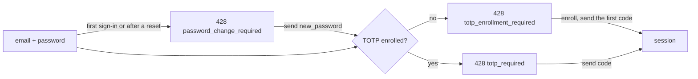

Moderators and admins work in a web console as console members, with accounts of their own. A console member is never a customer account with a role, and a phone sign-in opens no console access. The console reaches customer data only through the account, support, trust and catalog modules' published services.

## Roles

There are two roles, and an admin can do everything a moderator can. Each console route names the lowest role it accepts.

| Area | Moderator | Admin only |
|---|---|---|
| Accounts | Search, read one with its suspension history, suspend, unsuspend | |
| Support tickets | Read the queue and a ticket's chat, reply, resolve, reopen | |
| Report cases | Read, dismiss, resolve, reopen; hide and unhide a listing | |
| Feedback | Read, group, reply, set the status | |
| Console agent | Ask, read every shared chat, manage their own chats, approve or reject the changes the agent asks for | Rename or delete any chat, AI settings; an admin's turns also read the audit log and monitoring |
| Members | Change their own password | Create, rename, disable, enable, unlock, reset a moderator's password or TOTP |
| Audit log | | Read it |
| Ops dashboards | Those whose floor is moderator (Grafana by default) | The rest, and set each dashboard's floor |

Admins exist only through the server's command-line tool, which runs with database access. The API manages moderators and refuses any change whose target is an admin. The same tool clears the sign-in lock on an admin's email, which anyone can set by sending five wrong passwords.

## Sign-in

Members sign in with email, password and a TOTP code, and TOTP is required from the first sign-in. Every call to `POST /v1/console/login` sends the email and password again. The server reads the member and answers `428` with the step the call still lacks; the client cannot skip a step, because the server works it out from the member.

- An unknown email, a wrong password and a disabled member all get the same `invalid_credentials`, so the answer does not tell whether an email is a member's.
- A password has 12 to 128 characters and is not the email; there are no composition rules. An admin's reset gives a temporary password the member must replace.
- A TOTP code whose time step is not later than the last accepted one is refused, so a code cannot be replayed.
- There are no recovery codes; an admin resets a moderator's password or TOTP.

Each call is charged to the email's lock before anything is checked, in one statement, so parallel guesses cannot pass the check together. A wrong password or code keeps the charge; any other answer takes it back. Five kept charges lock the email for 15 minutes (`login_locked`), whether or not the email is a member's. A finished sign-in clears the count. Refused sign-ins go to the security log with the email and IP address.

## Session

A finished sign-in sets the `console_session` cookie: a random token, `HttpOnly`, `Secure`, `SameSite=Strict`, scoped to `/v1/console`, for 8 hours and never extended. The server stores only its hash. There is no access token and no refresh, so all console tabs share one session.

A session is live while it is not revoked, is younger than 8 hours, its member is active and its credentials version equals the member's. A password change, a password or TOTP reset and a disable raise the version, which ends every session of the member at once, the caller's own included. Enabling a member again brings no session back. Sign-out revokes the one session.

## How a console request is checked

Every request under `/v1/console/` passes the same checks, in order:

<Steps>
<Step title="The console header">
The request must carry `X-Requested-With: shopnexus-console`, which a form or a link on another site cannot set. With the `SameSite=Strict` cookie, this keeps any cross-site request from riding the session.
</Step>
<Step title="The session">
The server reads the session joined with its member from the database on every request. A disable or a reset therefore takes effect on the member's next request, with no cache to expire. No live session is `401`.
</Step>
<Step title="The role">
The member's role must reach the route's floor, or the answer is `403`. An unknown role grants nothing.
</Step>
<Step title="The rate limit">
The member counts against the route's rate limit, by member id rather than by IP.
</Step>
</Steps>

The sign-in routes need only the header. Because the cookie is `SameSite=Strict`, the console and the API must be on the same site, such as `console.x.vn` and `api.x.vn`. CORS lets only the console's origin call `/v1/console/`, with credentials. The docs site's API playground may call the customer API without credentials, since that API takes a bearer token; the console cookie never leaves its own origin.

Another module can serve a console route behind the same checks; the console agent's routes and the order and listing pages work this way.

## Ops dashboards

Grafana, Restate's UI, Bifrost's UI, the object store's UI, Argo CD and a database browser sit behind the console's sign-in, each on a host of its own. Each dashboard has a floor, the lowest role that opens it: moderator for Grafana, which only shows traces, metrics and logs, and admin for the others, which can cancel invocations, spend model budget, read every object, deploy or change any row. An admin may change a floor, and the change is audited.

<Sequence
  caption="Opening a dashboard from the console."
  actors={[
    { id: "console", label: "Console", icon: "ri:computer-line" },
    { id: "server", label: "Server", icon: "ri:server-line" },
    { id: "proxy", label: "Ingress", icon: "ri:shield-keyhole-line", note: "Asks the server before each request" },
    { id: "dash", label: "Dashboard", icon: "ri:dashboard-line" },
  ]}
  steps={[
    { from: "console", to: "server", label: "Ask for a ticket", detail: "`POST /v1/console/dashboard-tickets`; the role must reach the floor" },
    { from: "server", to: "console", label: "A one-time ticket, 60 seconds", back: true },
    { from: "console", to: "dash", label: "Open the dashboard's callback with the ticket" },
    { from: "dash", to: "server", label: "Spend the ticket", detail: "sets a dashboard cookie for that host only" },
    { from: "proxy", to: "server", label: "Check every request", detail: "session, host, floor" },
    { from: "proxy", to: "dash", label: "Pass it on with the member's email and role" },
  ]}
/>

A dashboard session ends with the console session it came from. The check runs on every request and reads the floor at once, so a lowered role or a raised floor refuses the next request. A request without a session is sent back to the console to open the dashboard again.

## Audit

Every member's write is a row in `console_actions`, written in the same transaction as the change, so a change never lands without its row. That covers suspensions, member changes, ticket replies and status changes, report case decisions, listing hides, feedback, AI settings and dashboard floors. A row names the member (or the command-line tool), the action, the target, the member's IP address and details the action does not say, such as a suspension's reason and end. Adding an action means adding it to the API's list of actions as well.

Finished sign-ins are rows in the sessions table; refused ones are in the security log. What the console agent calls for a member is recorded apart, in [the agent's call record](/en/agent/tools#what-is-recorded).

## Secrets at rest

Passwords are stored as argon2id hashes, and at most four hashes run at once so a burst of sign-ins cannot take the process's memory. TOTP secrets are sealed with a key derived from the console key and bound to the member, so a sealed secret copied to another member's row does not open.
