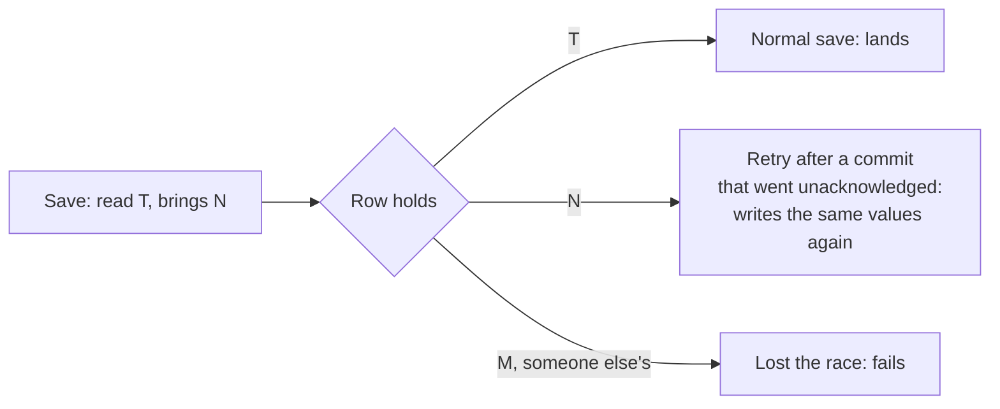

Every module keeps its data in one Postgres database running ParadeDB, which adds the full-text index search uses and vector support. Photos live in RustFS; the database keeps their object keys.

## Aggregates and transactions

An aggregate is the unit a module reads and saves whole: an account, a listing, a deal, one signed-in session. It can span tables, as a person's credentials span a root row and their identities. A transaction covers one aggregate.

Two writes cover more, because a half-done version would be wrong:

- **Sign-up** inserts the account and its credentials together. A sign-up that loses the phone number or email to another one writes neither, and the client gets `try_again`.
- **Erasure** saves the deleted account and, in the same transaction, deletes its credentials, addresses, blocks and follows and revokes its sessions. A deletion that loses a race leaves the account whole.

A few tables are not aggregates. Notification settings and quick replies are one row per account, and the last save wins. Search history, view counts and helpful marks are rows without a write ID. Where such rows must stay consistent as a group, the write takes a lock on the group.

## What one commit holds

A change is sent as one batch: the save, its [events](/en/architecture/events), the updates for the [live socket](/en/api/live-updates) and, for console actions, the audit entry. They commit or roll back together, in one round trip. A change to many rows of the same shape is one statement over the list, never one statement per row.

A batch is split only where the result of one statement decides what the next write is.

## Concurrent writes

Writes are checked optimistically. Each aggregate row carries a write ID, the ID of the last write to it. A save names the write ID it read and the new one it brings, and lands only if the row still holds one of the two. <Req id="NFR-CONC-01" />

A save that lost gets `try_again`, and the client reads again. In deal it gets `deal_changed`, since the other side's move may change what the tap means. A version counter would not work here, because another writer can raise it to the same value a retry expects.

The new write ID is always minted by the caller before the save, never by SQL, so a retry sends the same one. That holds for set-based writes too, such as revoking every session of an account.

One case is accepted: when a step commits, the process dies before Restate records it, and someone else writes before the retry, the retry sees a conflict although its change landed. The flow handles it like any conflict and reads again.

Caps that span rows, such as 20 listings on sale per seller or 3 COD orders in progress per buyer, are counted under a Postgres advisory lock on the account, before the write.

## Retries and duplicates

A phone on a bad network sends the same request twice, and Restate retries a step after a crash. Every write that a retry can repeat follows one of three rules. <Req id="NFR-IDEM-01" />

<Steps>
<Step title="Create: claim a key">
Every created row has a dedupe key that a unique constraint holds, claimed by the insert before any outside call. When the insert finds the key taken, the server answers with the existing row, as the same response. The key is one of:

- an outside fact, as its own columns: an identity's kind and value;
- a client request: the account and the request's [`Idempotency-Key`](/en/api/idempotency);
- an internal step: an ID minted in an earlier journaled step, or derived from the request key and the row's place when one request makes several rows, such as photo copies.
</Step>
<Step title="Change: save and compare">
A change to an existing row is the write ID save plus a check of the state it finds. A retry of the same request answers success with the current view. A different move that conflicts still gets its error. A deal's moves keep the request key, so a move the caller's key already made answers without moving again.
</Step>
<Step title="Outside calls carry our key">
Every outside call that could act twice carries a key of ours. A carrier order uses the order code as its ID, and a create that may have landed reads back by it. A mail resend carries the challenge ID. A push replaces a repeat on the phone with the same collapse key. A payment's reference at VNPay is its own ID, so a payment the server is unsure of is asked about by that ID, and a refund VNPay already took counts as done.
</Step>
</Steps>

Carrier reports are the one place without a unique key. A webhook and a poll date the same event from different fields, so a report is compared to the newest event of its kind and to events within 10 minutes, under a lock per shipment.

## Rules in the database

A rule that one row can show is also a `CHECK` constraint, so a raw write or a bug cannot break it: a reserved listing names its buyer, a listing has 1 to 10 photos, a cancelled order has a reason, a completed one a close time. A check added to a table that already has rows applies to new and changed rows only, so an old row never fails a deploy.

Every foreign key into a table rows are deleted from has an index, so deleting a parent does not scan the child.

## Limits

The server's pool holds 20 connections, and a statement that runs longer than 10 seconds is cancelled, so a slow query cannot hold a connection for good. The slowest query the server runs takes a few seconds. One-off jobs such as migrations and reindexing have no timeout.

## Migrations

The schema is a series of numbered SQL files, each applied once in its own transaction, in version order. A file that has run anywhere is never edited, not even a comment; a mistake is fixed with a new file, and the migrator stops on a changed file by its checksum. Gaps in the numbers are fine, and so is a lower number that lands after a higher one when two branches merge; only two files with the same number are refused.

The same migrations run in the local stack and in the cluster, so roles, grants, extensions and seed rows belong there. The server refuses to start while a migration is pending. No column is named after an SQL keyword, and a linter checks it.
