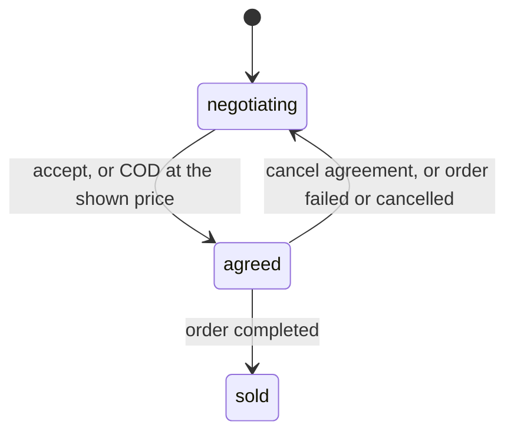
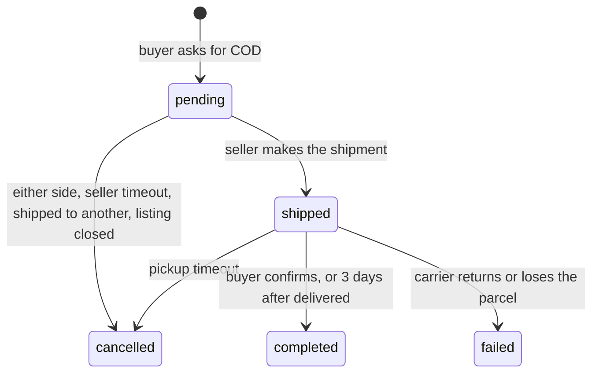
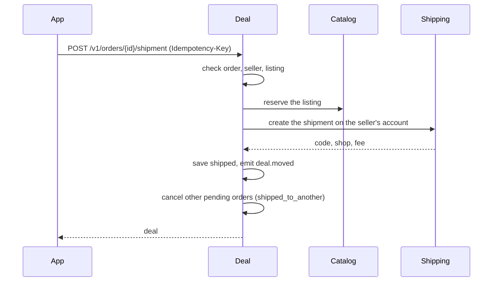

A deal is one buyer and one seller agreeing a price on one listing. There is one deal per buyer and listing. `POST /v1/deals` returns the caller's existing deal with 200, or starts one with 201. Starting needs a phone number, no block between the two (<Req id="BR-ACC-01" />, <Req id="BR-ACC-03" />), an account that is not suspended, and someone else's active listing.

The deal holds its latest order. Earlier orders on the same deal stay in `orders`, so one deal can see several purchases after failures and cancels. Carriers, waybills and tracking are on [Shipping](/en/architecture/shipping); the user-facing rules are in [The COD deal](/en/marketplace/cod-deal).

## The deal and its conversation

Every deal lives in the conversation of its buyer and seller, one conversation per pair. Opening a deal opens or reuses that conversation, and the checks for a deal are the checks for a conversation, so chat checks nothing more. Deal calls chat; chat never calls deal.

The conversation and the deal are two modules' rows, so they are not one transaction. If the deal's insert fails right after its conversation was opened, deal asks chat to drop it again. A crash between the two leaves an empty conversation, which the inbox hides and the pair's next deal or message reuses.

## Negotiation

While negotiating, a deal holds at most one open price: the buyer's offer or the seller's counter. An open price never expires. Agreeing reserves nothing, so several buyers can agree a price on the same listing (<Req id="BR-DEAL-04" />).

The moves are:

- The buyer offers when nothing is open, or under the seller's counter.
- The seller counters the buyer's open offer.
- The side facing an open price accepts or declines it.
- The side that made an open price withdraws it.
- Either side cancels an agreement, and the deal negotiates again.

Amounts are whole đồng in multiples of 1,000 (<Req id="BR-DEAL-03" />). An offer is at least half the listed price, rounded up to 1,000, and below the counter or the listed price. A counter is above the offer and below the listed price. The deal view carries `offer_range`, the amounts the viewer's next offer may take, so the rule lives only in the server.

`accept` and the COD request carry the price the person saw. Any other current price is `price_changed`, so nobody agrees to a price that moved under their thumb.

### Who may move

- A suspended account cannot offer, accept or ask for COD (<Req id="BR-MOD-02" />). Decline, withdraw and cancel take a price back, so they work for a suspended account and on a listing in any state.
- Offer and accept need an active listing.
- While the seller is away, the buyer's offer, accept and COD request are 409 `seller_away`, because each would bind the seller. The seller's own moves, decline, withdraw, cancel, chat and every step of an order already placed go on.

### Races

Two people can move at once. The save that loses is `deal_changed`, where other modules answer `try_again`. After the other side moved, the same tap may mean something else, so the app reads the deal again instead of retrying (<Req id="NFR-CONC-01" />).

## Moves, events and the thread

Each save writes the deal, its order, its new moves in `deal_moves` and one `deal.moved` event in a single transaction. The deal view lists every move oldest first. Order changes have no event of their own: they ride on `deal.moved` as moves, which chat and notification read.

Every move a person makes and every order step, whoever made it, becomes a deal message in the pair's conversation. A chat worker reads the moves named in each `deal.moved` and posts one message per move. The message takes the move's ID and time, so a redelivered event writes no second message, and a late event still lands in the right place in the thread. A side's move is sent by that side's account, a system move by ShopNexus. A move chat cannot place ends the work for good, since no retry would place it.

## When the listing changes

A worker follows `listing.updated`, `listing.hidden`, `listing.sold` and `listing.deleted`, reads the listing and each deal on it, and writes system moves:

| Listing change | Effect on its deals | Move |
|---|---|---|
| Hidden, sold or deleted | Drops the open price and cancels pending orders | `listing_closed` |
| Sold or deleted | Also ends an agreement | `listing_closed` |
| New listed price | Drops the open price | `price_changed` |
| Offers turned off | Drops the open price | `offers_closed` |

These system moves write no chat message. A listing back in processing after a photo edit is not closed. The deal stores the listed price at the time of its open price, so a repeated or late event changes nothing.

## Open offers for the seller

The seller sees the deals on their listings that wait on a buyer's offer, newest offer first, with a count. The page cursor is a deal; if that deal's offer was answered meanwhile, the next page starts from the newest again and the client drops rows it already shows.

## The order

An order is cash on delivery with inspection at the door (<Req id="BR-DEAL-05" />). ShopNexus holds no money.

A completed order makes the deal sold. A failure or a cancel sends the deal back to negotiating without its agreed price. A parcel the carrier lost after the pickup fails the order with the shipment `lost`: the carrier's fault, so it counts in neither side's figures, takes no review, and the listing goes hidden for its seller instead of back on sale. Hiding it withdraws open prices on the listing as any hide does, and the seller unhides it once they have the item. After the shipment the seller has no move on the order; the carrier's reports and the buyer move it. The order shows `completed_by`, the buyer or the system.

Cancel reasons are `buyer`, `seller`, `seller_timeout`, `pickup_timeout`, `shipped_to_another` and `listing_closed`. A shipped order is cancelled only by the pickup timeout (<Req id="BR-DEAL-07" />).

### Asking for COD

`POST /v1/deals/{id}/cod` carries the price the buyer saw and an `address_id` from the buyer's address book.

- The price is the agreed price, or on a deal still negotiating the listed price or the seller's open counter. On a negotiating deal this is "Mua ngay": the same save agrees the price and opens the order, with one `cod_requested` move and no `accept`, so buying at the shown price never leaves an agreed deal without an order.
- A sold deal, a deal with an open order, or the seller asking is `move_not_allowed`. Another price is `price_changed`, and a listing no longer active is `listing_unavailable`.
- The order copies the address, so editing or deleting it later leaves the order as it was. Someone else's address is `address_not_found`, and it answers before `move_not_allowed`.
- A buyer has at most 3 orders pending or shipped (<Req id="BR-DEAL-06" />). The save counts them under a lock on the buyer, so two requests at once cannot both take the last slot; the fourth is `cod_limit_reached`.

The order's code, such as `SN-100001`, comes from a sequence. It is also the order reference at the carrier, which lets a retried create find the first one.

### Order endpoints

The order moves take the order's ID: `POST /v1/orders/{order_id}/shipment` (seller), `/confirm` (buyer) and `/cancel` (either side, pending only). Each returns the whole deal. An unknown order, or one the caller is not a side of, is 404 `order_not_found`. An order that is not the deal's current open one is `move_not_allowed`, so a stale request cannot cancel a later order. The deal's own `cancel` also cancels a pending order.

A suspended account cannot ask for COD, but a shipment, a confirmation and a cancel finish or take back an order already under way, so they refuse no one for a suspension. While a party has an open order, their account cannot be deleted.

The buyer always reads the recipient in full. The seller reads it in full too, except on a cancelled order, which keeps only the name and the commune. The buyer never sees the pickup, since it may be a copy of the seller's address.

## Durable flows

The COD request, the shipment, the confirmation and the order cancel run as Restate flows (<Req id="NFR-DUR-01" />). Each move keeps the caller's `Idempotency-Key`, unique per deal and party, and a flow whose key already moved answers with the deal read anew (<Req id="NFR-IDEM-01" />). The key is optional; without one each request moves on its own. A flow that replays after a crash writes nothing twice, because the save recognises its own earlier commit.

| Flow | Steps |
|---|---|
| COD request | Load the deal, read the buyer's status, away mode and address, make the order under a fixed ID, save, start the seller timer. |
| Shipment | Check the order and listing, resolve a saved pickup, reserve the listing, make the shipment at the carrier, save, cancel the listing's other pending orders, start the pickup timer and the poll. |
| Confirmation | Save the order as completed, then sell the listing. |
| Cancel | Save the cancel. It touches no listing. |

The shipment is the flow with the most ways to go wrong:

- A carrier refusal gives the listing back and answers the refusal.
- When the save loses a race to a cancel, the flow releases the listing and calls off the shipment the order did not take. When it loses to another tap that shipped the same order, it keeps the listing.
- When the seller unlinked or switched the carrier shop while the shipment was being made, the save refuses with `carrier_not_linked`. The flow gives the listing back and only logs the shipment, since the seller's account no longer reaches it.
- A listing reserved for an order not yet shipped counts as paused, so a shipment that loses to a cancel ends no other buyer's order.

## Timers

The timers are delayed Restate sends. Each names its order, reads the deal when it fires, and does nothing if that order moved on. None compares clocks; a save that loses a race reads again.

| Timer | Starts | Fires after | Effect |
|---|---|---|---|
| Seller | COD request | 3 days | Cancels a still pending order with `seller_timeout`. |
| Pickup | Shipment | 3 days | Reads the carrier first. Picked up since: moves the order on. Still waiting: cancels with `pickup_timeout`, releases the listing, then calls the parcel off at the carrier. |
| Complete | Delivered report | 3 days | Completes the order as the system (<Req id="BR-DEAL-11" />). |
| Transit | Parcel in transit | 30 days | Reads the carrier. Gone, cancelled or lost fails the order with the shipment `lost` and hides the listing. A new status moves it and the timer waits again. |
| Poll | Shipment | every 2 hours | Reads the carrier while the order is shipped. See [Shipping](/en/architecture/shipping). |

A pickup timeout leaves the order cancelled even when the carrier already has the parcel or no longer knows it. The order shows the next deadline as `due_at`: the seller timer while pending, the pickup timer while the parcel waits for pickup, and the complete timer once delivered. It is computed, not stored.

## Carrier reports

Every carrier report, from a webhook, the poll or the dev endpoint, goes through one entry point with the carrier, the tracking code, the status, its time and the newest fee. It moves every shipped order with that code and changes nothing on a closed order. An unknown code changes nothing: the webhook still answers 200, and only the dev endpoint answers 404 `shipment_not_found`. How statuses map to the order is on [Shipping](/en/architecture/shipping#tracking).

- A report no newer than the stored one changes nothing, so a late webhook never lands an older status last. A newer report of the same status moves only the time, with no move or event.
- A carrier failure or return fails the order at once and releases the listing (<Req id="BR-DEAL-08" />). A parcel lost after the pickup fails it with the shipment `lost` and hides the listing (<Req id="BR-DEAL-11" />).
- A report's fee replaces the order's fee without a move, unless the report is older than the stored one. A closed order keeps its fee.
