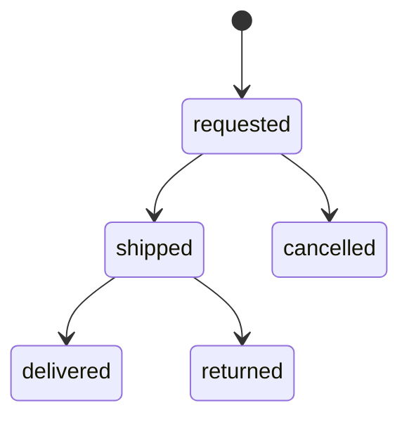

A deal is one buyer and one seller agreeing a price on one listing. There is one deal per buyer and listing, and opening it again returns the existing one. The rules for the buyer and seller are in [COD deal](/en/marketplace/cod-deal).

## Negotiation

A deal is negotiating or agreed, and sold at the end. While negotiating it holds at most one open price, the buyer's offer or the seller's counter. Several buyers may agree a price on the same listing; agreeing reserves nothing. The server computes the range the next offer may take and sends it with the deal, so the app never repeats the rule. Every move is stored, and the deal view lists them oldest first for the chat thread.

When two people move at once, the loser gets `deal_changed` and the app reads the deal again. A blind retry could mean something else after the other side moved.

## Orders

The order lives inside the deal. No carrier is integrated: the seller creates the waybill in the carrier's app and types it in.

Nothing sits between requested and shipped, so the buyer cannot cancel once the seller says the parcel is out. Delivered makes the deal sold. Returned or cancelled sends it back to negotiating. A buyer has at most 3 orders requested or shipped at once.

## Flows and the listing worker

Ship, delivered and returned change the listing too, so they run as Restate flows. The ship flow reserves the listing first, so a listing that is no longer on sale refuses before anything is written, then saves the order and cancels the listing's other requested orders. The finish flow saves the order, then sells or releases the listing.

A worker listens to listing events. A hidden, sold or deleted listing drops the open price and cancels requested orders; a new price or offers turned off drops the open price. Each of these is written as a system move, so the thread shows why.
