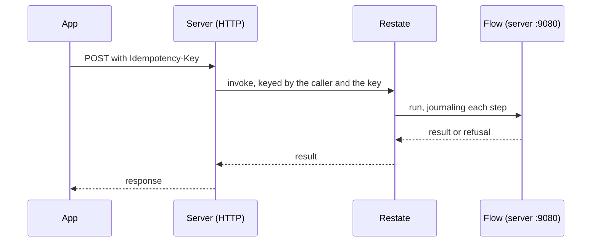

Most use cases are plain calls: a handler calls the module's service and the service talks to Postgres. A use case runs as a Restate flow only when it writes to more than one place and must finish after a crash. Keeping the rest off Restate means reads and token refresh keep working while Restate is down.

## Flows in the server

| Flow | Why it is durable |
|---|---|
| Sign-in | First sign-in creates the account, then its phone identity, and undoes the account if the identity was taken meanwhile |
| Posting and editing a listing | Writes the listing, attaches its uploads, then starts publishing |
| Publishing a listing | Waits for every photo to be processed, then makes the listing active or rejected |
| Processing and expiring uploads | Resizes a photo in the store; deletes uploads never attached after 24 hours |
| Shipping and finishing an order | Changes the order and reserves, sells or releases the listing |
| Sending a chat message | Adds the message and attaches its photos |

Event delivery and every module's event handlers also run on Restate (see [Events](/en/architecture/events)).

## Handing off

The service method in front of a flow invokes it through Restate's ingress and waits for the answer, so the handler sees the same result and errors as a plain call. The client's `Idempotency-Key` becomes the invocation key. A repeated key attaches to the first run and returns its result without running a step again.

## Rules inside a flow

- A step only reads or writes a store. Any error from a step is a fault, and Restate retries it.
- Every business decision happens between steps, on values the journal kept, so a replay takes the same decisions.
- IDs and the clock come from the journal, so a retried insert lands the same row and does nothing the second time.
- A business refusal, such as a reached listing cap, comes back as data in the result. Restate keeps only the code and message of a failed invocation, and the client needs the error's details.

The first version judged inside steps, and a retried step applied its change twice. The split into read, decide and save replaced it on 2026-10-21.

## Running Restate

The server registers its endpoint with Restate's admin API at start. Restate signs every request to the endpoint with a private key, and in production the server runs only requests signed with it. A service name prefix keeps test packages that share one Restate server apart.
