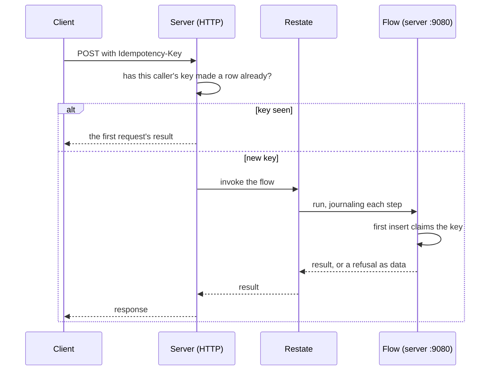

Most use cases are plain calls: a handler calls the module's service and the service talks to Postgres. A use case runs as a Restate flow only when it has several steps that must all happen after a crash, such as a write followed by a mail or a carrier call. Keeping the rest off Restate means reads and token refresh keep working while Restate is down. <Req id="ADR-0002" /> <Req id="NFR-DUR-01" />

## Flows in the server

| Module | Flows |
|---|---|
| account | Sign-in, sending an email code, adding an identity, reauthentication |
| catalog | Posting, editing and publishing a listing, copying photos into a listing, embedding a listing, telling IndexNow |
| media | Processing an upload, expiring uploads never attached, releasing photos a listing dropped |
| deal | Asking for COD, shipping, confirming and cancelling an order, the order's timers, applying carrier updates |
| chat | Sending and publishing a message |
| trust | The scam check after a message |
| assist | Reading a photo or a video |
| chotot | Importing listings and the hourly sync |
| support | Opening a ticket |
| ai | Speech to text, photo vectors, video frames |

Event delivery, every module's event handlers and the periodic sweeps also run on Restate (see [Events](/en/architecture/events)).

## Handing off

The service method in front of a flow invokes it through Restate's ingress and waits for the answer, so the handler sees the same result and errors as a plain call. A flow does not rely on a Restate idempotency key. It dedupes by the keys of the rows it writes: the first insert claims the caller's request key, so a retry that races the first run finds that row and answers with it. [Data](/en/architecture/data#retries-and-duplicates) has the full standard.

A few internal flows do keep a Restate key, because the key is the natural ID of the work: processing an upload runs once per upload, publishing a listing once per listing and write, publishing a message once per message, and delivering an event once per event.

## Rules inside a flow

- A step only reads or writes a store, or calls an outside service. Any error from a step is a fault, and Restate retries it.
- Every business decision happens between steps, on the values the journal kept. A replay therefore takes the same decisions.
- A step that can lose a race, such as a save that finds the row changed, returns that as a value. The flow then decides between steps: read again, or answer `try_again`.
- The clock is read once per run through the journal, and IDs are minted from it before the step that inserts them. A retried insert lands the same row and does nothing the second time.
- A business refusal, such as a reached listing cap or a suspended account, comes back as data in the result. Restate keeps only the code and message of a failed invocation, and the client needs the error's details.

## A flow keyed by listing

Embedding a listing runs one run per listing at a time, and a new request queues behind the run in progress. A burst of edits therefore embeds the newest content once, and the later runs find nothing left to do. When the gateway reports a spent budget, the run ends without the vector and tries again 6 hours later.

## Running Restate

The server registers its endpoint with Restate at start. In the cluster an operator registers each server version instead and keeps the old version running until its invocations finish, so a run never replays on code it did not start on. Restate signs every request to the endpoint, and in production the server runs only signed requests.
