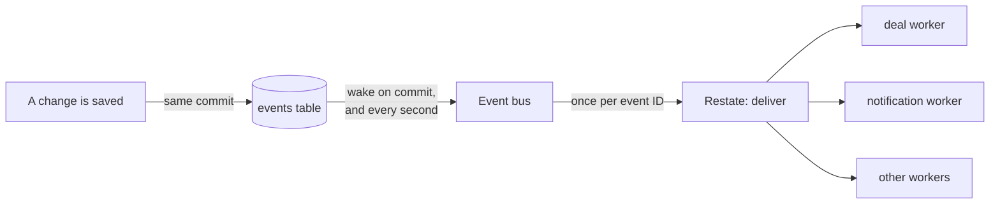

A module announces a change with an event, and modules that care subscribe to its kind. The module that changed the data never knows who reacts. Every subscriber is a module of the same server, so there is no broker: the outbox is a Postgres table, `events`, and Restate does the delivery. <Req id="NFR-MSG-01" />

## Publishing

A change and its events are written in one commit. A write that loses a race leaves no event, and a commit always leaves its events. An event whose ID exists already is not written again, so a durable step that retries its save writes one event.

An event is thin: a kind in the form `aggregate.past_tense`, the ID of what changed, and, for a few kinds, the fields its subscribers need, such as the end of a suspension.

| Module | Kinds |
|---|---|
| account | `account.updated`, `account.suspended`, `account.unsuspended`, `account.deleted` |
| catalog | `listing.published`, `listing.updated`, `listing.hidden`, `listing.unhidden`, `listing.sold`, `listing.unsold`, `listing.reserved`, `listing.released`, `listing.rejected`, `listing.deleted` |
| deal | `deal.moved` |
| chat | `message.sent` |
| trust | `review.posted`, `review.replied` |
| discovery | `saved.price_dropped`, `search_watch.matched` |
| feedback | `feedback.moved`, `feedback.replied` |
| chotot | `chotot_link.imported`, `chotot_import.sold` |
| payment | `payment.succeeded`, `payment.failed`, `payment.expired` |
| boost | `boost.started`, `boost.failed`, `boost.expired`, `boost.ended` |

## Subscribers

| Module | Listens to | Does |
|---|---|---|
| deal | listing updated, hidden, sold, deleted | Brings open deals in line: drops a price or cancels a request on a listing that changed or closed |
| deal | `deal.moved` | Posts the move into the pair's conversation |
| catalog | listing deleted; listing changes | Releases the deleted listing's photos; queues the change for IndexNow |
| discovery | listing published, updated | Records first publications for search watches, and checks saved listings for a price drop |
| trust | `message.sent` | Runs the scam check on the conversation |
| support | `message.sent` | Moves the ticket of a support chat: a person's message reopens it, a staff answer marks it answered |
| chotot | listing sold, updated, deleted | Reminds the seller to hide the listing on Chợ Tốt, or updates or forgets the import |
| boost | `payment.*` | Starts the boost of a paid payment, closes it on a failed or expired one |
| notification | deal moves, messages, listing published or rejected, reviews and replies, suspensions, price drops, search watch matches, feedback, Chợ Tốt imports, boosts | Writes notices and sends push and mail |
| every module with data about a person | `account.deleted` | Clears or ends what it holds of the account |

A subscriber reads the current state through the source module's service. Order, delay and duplicate deliveries therefore do not change the result. A subscriber that writes something of its own derives its IDs from the event's, so a second delivery writes nothing new.

## Delivery

The bus runs in the server. It wakes on a Postgres notification at each commit, and also once a second. Each round takes up to 100 pending rows and hands each one to Restate with the event ID as the idempotency key. Restate then starts one invocation per subscriber and retries each alone until it succeeds. A failing subscriber holds up no other subscriber and no other event.

- Delivery to the bus's Restate service is at least once, and Restate drops a repeated event ID for 24 hours.
- Every event is sent, with or without a subscriber. Restate runs the delivery on the newest server version, which alone knows the subscribers, so an old version still draining after a deploy never drops a kind it does not know.
- An event the ingress refuses waits 1 second, then 2, 4 and so on, up to an hour. Any other failure ends the round, and the next round sends the rest again.
- During a rolling deploy, a delivery to a subscriber Restate does not know yet is retried with backoff until the new version is registered.
- While Restate is down, events wait in the table and the API keeps working.
- Dispatched rows are deleted after 7 days. Nothing replays history; a subscriber that needs to rebuild its data reads the current tables with a job of its own.
