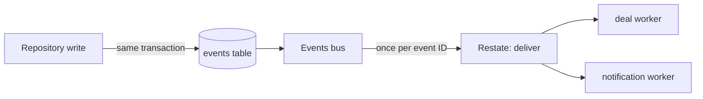

A module announces a change with an event, and modules that care subscribe to its kind. The module that changed the data never knows who reacts. Every subscriber is a module of the same server, so there is no broker: the outbox is a Postgres table, `events`, and Restate does the delivery.

## Publishing

A repository writes the events of a change in the transaction of that change. A write that loses a race leaves no event, and a commit always leaves its events. An event is thin: a kind such as `listing.sold`, the ID of what changed, and, for some kinds, a few fields its subscribers need, such as the end of a suspension.

Kinds in use today come from account (updated, suspended, unsuspended), catalog (listing published, updated, hidden, unhidden, sold, unsold, deleted, reserved, released, rejected), deal (`deal.moved`), chat (`message.sent`) and trust (`review.posted`).

## Subscribers

| Module | Listens to | Does |
|---|---|---|
| deal | listing updated, hidden, sold, deleted | Drops open prices and cancels requests on a listing that closed or changed price |
| notification | deal moves, messages, listing published or rejected, reviews, suspensions | Writes notices and sends push |

A subscriber reads the current state through the source module's service. Order, delay and duplicate deliveries therefore do not change the result.

## Delivery

The bus runs in the server. It wakes on a Postgres notification at each commit, and once a second, takes up to 100 pending rows and hands each one to Restate with the event ID as the idempotency key. Restate then starts one invocation per subscriber and retries each alone until it succeeds, so a failing subscriber holds up no other subscriber and no other event.

- Delivery is at least once to the bus's Restate service, and Restate drops a repeated event ID for 24 hours.
- An event the ingress refuses backs off from 1 second up to an hour.
- While Restate is down, events wait in the table and the API keeps working.
- Dispatched rows are deleted after 7 days. Nothing replays history; a subscriber that needs to rebuild its data reads the current tables with a job of its own.
