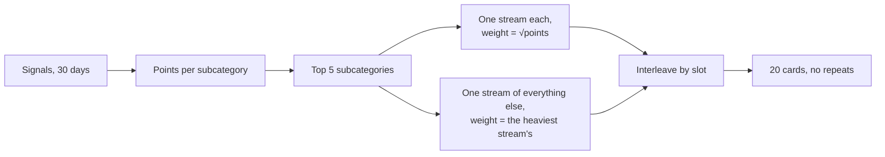
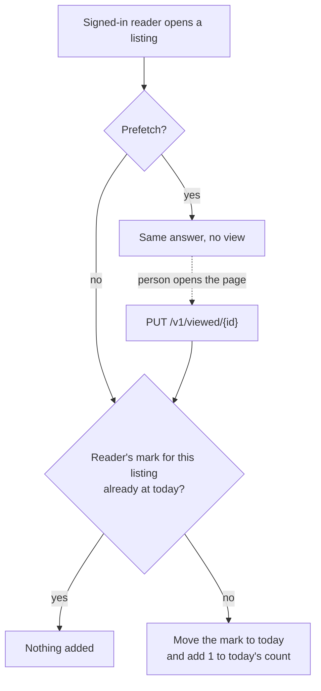

Home shows three feeds, and the seller's own listings screen shows how each listing is doing. All of them are read by the screen module from discovery, catalog, deal and chat, and every feed leaves out what [search](/en/architecture/search-and-discovery) leaves out: the viewer's hidden listings and the listings of accounts on either side of their blocks.

## Home

`GET /v1/screens/home` works signed in or not and returns the category tree with three feeds.

| Feed | What it holds | Pages |
|---|---|---|
| `nearby` | The first page of the `nearby` search | Yes, through `GET /v1/search?sort=nearby` |
| `for_you` (Dành cho bạn) | 20 cards weighted to the person's interests | No |
| `viewed` (Vì bạn đã xem gần đây) | Up to 10 cards from the subcategory the person browsed last | No |

Home carries no listing counts per category. Counting every active listing on each open was the database's busiest query, for numbers people did not look at.

### Nearby

The nearby feed is the first page of `GET /v1/search?sort=nearby` with the same position and radius: active listings within the radius (50 km by default, 1 to 200), scored by distance rings and freshness. Home's `next_cursor` pages on through search. Without a position, Home answers with an empty `nearby` and no cursor instead of an error.

### For you

For you reads the person's signals from the last 30 UTC days:

- the newest 100 listings they opened,
- the newest 100 listings they saved,
- their search history entries in the window whose first category chip is a subcategory (the history keeps the last 10 searches).

Each signal adds points to its subcategory: a save 3, a search 2, an opened listing 1. A chip that names a root category adds nothing. Only the 5 heaviest subcategories count, ties going to the lower code, which keeps the read fast for a heavy browser.

Each stream lists its active listings nationwide, newest first. The k-th listing of a stream takes the slot (k − ½) / weight, and the page orders by slot, then publish time, then ID. The square root keeps one interest read many times from crowding out the rest. One interest alone fills half the page and the newest listings the other half; two equal interests take a third each. A guest, or an account with no signals, gets the newest listings. For you also leaves out the viewer's own listings.

### Recently viewed

`viewed` reads the same 100 opened listings. It takes the latest day among them and the subcategory most of that day's listings belong to; on a tie, the subcategory of the newest listing. Its cards are that subcategory's active listings the person has not opened, newest first. It is absent for a guest, with no opened listing in the window, or when no such listing exists.

## Listing views

A view is a signed-in reader, other than the seller, opening `GET /v1/screens/listing/{id}`. It counts once per reader, listing and UTC day. Guests count nothing, and neither does the seller's own read through `GET /v1/listings/{id}`. Only an active or reserved listing counts, and a deleted account's open counts nothing.

Discovery keeps two tables beside the saves. `listing_view_marks` holds each person's last day per listing, and `listing_view_days` holds the views per listing and day. One statement moves the mark forward and adds to the day's count only when the mark moved, so a second open that day, a retry or a concurrent open adds nothing. The view is counted after the page's reads; a failed count is logged and the page answers as usual.

A browser prefetch counts no view. The website prefetches pages it expects the person to open and passes the browser's `Sec-Purpose: prefetch` header on to the API. That read answers the same but counts nothing, and when the person really opens the page the client reports it with `PUT /v1/viewed/{listing_id}`. The other reads of a listing page (similar listings, the seller's listings and reviews) write nothing.

A mark names a person, so deleting the account deletes their marks and keeps the day counts. A view being recorded while the account is deleted either finishes first and has its mark deleted, or starts after and writes nothing.

## Your listings (Tin của bạn)

`GET /v1/screens/my-listings?pane=on_sale|sold` is the seller's own list. The `on_sale` pane holds listings processing, active, hidden, rejected or reserved; `sold` holds sold ones, with when they sold and no buyer.

Each item is the listing as its seller reads it, with:

| Field | Meaning |
|---|---|
| `views`, `views_7d` | Views in total and in the last seven days |
| `askers` | People who asked about the listing, once each |
| `saves` | Saves that stand now |
| `order` | The order the seller has to act on, if any |
| `from_chotot` | The listing was brought over from the seller's Chợ Tốt profile, for the app's badge |

Every response also has `week`: the views, askers and saves of the last seven days over all the seller's listings on sale, whichever pane and page was read. The week is the seven UTC days that end today, the days views are stored by. The screen reads the clock once and counts every number from the same start.

An asker is a person who has a deal on the listing, or who wrote to the seller about it in their conversation, counted once per listing at their first contact. Deal messages are left out, and blocked or deleted people still count. The week counts askers whose first contact fell in the seven days. Saves in the week are those made since its start that still stand.

`order` is the shipped order, which holds the listing, else the pending order requested first, whose seller deadline ends first. It carries the deal, the order and its status.

A page costs the same five or six service calls whatever it holds: the page itself, the IDs of every listing on sale (for the week), then views and saves from discovery, buyers from deal and askers from chat at the same time, and the Chợ Tốt marks for the page.

### Repost (Đăng lại)

`POST /v1/listings/{id}/photo-copies` copies a listing's processed photos into fresh uploads for a new draft. It takes an `Idempotency-Key` and runs as a durable flow. Each copy's upload ID is derived from the seller, the listing, the key and the photo's place, so a retried tap returns the first run's uploads instead of a second set. The flow refuses another seller's listing or a deleted one with `listing_not_found`, then copies one photo per step without the bytes entering the journal. It answers 201 with the uploads and fresh signed URLs, in the listing's order.

Any status but deleted may be reposted, and a photo not processed yet is left out. A copy keeps its origin, so a photo first copied from another site stays marked as copied. Copies that no draft posts expire after 24 hours like any upload.
