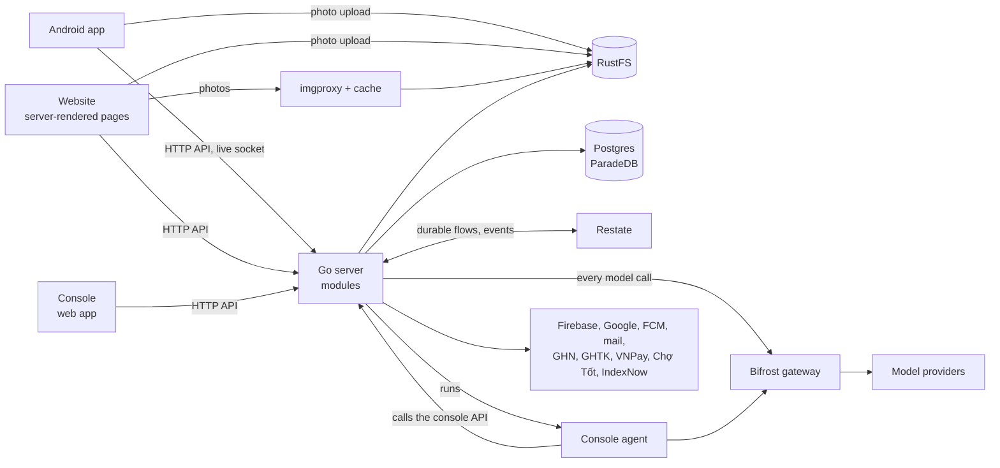

ShopNexus has three clients and one Go server. The Android app and the website are for buyers and sellers. The console is the web app moderators and admins work in. All three call the same HTTP API.

The server is a modular monolith: one binary, cut into modules that each own their tables and expose a service the others call. It serves the HTTP API on port 8080 and the endpoint Restate calls on port 9080.

## The stores

Postgres with ParadeDB holds every table, the full-text index search runs on, and the vectors of listings and photos. Restate runs the use cases that must finish after a crash and delivers events from one module to the others. RustFS stores photos behind an S3 API. Clients upload straight to it with a presigned URL, and the server turns each upload into a public photo and a thumbnail. The website serves photos at other sizes through imgproxy, which resizes from RustFS behind a cache.

## Outside services

- Firebase verifies a phone number. The client signs in with Firebase and hands the server the token it returns. Google sign-in and email codes are the other two proofs.
- Firebase Cloud Messaging carries push notifications, and a mail provider sends email codes and notices.
- GHN and GHTK are the carriers. A seller links their own carrier account, and the server makes, tracks and cancels shipments on it. Carriers report back through webhooks and polling.
- VNPay takes a seller's payment for a boost and reports it back to the server ([Boosts and payments](/en/architecture/boosts-and-payments)).
- Chợ Tốt's public API lets a seller bring over listings they already have there.
- IndexNow tells search engines when a public listing changes.

## Models

Every model call goes through Bifrost, the stack's AI gateway. The server gives each of its callers a virtual key with a budget, and Bifrost routes each call to a provider with fallbacks. Search reads a query with a language model and embeds text. The assist module reads a seller's photo or video into a listing draft, and drafts the listings brought over from Chợ Tốt.

Some models run inside the server itself, in module ai: speech to text, photo vectors and the frames cut from a video. In the cluster they run in a second deployment of the same binary that serves only module ai, so the API pods load no model.

The console agent is a separate service. The server starts its turns, and the agent calls the console API with each turn's token, as the member who asked, so it never touches the database ([What the agent does](/en/agent)).

## When a part is down

- While Restate is down, reads, sign-in refresh and every use case that is not a durable flow keep working. Events wait in their table and go out once it is back.
- When a model fails or a budget is spent, search goes on with the query's own words. A photo search answers 503 `search_unavailable`. Listings that could not be embedded are retried later.
- `/readyz` checks only Postgres and Restate, so a slow model or carrier never takes a pod out of service.

<Cards cols={2}>
  <Card title="Modules" href="/en/architecture/modules" icon="ri:layout-grid-line">How the server is cut up, and the rules between modules.</Card>
  <Card title="Durable flows" href="/en/architecture/durable-flows" icon="ri:loop-right-line">Which work runs on Restate, and why.</Card>
  <Card title="Events" href="/en/architecture/events" icon="ri:broadcast-line">The outbox and who reacts to what.</Card>
  <Card title="Data" href="/en/architecture/data" icon="ri:database-2-line">Postgres, transactions, retries and migrations.</Card>
  <Card title="Sign-in" href="/en/architecture/sign-in" icon="ri:smartphone-line">Phone, Google and email sign-in.</Card>
  <Card title="Account" href="/en/architecture/account" icon="ri:user-3-line">Profiles, addresses, support, feedback and deletion.</Card>
  <Card title="Catalog" href="/en/architecture/catalog" icon="ri:store-2-line">Listings, categories and regions.</Card>
  <Card title="Listing lifecycle" href="/en/architecture/listings-lifecycle" icon="ri:git-commit-line">Drafts, posting, editing, reserving and selling.</Card>
  <Card title="Deal" href="/en/architecture/deal" icon="ri:hand-coin-line">Offers and COD orders.</Card>
  <Card title="Shipping" href="/en/architecture/shipping" icon="ri:truck-line">Carrier accounts, shipments and tracking.</Card>
  <Card title="Search and discovery" href="/en/architecture/search-and-discovery" icon="ri:search-line">Search, saved searches and price alerts.</Card>
  <Card title="Feeds" href="/en/architecture/feeds" icon="ri:home-4-line">Home feeds, listing views and Tin của bạn.</Card>
  <Card title="Assist" href="/en/architecture/assist" icon="ri:magic-line">Reading a photo, video or link into a listing draft.</Card>
  <Card title="AI" href="/en/architecture/ai" icon="ri:cpu-line">The gateway, the agents and the models the server runs.</Card>
</Cards>
