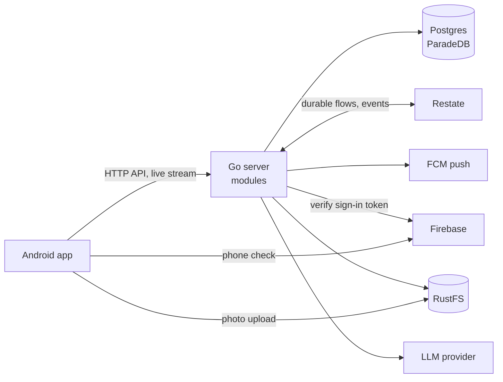

ShopNexus is a native Android app and one Go server. The server is a modular monolith: one binary, cut into modules that each own their tables and expose a service the others call. It serves the HTTP API on port 8080 and the endpoint Restate calls on port 9080.

Postgres 18 with ParadeDB holds every table and the full-text index that search runs on. Restate runs the few use cases that must finish after a crash, and delivers events from one module to the others. RustFS stores photos behind an S3 API: the app uploads straight to it with a presigned URL, and the server turns each upload into a resized public photo.

The app verifies a phone number with Firebase and hands the server the token Firebase returns. The server sends push notifications through Firebase Cloud Messaging, and asks a language model, over an OpenAI-compatible API, what a search query means.

While Restate is down, reads, sign-in refresh and every use case that is not a durable flow keep working, and events wait in their table.

<Cards cols={2}>
  <Card title="Modules" href="/en/architecture/modules" icon="ri:layout-grid-line">How the server is cut up, and the rules between modules.</Card>
  <Card title="Durable flows" href="/en/architecture/durable-flows" icon="ri:loop-right-line">Which work runs on Restate, and why.</Card>
  <Card title="Events" href="/en/architecture/events" icon="ri:broadcast-line">The outbox and who reacts to what.</Card>
  <Card title="Data" href="/en/architecture/data" icon="ri:database-2-line">Postgres, transactions and migrations.</Card>
  <Card title="Sign-in" href="/en/architecture/sign-in" icon="ri:smartphone-line">Phone sign-in through Firebase.</Card>
  <Card title="Catalog" href="/en/architecture/catalog" icon="ri:store-2-line">Listings, categories and regions.</Card>
  <Card title="Deal" href="/en/architecture/deal" icon="ri:hand-coin-line">Offers and COD orders.</Card>
  <Card title="Search and discovery" href="/en/architecture/search-and-discovery" icon="ri:search-line">Search, the nearby feed and saved listings.</Card>
</Cards>
