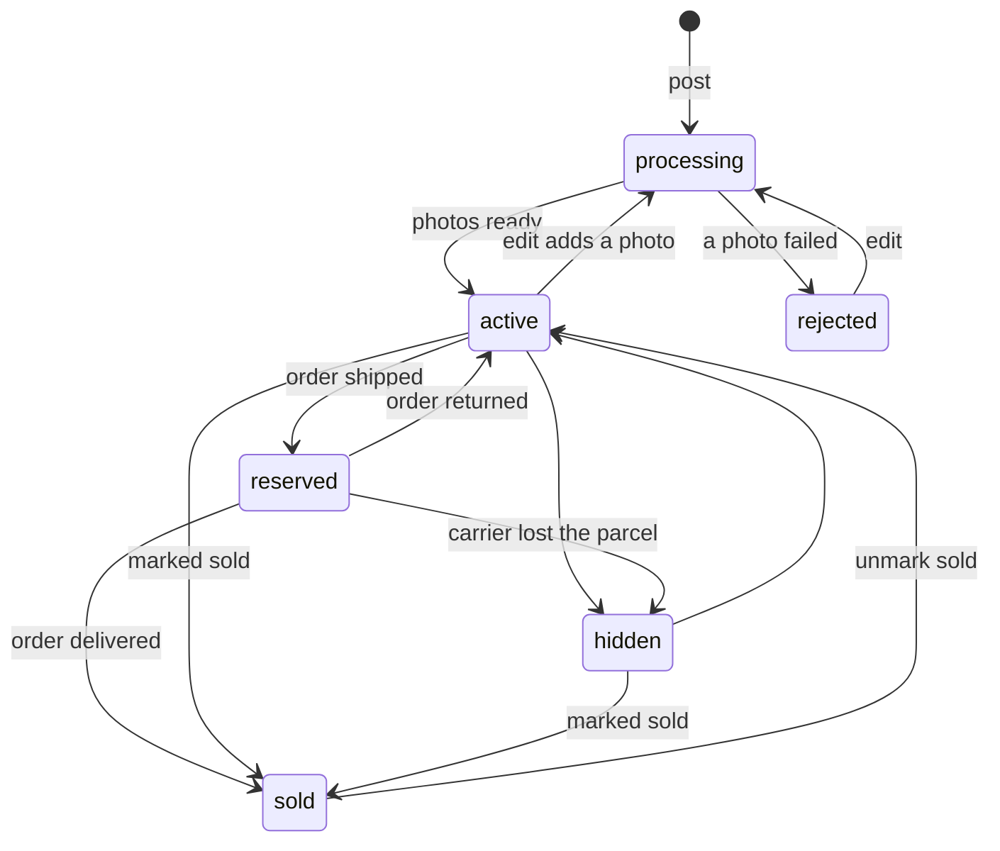
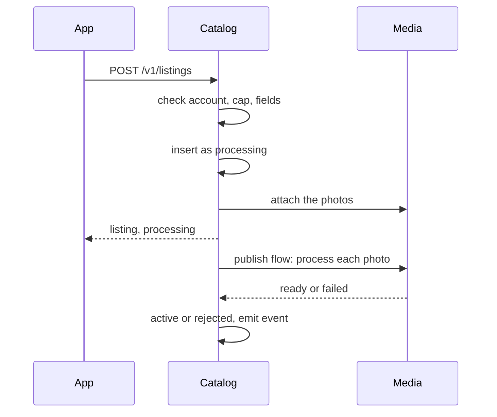

This page follows one listing from draft to deletion. Categories, regions and public reads are on [Catalog](/en/architecture/catalog); photos are on [Media](/en/architecture/media).

## Drafts

Drafts live on the server so the seller's other devices see them. A draft is loose: the posting rules apply only when the complete listing reaches `POST /v1/listings`.

- `PUT /v1/listing-drafts/{id}` creates or replaces a draft. The app mints the ID and the last write wins.
- `GET /v1/listing-drafts` returns every draft in full, newest first. Another account's, an expired or a missing draft is `draft_not_found`; `DELETE` always answers 204.
- The server reads the title (up to 100 characters), the price and up to 10 photo IDs. The rest of the form is the app's JSON, up to 32,768 characters, stored unread.

An account keeps 20 drafts (`draft_limit_reached`). A draft lives 30 days after its last write. No job cleans up: the account's next list or PUT deletes expired drafts first.

Each PUT drops photos media reports as gone and asks media to keep the rest 30 days. A read extends nothing, so reading never keeps a draft alive. Draft photos stay private, behind URLs signed for an hour.

## Statuses

Any status except reserved can also go to deleted; the row stays. Active and reserved are public. Editing a sold, deleted or reserved listing is `listing_state_conflict`.

## Posting

Posting is a durable flow. `POST /v1/listings` takes an `Idempotency-Key`, claimed per seller in the insert itself, so a retried tap posts one listing.

The checks run in order (<Req id="BR-LST-02" />, <Req id="BR-LST-03" />):

1. A suspended account is refused.
2. An account without a phone number is `phone_required` (<Req id="BR-ACC-03" />).
3. 20 listings in processing, active, hidden, reserved or rejected is `listing_cap_reached`.
4. Fields: title 1–70 characters, price in whole đồng from 10,000 to 1,000,000,000, description up to 1,500 characters, 1–10 photos with the first as cover, up to 20 specs including the subcategory's required ones. `invalid_listing` lists every bad field at once.

A per-seller lock around the insert stops two racing posts from both taking the last slot. The cap is checked before any photo is attached; if attaching fails, the flow deletes the row.

A listing declares no marks or flaws (<Req id="BR-LST-01" />): people judge wear differently, and the buyer inspects the item at the door. Condition, specs and photos describe it.

## Publishing

Every write that leaves a listing in processing starts a publish run, keyed by listing and write. It asks media to process each new photo and waits for all of them.

- All ready: active, photo keys stored, `listing.published`. The first publication carries `first: true`.
- One failed: rejected, with the reason on that photo.

If the listing changed meanwhile, the run stops quietly; the newer write has its own run. A photo the server copied from the seller's listing on another site shows `copied: true` to every reader.

## Editing

`PUT /v1/listings/{id}` replaces the whole listing, since the app sends the whole form. The edit saves with `listing.updated`, then tells media to release the photos it dropped. Adding a photo, or editing a rejected listing, goes back through processing.

When two edits race, the loser gets `try_again`. Its new photos are already attached, so the next try passes. A tidy step 24 hours later releases any the listing still does not show.

A listing remembers its last price change after it first went on sale. A drop of at least 5 % within the last 7 days shows as a price drop, with the old price struck through. A later raise ends it, and a raise under 7 days old is not a base to drop from.

## Reservation and sale

The [deal module](/en/architecture/deal) reserves a listing for one order while the parcel travels. Reserve, release and sell name the order, so a durable flow can repeat them safely. They emit `listing.reserved`, `listing.released` and `listing.sold`. When the carrier loses the parcel, the release leaves the listing hidden by its seller, with `listing.hidden`, since the seller no longer has the item; a normal unhide puts it back on sale. A reserved listing counts toward the cap; the seller cannot hide, edit, mark sold or delete it.

`unmark-sold` undoes only a sale marked by hand; undoing an order's sale is `listing_state_conflict`, so an item cannot sell twice. Unmarking counts toward the cap. Hide, unhide, mark sold, unmark sold and delete still work for a suspended account.

## Console holds

`POST /v1/console/listings/{id}/hide` hides an active or seller-hidden listing and holds it. While held, the seller's unhide is `listing_held` (409), and a publish after an edit leaves it hidden. `…/unhide` lifts the hold and puts it back on sale. Both write an audit entry in the listing's transaction. Policy is in [Moderation](/en/marketplace/moderation).

## Deletion and events

`listing.deleted`, whether from the seller or account erasure, releases every photo except a processed cover: orders, deals and chats still show its thumbnail. A deleted listing keeps its sale date, so sold counts do not drop.

Each change emits its event in its own transaction: `listing.published`, `.updated`, `.hidden`, `.unhidden`, `.sold`, `.unsold`, `.deleted`. Search, notifications and IndexNow react; see [Events](/en/architecture/events).
