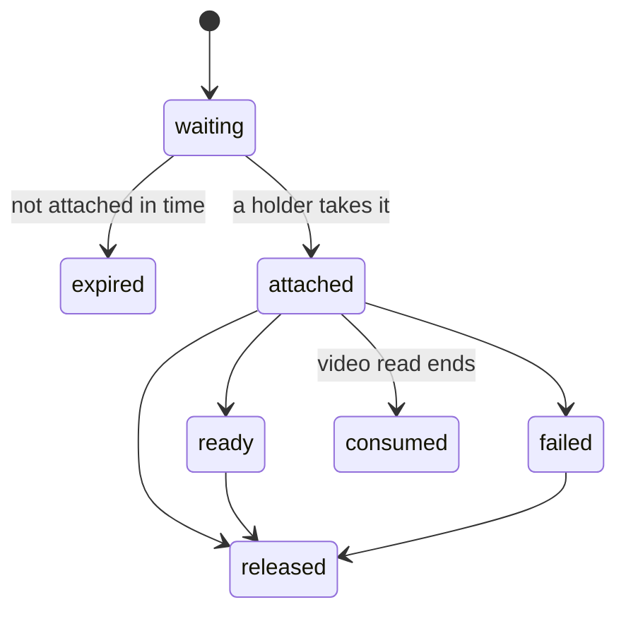

The media module owns uploads: listing, message and review photos, avatars, and the videos and copied photos of the AI listing reads. Media reads no other module's tables; each holder names its uploads.

## Object store

Files live in RustFS through its S3 API, in one bucket:

- `uploads/<id>` is private, written only through presigned PUTs. Originals keep their EXIF and GPS here.
- `media/` is public-read: processed photos and thumbnails.

URLs are signed for the address phones reach, and the signature covers the host. The bucket's CORS lets the website upload from the browser.

## Upload statuses

Expired, consumed and released uploads never attach again.

## Uploading and expiry

`POST /v1/uploads` takes a type and size: JPEG, PNG or WebP up to 15 MB, or MP4 or QuickTime up to 50 MB. It returns a PUT URL valid 15 minutes that signs both. The client uploads straight to the store; file bytes never pass through the API.

A waiting upload expires 24 hours after creation, and a job then deletes it with its object. A listing draft can extend its photos to 30 days from now, all or none. Nothing shortens an expiry, so a photo two drafts share lives until the later one ends. The expiry job reschedules itself when it finds the expiry moved.

## Attaching

A holder, such as a listing or a message, attaches its uploads all or none. Each must be the owner's, and either already the holder's or waiting and present in the store with the declared type and size. Otherwise the call is `invalid_upload`. An upload the holder already has passes, so a retried attach succeeds.

## Processing

A durable step processes one upload, keyed by its ID, so callers share one run and a repeat returns the first result.

1. Check the magic bytes against the declared type.
2. Refuse over 40 megapixels or 160 MB of decoded pixels, read from the header before decoding.
3. Make an upright JPEG of at most 1600 px on the long side, and a 400 px thumbnail.
4. Write both under `media/`. Re-encoding drops all EXIF, GPS included.
5. Save the upload ready, or failed with the reason, and delete the original.

Each server process decodes two photos at once. Photo bytes never enter the flow journal.

| Shape | Output | Used by |
|---|---|---|
| photo | 1600 px plus 400 px thumbnail | Listings, messages, reviews |
| square | Centre crop, at most 400 px, no thumbnail | Avatars |
| query | 768 px, nothing stored | Image search |

Listing and message flows process all their uploads at once, then wait. Avatars and review photos wait for processing before the request answers.

## Releasing

A holder releases uploads it no longer shows: photos an edit dropped, or a deleted listing's photos except its cover. The original is deleted at once, since it carries EXIF and GPS. The public copies go 24 hours later, so cached pages still load. Only listings release today; message, review and old avatar objects stay.

## Server-made photos and videos

The server can write a photo itself and insert a waiting upload for the seller, which a listing then attaches like any other. Its origin is `app`, `frame` (from a video), `link` (copied from another site; the listing marks it copied) or `listing` (copied from the seller's own listing).

A video serves only an AI video read. Attach, square and search refuse it with `invalid_upload`. The read holds it, then consumes it, which deletes the object. See [Assist](/en/architecture/assist).

Image search reads a waiting upload of the caller in the query shape, else `invalid_upload` (422). Draft photos and AI read views get a signed GET of the original, valid an hour; unposted photos never go public.
