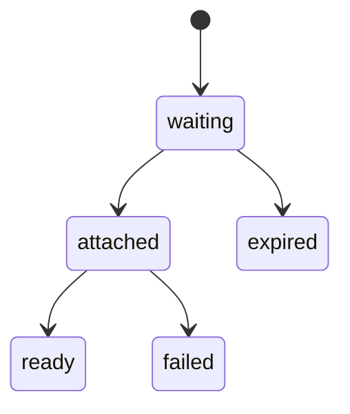

The media module owns uploads, which the catalog uses for listing photos, chat for message photos and the account module for avatars.

## Object store

Photos live in RustFS through its S3 API, in one bucket. Originals go under a private prefix and are written only through presigned URLs; processed photos go under a public-read prefix. The server signs URLs for the address phones reach, which is set separately from the address the server itself uses.

## Upload flow

The app asks for an upload with a type (JPEG, PNG or WebP) and a size up to 15 MB, and gets a PUT URL valid for 15 minutes. It uploads the file straight to the store, so photo bytes never pass through the API. An upload that is still waiting after 24 hours is deleted with its object.

A listing or a message then attaches its uploads, all or none. Attaching an upload the holder already has passes, so a retried request works.

## Processing

A Restate flow checks the file's real type, refuses images over 40 megapixels before decoding them, and makes a JPEG of at most 1600 px on the long side plus a 400 px thumbnail. Re-encoding drops all EXIF data, GPS included. Two photos are decoded at once per process. The original is deleted afterwards. Avatars use a square shape instead: the centre of the image, at most 400 px a side, with no thumbnail.

Listings store object keys, and URLs are built at read time from a public base URL.

## Time-stamped photos

The product model asks for photos that carry the time they were taken. That is not built: processing drops the capture time with the rest of the EXIF data.
