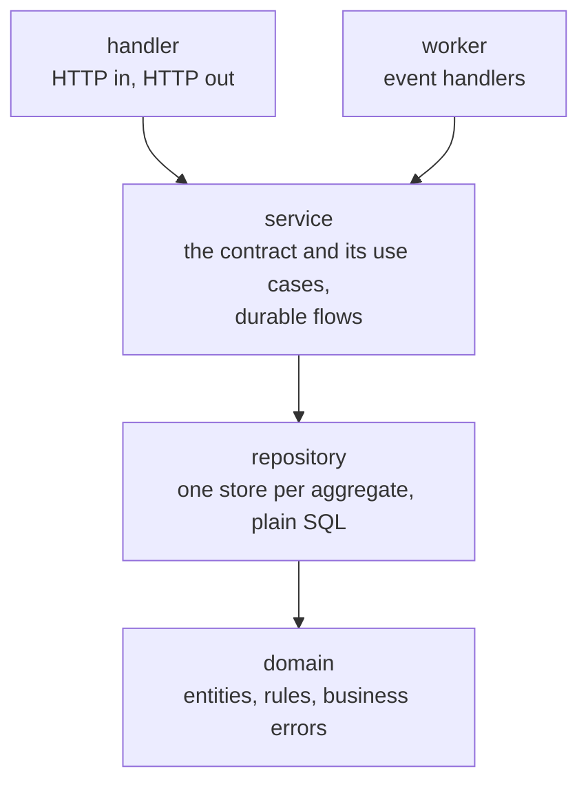

The server is one binary made of modules. <Req id="ADR-0005" /> The modules follow the product model, a C2C marketplace for used goods paid cash on delivery. ShopNexus holds no deal money, so there is no wallet or finance module. The only money it takes is a seller's payment for a boost, one payment per purchase (<Req id="ADR-0006" />).

## The modules

| Module | Holds |
|---|---|
| account | Profiles, suspension, addresses, blocks and follows, and sign-in: phone, Google and email identities and each device's session |
| catalog | Listings from draft to sale, categories, provinces and communes, and the listings' vectors |
| media | Uploads, their processing into public photos and thumbnails, and their expiry |
| deal | Price negotiation and COD orders |
| shipping | A seller's GHN and GHTK accounts, shipments and the carriers' reports |
| chat | Conversations between two people and their messages |
| trust | Reviews, a seller's public profile, scam signals and reports |
| discovery | Search with the nearby feed as one of its sorts, saved listings, search history and search watches |
| assist | Reading a photo or video into a listing draft, drafting Chợ Tốt imports, and price guides |
| chotot | A seller's linked Chợ Tốt profile and the listings brought over from it |
| boost | Boost packages, a seller's purchases and the daily bumps they schedule |
| payment | One payment per purchase through VNPay or its fake: the payment page, the gateway's reports and expiry; nothing is refunded |
| notification | The in-app notice list, push and mail |
| support | Support tickets, answered in a chat with ShopNexus |
| feedback | What people tell ShopNexus without asking for an answer |
| console | Moderator and admin accounts, their sessions and roles, and the console's API |
| agent | The console agent's conversations and runs, its MCP endpoint, and the AI settings |
| ai | The models the server runs itself: speech to text, photo vectors, video frames |
| erasure | Deleting an account |
| beacon | Script errors, page speed and other reports from the clients, as metrics and logs |
| screen | One read per app or website view, built from the other modules |

There is no identity-check module: a verified phone is enough, since the carrier checks a seller's identity when it opens their account. Reputation has no module or table either; screen reads the figures from the modules that hold them. Seller plans, if they come, would be another product of module payment.

Two shared areas sit beside the modules. The platform holds what every module uses: config, Postgres, the Restate helpers, the event bus, HTTP helpers, the live socket, errors, languages and telemetry. The providers wrap outside services: Firebase, Google, push, mail, the carriers, VNPay, Chợ Tốt, Bifrost and the embedding models.

## Inside a module

A module has up to five layers, and calls run one way, from the top down:

- The domain holds the entities and their rules, and the business errors a client can see.
- The repository loads and saves one aggregate at a time.
- The service is the module's contract. Each use case is one method. The few that must survive a crash run as Restate services.
- The handler turns an HTTP request into one service call and adds no rules of its own.
- The worker, in a module that reacts to events, holds one Restate handler per event kind it hears.

Screen, erasure and beacon own no table, so they have only a service and a handler.

## Rules between modules

<KeyRules>
- A module calls another module only through that module's service.
- A module never reads or writes another module's tables.
- A module announces a change with an event and never lists who reacts to it.
- No module calls screen or erasure. Only screen calls notification; notification hears the others through events.
- A module that would need the reverse of an existing call gets it passed in, as deal passes itself to shipping, so no two modules import each other.
</KeyRules>

A test refuses an import against the layer order or these rules. Because every call crosses a service contract, a module could later run in its own process behind a network client of the same contract. Moving its tables out of the shared database would be separate work.

## One binary, two roles

The same binary runs in two roles. The API role serves HTTP, the Restate endpoint and MCP, and loads no model. The ai role serves only module ai's models and opens no database. Locally one process does both. In the cluster the ai role is its own deployment, so a model's memory and start time never hold up the API. The modules reach module ai through Restate, so they do not know where it runs.
