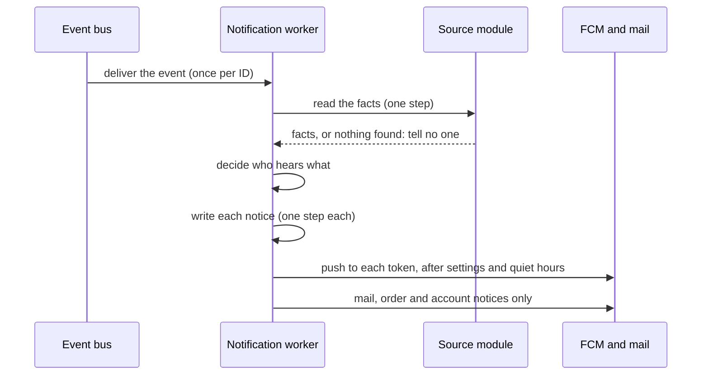

The notification module tells people about their deals, orders, listings, reviews, searches and account <Req id="FR-SHR-02" />. It reaches them three ways:

- **The list**: the notices in the app's notification screen, with an unread count.
- **Push**: Firebase Cloud Messaging to Android phones and to browsers on the website.
- **Mail**: only order notices and account notices.

Everything starts from an [event](/en/architecture/events). No module calls notification, except screen to read the unread counts for Home and `GET /v1/me/unread`.

## From event to notice

A durable worker has one handler per event kind. Each handler runs the same steps:

Each step is journaled, so a crash resumes after the last finished step and repeats no push or mail <Req id="NFR-MSG-01" />. If the source no longer has the thing the event is about (a deleted watch, a listing taken down), the handler tells no one.

## Which events notify

| Event | Who hears | Notice | Push switch | Mailed |
|---|---|---|---|---|
| `deal.moved`: offer, counter | the other side, unless they ignore the pair's conversation | `offer`, `counter` | offers | no |
| `deal.moved`: accept, decline, cancel | the other side | `agreed`, `declined`, `agreement_cancelled` | offers | no |
| `deal.moved`: price changed, offers closed, listing closed | the buyer | `offer_voided` | offers | no |
| `deal.moved`: COD request, shipped, completed, failed, cancelled | the other side; also the seller when the system completes the order, delivery fails or a deadline cancels it | `cod_requested`, `shipped`, `completed`, `failed`, `order_cancelled` | orders | while `order_emails` is on |
| `message.sent` | the other member | push only, never listed | messages | no |
| `listing.published` | the seller | `listing_live` | none | no |
| `listing.published`, first time | each follower | `followed_listing` | followed | no |
| `listing.rejected` | the seller | `listing_rejected` | none | no |
| `review.posted` | the reviewed person, once the review shows | `review` | reviews | no |
| `review.replied` | the reviewer | `review_reply` | reviews | no |
| `account.suspended`, `account.unsuspended` | the account | `suspended`, `unsuspended` | none | always |
| `search_watch.matched` | the watch's owner | `watch_matched` | the watch's own bell | no |
| `saved.price_dropped` | whoever saved the listing | `price_dropped` | price_cuts | no |
| `feedback.moved`, `feedback.replied` | the feedback's author | `feedback_moved`, `feedback_replied` | none | no |
| `chotot_link.imported`, `chotot_import.sold` | the seller | `chotot_imported`, `chotot_sold_here` | none | no |

A withdrawn offer tells no one. A suspended account still gets notices, so it learns of its suspension.

Each notice carries a target, the screen it opens: an order notice opens its own order (a deal can have earlier orders besides the latest), a price notice opens the deal, a listing notice the listing, a watch notice the saved search.

### Chat messages

A chat message is pushed and never listed, because the inbox already lists it. The push shows the sender's name and the first 100 characters. Messages in a conversation the recipient ignores push nothing, and the sender is not told. A deal message pushes nothing either: the deal's own notice covers the move.

In a support chat, a staff reply pushes only to the ticket owner, titled ShopNexus, and opens the ticket. The owner's message to ShopNexus pushes nothing.

### Reviews

A review may stay hidden for a while after it is posted (see [Trust](/en/architecture/trust)). The handler of a hidden review waits until the review shows, then reads it again. When the second side's review reveals the first, its handler tells both people, and the first review's handler tells no one.

### A followed seller lists something

When a seller puts a listing on sale for the first time, the seller hears that it is live, and each follower gets a `followed_listing` notice. The worker reads the followers 500 at a time and starts one small job per follower, keyed by the event and the follower, so a retry tells nobody twice. Each job reads the listing again and tells no one if it is no longer on sale. These notices collapse per seller, so a run of new listings leaves one unread notice.

The fan-out job journals one entry per follower. That is fine at today's follower counts; a seller with tens of thousands of followers would want the job split into a chain of pages.

## Collapsing and ordering

Notices about one thing collapse on a key, so the list does not fill with stale steps:

| Key | Covers |
|---|---|
| the deal | every deal and order notice |
| the listing | listing live and rejected |
| the seller | new listings from a followed seller |
| the saved search | watch matches |
| the saved listing | price drops |

A new notice replaces the recipient's **unread** notice with the same key, keeps its ID and moves it to the top. A notice already read stays, and the new one starts a fresh row. At most one unread notice per key exists.

Two races are guarded:

- **A late event.** An event older than the recipient's newest notice of the key, read or unread, writes nothing and pushes nothing. A delayed delivery can neither bring back old text nor reappear as a new unread notice.
- **A redelivered event.** The notice records the event's ID, so a second delivery writes nothing.

Notices last bumped more than 90 days ago are deleted. The cleanup runs when the recipient gets a new notice, and also clears up to 100 old notices of anyone, so silent accounts are cleaned too.

## Reading the list

| Endpoint | Does |
|---|---|
| `GET /v1/notifications` | The caller's notices, newest first, with the unread count. |
| `POST /v1/notifications/{id}/read` | Marks one read. |
| `POST /v1/notifications/read-all` | Marks all read and returns every ID it changed. |
| `POST /v1/notifications/unread` | Makes 1 to 500 read notices unread again. |

Mark-unread serves both a single notice and the undo of read-all; an undo of more than 500 is sent in chunks. Among read notices that share a key, only the newest becomes unread, and none when the key already has an unread notice.

Each new or bumped notice logs a `notification` update on the [live stream](/en/api/live-updates), so an open app refreshes its list and badge.

## Push

A push token belongs to one sign-in session. `PUT /v1/me/push-token` gives the session's token and `DELETE` forgets it.

- Putting a token takes it from every other session that had it. A phone signed in to a second account stops getting the first account's pushes.
- Before each push the worker asks which of the recipient's sessions are still active and deletes the other sessions' tokens. One read covers sign-out, revocation, refresh-token reuse, expiry and 30 days idle (see [Sessions](/en/architecture/sessions)).
- Each token is sent in its own step, so a retry repeats no other send. FCM's "unregistered" or "invalid argument" deletes the token. Rate limits, server errors and network failures retry for up to an hour. Any other error is logged and dropped.

A notice's push carries the tag `notification:<id>`. Since a bumped notice keeps its ID, a newer push replaces the old one in the phone's tray, and the app clears the tray item when the notice is read in the app. A chat push carries `conversation:<id>` the same way.

The website takes pushes too. A browser gives its FCM token like a phone does, and the same message carries a web-push block with the same tag. The site's service worker opens the page from the push's target on its own origin.

Without FCM credentials the server only logs pushes, and production refuses to start that way.

## Settings and quiet hours

`GET` and `PUT /v1/me/notification-settings` hold one document. `PUT` replaces it whole and returns it.

| Setting | Default | Effect |
|---|---|---|
| `messages` | on | chat pushes, support replies included |
| `offers` | on | offers, counters, agreements and voided offers |
| `orders` | on | order pushes |
| `price_cuts` | on | price drops on saved listings |
| `followed` | on | new listings from followed sellers |
| `reviews` | on | new reviews and replies |
| `order_emails` | on | mail for order notices |
| quiet hours `{on, from, to}` | on, 22:00 to 07:00 | no push inside the window |

- A switch that is off stops the push only. The notice is still listed. Since chat messages are never listed, a message with `messages` off reaches no phone.
- Notices with no switch (listing live or rejected, suspension, feedback, Chợ Tốt) always push, subject to quiet hours. Search watch pushes follow each watch's own bell.
- Quiet hours use Vietnam time, as HH:MM, and may cross midnight. A push held back by quiet hours is dropped, not delayed; the notice stays in the list. `from` equal to `to` is 400 `invalid_quiet_hours`.
- An account that never saved settings reads the defaults, and reading them saves nothing.

## Mail

Only two groups are mailed. Order notices (COD requested, shipped, completed, failed, cancelled) are mailed while `order_emails` is on. Suspension notices are always mailed. Every other notice matters for minutes only, and mailing it would teach mail providers to file ShopNexus mail, sign-in codes included, as spam.

Mail ignores the push switches and quiet hours. An account without an email address (phone only, or erased) gets no mail. The send runs in its own step keyed by event, recipient and notice, so it is sent once; a refusal is logged and dropped, other failures retry for an hour. Advertising mail, if it ever comes, must start switched off and ask for consent.

## Languages

A notice stores only its type and parameters, never text, so the same notice reads in any language. Vietnamese is the default and English is supported.

- The list is written in the language of each `GET /v1/notifications` request.
- A push or a mail is written in the recipient's language, which each sign-in records from the app's language header.
