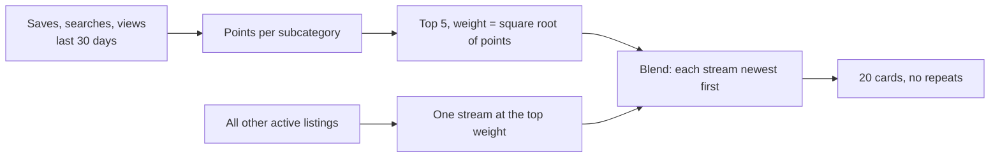

The screen module serves one `GET` per view of the app. The app reads a view in one call, and after a [stream update](/en/api/live-updates) it reloads the view it shows in one call. Mobile and desktop read the same views. A desktop page that shows two views calls both at once.

## How a view is built

Screen owns no table. Each view reads the other modules' services top to bottom and puts the answers side by side. No other module may depend on screen, so it adds no link between the others.

A view makes a fixed number of service calls per page, whatever the page size. The services read a page's people, communes and listings in one query each.

Each piece of data has one read path. There is no resource that carries fields for one screen, and no second endpoint that returns the same thing. "Load more" uses the plain list endpoints, which return the same item shapes as the view: `/v1/sellers/{id}/listings`, `/v1/sellers/{id}/reviews` and `/v1/conversations/{id}/messages`.

A value that depends on the request, such as the distance from the reader, sits beside the resource, not inside it. A listing reads the same for every caller and every endpoint.

## The views

Views open to everyone also take a signed-in reader and then add that reader's own fields.

| View | Path | Who | What it holds |
|---|---|---|---|
| Home | `/v1/screens/home` | anyone | Category tree, the nearby feed's first page, For you, Recently viewed, unread notices |
| Listing | `/v1/screens/listing/{id}` | anyone | The public listing, the seller summary, the distance, the reader's save, deal and conversation |
| Sold listing | `/v1/screens/sold-listing/{id}` | anyone | What sold, for old links |
| Seller | `/v1/screens/seller/{id}` | anyone | Seller profile, first page of listings and reviews, block and follow state |
| Inbox | `/v1/screens/inbox` | signed in | A page of conversations, each with one deal, and the unread total |
| Inbox search | `/v1/screens/inbox/search` | signed in | Matching threads with the pair's deals |
| Chat | `/v1/screens/chat/{conversation_id}` | members | The conversation, the pair's deals, the first page of messages |
| Offers | `/v1/screens/offers` | signed in | Open offers waiting on the seller, with each buyer |
| Your listings | `/v1/screens/my-listings` | signed in | The seller's listings by pane |
| Orders, order | `/v1/screens/orders`, `/v1/screens/order/{order_id}` | signed in | The caller's orders as buyer or seller |
| COD setup, COD checkout | `/v1/screens/cod-setup`, `/v1/screens/cod-checkout/{deal_id}` | signed in | What the COD forms need |
| Complete your profile | `/v1/screens/profile-tasks` | signed in | Four profile steps and whether each is done |
| Your reputation | `/v1/screens/reputation` | signed in | The caller's own figures and caps |
| Badges | `/v1/me/unread` | signed in | Unread messages, unread notices and open offers waiting on the caller |

The order, COD and listing-management views are described with the [deal](/en/architecture/deal), [shipping](/en/architecture/shipping) and [catalog](/en/architecture/catalog) modules.

### Listing and sold listing

The listing view shows only a public listing (active or reserved). Any other listing is 404 for everyone, its seller included; the seller reads their own through `GET /v1/listings/{id}`. For a signed-in reader who is not the seller it adds `viewer`: saved or not, the reader's deal on the listing, and their conversation with the seller. With a position (`near_lat`/`near_lng` or `near_commune`) it adds `distance_km`.

The seller summary carries the rating, `reply_time` and `phone_verified`. The phone number itself never appears. These figures are explained in [Trust](/en/architecture/trust#reputation).

The sold-listing view keeps an old link useful. It shows the title, price, category, condition, place, photos and when it sold, and leads to similar listings. It has no seller, description, specs or viewer fields, and counts no view. Any other status is 404. So is a listing ShopNexus hid after the sale, and a sold listing whose seller deleted their account: erasure keeps that listing for the buyer's order, not for the public. It is a separate view because the app reads the listing view's 404 as "maybe my own listing" and falls back to the seller's read.

### Seller

The seller view holds the public profile (name, avatar, bio, join date, rating, on-sale and sold counts, follower count, reply time, phone verified), the first page of the seller's public listings as search cards and the first page of reviews. A signed-in reader also gets `blocked`, `following` and their conversation with the seller. `blocked` is true for a block in either direction.

Listing cards behave as on search: `saved` for a signed-in reader, `distance_km` with a position, and listings the reader hid left out.

### Inbox and chat

Each inbox row carries one deal of the pair, picked in this order:

1. The newest deal where it is the caller's turn.
2. Else the newest active deal (negotiating or agreed).
3. Else the newest deal.

"Newest" means the newest move; a deal without moves counts from when it opened. The turn rule belongs to the deal module. On an agreed deal it is the buyer's turn only while the listing is still active, since a COD request on a hidden or reserved listing is refused. Each row also counts the pair's other active deals.

The chat view lists the pair's deals newest first, by when they opened. It adds `blocked` (either way), so the app can turn off the composer, and the other member's read marker, so the app can show "Seen". The marker shows even under a block. Anyone who is not a member gets `conversation_not_found`.

The inbox, inbox search and chat views carry the [scam warning](/en/architecture/trust#scam-warnings) for each conversation, read once per page.

### Complete your profile

The view lists four steps in a fixed order, each with `done`:

- `address`: the address book holds an address.
- `bio`: the bio is not empty.
- `phone`: the account has a phone number.
- `avatar`: the account has an avatar.

It also returns the caller's account and default address. The app counts the steps and takes the first one not done as the next. COD setup is not a step, since someone who only buys never sets it up.

### Badges

`GET /v1/me/unread` returns the unread message total (as the inbox counts it), unread notices and the open offers waiting on the caller as seller. One call fills every badge. Screen serves it because chat cannot depend on notifications.

## Home

Home works signed in or not. It returns:

- The category tree, with no listing counts. Counting every active listing on each open was the busiest query in a load test, for numbers people do not read.
- The first page of the nearby feed, the same as `GET /v1/search?sort=nearby` with the same position and `radius_km` (1 to 200, default 50). Without a position, `nearby` is empty and has no next page.
- **For you**: one page of 20 listing cards that does not page.
- **Recently viewed**: one subcategory and up to 10 cards from it.
- The unread notice count, 0 signed out.

Both personal lists leave out what search leaves out (the reader's hides and anyone on either side of a block) and the reader's own listings.

### For you

The feed weighs the reader's interests over the last 30 days. Each signal adds points to a subcategory:

| Signal | Points | Bound |
|---|---|---|
| A saved listing | 3 | newest 100 saves |
| A search whose first chip is a subcategory | 2 | the last 10 searches |
| An opened listing | 1 | newest 100 listings opened |

A chip that names a root category adds nothing. Only the 5 heaviest subcategories count, which keeps the query fast for someone with wide interests.

Each boosted subcategory is a stream of its active listings nationwide, newest first, weighing the square root of its points. The square root keeps one interest read many times from crowding out the rest. All other listings form one more stream, weighing as much as the heaviest boost.

The blend interleaves the streams by weight. The k-th listing of a stream takes the slot (k − ½) ÷ weight, and the page orders by slot. One interest alone fills half the page and fresh listings the other half; two equal interests take a third each. A guest, or an account without signals, gets the newest listings.

### Recently viewed

It takes the latest day the reader opened listings, and the subcategory most of that day's listings belong to. Its items are that subcategory's active listings the reader has not opened, newest first, with the feed's exclusions. It is absent signed out, with no view in the last 30 days, or when no such listing exists.

## Website sitemap

`GET /v1/sitemap/categories` lists the subcategories with at least 5 listings on sale. The website reads it once an hour for its sitemap and links, so thin subcategory pages stay out of search engines.
