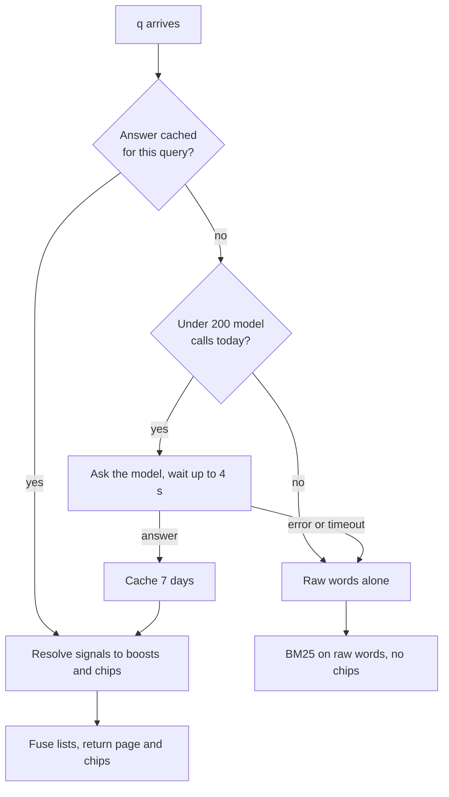
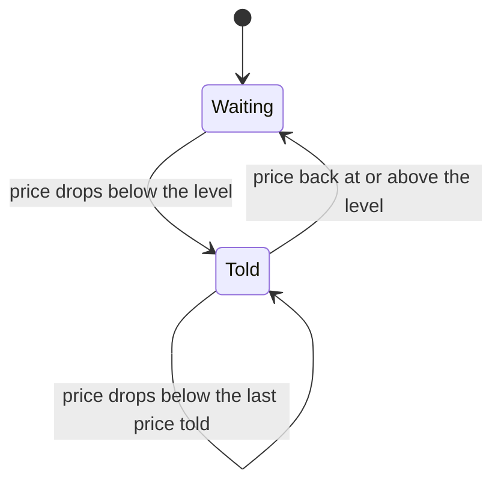
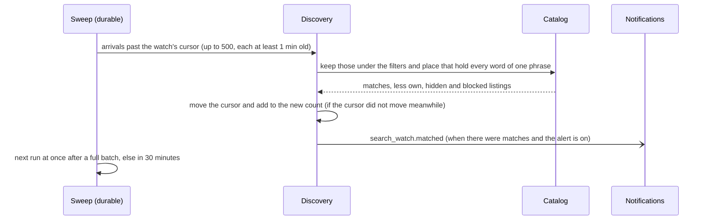

Search is split between two modules. Catalog owns the listings and their ParadeDB index and runs a structured query: filters that must hold, phrases of which one must match, fixed boosts, and a sort. Discovery turns what the person typed, a photo or a listing into that query, and owns saved listings, hides, search history and watches. The feeds on Home are on [Feeds and listing views](/en/architecture/feeds).

The index is transactional, so a listing is searchable once its write commits. Only active listings show.

## One endpoint, several modes

Everything goes through `GET /v1/search`. The parameters pick the mode, and the person's filters (category, province, seller, price range, conditions, offers only, position and radius) apply in every mode.

| Mode | Parameters | Who | Lists fused |
|---|---|---|---|
| Text, signed in | `q` | signed in | BM25, text vectors, photo vectors, boosts |
| Text, guest | `q` | guest | BM25 on the raw words alone |
| Similar listings | `like` (with optional `q`) | anyone | BM25, text vectors, photo vectors, boosts |
| Photo | `photo` alone | signed in | photo vectors alone |
| Watch | `watch` | the watch's owner | as text, signed in |
| Browse | none of the above | anyone | none: filters and a sort |

`sort` is `relevance` (the default with `q`, `photo` or `like`), `newest` (the default without), `nearest`, `nearby`, `price_asc` or `price_desc`. Sorts other than relevance order the listings the search found. `nearby` is the Home feed and takes no `q`, `photo` or `like`. Results page by an offset cursor and stop at 500 listings.

Every response carries a fresh `search_id`, which the clients send back with impressions and clicks.

## Reading the query

A signed-in person's `q` goes to a language model through the [AI gateway](/en/architecture/ai) with a strict JSON schema. The model answers with signals, not weights: phrase, category, price, condition, place, near me, fresh and offers, each with up to three values in priority order. It also gives a rewrite of the query in correct Vietnamese, for the text vectors, and a short English description of what the item looks like, for the photo vectors. Every value is resolved against real rows (the category tree, provinces and communes by name) or dropped. Each resolved signal becomes a chip the person can turn off. The model only reads the query; it never acts for the person. <Req id="BR-DSC-01" /> <Req id="FR-DSC-01" />

- **Cache.** The answer is cached by the lowercased query and the prompt version for 7 days. The cache stores no account. Turning a chip off (`off=<id>`) reuses the cached answer.
- **Shared calls.** Searches of one query share one model call. The call runs apart from the request, so its answer is cached even when the person left.
- **Failure.** The raw query is always a phrase at weight 0.5 unless the model named it. A model that errs or takes longer than 4 seconds leaves the raw words to search, with no chips. A page that searched the raw words marks its cursor, and the pages after it search the raw words too, so the results do not shift under the person.
- **Daily cap.** One person's queries reach the model at most 200 times a UTC day. A cached answer does not count. Past the cap the raw words search.

### Guests

A guest's `q` skips the model and the embeddings: the raw words search through BM25 alone, with no chips. Their vectors, often typed without diacritics, brought in listings that shared no word. The model's cost then follows accounts, and the full search is a reason to sign in.

A guest's first page carries `preview_chips`: the chips of a cached answer for the same query, when a signed-in person searched it in the last 7 days. The search does not apply them, and the clients show them locked beside the sign-in button. The preview calls no model.

A guest's address may run 2 searches with `q` a second, in bursts of 30, then gets 429 `rate_limited`. Browsing, `like` and category pages are not limited, since they reach no paid model.

## Ranking

BM25 scores the phrases. A matching short title scores about 1 to 7 points, and the boosts are in the same points:

| Signal | Weight |
|---|---|
| Category, price | 1.5 |
| Condition, offers | 0.75 |
| Fresh | 1.0 within 3 days, 0.5 within 7 |
| Distance | 1.25 within 2 km, 0.75 within 5, 0.4 within 15 |

A signal's second and third values count 0.5 and 0.33 of its weight. A phrase matches the title at twice its weight, the description and specs at its weight, and title words of 5 letters or more with one typo at half.

The index holds the title, description and specs twice: as written, and with Vietnamese marks folded away. The raw words match the folded fields, so "xe dap" finds "Xe đạp". The model's rewrite has the marks, so it matches the fields as written.

Distance and freshness score inside the index as range boxes on the listing's point and publish time. The `nearby` sort is the same query with no phrase: listings within the radius, scored by the distance rings and freshness alone.

## Hybrid search

With vectors, the search runs up to four lists in one SQL statement and fuses them by weighted reciprocal rank fusion with k = 60:

- **BM25** on the phrases.
- **Text vectors**: the rewrite (or the raw query when the model failed) against each listing's text vector.
- **Photo vectors**: the model's visual description, or the searched photo, against each listing's photos; a listing counts at its closest photo.
- **Boosts**: the other lists' listings ranked by boost points alone.

Each list takes at most 500 listings under the person's filters. A listing joins a vector list only above a cosine floor, which is lower when a text is compared with photos. The vector scan keeps going past filtered-out rows, so a narrow filter still fills a vector list.

| Mode | BM25 | Text | Photo | Boost |
|---|---|---|---|---|
| `q` | 1.0 | 1.0 | 0.5 | 0.75 |
| `like` | 0.5 | 1.0 | 1.0 | 0.5 |
| `photo` | | | 1.0 | |

`like` takes a listing on sale or reserved. It searches with that listing's text vector, the mean of its photo vectors, its title as a phrase, and boosts for its subcategory and a price band of ±30 %. It leaves out the source listing and the viewer's own. <Req id="FR-DSC-02" />

`photo` takes one of the caller's waiting uploads. It goes alone, needs a signed-in caller, and answers 503 `search_unavailable` when the photo cannot be embedded.

An embedding model that fails leaves its list out, so a text search falls back to BM25.

Query text vectors are cached by the embedding model and the normalized text, and leave by disuse (30 days unread, 180 days after the last read, the least used first past 2,000,000 rows). The cache may be lost in a crash; searches then embed again. A search photo's vector is kept until its upload expires. No search photo or vector reaches a log or the journal.

## Filters and position

- `province` keeps listings whose commune is in that province. An unknown code is 400 `invalid_province`. The index holds no province, so this filter runs beside the index query and is slower on large browses.
- `seller` keeps one seller's listings, for the website's search of a seller page. Such a search keeps no history entry and cannot be watched.
- The searcher sends `near_lat` and `near_lng`, or `near_commune`. Neither is stored or logged. `distance_km` is whole kilometres, truncated, with 0 meaning under 1 km. `radius_km` is 1 to 200, 50 when absent, and `nearest` or `nearby` without a position is `position_required`.
- A listing's point is the seller's GPS blurred (a random offset of up to 500 m, then a grid of about 1 km), or its commune's point. The exact point reaches no row or log.

### What a search leaves out

A signed-in search of any mode, Home's feeds included, leaves out the listings the person hid and every listing of an account on either side of their blocks. Saved listings, the seller page and the listing itself still show them.

`PUT /v1/hidden/{listing_id}` hides someone else's listing (409 `own_listing` for one's own) and `DELETE` shows it again. An account keeps the 1,000 newest hides; the next hide shows the oldest again. No endpoint lists hides.

## Search history

The first page of a signed-in person's `q` search is kept after the search answers. Photo, `like` and seller searches, later pages and guests keep nothing. A failed write is logged and the search still answers.

An entry holds the query as typed, the first category chip and the first card's thumbnail. Case, spaces and Vietnamese marks are folded, so "Xe Đạp" and "xe dap" are one entry. Searching it again moves it to the top. The person keeps the 10 newest. `GET /v1/search/history` lists them, `DELETE /v1/search/history` empties it and `DELETE /v1/search/history/{id}` forgets one.

## Saved listings and price alerts

A person saves someone else's listing that is active or reserved, at most 500 saves. The save keeps the price at that moment, and saving again changes nothing. `GET /v1/saved` lists listings still on sale first, then those sold, hidden or deleted, each group newest save first. A hidden or deleted listing shows its status alone. The client shows the price change since the save. <Req id="UC-DSC-03" />

Each save has an alert level: its own (`PUT /v1/saved/{listing_id}/alert`, which saves the listing first if needed), or the saved price when none is set. `DELETE` on the alert removes the level and keeps the save.

A save tells at each new low below its level, and only then. Discovery hears `listing.published` and `listing.updated`, reads the listing's current price, skips a listing that is not active, and writes `saved.price_dropped` for each save that tells. A late or reordered event weighs the price as it is when the handler runs, and a retried step finds the save already at that price and writes nothing. Notifications push it unless the person turned price cuts off; the notice itself is always written.

## Search watches

A watch follows a `q` with its filters (category, price range, conditions, offers only) and a place. `POST /v1/search/watches` creates one (201), or, for the same folded words, updates the filters, keeps the ID, resets the count and answers 200. An account has at most 20 watches (`watch_limit_reached`). A watch keeps a commune, never a point: a GPS point is turned into the nearest commune. It stores the phrases the model read when it was made, so a sweep calls no model.

Discovery logs each listing's first publication in an arrivals table, numbered in order, and deletes arrivals older than 2 days. It does not sweep by publish time, because that time is set before the photos are processed and a late listing would be missed. A durable sweep per watch reads the arrivals:

The first run is scheduled with the watch's ID as the idempotency key. A deleted watch ends the chain, and a watch made again gets a new ID and a chain of its own. `/mute` and `/unmute` turn the alert off and on; a muted watch still counts.

`GET /v1/search?watch=<id>` runs the watch as a full search; only `cursor`, `limit`, `sort` and `off` may go with it. Its first page resets the new count. Another account's watch is `watch_not_found`. A text search's response names the viewer's watch of that query in `watch_id`.

When a seller drafts a listing, the price guide asks how many watches would match it. Discovery returns up to 200 matching watches of active accounts (category, conditions, area and the phrase words, tokenized as the index does), each as its price bounds and offers-only flag and nothing that names the buyer. The app counts them at the price the seller types.

## Errors

| Code | When |
|---|---|
| 400 `search_conflict` | `photo` with `q` or `like`; `nearby` with `q`, `photo` or `like`; `watch` with other parameters; `province` or `seller` on a watch |
| 400 `invalid_province`, `invalid_position`, `position_required` | Bad or missing place |
| 401 `unauthenticated` | `photo` or `watch` signed out |
| 404 `listing_not_found`, `watch_not_found` | Unknown `like` listing or another account's watch |
| 409 `own_listing`, `listing_unavailable` | Saving or hiding one's own listing; saving one not on sale or reserved |
| 409 `saved_limit_reached`, `watch_limit_reached` | Past 500 saves or 20 watches |
| 422 `invalid_upload` | The photo upload is not usable |
| 429 `rate_limited` | A guest's text searches past the limit |
| 503 `search_unavailable` | A search photo could not be embedded |
