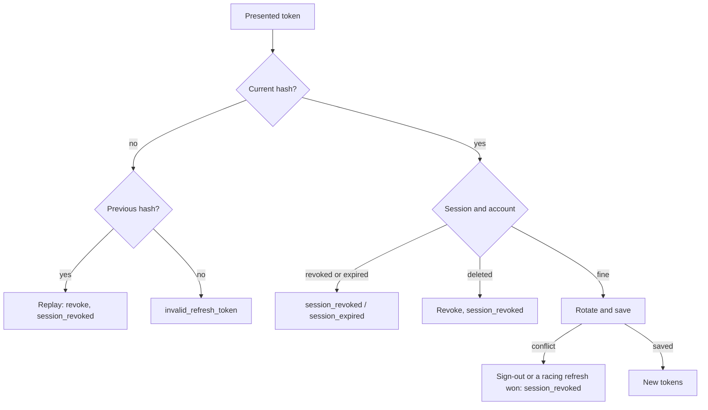

A session is one signed-in device <Req id="UC-ACC-02" />. [Sign-in](/en/architecture/sign-in) creates it and hands the app a short access token and a long-lived refresh token. Refresh, sign-out and the device list run straight against Postgres, outside Restate.

## Access token

A JWT signed with Ed25519, valid for 15 minutes <Req id="NFR-SEC-01" />. It carries the account ID, the session ID and the time of the last sign-in, and no name or number. The middleware checks signature and expiry only and reads no database.

So a deleted person can still read for up to 15 minutes. A suspended person keeps the session and can still read <Req id="BR-MOD-02" />. Every write checks the account's status: suspended is 403 `account_suspended`, deleted is 401 `session_revoked`.

A key ID in the token header names the signing key. During a key change the previous key still verifies, so a key change signs nobody out.

## Refresh

The server stores only the refresh token's hash. A session ends 60 days after sign-in or after 30 days unused. Each refresh replaces the token and keeps the previous hash to spot a replay.

- Two refreshes racing with one token count as a replay: the loser revokes the session.
- A suspended account refreshes as any other, and a suspension signs out no device <Req id="BR-MOD-02" />. The app learns of it from `GET /v1/accounts/me`, which carries `suspension` with the reason and the end, if any.
- A revoked session keeps the reason it was first revoked: `sign_out`, `reuse` or `deleted`. Older rows may say `suspended`; such a session answers `session_revoked` like any other.

## Reauthentication

Signing out other devices, adding an identity, mailing an add-email code and deleting the account need a sign-in within 15 minutes, otherwise 428 `reauth_required`. `POST /v1/auth/sessions/current/reauthenticate` renews it without creating or changing an account.

1. The account must be able to write and the session must be usable.
2. The proof is checked as at sign-in. An email code comes from the sign-in code endpoint, with its quotas and guesses.
3. A proof of another account, or of an address no account holds, is 403 `wrong_account`, so the answer reveals nothing about who is registered <Req id="BR-ACC-02" />.
4. The session's sign-in time moves forward to when the proof was checked, if the session was still live then.
5. The reply is a new access token for the same session. The refresh token stays.

Two choices keep this safe next to refresh. Rotating the refresh token here would leave an app that lost the reply holding a token that now looks replayed. And the update leaves the session's write version alone, since refresh treats a version conflict as a reused token; refresh in turn never writes the sign-in time. A retry with the same key proves at the first check's time, so one code renews the sign-in once.

## Sign-out and devices

The device list and the sign-outs share one resource <Req id="FR-ACC-02" />:

| Endpoint | Does |
|---|---|
| `GET /v1/auth/sessions` | active devices, newest first |
| `DELETE /v1/auth/sessions/current` | signs out this session |
| `DELETE /v1/auth/sessions/others` | signs out every other session; needs a recent sign-in |
| `DELETE /v1/auth/sessions/{id}` | signs out one device; another account's is 404 |

A signed-out access token stays valid until it expires. Signing out other devices is one bulk update, and their push tokens stop at the next push (see [Notifications](/en/architecture/notifications)).
