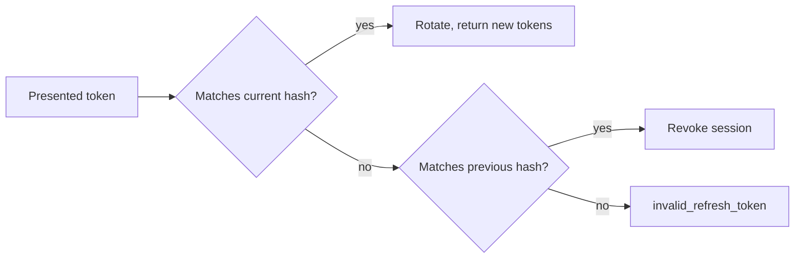

A session is one signed-in device. Sign-in creates it, and the app then holds two tokens: a short access token and a long-lived refresh token. Refresh, sign-out and the device list run directly against the database, outside Restate, so they keep working when Restate is down.

## Access token

The access token is a JWT signed with Ed25519 and valid for 15 minutes. It carries the account ID, the session ID and the time of the sign-in, and no phone number or name. The middleware checks only its signature and expiry and reads no database. A suspended person can therefore still read for up to 15 minutes; write actions load the account and check its status.

## Refresh and rotation

The refresh token is random, and the server stores only its hash. A session ends 60 days after sign-in, or after 30 days without use.

Each refresh replaces the token and keeps the hash of the previous one. When a client presents that previous token, someone has replayed it, and the server revokes the whole session and answers `session_revoked`. Two refreshes racing with the same token count as a replay too. An unknown token gets `invalid_refresh_token`, and a suspended account gets its session revoked and `account_suspended`.

## Signing keys

The server signs with one current key, named by a key ID in the token header. During a key change the configuration also holds the previous key's ID and public key, and tokens signed with either key verify, so a key change signs nobody out. Outside a key change the two previous-key variables stay empty. They must be set together, and the previous ID must differ from the current one.

## Sign-out and devices

Signing out revokes the current session. The access token stays valid until it expires, at most 15 minutes later. A person can list their active devices and sign one out; another account's session answers as not found. Signing out every device needs a sign-in within the last 15 minutes, otherwise the server answers `reauth_required`.
