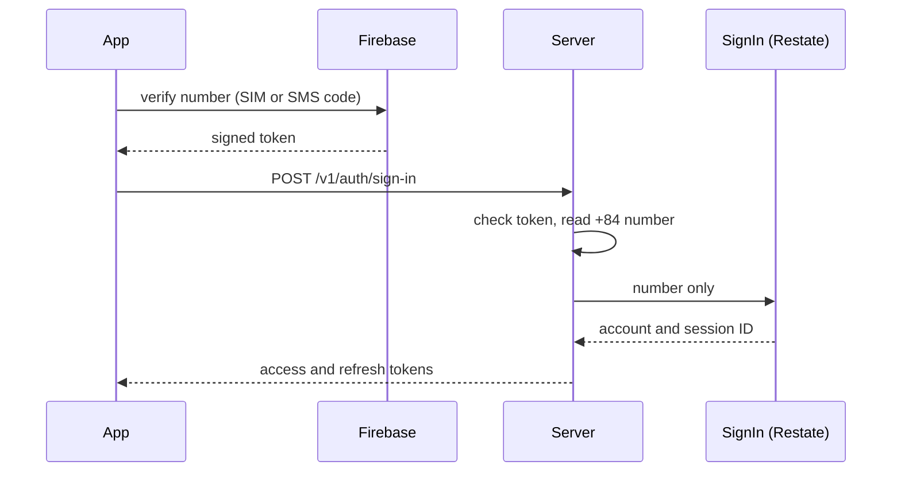

Every customer account has a phone number, and the phone number is the only way to sign in. The server sends no codes. The app verifies the number through Firebase and hands the server the token Firebase returns.

## Verifying the number

Firebase offers two ways to prove a number. Phone Number Verification (PNV) reads it from the SIM through the carrier. Firebase Authentication sends an SMS code. In September 2026 PNV covered no Vietnamese carrier, so people in Vietnam take the SMS path for now. When Google adds a carrier, an installed app uses it without an update, and the server already accepts its tokens.

## What the server checks

The token's issuer decides which public keys, algorithm and audience apply. The verification must be at most 5 minutes old. Within that window the same token can sign in again; the team chose that over single use. A number outside Vietnam is refused with `invalid_phone`, and any other failed check with `invalid_phone_token`, with the failed check named in the log.

The server fetches each issuer's keys from its published key set and caches them. If it has never managed to fetch any, sign-in answers `unavailable`, so the app retries instead of asking the person for a new code. The endpoint has no quota of its own, because Firebase already limits code requests.

## Finding or creating the account

The token stays in the HTTP handler. Only the verified number goes to the durable <Term id="sign-in-flow">SignIn</Term> flow, because Restate's journal is readable through its admin API.

The flow looks up the phone identity. A known, active account is marked as used. A suspended account ends the run. An unknown number gets a new account and then its phone identity. If another sign-up takes the same number between those two steps, the flow deletes the account it just made and the app gets `try_again`.

The invocation key combines the number with the request's idempotency key. A retried request with a valid token for the same number gets the same [session](/en/architecture/sessions) back, with a fresh refresh token.

## Email and OTP

Email sign-in, server-sent OTP codes and their quotas were removed on 2026-10-28. The migration deleted accounts that had only an email, and the database now accepts phone identities only. Staff still sign in with email, through a separate flow described in [Staff](/en/architecture/staff).
