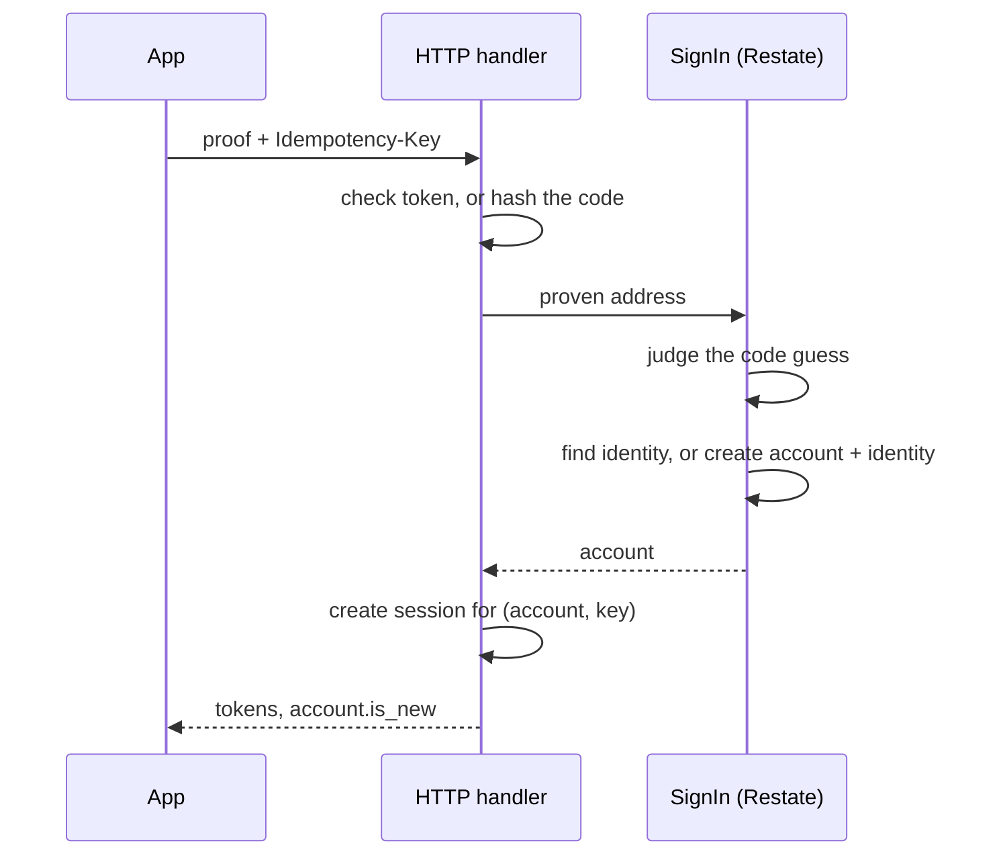

A person signs in, or signs up on first use, with one proof sent to `POST /v1/auth/sign-in` <Req id="FR-ACC-01" />. Console members sign in separately; see [Console](/en/architecture/console).

## Identities and proofs

An account holds a phone identity, an email identity, or both, at most one of each. A number or address belongs to one account only. Accounts are never merged, and no endpoint changes or removes an identity.

| Proof | Proves | Source |
|---|---|---|
| `phone_token` | a phone number | Firebase: an SMS code, or Phone Number Verification from the SIM |
| `google_token` | an email address | a Google ID token from Android Credential Manager |
| `email_code` | an email address | a challenge ID and the six-digit code the server mailed |

Google is not an identity kind. A Google token for an address an email identity holds signs in to that account.

## The flow

Tokens and codes never enter Restate, because its journal is readable through the admin API. The HTTP side checks a token and passes on only the proven address; for a code it passes the challenge ID and a keyed hash of address and code.

1. A code is refused when its challenge is unknown, not the newest for its address, meant for adding an identity, expired or out of guesses. The counted guess is saved.
2. A known identity is marked as used; a suspended account ends the run with `account_suspended`.
3. An unknown address gets a new account and identity in one transaction. If another sign-up took the value first, nothing is written and the answer is `try_again`.
4. The HTTP side creates the [session](/en/architecture/sessions). `account.is_new` tells the app to ask for a profile.

A retry with the same key and a valid proof finds the session already made and gets fresh tokens for it, or `session_revoked` if it was signed out since. A code retry finds the code consumed by its own first try and proves again; another code is `code_expired`.

## Token checks

The issuer picks the key set, algorithm and audience. The verification must be at most 5 minutes old (30 seconds of clock skew); within that window a token signs in again. A failed check is 401 `invalid_phone_token` or `invalid_google_token`, and a number outside Vietnam is 422 `invalid_phone`.

Provider keys are cached and fetched again at most once a minute. With no keys ever fetched, sign-in answers 503 `unavailable`, so the app retries rather than asking for a new code.

## Email codes

`POST /v1/auth/email-codes` mails a sign-in code; `POST /v1/accounts/me/email-codes` mails a code that adds an email to the caller's account. The answer is the same whether or not an account holds the address <Req id="BR-ACC-02" />.

- Limits: 20 codes an hour per client address, and per email one per 45 seconds and 5 an hour (`otp_too_soon`, `otp_limit`).
- A code lasts 5 minutes and takes 5 guesses: `invalid_code` with `attempts_left`, then `code_locked`. A newer code replaces the old one (`code_expired`).
- The code is derived from the challenge, so none is stored, and the mail goes out with the challenge as idempotency key. A retried step or request mails once and spends no extra quota <Req id="NFR-DUR-01" />.

## Adding an identity

`POST /v1/accounts/me/identities` takes a proof of the kind the account lacks. A held kind is 409 `identity_kind_taken`; a value another account holds is 409 `identity_taken`. A retry answers with the identities.

Adding an identity and mailing an add-email code need a sign-in within 15 minutes (428 `reauth_required`, see [reauthentication](/en/architecture/sessions#reauthentication)), since an identity added with a leaked access token would let its holder in for good. On these calls a bad proof is 422, not 401: a 401 on a bearer call always means the bearer.

## What needs a phone

Posting a listing, opening a deal and opening a chat need a phone identity, otherwise 403 `phone_required` <Req id="BR-ACC-03" />. Replying, requesting COD and everything else need none. A delivery address's phone is not an identity.
