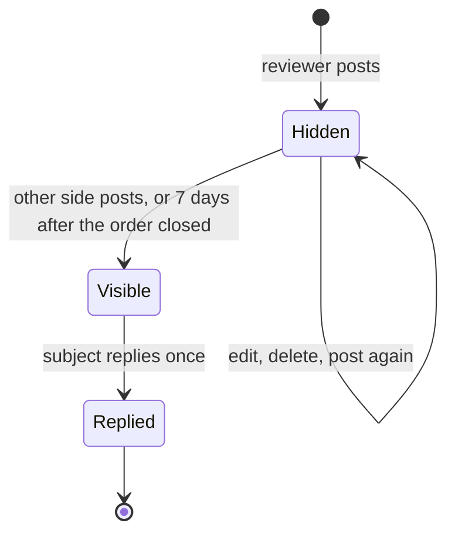
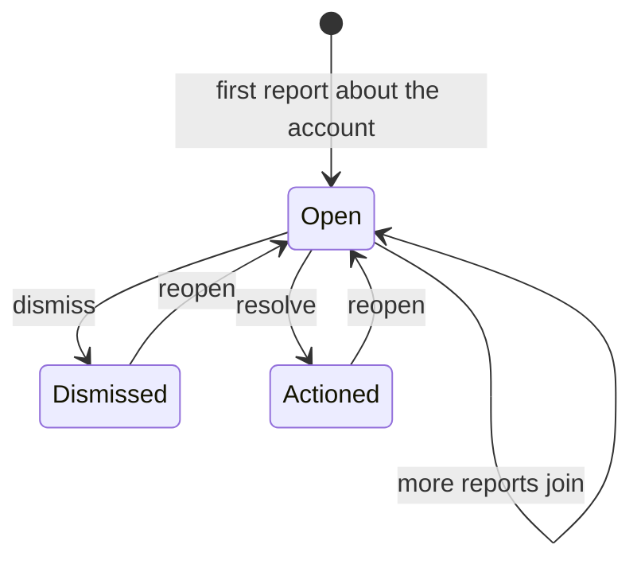
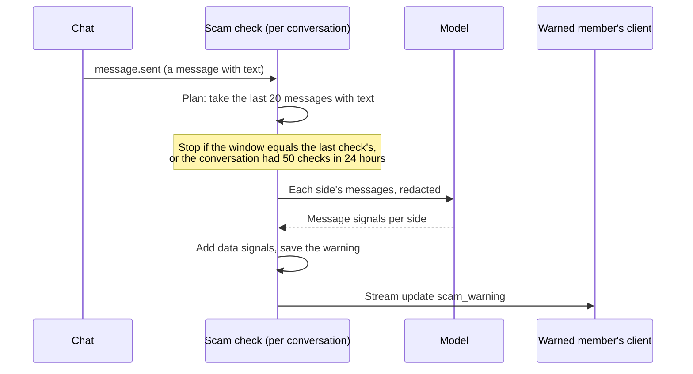

The trust module holds reviews, report cases and scam warnings, and reads the rating every view shows. Reputation is a set of figures the server already has: no points, no tiers, and the same caps for every account (<Req id="BR-TRS-05" />). Blocks live in the account module, since chat and deal both check them.

A suspended account cannot write, delete or mark a review, and cannot report. It answers `account_suspended`.

## Reviews

Both sides of an order review each other once the order is `completed` or `failed` (<Req id="FR-TRS-01" />, <Req id="BR-TRS-04" />). An order in any other state is `order_not_delivered`. A review rates a person, not a listing:

- `role` is the side its subject was on: `seller` (the buyer wrote it) or `buyer` (the seller wrote it).
- 1 to 5 stars and up to 500 characters of text.
- Optional tags from a fixed list per role. A seller can get "as described", "quick reply" and "well packed"; a buyer "quick reply" and "on time".
- Up to 4 photos, from uploads. Leaving the field out keeps the photos, `[]` removes them. A photo the media pipeline refuses is `invalid_upload`.

There is one review per order and role. `PUT /v1/orders/{order_id}/review` takes the role from the caller's side of the order, so the same call serves both sides. Anyone who is not a party gets `order_not_found`.

### Blind until both sides write

A review stays hidden until the other side reviews too, or until 7 days after the order closed, whichever comes first. This stops one side from answering the other's stars. The reveal time is written when the review is created. When the second review lands, both become visible at once, in one transaction. No timer runs; a review is visible once its reveal time has passed.

A hidden review shows only to its reviewer. Lists, ratings and the subject's order view skip it.

### Edit, delete and reply

The reviewer may edit, delete or post again while the review is still hidden and within 7 days of the first post. Once it shows, a change is `review_locked`: a side that has read the other's stars cannot change its own. A review posted more than 7 days after the order closed shows at once, so it is final when posted. A delete keeps the row without its text, tags or photos, so posting again cannot restart the 7 days.

The subject replies once to a visible review, up to 500 characters (`POST /v1/reviews/{id}/reply`). A hidden review is `review_hidden`, a second reply `review_replied`, and anyone but the subject gets `review_not_found`. After a reply the review is closed for good (`review_closed`).

### Helpful marks

Anyone else can mark a visible review helpful (`PUT /v1/reviews/{id}/helpful`) and take the mark back (`DELETE`). The reviewer and the subject get `own_review`; a hidden or deleted review is `review_not_found`. A review carries the count, and `marked` only for a reader who may mark it. Deleting a review drops its marks, and a mark racing the delete lands before it or not at all.

### Retries and races

A put that finds the caller's review already holding the same stars, text, tags and photos answers the review as it is. So a retry whose first try landed, even one that made the review visible, gets the review and not `review_locked`. The same reply sent twice answers the review once. Deleting a review already deleted answers 204.

Two writes racing on one review lose with `try_again`, and the client reads again.

### Who reads reviews

`GET /v1/accounts/{id}/reviews?role=` is public and lists visible reviews. `GET /v1/sellers/{id}/reviews` is the same list for `role=seller`. The first review writes `review.posted` and the first reply `review.replied`; the [notifications](/en/architecture/notifications) module turns each into a notice.

## Reputation

Each figure answers a question a buyer or seller asks before a deal (<Req id="FR-TRS-03" />).

| Figure | Where it shows | Rule |
|---|---|---|
| Rating as seller, rating as buyer | Listing, seller and reputation views; the seller's rating as buyer shows on the offer card in chat | Average and count of visible reviews in that role. No average without reviews. |
| Sold | Seller and reputation views | Every listing sold, through an order or marked by hand. |
| Reply rate | Reputation view | See below. Absent with fewer than 5 threads counted. |
| Reply time | Listing and seller views | See below. Absent with fewer than 5 answers in 30 days, or when the median is over a day. |
| Phone verified | Listing and seller views | The seller signs in with a phone number, which sign-in verified. The number is never shown. |
| COD orders and failed ones, last 90 days | Reputation view | The caller as a buyer. |
| Caps | Reputation view | Listings on sale against 20, open COD orders as buyer against 3. |

**Reply rate.** It counts threads that someone else started about one of the caller's listings, where the first message is from the last 90 days and is either answered or more than 24 hours old. A thread is in time when the caller answered within 24 hours. The rate is the percent in time, rounded down, with the count. It is computed on read.

**Reply time.** It is how soon the seller usually answers people who write about their listings, as a bucket the client words: within minutes (up to 10), within an hour, within hours (up to 6), within a day. A wait starts at the other person's first message after the seller's last one, if at least an hour passed, or at the first message of the conversation. A message within the hour is the same talk and starts no new wait. Deal moves count on neither side. Each answered wait is stored as one sample when the answer is sent, and samples older than 30 days are pruned as new ones are written. The figure is the median of the last 30 days; unanswered waits count only in the reply rate.

## Reports

A user reports a listing or an account (<Req id="UC-MOD-01" />) with `POST /v1/reports`:

- Exactly one of `listing_id` and `account_id`.
- A `reason`: `banned`, `fake`, `scam` or `other`.
- An optional note of up to 500 characters.
- For an account, optionally the reporter's conversation with that account, so staff can read it. A block keeps the conversation, so the app blocks first and reports second.

A broken rule is `invalid_report`; reporting yourself or your own listing is `self_report`. A deleted listing is `listing_not_found`, but a hidden, reserved, sold or rejected one can be reported.

Every report names the account it is about; a listing report names its seller too. That way a case gathers everything about one person.

A reporter has one open report per target. Reporting the same target again replaces the reason, note and conversation and answers 200; a new report answers 201. `DELETE /v1/reports/{id}` withdraws a report (the app's undo). The row stays, and the next report of that target opens a new one. `GET /v1/reports` lists the caller's reports, newest first, each `open`, `resolved` or `withdrawn`.

## Report cases

Console staff work reports as cases (<Req id="UC-MOD-02" />, <Req id="FR-MOD-01" />). A case is every report about one account that is neither withdrawn nor resolved. Resolving the case stamps those reports, and the account's next report opens a new case.

- `GET /v1/console/reports?status=open|resolved` lists cases: open ones by their latest report with a total, resolved ones by when they were resolved.
- `GET /v1/console/reports/{account_id}` shows the open case, or else the latest resolved one. It lists every listing reported in it, most reported first, and the reports newest first. An account with no report is `report_case_not_found`.
- Dismiss ("no violation") and resolve ("action taken") close the open case. Without one they are `report_case_not_open`.
- Reopen brings the latest resolved case back. A report whose reporter has reported the same target since stays with the old resolution, so one reporter never has two open reports of one target. Without a resolved case it is `report_case_not_resolved`.

Each action locks the account and writes its audit entry (`report.dismiss`, `report.resolve`, `report.reopen`) in the same transaction. A retried dismiss or resolve that finds the case already closed with the same outcome answers that case instead of 409. The ShopNexus system account cannot be a case (`account_is_system`).

The console agent can read a case and answer questions about it; it changes nothing, and a staff member clicks every change (<Req id="BR-MOD-03" />).

### Sanctions

Staff act on the account in the console, then close the case with resolve. The actions below do not close it on their own:

- **Hide a listing.** A hidden-by-staff listing is held: the seller cannot show it again (`listing_held`), and an edit or "unmark sold" leaves it hidden. Only staff lift the hold.
- **Suspend the account**, with a reason and an optional end. A suspended account cannot sign in, refresh its session or write anything new (listings, messages, offers, COD requests, reviews, reports, follows, profile changes). It can still withdraw, decline, cancel, and open or answer a support ticket (<Req id="BR-MOD-02" />).

Both are audited. Staff take on only banned and fake goods, organised scams and requests from authorities; price and condition stay between the two people (<Req id="BR-MOD-01" />). There are no automatic sanctions.

## Scam warnings

Trust watches chats and warns a member when the other side's messages look like a scam (<Req id="FR-TRS-04" />, <Req id="BR-TRS-06" />). A warning is a list of fixed signals, each with server-written text:

- Read from messages: `prepayment_request`, `off_app_contact`, `suspicious_link`, `sensitive_info_request`, `impersonation`, `fake_payment_proof`, `pressure`.
- Computed from data: `new_account` (under 7 days old) and `price_far_below` (at least 30% under the median of 5 or more similar listings).

A warning needs at least one message signal. Data signals only join one; a new account alone warns nobody.

Checks run one at a time per conversation, and a restart resumes without asking the model again. If the model refuses, or the classify step still fails after 3 attempts or 10 minutes, that check is skipped.

Redaction keeps amounts: digits followed by a currency unit (đ, vnd, k, tr) stay. Other runs of 8 to 19 digits become a phone or a bank number.

Each signal names the message it sits under, the suspect's newest message in that check, so the client shows the warning beside it.

### Dismiss and privacy

The warned member dismisses with `POST /v1/conversations/{id}/scam-warning/dismiss`, even after blocking the other. A dismissed warning returns only when a new message signal appears after the dismissal. A signal the model found while the dismissal landed counts as after it.

The suspect never sees a warning about themselves. The inbox, inbox search and chat views carry the caller's warnings.

Each check is stored with the message IDs it read, the classifier and the signals, never the text. With dismissals and scam reports this is a training set for a future model. Checks older than 365 days are pruned. Deleting an account deletes the warnings shown to it; warnings about it stay with the people it talked to.
