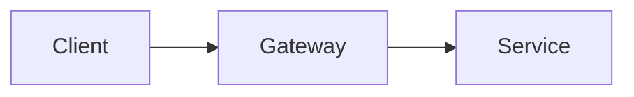

Pages in this tab exist only in `bun run build:internal`.

## Files and URLs

A page lives at `src/content/docs/<en|vi>/<tab>/<slug>.mdx` and is served at `/<lang>/<tab>/<slug>`. `index.mdx` is the landing page of a tab or folder. Tabs are declared in `src/lib/tabs.ts` and the home page copy in `src/components/home/home-strings.ts`.

## Frontmatter

| Field | Use |
|---|---|
| `group`, `groupOrder`, `order` | Place the page in the left nav. |
| `audience`, `type` | The badges under the title. |
| `related` | Fills the Related rail. |
| `toc: false` | Hides the page outline. |
| `internal: true` | Keeps the page out of the public build. |

`src/content.config.ts` validates every field. A Vietnamese page that does not exist yet renders the English one under `/vi/...` with a "not translated yet" banner.

## Components

MDX components need no import: `Callout`, `Steps`/`Step`, `Shot`, `Tabs`/`Tab`, `Cards`/`Card`, `Prereqs`, `KeyRules`, `Accordion`/`AccordionGroup`, `UI`, `Term`, `Kbd` and `Glossary`. Glossary terms are in `src/data/glossary.ts`.

## Diagrams

A fenced block with the language `mermaid` becomes a diagram drawn in the site's colours, and redrawn when the theme changes. `title="…"` adds a caption.

````md title="page.mdx"

````

## Images

Screenshots and illustrations go under `public/` and are referenced by that path, for example `<Shot src="/shots/home.png" />`. `<Shot>` reads the image size at build time, so its crop and hotspot coordinates are in source pixels.
