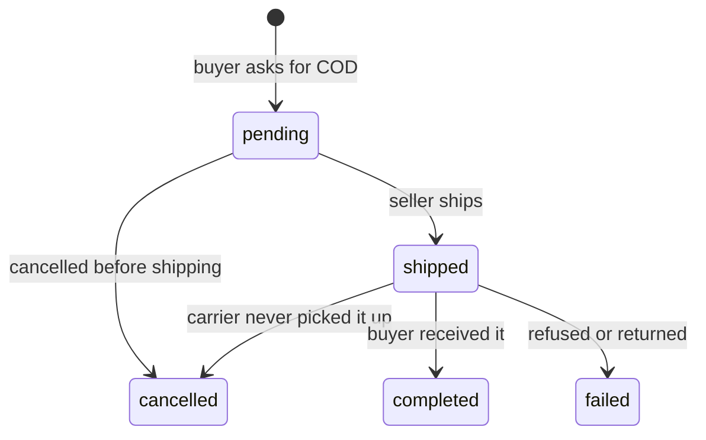

A deal is a buyer and a seller agreeing a price on one listing. The buyer can buy at the listed price with **Mua ngay**, or make an offer of at least half of it, and the seller can counter. Several buyers may agree a price on the same listing, and agreeing reserves nothing.

The parcel goes by GHTK or GHN, on the seller's own carrier account, which the seller links once in the COD setup. The carrier collects the money from the buyer and pays it to the seller. ShopNexus never holds it.

## Steps

<Steps>
<Step title="The buyer asks for COD">
The buyer taps **Mua ngay**, or **Chọn giao COD** on an agreed price, picks an address from their address book and sends the request. The order now waits for the seller. Until the seller ships, other buyers can ask for COD on the same listing.
</Step>

<Step title="The seller ships">
The seller picks the carrier, the service, the weight and where the shipper takes the parcel. ShopNexus creates the waybill on the seller's carrier account, with the price collected on delivery and the recipient paying the shipping. The listing is reserved for this buyer, and every other buyer's waiting order on it is cancelled with "Người bán đã gửi cho người khác".
</Step>

<Step title="The carrier delivers">
The carrier picks the parcel up and reports each step, and the order screen shows them. The buyer sees the shipping fee as soon as the carrier tells it.
</Step>

<Step title="The buyer inspects at the door">
The shipper arrives and the buyer looks at the item. If it is right, they pay the shipper the price plus the shipping fee. If not, they refuse it and pay nothing, and the carrier returns the parcel to the seller.
</Step>

<Step title="The order closes">
The buyer taps **Đã nhận hàng**, or the order completes on its own 3 days after the carrier reports it delivered. The listing is then sold to that buyer. A refused or returned parcel fails the order, and the listing goes on sale again.
</Step>
</Steps>

A completed order closes the deal. After a failure or a cancel, the deal goes back to negotiating.

## Deadlines

- Either side can cancel an order until the seller ships it.
- A seller who does not ship within 3 days loses the order: it is cancelled.
- A parcel the carrier has not picked up 3 days after the seller shipped is cancelled, and so is its waybill.
- While the seller is away, buyers cannot make offers, accept a price or ask for COD; orders already placed go on.

## Sales outside the app

A sale made outside the app is recorded with **Đánh dấu đã bán**, so it still counts toward the seller's record.

## Limit per buyer

A buyer can have at most 3 COD orders waiting or shipped at a time; [Trust and sanctions](/en/marketplace/trust-and-sanctions) explains the reason.
