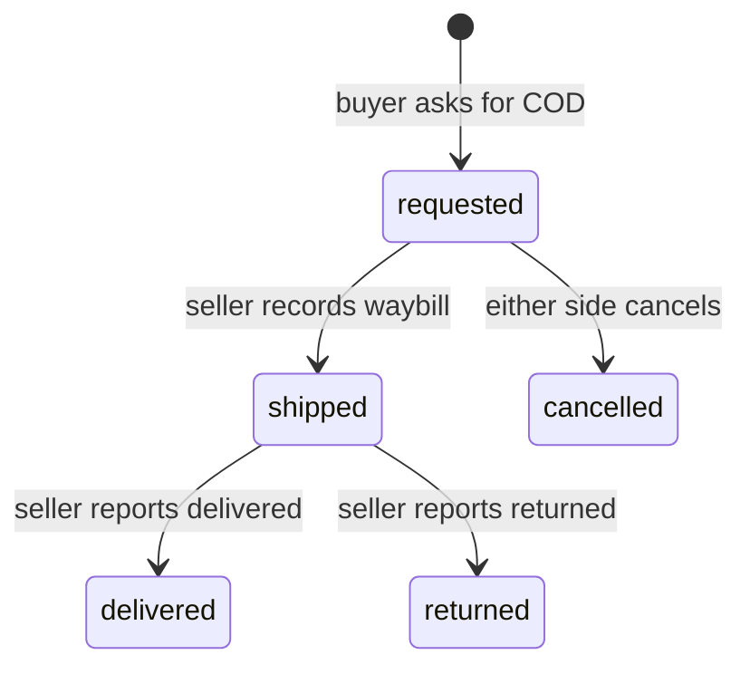

A deal is a buyer and a seller agreeing a price on one listing. The buyer can accept the listed price or make an offer of at least half of it, and the seller can counter. Several buyers may agree a price on the same listing, and agreeing reserves nothing.

## Steps

<Steps>
<Step title="The buyer asks for COD">
The buyer taps **Đặt COD** in the chat and picks an address from their address book. The order is now requested. Until the seller ships, other buyers can ask for COD on the same listing.
</Step>

<Step title="The seller ships">
The seller creates a waybill in the carrier's app, on their own carrier account, with the recipient paying the shipping. Then they type the carrier, the waybill code and the fee into ShopNexus. The order is shipped, the listing is reserved, and every other buyer's request on it is cancelled with "Người bán đã gửi cho người khác". The buyer sees the shipping fee at this point.
</Step>

<Step title="The buyer inspects at the door">
The shipper arrives and the buyer looks at the item. If it is right, they pay the shipper the price plus the shipping fee. If not, they refuse it and pay nothing. The shipper reports the outcome to the carrier, and the buyer presses nothing in the app.
</Step>

<Step title="The seller reports the ending">
ShopNexus does not track parcels. The seller taps **Đã giao xong** when the COD money arrives, and the listing is sold to that buyer. If the parcel comes back, the seller taps **Hàng bị hoàn** and the listing goes on sale again.
</Step>
</Steps>

A delivered order closes the deal. After a return or a cancel, the deal goes back to negotiating.

## Expensive items and meetings

Items above 5 triệu can still go by COD, and the app suggests meeting first to look at the item. The two arrange the meeting in their messages. The app has no step for it, because it holds no money, cannot check the item and cannot tell when a meeting ended. When a message names a place, the app shows a button that opens it on the map.

A sale made outside the app is recorded with **Đánh dấu đã bán**, so it still counts toward the seller's record.

## Limit per buyer

A buyer can have at most 3 orders requested or shipped at a time; [Trust and sanctions](/en/marketplace/trust-and-sanctions) explains the reason.
