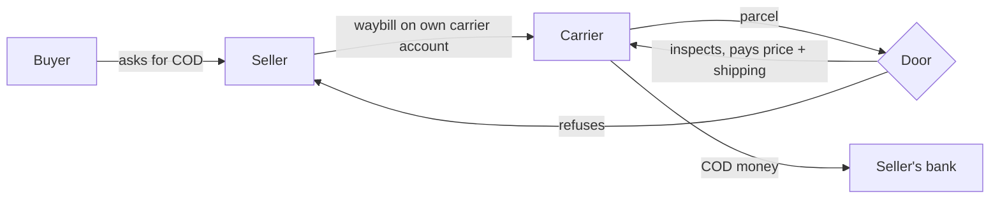

ShopNexus is a C2C marketplace in Vietnam where people sell used things quickly. It works under two constraints: it holds nobody's money, and it does not judge individual cases. Every other rule in the product comes from these two.

## What follows

- There is one way to buy in the app, <Term id="cod-inspection">COD with inspection at the door</Term> (COD đồng kiểm). The buyer looks at the item before paying the shipper.
- The buyer pays nothing in the app. There is no deposit, wallet or credit, so there is never anything to refund.
- A refused parcel is the refund. After the buyer has paid, the platform cannot get money back, and the app says so before they pay.
- Problems after delivery are recorded in the chat, and the seller decides how to answer. Nobody issues a ruling.
- Trust comes from statistics, and a sanction removes rights.
- Staff handle three kinds of case. Their number does not grow with the number of orders.
- Revenue comes from boosts and seller plans. There is no fee per order.

## The COD path

The seller ships through a carrier account in their own name (GHTK, GHN, SPX, J&T, Viettel Post and others) and types the carrier, waybill code and fee into ShopNexus. The carrier pays the COD money into the bank account the seller registered with it. Carriers check a seller's identity when they open the account, so posting on ShopNexus needs only a phone number verified through Firebase.

No carrier API is integrated yet, and the order model keeps room for an integration later.

## Deferred: escrow

Payment held by a licensed provider may be added later for expensive categories. Because a deal already goes through a named transaction path, escrow would be a second path beside COD, and the rest of the system would stay as it is.
