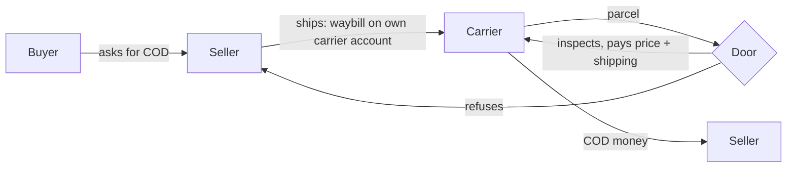

ShopNexus is a C2C marketplace in Vietnam where people buy and sell to each other. It works under two constraints: it holds nobody's money, and it does not judge individual cases. Every other rule in the product comes from these two.

## What follows

- There is one way to buy, <Term id="cod-inspection">COD with inspection at the door</Term> (COD đồng kiểm). The buyer looks at the item before paying the shipper.
- The buyer pays nothing in the app, so there is never anything for the platform to refund.
- A refused parcel is the refund. After the buyer has paid, the platform cannot get money back, and the app says so before they pay.
- After delivery, the buyer and the seller review each other. Nobody issues a ruling.
- Trust is a set of facts people see before they deal, and a sanction removes rights.
- Staff handle four kinds of case: banned or fake goods, organised scams, requests from the authorities and support tickets. Their number does not grow with the number of orders.
- There is no fee per order. A seller can pay for a boost, which moves a listing up the newest listings; that money is ShopNexus's own sale, never a deal's.

## The COD path

The seller links their own GHTK or GHN account once, in the COD setup. When they ship, ShopNexus creates the waybill on that account and follows the parcel through the carrier's updates. The carrier pays the COD money to the seller under the terms of the seller's own account. Carriers check a seller's identity when they open the account, so selling on ShopNexus needs only a verified phone number.

The steps, states and deadlines of an order are in [The COD deal](/en/marketplace/cod-deal).
