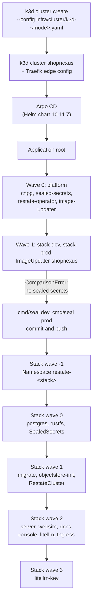

This tutorial takes a fork of the umbrella repo to one k3d cluster named `shopnexus` that runs two stacks: dev in `shopnexus-dev` and prod in `shopnexus-prod`. You run three commands: `k3d cluster create` with a config from `infra/cluster/` creates the cluster, and k3s installs Argo CD in it; `go -C infra run ./cmd/seal` writes the secrets; and Hurl runs `infra/smoke.hurl` to check the result. Argo CD installs and syncs everything else from your fork.

<Prereqs time="1 hour" who="Admins and developers">
- A Linux machine with a public IP address and enough free memory for two stacks. The author's bring-up plan stops to reconsider when less than 6 GB is available.
- Docker. The seal command also runs the server image with Docker to generate keys.
- k3d. The cluster was built with k3d v5.9.0; the author's server runs v5.8.3. Both configs in `infra/cluster/`, `k3d-direct.yaml` and `k3d-behind-proxy.yaml`, pin the node image `rancher/k3s:v1.37.1-k3s1`.
- kubectl (tested with v1.37.2), Helm (v4.3.1) and kubeseal (0.41.2).
- Go, to run the seal command in `infra/cmd/seal`. `infra/go.mod` asks for Go 1.27.
- Hurl, to run the smoke test in `infra/smoke.hurl`.
- yq (v4.54.1) and the Helm plugin helm-unittest (v1.2.1), which only `infra/check.sh` needs, to check the chart before you push a change. Install the plugin with `helm plugin install https://github.com/helm-unittest/helm-unittest --version v1.2.1 --verify=false`.
- A domain whose DNS you control, and a GitHub account to hold the fork.
</Prereqs>

## Bootstrap order



The `root` Application syncs `infra/platform` and `infra/argocd` from your fork. Its wave 0 installs the four platform operators, and its wave 1 creates one Application per stack. Each stack Application renders the Helm chart in `infra/stack` and applies it in its own waves.

## Steps

<Steps>
<Step title="Fork the repo and point it at your fork">
Fork `shopnexus/shopnexus` on GitHub and clone the fork onto the machine. Argo CD reads the fork without credentials, so the fork must be public.

Set `repoURL` to your fork's clone URL in two files:

- `infra/argocd/root.yaml`, which has it twice, once for `infra/platform` and once for `infra/argocd`;
- `infra/argocd/stacks.yaml`, once in `stack-dev` and once in `stack-prod`.

Set `domain` in `infra/stack/values-dev.yaml` and `infra/stack/values-prod.yaml`. The upstream values are `dev.shopnexus.id.vn` and `shopnexus.id.vn`; keep the same shape, with dev one label below prod.

Each stack runs LiteLLM, which sends search to `litellm.model` at `litellm.apiBase` in `infra/stack/values.yaml`. The defaults are `claude-haiku-5-5` and `http://host.k3d.internal:8317/v1`, a cli-proxy-api on the host. Point `apiBase` at any OpenAI-compatible API you have a key for. If you build your own images, change the `ghcr.io/shopnexus/*` names in `infra/stack/values.yaml` and `infra/argocd/stacks.yaml`, and make the GHCR packages public.

Commit and push to `main`.

You should see your clone URL in every `repoURL` line:

```bash title="Terminal"
grep -n repoURL infra/argocd/*.yaml
```
</Step>

<Step title="Create the DNS records">
Create four A records pointing at the machine's public IP. With `example.com` as the prod domain:

| Record | Covers |
|---|---|
| `@` | `example.com`, the prod website |
| `*` | `api.`, `media.`, `docs.` and `console.example.com` |
| `*.dev` | `api.dev.`, `media.dev.`, `docs.dev.` and `console.dev.example.com` |
| `dev` | `dev.example.com`, the dev website |

The `*` record stops covering `dev.example.com` once `*.dev` exists, so the dev website needs its own `dev` record ([Edge and network](/en/operations/cluster/networking#dns-records) explains why).

You should see the machine's IP for both the dev website and a host below it:

```bash title="Terminal"
dig +short dev.example.com
dig +short api.dev.example.com
```
</Step>

<Step title="Create the cluster with k3d">
Pick the edge mode. `direct` lets Traefik inside the cluster take ports 80 and 443 and get certificates from Let's Encrypt. `behind-proxy` is for a machine where another proxy already holds those ports; Traefik then listens on `127.0.0.1:18080` and the proxy terminates TLS. A fresh machine uses `direct`. The author's server uses `behind-proxy` behind a shared Caddy.

<Tabs labels={["direct", "behind-proxy"]}>
<Tab>
`ACME_EMAIL` is required; k3d fills `${ACME_EMAIL}` in the config from the environment. Traefik gets its certificates from Let's Encrypt's production server.

```bash title="Terminal"
ACME_EMAIL=you@example.com k3d cluster create --config infra/cluster/k3d-direct.yaml
```

To try the setup against Let's Encrypt's staging server, whose rate limits are higher and whose certificates browsers do not trust, add `caServer: https://acme-staging-v02.api.letsencrypt.org/directory` under `acme` in `infra/cluster/k3d-direct.yaml` before you create the cluster. k3d copies the Traefik config into the cluster when it creates it, so a later edit to the file does not reach a running cluster.

Traefik answers the TLS-ALPN-01 challenge on port 443, so port 443 must be open from the internet. Port 80 redirects to HTTPS with a 301. [Edge and network](/en/operations/cluster/networking#edge-modes) has the port mapping and the Traefik settings of this mode.
</Tab>
<Tab>
```bash title="Terminal"
k3d cluster create --config infra/cluster/k3d-behind-proxy.yaml
```

The proxy on the host terminates TLS and forwards plain HTTP to `127.0.0.1:18080`. Traefik trusts the `X-Forwarded-*` headers that arrive from private addresses. The Caddy block on the author's server lists every host of both stacks:

```text title="/etc/caddy/conf.d/shopnexus.caddy"
shopnexus.id.vn, api.shopnexus.id.vn, console.shopnexus.id.vn, media.shopnexus.id.vn, docs.shopnexus.id.vn,
dev.shopnexus.id.vn, api.dev.shopnexus.id.vn, console.dev.shopnexus.id.vn, media.dev.shopnexus.id.vn, docs.dev.shopnexus.id.vn {
	request_body {
		max_size 50MB
	}
	reverse_proxy 127.0.0.1:18080
}
```

Replace the names with your domain, then run `caddy validate --adapter caddyfile --config <file>` and reload Caddy. The proxy must pass the `Host` header through unchanged, which `reverse_proxy` does by default: a presigned upload to `media.` is signed for that host. Plain HTTP is redirected by Caddy with a 308.
</Tab>
</Tabs>

The cluster has one server node and three agents, with the port mapping of the edge mode. `agent-0` carries the label `role=stateful`, and `agent-1` and `agent-2` carry `role=app`. The config's `files:` list puts three manifests into the k3s manifests directory on the server node, and k3s applies them at its first start:

1. A `HelmChartConfig` that reconfigures the Traefik k3s ships. It is written inline in the k3d config of each mode.
2. `infra/cluster/argocd.yaml`, a k3s `HelmChart` that installs the `argo-cd` chart, version 10.11.7, into the namespace `argocd`. Its values add a health check for Applications, without which `root` would not wait for the platform to be healthy before starting the stacks.
3. `infra/argocd/root.yaml`. k3s retries it until Argo CD's CRDs exist. From then on Argo CD manages that file too.

When the server node restarts, k3s applies the copy of `root.yaml` it got at cluster creation again. If the file in git has changed since, Argo CD's self-heal puts the git version back within minutes.

You should see `root` in the list once Argo CD is up:

```bash title="Terminal"
kubectl -n argocd get applications
```
</Step>

<Step title="Read what Argo CD shows">
```bash title="Terminal"
kubectl -n argocd get applications
```

After a few minutes the four platform Applications `cnpg`, `sealed-secrets`, `restate-operator` and `image-updater` are Synced and Healthy. `stack-dev` and `stack-prod` show Unknown with a ComparisonError:

```text
infra/stack/secrets/dev/ holds no sealed secrets: run go -C infra run ./cmd/seal dev, commit and push
```

The error is expected. The chart in `infra/stack/templates/secrets.yaml` refuses to render while `infra/stack/secrets/<stack>/` holds no SealedSecrets, because the stack cannot start without them. The secrets cannot exist yet: `kubeseal` encrypts with the certificate of the Sealed Secrets controller, and that controller came up a minute ago in wave 0. Both stack Applications retry, with a backoff that grows from 30 seconds to 5 minutes, until the sealed files arrive in git.

For the web UI, forward a port and read the initial admin password:

```bash title="Terminal"
kubectl -n argocd port-forward svc/argocd-server 8080:443
kubectl -n argocd get secret argocd-initial-admin-secret -o jsonpath='{.data.password}' | base64 -d
```
</Step>

<Step title="Seal the secrets">
Run the seal command once per stack, from the umbrella root. It needs Docker, Go, and a kubectl context on this cluster, which k3d set as the current one.

```bash title="Terminal"
go -C infra run ./cmd/seal dev
```

The first run copies `infra/stack/secrets/example.env` to `infra/stack/secrets/dev.env` with mode 600 and generates every key the stack needs, filling an empty `KEY=` line in place or adding a line: the JWT and staff keys and the Restate signing key (from the server image's `/envgen`), the RustFS keys, the LiteLLM master key and database password, and the server's virtual LiteLLM key. The Restate private key goes to `dev.restate.pem` beside it. Then it stops:

```text
seal: .../infra/stack/secrets/dev.env: set LLM_UPSTREAM_API_KEY
```

Open `dev.env` and fill the values the script cannot make:

| Variable | dev | prod |
|---|---|---|
| `LLM_UPSTREAM_API_KEY` | required | required |
| `FCM_CREDENTIALS` | optional; empty logs push notifications instead of sending them | required; `APP_ENV=prod` refuses it empty, and so does the seal command for prod |

`LLM_UPSTREAM_API_KEY` is the key of the API at `litellm.apiBase`. `FCM_CREDENTIALS` is a Firebase service account's JSON, encoded in base64.

Run the command again for dev, then twice for prod:

```bash title="Terminal"
go -C infra run ./cmd/seal dev
go -C infra run ./cmd/seal prod     # creates prod.env and stops
go -C infra run ./cmd/seal prod     # after filling prod.env
```

A second run keeps the keys already in `<stack>.env`, so it seals the same values. Each successful run writes four SealedSecrets to `infra/stack/secrets/<stack>/`: `server-secrets.yaml`, `restate-secrets.yaml`, `litellm-secrets.yaml` and `litellm-db.yaml`. Commit and push them:

```bash title="Terminal"
git add infra/stack/secrets/dev infra/stack/secrets/prod
git commit -m "infra: sealed secrets for dev and prod"
git push
```

The `.env` and `.pem` files are git-ignored and stay on the machine.

You should see `sealed into .../infra/stack/secrets/<stack>; commit and push` after each successful run.

<Callout type="warning" title="Back up the keys now">
Copy `dev.env`, `prod.env`, `dev.restate.pem` and `prod.restate.pem` into a password manager, together with the controller's key:

```bash title="Terminal"
kubectl -n kube-system get secret -l sealedsecrets.bitnami.com/sealed-secrets-key -o yaml > sealed-secrets-key.yaml
```

Without the controller's key, the SealedSecrets in git cannot be opened on a new cluster. Without the `.env` files, a reseal generates new keys. A new `STAFF_KEY` makes every stored TOTP secret unreadable, and no staff member can sign in until `/staff reset-totp` clears their TOTP. A new JWT key only rejects the access tokens signed before it, which live 15 minutes; refresh tokens are stored in Postgres and keep working. The table of what each file protects is in [Secrets](/en/operations/cluster/secrets#files-to-back-up), with the commands to export and restore them.
</Callout>
</Step>

<Step title="Watch the sync waves">
Argo CD picks up the push on its next poll of the repo. To have it look now:

```bash title="Terminal"
kubectl -n argocd annotate application stack-dev argocd.argoproj.io/refresh=normal
kubectl -n argocd annotate application stack-prod argocd.argoproj.io/refresh=normal
```

Each stack then syncs in waves -1 to 3, as in the diagram above, and Argo CD waits for one wave to be healthy before it starts the next. [Postgres, Restate and RustFS](/en/operations/cluster/data#sync-waves-and-jobs) lists every resource of each wave.

```bash title="Terminal"
kubectl -n argocd get applications -w
kubectl -n shopnexus-prod get pods -o wide
kubectl -n restate-prod get pods -o wide
```

You should see `stack-dev` and `stack-prod` Synced and Healthy. Dev runs one of everything. Prod runs three server pods on `agent-1` and `agent-2`, two Postgres pods on different nodes and three Restate pods on three different nodes.
</Step>

<Step title="Run the smoke test">
`infra/smoke.hurl` requests every public host of one stack. Add `--insecure` if the certificates come from Let's Encrypt staging.

```bash title="Terminal"
hurl --test --continue-on-error --variable domain=dev.example.com infra/smoke.hurl
hurl --test --continue-on-error --variable domain=example.com infra/smoke.hurl
```

It checks `https://<domain>/`, `https://api.<domain>/healthz` and `/readyz`, `https://docs.<domain>/`, `https://console.<domain>/` and `https://media.<domain>/health` for a 200, and `http://api.<domain>/healthz` for a redirect to HTTPS (301 from Traefik, 308 from Caddy). `--continue-on-error` runs all seven requests even after one fails, so the report lists every failing host.

You should see the file reported as a success and an exit status of 0.
</Step>

<Step title="Open the console">
The staff console at `console.<domain>` needs a staff account, and a new cluster has none. The API and the console create moderators only; the first admin comes from the `staff` command in a server pod:

```bash title="Terminal"
kubectl -n shopnexus-prod exec -it $(kubectl -n shopnexus-prod get pod -l app.kubernetes.io/name=server -o name | head -1) -- \
  /staff create-admin --email you@example.com --name "Your Name"
```

It prints `created admin you@example.com (<id>)` and a temporary password. Open `https://console.example.com` and sign in with it. The console asks for a new password and then for a TOTP authenticator. Run the same command in `shopnexus-dev` for the dev console.

You should see the console's home page. [Runbook](/en/operations/cluster/runbook#staff-admins) has the other `staff` commands.
</Step>
</Steps>

## Tear down

```bash title="Terminal"
k3d cluster delete shopnexus
```

This deletes every node, volume and database in the cluster, including the Sealed Secrets controller's key. The SealedSecrets in git can only be opened on a new cluster if you restore that key from the backup before sealing again; [Secrets](/en/operations/cluster/secrets) has the procedure. Without the key, run the seal command against the new cluster, which reuses the keys in `<stack>.env`, and commit the new SealedSecrets.

<Cards>
<Card title="Cluster overview" href="/en/operations/cluster">What runs in the cluster and why.</Card>
<Card title="Edge and network" href="/en/operations/cluster/networking">The two edge modes, Traefik and the network policies.</Card>
<Card title="Secrets" href="/en/operations/cluster/secrets">Sealing, resealing and restoring the controller key.</Card>
<Card title="Runbook" href="/en/operations/cluster/runbook">What to do when a step above fails.</Card>
</Cards>
