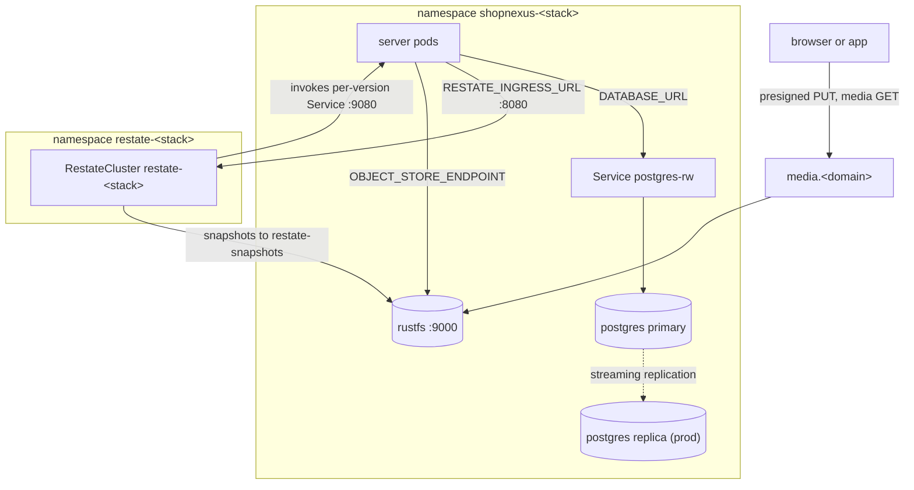
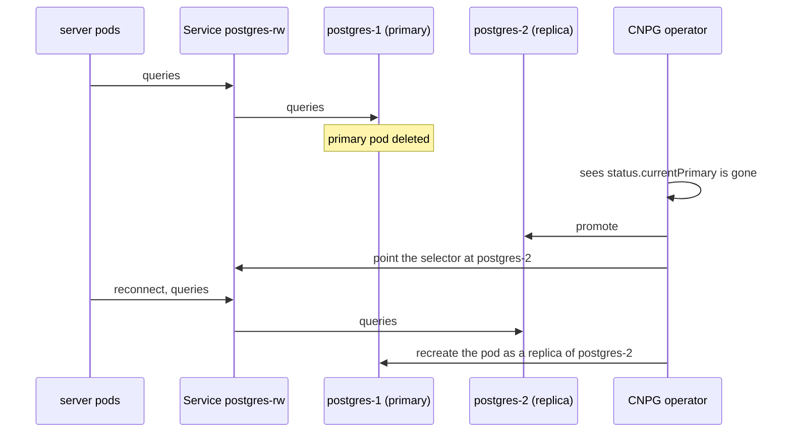
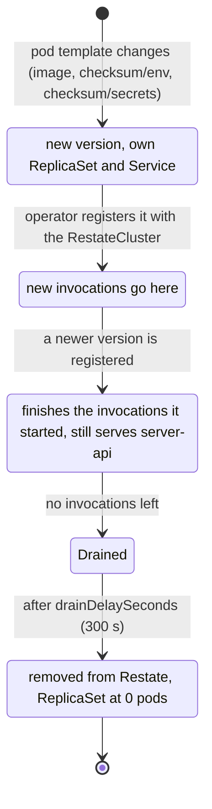

Each stack (`shopnexus-dev` and `shopnexus-prod`) has its own Postgres, its own Restate cluster and its own RustFS. The two stacks share the operators and no data. The chart that declares them is `infra/stack/`; the templates are `postgres.yaml`, `restate.yaml`, `rustfs.yaml`, `server.yaml` and `jobs.yaml`.



| | dev | prod |
|---|---|---|
| Postgres instances | 1 | 2 |
| Postgres storage | 5Gi | 10Gi |
| Restate nodes | 1 | 3 |
| Restate `default-replication` | 1 | 2 |
| Restate storage per node | 2 GiB | 4 GiB |
| RustFS replicas | 1 | 1 |
| RustFS storage | 10Gi | 10Gi |
| server replicas | 1 | 3 |

The values come from `infra/stack/values.yaml`, overridden by `values-prod.yaml`.

## Postgres on CloudNativePG

The CloudNativePG operator (CNPG, in namespace `cnpg-system`) runs a `Cluster` named `postgres` in each stack namespace. dev has 1 instance and prod has 2: a primary and a streaming replica.

### Image and user

The image is `paradedb/paradedb:0.26.4-pg18`, which is Postgres 18 with ParadeDB's `pg_search` extension. CNPG reads the Postgres major version from the image tag, and it cannot parse `0.26.4-pg18`. The chart therefore declares an `ImageCatalog` named `postgres` that maps `major: 18` to the image, and the `Cluster` points at the catalog through `imageCatalogRef`.

The ParadeDB image runs `postgres` as uid 999. CNPG assumes uid 26, the uid in its own images, so the `Cluster` sets `postgresUID: 999` and `postgresGID: 999`. Both problems were found on a local k3d cluster before the fix went in.

### pg_search

`shared_preload_libraries: [pg_search]` loads the extension into every instance. The bootstrap section creates database `app`, owned by role `app`, and runs `CREATE EXTENSION IF NOT EXISTS pg_search CASCADE` in it through `postInitApplicationSQL`. CNPG runs that statement as the superuser. The server's migration `0019_search.sql` runs the same statement as `app`, which may not create the extension, and passes because the extension already exists.

### Connection and secrets

CNPG creates the Secret `postgres-app`. The server and its jobs read `DATABASE_URL` from its `uri` key. That URI names the Service `postgres-rw`, which CNPG keeps pointed at the current primary, so the stack's configuration names no Postgres pod.

### LiteLLM's database

The `Cluster` also manages a role `litellm` (`ensure: present`, `login: true`) whose password CNPG reads from the basic-auth Secret `litellm-db`, sealed by the seal command, `infra/cmd/seal`. A separate `Database` resource named `litellm`, owned by `litellm`, creates the database on the same cluster in wave 1. LiteLLM keeps its virtual keys and spend there, as described in [Language model gateway](/en/operations/cluster/llm-gateway).

### Placement

`enablePodAntiAffinity: true` with `podAntiAffinityType: preferred` and `topologyKey: kubernetes.io/hostname` asks the scheduler to put prod's two instances on different nodes. The rule is preferred, so both instances still schedule when only one agent is available.

### Failover

When the primary pod goes away, CNPG promotes the replica and moves `postgres-rw` to it. The server reconnects through the same Service name. dev has a single instance, so on dev a lost primary means downtime until the pod comes back.



The drill for this is written (plan Task 17, step 1) and has not been run yet. Its expected result is that `currentPrimary` changes to the other instance within a minute and `infra/smoke.hurl` passes. To watch it:

```bash
kubectl -n shopnexus-prod get cluster postgres \
  -o jsonpath='{.status.currentPrimary} {.status.phase}{"\n"}'
```

## Restate on restate-operator

restate-operator 3.2.0 runs two resources for each stack: a `RestateCluster`, which is the Restate server, and a `RestateDeployment`, which runs `server` as a Restate service endpoint.

### RestateCluster

The `RestateCluster` is named `restate-<stack>`, and the operator puts it in a namespace of the same name. The chart creates that namespace itself in wave -1, so the sealed `restate-secrets` can land there before the cluster exists.

| Setting | Value |
|---|---|
| Image | `restatedev/restate:1.8.1` |
| Nodes (`compute.replicas`) | dev 1, prod 3 |
| Roles on every node | `worker`, `admin`, `log-server`, `metadata-server`, `http-ingress` |
| Metadata | `[metadata-client] type = "replicated"`, address `http://restate-cluster:5122/` |
| Partitions | `default-num-partitions = 24` |
| Replication | `default-replication` = the smaller of 2 and the node count: dev 1, prod 2 |
| Provisioning | `spec.cluster.autoProvision: true`: the operator calls ProvisionCluster once the pods run; the nodes have `auto-provision = false` |
| Snapshots | `s3://restate-snapshots/<stack>` on `http://rustfs.shopnexus-<stack>:9000`, every 10000 records |
| Request signing | `requestSigningPrivateKey` version `v1`, key `private.pem` of `restate-secrets` |
| Spread | `topologySpreadConstraints`, `maxSkew: 1` over `kubernetes.io/hostname`, `ScheduleAnyway` |

Snapshots go to the stack's RustFS with the access keys stored in `restate-secrets` as `AWS_ACCESS_KEY_ID` and `AWS_SECRET_ACCESS_KEY`. They are the same keys RustFS itself runs with. The operator's README advises against a distributed cluster without snapshots, because a node that falls behind catches up from a snapshot.

Restate signs every request it sends to the server with `private.pem`. The server holds the public key in `RESTATE_IDENTITY_KEY` and rejects unsigned requests. The seal command keeps the private key in `infra/stack/secrets/<stack>.restate.pem` and stops if that file is missing while the `.env` still has a public key; see [Secrets](/en/operations/cluster/secrets).

`spec.security.networkPeers` admits traffic to the ingress and admin ports only from the stack's server pods. In the other direction, Restate may reach only pods labelled `allow.restate.dev/restate-<stack>: "true"`, which the chart sets on the server and RustFS pods.

The `ScheduleAnyway` spread places prod's three nodes on three agents and still schedules them when an agent is stopped. With `default-replication = 2`, prod is meant to keep accepting invocations with one node down; the drill that stops an agent (plan Task 17, step 2) has not been run yet.

### RestateDeployment for the server

The server runs as a `RestateDeployment` named `server` (`restate.dev/v1beta1`), in wave 2. It works like a Deployment, except that every distinct pod template becomes a version with its own ReplicaSet and its own Service, and the operator keeps an old version alive until Restate has no invocations left on it.

- The operator registers each version with the cluster named in `restate.register.cluster` (`restate-<stack>`), with `useHttp11: true`. Each invocation is then its own HTTP request, so a Service spreads invocations evenly over the pods.
- An invocation that started on one version finishes on that version and never replays on another.
- Once a version is drained, the operator waits `drainDelaySeconds` (default 300 s; the chart does not set it) and then removes the version and scales its ReplicaSet to zero. `revisionHistoryLimit` (default 10) old ReplicaSets are kept.
- API traffic goes through the Service `server-api` on port 8080, which selects every server pod of any version, so an old version also serves API requests until it is scaled to zero.

Under `make run` the server registers itself with Restate at start, with `force: true`. Under the operator that registration would overwrite the operator's, so the stack sets `RESTATE_REGISTER: "false"` in the ConfigMap `server-env`. The server then only serves its endpoint on `0.0.0.0:9080` and logs that registration is left to restate-operator.

The operator starts a new version only when the pod template changes. A new image tag changes it. A change to the ConfigMap `server-env` or to a SealedSecret would not, so the template carries two annotations:

| Annotation | Hash of |
|---|---|
| `checksum/env` | the rendered data of ConfigMap `server-env` (sha256, first 16 characters) |
| `checksum/secrets` | every file in `infra/stack/secrets/<stack>/` |

RustFS's StatefulSet carries the same `checksum/secrets`, so a reseal of its access keys restarts it with the new keys.



On a local k3d cluster the operator registered the first version with its 13 services, and a config change created a second version while the first stayed registered. The release drill with a long invocation (plan Task 17, step 3) has not been run yet.

To look at the versions of a stack:

```bash
kubectl -n shopnexus-dev get restatedeployment server
kubectl -n shopnexus-dev get replicasets
```

The [Releases](/en/operations/cluster/releases) page covers how a new image reaches the stack.

## RustFS

RustFS is the S3-compatible object store. Each stack runs a StatefulSet `rustfs` with one replica (`rustfs/rustfs:1.0.4`), a 10Gi volume mounted at `/data`, and a Service `rustfs` on port 9000. Its console is off (`RUSTFS_CONSOLE_ENABLE=false`). The pod prefers nodes labelled `role=stateful`, which is `agent-0`. It reads its access keys from `server-secrets` (`OBJECT_STORE_ACCESS_KEY`, `OBJECT_STORE_SECRET_KEY`).

| Bucket | Used by | Access |
|---|---|---|
| `shopnexus` | the server's `OBJECT_STORE_BUCKET` | keys under `media/` are public-read |
| `restate-snapshots` | Restate's snapshots, under the prefix `<stack>/` | the `media/` read rule exists here too; the prefix holds nothing |

### Bucket creation

The server image contains `/objectstore-init`. It creates `OBJECT_STORE_BUCKET` when the bucket is missing and sets a policy that lets anyone `s3:GetObject` on `<bucket>/media/*`. The chart runs it twice in wave 1: the job `objectstore-init` with the server's environment, which prepares `shopnexus`, and the job `objectstore-init-snapshots` with `OBJECT_STORE_BUCKET=restate-snapshots`. A second run on an existing bucket only sets the policy again.

### Uploads

The browser and the app upload straight to RustFS with presigned PUT URLs. The server signs them for `OBJECT_STORE_PUBLIC_ENDPOINT=https://media.<domain>` and talks to RustFS inside the cluster at `OBJECT_STORE_ENDPOINT=http://rustfs:9000`. A presigned PUT fixes `Content-Type` and `Content-Length`. Public files are read from `MEDIA_PUBLIC_URL=https://media.<domain>/shopnexus`. The Ingress sends `media.<domain>` to `rustfs:9000`.

<Callout type="warning" title="Host header">
The signature covers the host `media.<domain>`. A proxy in front of Traefik that rewrites the `Host` header breaks every upload with a signature error. On the author's server the shared Caddy must pass `Host` through unchanged; see [Edge and network](/en/operations/cluster/networking).
</Callout>

Any S3 service can replace RustFS by changing the `OBJECT_STORE_*` values.

## Sync waves and jobs

Argo CD applies a stack in waves. It starts a wave only after every resource of the previous wave is healthy, and a Sync hook job counts as healthy when it has completed.

| Wave | Resources |
|---|---|
| -1 | Namespace `restate-<stack>` |
| 0 | `ImageCatalog` and `Cluster` `postgres`, StatefulSet `rustfs`, the SealedSecrets; resources without a wave annotation (ConfigMap `server-env`, Services, NetworkPolicies) |
| 1 | `RestateCluster`, `Database` `litellm`, Sync hook jobs `migrate`, `objectstore-init`, `objectstore-init-snapshots` |
| 2 | `RestateDeployment` `server`, Deployments `website`, `docs`, `console`, `litellm`, Ingress `shopnexus` |
| 3 | Sync hook job `litellm-key` |

The three wave-1 jobs run the server image with the server's full environment. Each has `backoffLimit: 6`, `restartPolicy: OnFailure` and `hook-delete-policy: BeforeHookCreation`, so every sync deletes the previous run and runs the job again.

`migrate` must finish before wave 2. At start the server compares the database with its embedded migrations and refuses to start when any are pending, with `migrations pending: <names>; run go run ./cmd/migrate or make run`. A server that started before `migrate` would crash-loop until the job finished.

<KeyRules>
- `DATABASE_URL` always comes from `postgres-app`, key `uri`, and points at `postgres-rw`.
- `RESTATE_REGISTER` stays `"false"` in the cluster; restate-operator registers versions.
- A change to `server-env` or to a SealedSecret reaches the server only through the `checksum/env` and `checksum/secrets` annotations.
- `infra/stack/secrets/<stack>.restate.pem` is never regenerated for a running stack.
</KeyRules>

## Data protection

<Callout type="danger" title="No backups">
Nothing in `infra/` backs up Postgres, Restate or RustFS. CNPG has no backup or WAL archive configured, and RustFS has one copy of every object. On k3d every volume is a directory on the one host disk, so prod's second Postgres instance and its three Restate nodes protect against a lost pod or a stopped agent. A lost or full disk takes all copies at once. Losing the host loses the data of both stacks.
</Callout>

What is covered:

- A deleted Postgres primary pod in prod: CNPG promotes the replica.
- A stopped agent in prod: Restate keeps two copies of its data (`default-replication = 2`) and keeps running on the other nodes.
- A crashed RustFS or Restate pod: the StatefulSet recreates it on the same volume.

What is not covered:

- The host disk. All volumes use k3s's default storage class, `local-path`, which places a volume on one node's filesystem, and every node is a container on the same host.
- A stopped node for the pods whose volume is on it. A `local-path` volume binds its pod to that node, so RustFS on `agent-0` waits for `agent-0` to come back.
- Deleted or corrupted rows in Postgres. The replica copies a bad write within a moment.
- dev's Postgres and Restate, which run one instance each.
- RustFS on any stack: one replica, one volume.
- The SealedSecrets controller's key and the files the seal command keeps. [Secrets](/en/operations/cluster/secrets#files-to-back-up) lists them; back them up by hand.

<AccordionGroup>
<Accordion title='Server pods crash-loop with "migrations pending"'>
The `migrate` job did not complete. Look at its logs with `kubectl -n shopnexus-<stack> logs job/migrate`. A failed connection usually means the `postgres` `Cluster` is not healthy yet; check `kubectl -n shopnexus-<stack> get cluster postgres`.
</Accordion>
<Accordion title="The postgres pod does not start after an image change">
CNPG needs the major version from the `ImageCatalog`, and the ParadeDB image needs `postgresUID`/`postgresGID` 999. A new ParadeDB tag on another Postgres major needs a new `major` in both the catalog and `imageCatalogRef`.
</Accordion>
<Accordion title="A config change did not reach the server">
Check that the new pod template annotations differ from the old ones: `kubectl -n shopnexus-<stack> get replicasets -o yaml | grep checksum/`. A draining old version that restarts reads the current `server-env`, because both versions share one ConfigMap.
</Accordion>
<Accordion title="Argo CD shows the server Healthy while it crash-loops">
Argo CD has no health check for `RestateCluster` and `RestateDeployment`, so it reports them Healthy as soon as they exist. Look at the pods: `kubectl -n shopnexus-<stack> get pods -l app.kubernetes.io/name=server`.
</Accordion>
</AccordionGroup>
