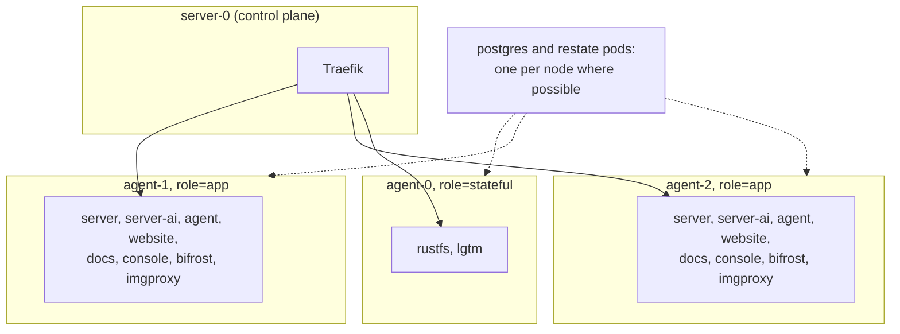
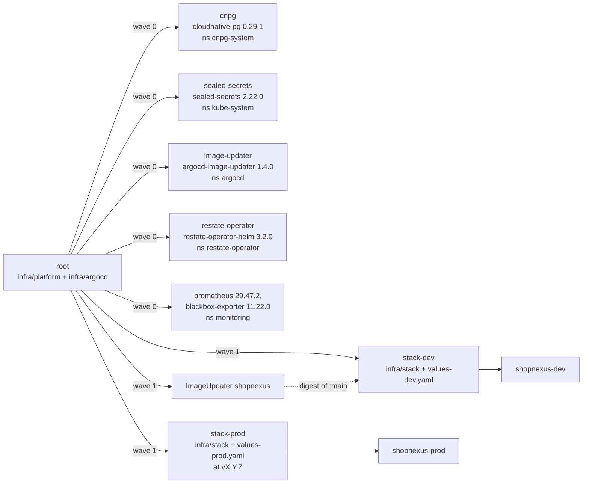

One k3d cluster named `shopnexus` runs two stacks of ShopNexus, dev and prod. Each stack lives in its own namespace and has its own database, Restate cluster, object store, model gateway (Bifrost) and Grafana. Argo CD keeps both stacks in step with the umbrella repo.

## Nodes

Both k3d configs, `infra/cluster/k3d-direct.yaml` and `infra/cluster/k3d-behind-proxy.yaml`, create one server node and three agents from the image `rancher/k3s:v1.37.1-k3s1`. Each agent stands in for a machine and carries a `role` label that the chart's workloads prefer.

| Node | Label | Prefers |
|---|---|---|
| `server-0` | control plane | Traefik (both edge configs pin it here with a `nodeSelector`) |
| `agent-0` | `role=stateful` | `rustfs`, `lgtm` |
| `agent-1` | `role=app` | `server`, `server-ai`, `agent`, `website`, `docs`, `console`, `bifrost`, `imgproxy`, `pgweb` |
| `agent-2` | `role=app` | the same as `agent-1` |



Every placement rule is a preference. The node affinity on `role` and the pod anti-affinity on `server`, `website`, `docs` and `console` use `preferredDuringSchedulingIgnoredDuringExecution`. CloudNativePG uses `podAntiAffinityType: preferred`, and the `RestateCluster` spreads its pods with `topologySpreadConstraints` and `whenUnsatisfiable: ScheduleAnyway`. Pods therefore still schedule when an agent is stopped.

k3d runs every node as a Docker container on one host, so the agents share one kernel and one disk. Stopping an agent with `docker stop` still behaves like losing a machine to Kubernetes, which is what the failover drills need. No file outside `infra/cluster/` names k3d, so a move to k3s on real hosts changes `infra/cluster/` alone.

## Stacks

| | dev | prod |
|---|---|---|
| Domain | `dev.shopnexus.id.vn` | `shopnexus.id.vn` |
| Namespace | `shopnexus-dev` | `shopnexus-prod` |
| Restate namespace | `restate-dev` | `restate-prod` |
| Argo CD Application | `stack-dev` | `stack-prod` |
| Values file | `values-dev.yaml` | `values-prod.yaml` |
| `APP_ENV` | `dev` | `prod` |
| Images | `:main`, by digest | the digests a release of the umbrella pinned, `vX.Y.Z` |
| Carriers | GHTK and GHN fake | off until a partner contract |

<Callout type="note" title="Before the first prod release">
While prod has no release, `values-dev.yaml` gives dev the domain `shopnexus.id.vn`, indexed, and serves the `dev.shopnexus.id.vn` hosts as aliases with `noindex`. An alias serves the same website, API, media and docs, and its console and dashboard hosts redirect to the main domain.
</Callout>

The `RestateCluster` of a stack is named `restate-<stack>`, and restate-operator puts it in a namespace of the same name. The chart creates that namespace in sync wave -1, so the sealed `restate-secrets` land in it before the cluster starts. NetworkPolicy denies all ingress in a stack namespace and opens only the paths the stack needs ([Edge and network](/en/operations/cluster/networking) lists them). No policy opens a path between `shopnexus-dev` and `shopnexus-prod`.

## Components

Each row is one workload that the chart in `infra/stack` renders into a stack namespace. The counts come from `values.yaml` (dev) and `values-prod.yaml` (prod).

| Component | Kind | Port | dev | prod |
|---|---|---|---|---|
| `server` | `RestateDeployment` | 8080 HTTP, 9080 Restate, 9090 MCP | 1 | 3 |
| `server-ai` | `RestateDeployment` | 9080 Restate | 1, 2Gi, no SigLIP 2 | 1, 6Gi |
| `agent` | `Deployment` | 3000 | 1 | 1 |
| `website` | `Deployment` | 3000 | 1 | 2 |
| `docs` | `Deployment` | 80 | 1 | 1 |
| `console` | `Deployment` | 80 | 1 | 2 |
| `postgres` | CloudNativePG `Cluster` | 5432 | 1 instance, 5Gi | 2 instances, 10Gi |
| `restate-<stack>` | `RestateCluster` | 8080 ingress, 9070 admin | 1 node, 2 GiB | 3 nodes, 4 GiB |
| `rustfs` | `StatefulSet` | 9000 S3, 9001 web console | 1, 10Gi | 1, 10Gi |
| `bifrost` | `Deployment` | 8080 | 1 | 1 |
| `imgproxy`, `imgproxy-cache` | `Deployment` | 8080, 80 | 1 each | 1 each |
| `lgtm` | `Deployment` | 3000 Grafana, 4318 OTLP | 1, 5Gi | 1, 5Gi |
| `pgweb` | `Deployment` | 8081 | 1 | 1 |

- `server` runs with `SERVER_ROLE=api`. Speech, photo vectors and video frames run in `server-ai`, the same image with `SERVER_ROLE=ai`, which the other pods call through Restate. Its model files are on the volume `models`.
- `agent` is the console agent, built from the agent repository as `ghcr.io/shopnexus/agent`. It has no host: only the server calls it, and it calls only the server's MCP port.
- `bifrost` is the stack's gateway to the remote models ([Bifrost gateway](/en/operations/cluster/llm-gateway)).
- `imgproxy` resizes photos from RustFS, and `imgproxy-cache` (nginx) keeps each answer. The website's host sends `/_img` to the cache.
- `lgtm` is Grafana with Loki, Tempo and Prometheus, and receives the server's telemetry. `pgweb` reads the stack's database. Both sit behind the console's sign-in ([Monitoring](/en/operations/monitoring)).

Restate replicates each partition to `min(2, replicas)` nodes, which is 1 copy in dev and 2 in prod. Postgres runs the image `paradedb/paradedb:0.26.4-pg18`; Bifrost keeps its own database `bifrost` on the same CloudNativePG cluster. The Services `server-api` (8080) and `server-mcp` (9090) select the current server version only, and restate-operator creates a Service per server version for port 9080.

Three Jobs run as Argo CD Sync hooks in wave 1:

| Job | Does |
|---|---|
| `migrate` | applies the server's migrations |
| `objectstore-init` | creates the bucket `shopnexus` and the server's own RustFS user for it |
| `objectstore-init-snapshots` | creates the bucket `restate-snapshots` and Restate's user for it |

Argo CD applies a stack in sync waves -1 to 3. The table of what each wave holds, and the stateful workloads themselves, are on [Postgres, Restate and RustFS](/en/operations/cluster/data#sync-waves-and-jobs).

## The app-of-apps

k3s installs Argo CD (chart `argo-cd` 10.11.7, namespace `argocd`) from `infra/cluster/argocd.yaml` and applies one Application, `root`, at its first start; both files come in through the k3d config's `files:` list. From then on Argo CD manages everything else, `root` included. When the server node restarts, k3s applies the copy of `root.yaml` it got at cluster creation again, and Argo CD's self-heal puts the git version back within minutes.



`root` has two sources in the umbrella repo: `infra/platform`, with one Application per platform chart, and `infra/argocd`, with `root.yaml` itself, `stack-dev`, `stack-prod` and the `ImageUpdater`. The platform charts come from their upstream Helm repositories and are not vendored. restate-operator's chart is read from GHCR as an OCI repository through the Secret `repo-restatedev-oci`. The cluster's Prometheus scrapes Postgres, Restate, Bifrost and the blackbox probes, with 3 days of retention.

The values in `infra/cluster/argocd.yaml` add two health checks. One for `argoproj.io/Application`, so `root` waits for the platform Applications in wave 0 to be Healthy before it creates the stacks in wave 1. One for `RestateDeployment`, Healthy once its current version has its ready pods, so the server's Services in wave 3 move only then. Argo CD serves without TLS and without a sign-in of its own, behind the console's sign-in at `argocd.<prod domain>`. Every Application syncs automatically with `prune` and `selfHeal` and retries without limit. `root` ignores `/spec/source/helm/parameters` on the Applications, because Image Updater writes the image tags of `stack-dev` there and self-heal would otherwise put them back.

## Repository layout

```text title="infra/"
infra/
├── check.sh                      # lints the chart, runs its tests, checks Argo CD, the edge and compose; CI runs it
├── release-plan.sh               # what a prod release would ship, image by image
├── RELEASING.md                  # the release process
├── smoke.hurl                    # hurl --test --variable domain=<domain>: requests every host of one stack
├── go.mod                        # Go module for cmd/
├── cmd/seal/                     # go -C infra run ./cmd/seal dev|prod [-dry-run]: seals a stack's secrets
├── host/                         # the host's flood limits (Linux server setup)
├── cluster/                      # used once per machine; the only k3d-specific part
│   ├── k3d-direct.yaml           # Traefik on 80/443 with ACME, Argo CD, root
│   ├── k3d-behind-proxy.yaml     # Traefik behind a proxy on 127.0.0.1:18080, Argo CD, root
│   └── argocd.yaml               # k3s HelmChart: Argo CD and its health checks
├── argocd/
│   ├── root.yaml                 # the app-of-apps
│   └── stacks.yaml               # stack-dev, stack-prod and the ImageUpdater
├── platform/                     # one Application per upstream chart
└── stack/                        # Helm chart "shopnexus": one stack
    ├── values.yaml               # defaults, which are the dev values
    ├── values-dev.yaml           # dev's domain, carriers, vectors and log level
    ├── values-prod.yaml          # prod's, plus replicas, storage and the release's image digests
    ├── env/                      # settings shared with the root docker-compose.yml
    ├── bifrost/, grafana/, imgproxy/   # config files the chart and compose both read
    ├── secrets/
    │   ├── example.env           # template that cmd/seal copies to <stack>.env
    │   ├── dev/, prod/           # SealedSecrets of each stack, committed
    ├── templates/
    └── tests/                    # helm-unittest suites, and probe SealedSecrets they render with
```

The seal command keeps the generated keys in `infra/stack/secrets/<stack>.env` and `<stack>.restate.pem`, which git ignores and which belong in a backup with the controller's key ([Secrets](/en/operations/cluster/secrets)).

## Design principles

<KeyRules>
- One Helm chart, `infra/stack`, renders both stacks. `values-dev.yaml` and `values-prod.yaml` hold every difference between them.
- Every host derives from one `domain` value: `<domain>`, `api.`, `media.`, `docs.`, `console.` and the dashboard hosts below it.
- A setting that is the same in the root `docker-compose.yml` and in both stacks lives once in `infra/stack/env/`; `infra/check.sh` fails on a key set in both places.
- Nothing specific to an environment lives outside `infra/`. The one exception is the host proxy file `conf.d/shopnexus.caddy` in `linux-server-setup`, used in `behind-proxy` mode.
- Only `infra/cluster/` knows about k3d.
- CI builds images and never connects to the cluster; Argo CD pulls every change from git.
</KeyRules>

A fork, following [Bring up a cluster](/en/operations/cluster/bootstrap), changes `repoURL` in `infra/argocd/root.yaml` and `infra/argocd/stacks.yaml`, and `domain` in the two values files. Images under another owner than `ghcr.io/shopnexus` also need new names in the values files and `stacks.yaml`. The website image sets `API_URL=http://server-api:8080`, an in-cluster Service name that resolves in whichever stack namespace the website runs in, so one image serves both stacks.

## Limits

- Nothing backs up Postgres, RustFS or Restate. The Sealed Secrets controller's key and the files the seal command writes are saved by hand.
- The agents are containers on one host and share its disk, so a failed disk takes every node with it.
- Memory is the tight resource. `server-ai` holds SigLIP 2 in prod (6Gi requested); dev's loads no SigLIP 2 and has no photo vectors. Text vectors come from OpenRouter through Bifrost. The fallbacks are to scale dev to zero when unused or to drop the cluster to two agents.
