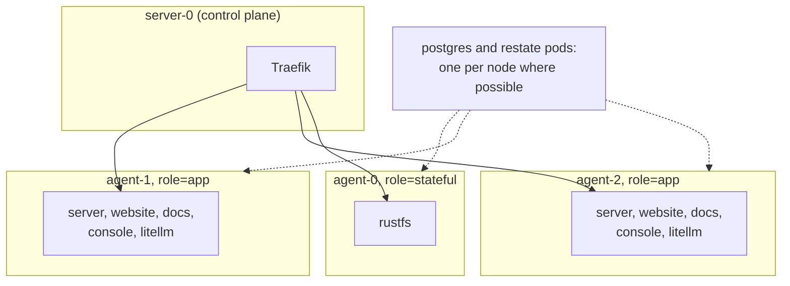
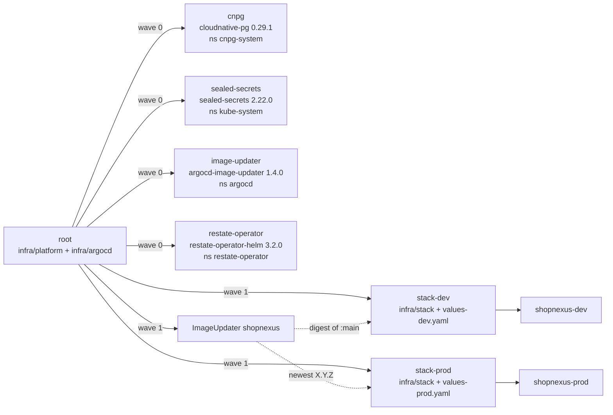

One k3d cluster named `shopnexus` runs two stacks of ShopNexus, dev and prod. Each stack lives in its own namespace and has its own database, Restate cluster, object store and language model gateway. Argo CD keeps both stacks in step with the umbrella repo, and the design is in `docs/superpowers/specs/2026-11-04-infra-k3d-stacks-design.md`.

## Nodes

Both k3d configs, `infra/cluster/k3d-direct.yaml` and `infra/cluster/k3d-behind-proxy.yaml`, create one server node and three agents from the image `rancher/k3s:v1.37.1-k3s1`. Each agent stands in for a machine and carries a `role` label that the chart's workloads prefer.

| Node | Label | Prefers |
|---|---|---|
| `server-0` | control plane | Traefik (both edge configs pin it here with a `nodeSelector`) |
| `agent-0` | `role=stateful` | RustFS |
| `agent-1` | `role=app` | `server`, `website`, `docs`, `console`, LiteLLM |
| `agent-2` | `role=app` | the same as `agent-1` |



Every placement rule is a preference. The node affinity on `role` and the pod anti-affinity on `server`, `website`, `docs` and `console` use `preferredDuringSchedulingIgnoredDuringExecution`. CloudNativePG uses `podAntiAffinityType: preferred`, and the `RestateCluster` spreads its pods with `topologySpreadConstraints` and `whenUnsatisfiable: ScheduleAnyway`. Pods therefore still schedule when an agent is stopped; the three prod Restate pods spread over the three agents while all three run.

k3d runs every node as a Docker container on one host, so the agents share one kernel and one disk. Stopping an agent with `docker stop` still behaves like losing a machine to Kubernetes, which is what the failover drills need. The project is a learning project, and k3d keeps the cost at one machine. The only k3d name outside `infra/cluster/` is `litellm.apiBase` in `infra/stack/values.yaml`, which reaches cli-proxy-api on the host at `host.k3d.internal:8317`. A move to k3s on real hosts changes `infra/cluster/` and that one value.

## Stacks

| | dev | prod |
|---|---|---|
| Domain | `dev.shopnexus.id.vn` | `shopnexus.id.vn` |
| Namespace | `shopnexus-dev` | `shopnexus-prod` |
| Restate namespace | `restate-dev` | `restate-prod` |
| Argo CD Application | `stack-dev` | `stack-prod` |
| Values file | `values-dev.yaml` | `values-prod.yaml` |
| `APP_ENV` | `dev` | `prod` |
| Images | `:main`, by digest | newest `X.Y.Z`, by semver |

The `RestateCluster` of a stack is named `restate-<stack>`, and restate-operator puts it in a namespace of the same name. The chart creates that namespace in sync wave -1, so the sealed `restate-secrets` land in it before the cluster starts. NetworkPolicy denies all ingress in a stack namespace and opens only the paths the stack needs ([Edge and network](/en/operations/cluster/networking) lists them). No policy opens a path between `shopnexus-dev` and `shopnexus-prod`.

## Components

Each row is one resource that the chart in `infra/stack` renders into a stack namespace. The counts come from `values.yaml` (dev) and `values-prod.yaml` (prod).

| Component | Kind | Port | dev | prod |
|---|---|---|---|---|
| `server` | `RestateDeployment` | 8080 HTTP, 9080 Restate | 1 | 3 |
| `website` | `Deployment` | 3000 | 1 | 2 |
| `docs` | `Deployment` | 80 | 1 | 1 |
| `console` | `Deployment` | 80 | 1 | 2 |
| `litellm` | `Deployment` | 4000 | 1 | 1 |
| `postgres` | CloudNativePG `Cluster` | 5432 | 1 instance, 5Gi | 2 instances, 10Gi |
| `restate-<stack>` | `RestateCluster` | 8080 ingress, 9070 admin | 1 node, 2 GiB | 3 nodes, 4 GiB |
| `rustfs` | `StatefulSet` | 9000 | 1, 10Gi | 1, 10Gi |

Restate replicates each partition to `min(2, replicas)` nodes, which is 1 copy in dev and 2 in prod. Postgres runs the image `paradedb/paradedb:0.26.4-pg18`; LiteLLM keeps its own database `litellm` on the same CloudNativePG cluster. The `server-api` Service on port 8080 selects every server pod of any version, and restate-operator creates a Service per server version for port 9080.

Four Jobs run as Argo CD Sync hooks:

| Job | Wave | Does |
|---|---|---|
| `migrate` | 1 | applies the server's migrations (`cmd/migrate`) |
| `objectstore-init` | 1 | creates the bucket `shopnexus` |
| `objectstore-init-snapshots` | 1 | creates the bucket `restate-snapshots` |
| `litellm-key` | 3 | creates or updates the server's LiteLLM virtual key |

Argo CD applies a stack in sync waves -1 to 3. The table of what each wave holds, and the stateful workloads themselves, are on [Postgres, Restate and RustFS](/en/operations/cluster/data#sync-waves-and-jobs).

## The app-of-apps

k3s installs Argo CD (chart `argo-cd` 10.11.7, namespace `argocd`) from `infra/cluster/argocd.yaml` and applies one Application, `root`, at its first start; both files come in through the k3d config's `files:` list. From then on Argo CD manages everything else, `root` included. When the server node restarts, k3s applies the copy of `root.yaml` it got at cluster creation again, and Argo CD's self-heal puts the git version back within minutes.



`root` has two sources in the umbrella repo: `infra/platform`, with one Application per platform chart, and `infra/argocd`, with `root.yaml` itself, `stack-dev`, `stack-prod` and the `ImageUpdater`. The platform charts come from their upstream Helm repositories and are not vendored. restate-operator's chart is read from GHCR as an OCI repository through the Secret `repo-restatedev-oci`.

Argo CD stopped judging the health of an Application in version 1.8. The values in `infra/cluster/argocd.yaml` add a health check for `argoproj.io/Application`, so `root` waits for the platform Applications in wave 0 to be Healthy before it creates the stacks in wave 1. Every Application syncs automatically with `prune` and `selfHeal` and retries without limit. `root` ignores `/spec/source/helm/parameters` on the stack Applications, because Image Updater writes the image tags there and self-heal would otherwise put them back.

## Repository layout

```text title="infra/"
infra/
├── check.sh                      # lints the chart, runs its tests, checks Argo CD and the edge; CI runs it
├── smoke.hurl                    # hurl --test --variable domain=<domain>: requests every host of one stack
├── go.mod                        # Go module for cmd/
├── cmd/
│   └── seal/                     # go -C infra run ./cmd/seal dev|prod [-dry-run]: seals a stack's secrets
│       ├── main.go
│       └── main_test.go          # go -C infra test ./...; needs Docker
├── cluster/                      # used once per machine; the only k3d-specific part
│   ├── k3d-direct.yaml           # k3d config: Traefik on 80/443 with ACME, Argo CD, root
│   ├── k3d-behind-proxy.yaml     # k3d config: Traefik behind a proxy on 127.0.0.1:18080, Argo CD, root
│   └── argocd.yaml               # k3s HelmChart: Argo CD, with a health check for Applications
├── argocd/
│   ├── root.yaml                 # the app-of-apps
│   └── stacks.yaml               # stack-dev, stack-prod and the ImageUpdater
├── platform/                     # one Application per upstream chart
│   ├── cnpg.yaml
│   ├── image-updater.yaml
│   ├── restate-operator.yaml
│   └── sealed-secrets.yaml
└── stack/                        # Helm chart "shopnexus": one stack
    ├── Chart.yaml
    ├── values.yaml               # defaults, which are the dev values
    ├── values-dev.yaml           # stack, domain, appEnv, LiteLLM budget
    ├── values-prod.yaml          # the same, plus replicas, storage and 0.1.0 tags
    ├── secrets/
    │   ├── example.env           # template that cmd/seal copies to <stack>.env
    │   ├── dev/                  # SealedSecrets of stack-dev, committed
    │   └── prod/                 # SealedSecrets of stack-prod, committed
    ├── templates/                # server, web, postgres, restate, rustfs, litellm,
    │                             # jobs, ingress, networkpolicy, secrets, validate
    └── tests/                    # helm-unittest suites, and probe SealedSecrets they render with
```

The seal command keeps the generated keys in `infra/stack/secrets/<stack>.env` and `<stack>.restate.pem`, which git ignores and which belong in a backup with the controller's key ([Secrets](/en/operations/cluster/secrets)).

## Design principles

<KeyRules>
- One Helm chart, `infra/stack`, renders both stacks. `values-dev.yaml` and `values-prod.yaml` hold every difference between them.
- Every host derives from one `domain` value: `<domain>`, `api.<domain>`, `media.<domain>`, `docs.<domain>` and `console.<domain>`.
- Nothing specific to an environment lives outside `infra/`. The one exception is the host proxy file `conf.d/shopnexus.caddy` in `linux-server-setup`, used in `behind-proxy` mode.
- Only `infra/cluster/` and `litellm.apiBase` know about k3d.
- CI builds images and never connects to the cluster; Argo CD pulls every change from git.
</KeyRules>

A fork, following [Bring up a cluster](/en/operations/cluster/bootstrap), changes `repoURL` in `infra/argocd/root.yaml` and `infra/argocd/stacks.yaml`, and `domain` in the two values files. Images under another owner than `ghcr.io/shopnexus` also need new names in `values.yaml` and `stacks.yaml`. The website image sets `API_URL=http://server-api:8080/v1`, an in-cluster Service name that resolves in whichever stack namespace the website runs in, so one image serves both stacks.

## Later work

The spec leaves backups, observability, real machines and the root `docker-compose.yml` out of scope.

- Nothing backs up Postgres, RustFS or Restate. The Sealed Secrets controller's key and the files the seal command writes are saved by hand.
- The chart sets `OTEL_EXPORTER_OTLP_ENDPOINT` to an empty string, so the server sends nothing over OTLP and writes its JSON logs to stdout only. The cluster runs no collector.
- The agents are containers on one host and share its disk, so a failed disk takes every node with it. A move to k3s on separate hosts changes `infra/cluster/` and `litellm.apiBase`.
- The root `docker-compose.yml` now has three stacks, one per profile, each with its own network, Postgres, Restate, RustFS and volumes. `dev` runs the server with `go run` and the web apps' dev servers with Compose Watch, behind Caddy on port 56481. `prod` builds every component from its Dockerfile, behind Caddy on port 56480. `test` runs the server's Go tests. `infra/check.sh` fails when the Postgres, Restate and RustFS image tags there differ from `infra/stack/values.yaml`.
- The spec estimates the two stacks at 6 to 8 GB of memory; nobody has measured it on the author's server yet. The fallbacks are to scale dev to zero when unused or to drop the cluster to two agents.
