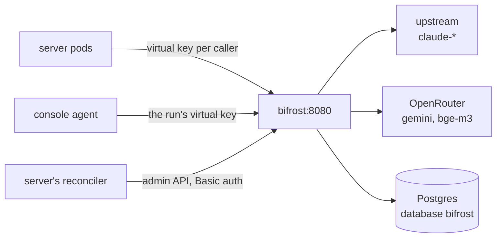

Search asks a language model what a query means, a listing read turns a seller's video or photo into a draft, a scam check reads a chat, and the console agent answers moderators. None of them calls a model provider itself. Each stack runs Bifrost (`maximhq/bifrost:v2.6.0`), a gateway with an OpenAI-compatible API, as the Service `bifrost` on port 8080.

Bifrost is one Go binary: it uses about 260 to 440 MiB and starts in 1 to 2 s, or about 20 s on an empty database while it runs its migrations.

Speech to text, photo vectors and video frames do not go through Bifrost. They are the server's module ai, which runs in `server-ai` and is called through Restate.

## Agents

An agent is one purpose that calls a model. The server's `ai_agents` table holds them, and a server migration seeds these:

| Agent | Model | Callers | Used for |
|---|---|---|---|
| `console-agent` | `upstream/claude-sonnet-5-5` | `console-agent` | the console agent |
| `scam-check` | `upstream/claude-haiku-5-5` | `server-trust` | checking a chat window for scams |
| `listing-read` | `upstream/claude-haiku-5-5` | `server-assist` | reading a seller's video, photo or Chợ Tốt listing into a draft |
| `search` | `openrouter/google/gemini-2.5-flash` | `server-search` | reading a search query |
| `embed-text` | `openrouter/baai/bge-m3`, DeepInfra only | `server-embed-index`, `server-embed-search` | text vectors of listings and queries |

A model is always `provider/model`. A bare model name is ambiguous once two providers list it, so callers never send one, and Bifrost's aliases are not used. Each agent also has fallbacks (more `provider/model` entries, none seeded), a monthly budget in USD (100 for `console-agent`, 30 for the others) and a rate limit per caller.

## Who owns what

| What | Owner | Where |
|---|---|---|
| Providers: base URL, API key, retries, timeouts | infra | `infra/stack/bifrost/config.json`; the keys in the Secret `bifrost-secrets` |
| Agents: model, fallbacks, price per model, monthly budget, callers and their rate limits | server | its database, seeded by a migration and edited in the console |
| Teams, virtual keys, budgets, rate limits and pricing overrides in Bifrost | server | written by the server's reconciler; nobody else writes them |
| Measured spend, logs, metrics | Bifrost | its logs store, which the server reads; `/metrics` for Prometheus |

The console's Providers page is read-only. A new provider or a new provider key is an infra change. Everything about an agent is edited in the console, and the server writes it into Bifrost.

## Deployment

`infra/stack/templates/bifrost.yaml` renders a ConfigMap `bifrost-config` from `bifrost/config.json` and `bifrost/start.sh`, a Deployment `bifrost` with one replica in sync wave 2, and the Service `bifrost`. The probes call `/health`. The pod requests 64Mi and is limited to 512Mi. The startup probe allows two minutes, since an empty database takes about 20 s of migrations.



The pod's annotations carry a checksum of `config.json`, `start.sh`, `env/bifrost.env` and the stack's sealed secrets, so a change to any of them restarts Bifrost. Prometheus scrapes `/metrics` on port 8080.

## The config file

`config.json` holds only `client`, `governance.auth_config`, the two stores, `encryption_key` and `providers`. It sets `source_of_truth: "config.json"`, and Bifrost applies that per section: on every start it resets the providers to the file and keeps the virtual keys, teams, budgets and pricing overrides that the server made through the API. A `governance` section other than `auth_config` in the file would wipe what the server made, so `infra/check.sh` fails on one.

```json title="infra/stack/bifrost/config.json, the providers"
"upstream": {
  "keys": [{ "name": "upstream", "value": "env.LLM_UPSTREAM_API_KEY", "models": ["*"], "weight": 1 }],
  "network_config": {
    "base_url": "${LLM_UPSTREAM_BASE_URL}",
    "allow_private_network": true,
    "default_request_timeout_in_seconds": 120,
    "max_retries": 2
  },
  "custom_provider_config": { "base_provider_type": "openai", "allowed_requests": { "list_models": true, "chat_completion": true, "chat_completion_stream": true } }
},
"openrouter": {
  "keys": [{ "name": "openrouter", "value": "env.OPENROUTER_API_KEY", "models": ["*"], "weight": 1 }],
  "network_config": { "base_url": "https://openrouter.ai/api", "default_request_timeout_in_seconds": 60, "max_retries": 2 },
  "ignore_provider_cost": true
}
```

- `upstream` is a custom provider that speaks the OpenAI API. Its URL is `LLM_UPSTREAM_BASE_URL` in `infra/stack/env/bifrost.env`, without `/v1`. `allow_private_network` lets Bifrost call it on a private address.
- `base_url` takes no `env.` reference, so the file holds the placeholder `${LLM_UPSTREAM_BASE_URL}`. `start.sh` fills it in and writes the result to Bifrost's data directory before it starts Bifrost. The chart and compose both run `start.sh`.
- `openrouter` is Bifrost's built-in provider. `ignore_provider_cost` makes Bifrost log the cost from the server's prices, not OpenRouter's.
- `client` turns on auth for inference (`enforce_auth_on_inference`), leaves only `/metrics` open (`whitelisted_routes`), and puts Bifrost's routing details in response headers (`extra_fields_placement: "headers"`).
- Logs keep no request or response bodies (`disable_content_logging`), since a search photo passes through, and are kept 30 days.
- `auth_config` protects the admin API and the UI with the user `BIFROST_ADMIN_USERNAME` (`admin`, in `env/bifrost.env`) and `BIFROST_ADMIN_PASSWORD`.

## Keys and budgets

The server's reconciler writes Bifrost's governance objects. It runs at startup (retrying until it succeeds), after every AI settings write, every 5 minutes, and when a caller finds no key for itself. It holds a Postgres advisory lock, so two replicas never create the same key twice. The design is on [AI layer](/en/architecture/ai).

<Steps>
<Step title="List what the server owns">
It lists the teams, the virtual keys that carry `metadata.owner = "server"` and the pricing overrides named `server:<provider>/<model>`.
</Step>
<Step title="Write each agent">
One team per agent, named after its slug, carries the monthly budget. One virtual key per caller, under its agent's team, carries the caller's rate limit and `allowed_models`: the agent's model and fallbacks, exactly. A leaked key can call nothing else.
</Step>
<Step title="Write the prices">
Each row of `ai_model_prices` becomes a pricing override for its provider and model.
</Step>
<Step title="Clean up">
It deletes server-owned keys and overrides that no caller or price names any more, and disables the keys of agents that are turned off. Teams are never deleted, as agents are not.
</Step>
<Step title="Load the keys">
It reads every server-owned key's value into the server's memory.
</Step>
</Steps>

Bifrost generates the key values. No caller key is stored in git, in a Secret or in the server's database. The server hands its own modules their key from memory. When Bifrost refuses a key as unknown, disabled or not allowed the model, the server reads the keys again (at most every 10 s) and retries once if the key changed. A provider's own 401 or 403 passes through. The console agent gets its key, model, fallbacks and prices in each run request; see [Agents and configuration](/en/agent/setup).

Bifrost's own UI shows the server's teams and keys. An edit made there is overwritten at the next reconcile.

## Prices and spend

`ai_model_prices` holds the price of every model an agent uses, in USD per token for input, output, cache read and cache write, seeded with list prices, so budgets are in dollars. The model picker in the console prefills a price from Bifrost's catalog. Bifrost counts each call's cost from these prices and charges it to the caller's team.

The console reads spend by agent and by day from Bifrost's logs and shows it on the Overview page. Bifrost's totals trail real time by up to a minute. Each agent's budget is on its own page.

## When a budget or a limit runs out

- A spent monthly budget: Bifrost answers 402 with `X-Bifrost-Error-Type: policy_budget_exceeded`. The console agent ends the segment with `agent_budget` ([Limits and failures](/en/agent/limits)).
- A caller over its rate limit: Bifrost answers 429 with `policy_rate_limited` and sends no Retry-After. The console agent waits for the window named in the message, or 60 s.
- A spent OpenRouter credit: the upstream's 402 comes through.

The server's search does not fail when the model does. `Search` in `server/internal/discovery/service/search.go` gives the model 4 seconds. On any error it logs `the model did not read the query` at warn level with the error and searches the raw words alone. The page then has no chips and no boosts for category, price, place or freshness. A query the model read in the last 7 days comes from the server's cache and keeps its understanding.

## OpenRouter and the text vectors

`search` and `embed-text` go to OpenRouter with the stack's `OPENROUTER_API_KEY`, one key per stack. Give that key a daily credit limit on OpenRouter; it is the last stop behind the agents' budgets.

OpenRouter serves `baai/bge-m3` from two providers. DeepInfra (fp32) gave the vectors of the TEI the stacks ran before at a cosine of 0.999999 on every reference text under 2048 tokens; Parasail gave 0.996. `embed-text` pins DeepInfra and allows no fallbacks, so stored vectors and new ones stay in one space.

The server stores `EMBED_TEXT_VERSION` and `EMBED_IMAGE_VERSION` with every vector. Both are in `infra/stack/env/server.env`. A new model needs a new version in the same change: the server then treats the stored vectors as missing, and `go run ./cmd/search-reindex -every 2s` in the server embeds every listing again. `EMBED_TEXT_MODEL` is only the on/off switch for text vectors: `server.embed.text` in a stack's values sets it.

## The database

Bifrost keeps its config store and its logs in the database `bifrost` on the stack's CNPG cluster `postgres`. `templates/postgres.yaml` declares the managed role `bifrost`, with its password from the basic-auth Secret `bifrost-db` (`username` and `password`), and a CNPG `Database` `bifrost` owned by that role in wave 1.

The chart gives Bifrost `BIFROST_DB_HOST=postgres-rw`, `BIFROST_DB_USER=bifrost` and `BIFROST_DB_PASSWORD` from `bifrost-db`. LiteLLM's spend history was not carried over. CNPG does not drop a database or role the chart stops declaring, so the old `litellm` database and role must be dropped by hand once; see [Runbook](/en/operations/cluster/runbook#after-the-switch-to-bifrost).

## Secrets

`go -C infra run ./cmd/seal <stack>` generates the three Bifrost values below into `infra/stack/secrets/<stack>.env`. You write the two provider keys yourself.

| Value in `<stack>.env` | Sealed into | Read by |
|---|---|---|
| `BIFROST_ADMIN_PASSWORD` | `bifrost-secrets` | Bifrost; the server as `GATEWAY_ADMIN_PASSWORD`; you in the UI |
| `BIFROST_ENCRYPTION_KEY` | `bifrost-secrets` | Bifrost, which encrypts what it stores with it |
| `LLM_UPSTREAM_API_KEY` | `bifrost-secrets` | Bifrost, for the provider `upstream` |
| `OPENROUTER_API_KEY` | `bifrost-secrets` | Bifrost, for the provider `openrouter` |
| `BIFROST_DB_PASSWORD` | `bifrost-db`, with `username: bifrost` | CNPG for the role, Bifrost |

<Callout type="danger" title="Never change the encryption key">
A new `BIFROST_ENCRYPTION_KEY` makes everything Bifrost stored unreadable. On dev it was sealed on the cluster host. Copy it and `BIFROST_ADMIN_PASSWORD` into your `dev.env` before any full `seal dev`; [Runbook](/en/operations/cluster/runbook#bifrosts-encryption-key) has the commands.
</Callout>

The server reads `GATEWAY_URL=http://bifrost:8080` and `GATEWAY_ADMIN_USERNAME=admin` from `infra/stack/env/server.env`. The agent reads `GATEWAY_BASE_URL=http://bifrost:8080/v1` from `infra/stack/env/agent.env`. The caller keys of the LiteLLM days (`LLM_API_KEY`, `ASSIST_LLM_API_KEY`, `TRUST_LLM_API_KEY`, `EMBED_*_API_KEY`, `AGENT_LLM_API_KEY`) are gone from `server-secrets` and `agent-secrets`.

## Network

`default-deny-ingress` covers Bifrost too, and `from-stack` leaves it out. Two policies of `infra/stack/templates/networkpolicy.yaml` name it:

| Policy | Allows |
|---|---|
| `to-bifrost` | port 8080 from the server, the console agent and the cluster's Prometheus |
| `bifrost-egress` | DNS; Postgres on 5432; the upstream's port at any address; 443 to public addresses only (OpenRouter, and `getbifrost.ai` for the price sheet) |

A NetworkPolicy names no host, so the chart reads the upstream's port from `LLM_UPSTREAM_BASE_URL` and opens that port. `from-traefik` admits Traefik for the dashboard host. Bifrost loads its price sheet at startup and starts without it when it is unreachable; the server's prices cover every model in use anyway.

## Metrics and alerts

Grafana's platform dashboard and the cluster alerts read Bifrost's metrics: `bifrost_success_requests_total`, `bifrost_error_requests_total`, `bifrost_upstream_latency_seconds`, `bifrost_cost_total` and `bifrost_provider_key_up`, labelled by `team_name`, the agent. Two alerts watch them: `sn-bifrost-failing`, the share of failed calls over 10 minutes, and `sn-bifrost-key-down`, a provider key whose last call failed for 10 minutes.

## Dashboard

The stack's dashboard host `bifrost.<domain>`, behind the console's sign-in, routes to `bifrost:8080`. Sign in to Bifrost's UI as `admin` with `BIFROST_ADMIN_PASSWORD`:

```bash
kubectl -n shopnexus-dev get secret bifrost-secrets -o jsonpath='{.data.BIFROST_ADMIN_PASSWORD}' | base64 -d; echo
```

Use it to read the logs and each team's spend. Use the console for every change.

## Local stacks

The root `docker-compose.yml` runs `bifrost-dev` and `bifrost-prod` with the same image, `config.json`, `start.sh` and `env/bifrost.env`, answering as `bifrost` inside their stack. They have no host: only the server and the agent call them. `bifrost-keys-<stack>` adds `BIFROST_ADMIN_PASSWORD`, `BIFROST_ENCRYPTION_KEY` and `GATEWAY_ADMIN_PASSWORD` to the keys volume when missing, and `bifrost-db-<stack>` creates the database `bifrost`. The provider keys come from `infra/stack/secrets/compose.env`. Compose's `x-bifrost-env-<stack>` blocks set `BIFROST_DB_HOST`, `BIFROST_DB_USER` and `BIFROST_DB_PASSWORD`.

## Change a model or a budget

<Steps>
<Step title="Open the agent in the console">
Under **Settings**, open the agent. Pick the provider and model, add fallbacks if you want them, and set the monthly budget and the callers' rate limits.
</Step>
<Step title="Check the price">
A model needs a price. The model picker prefills Bifrost's catalog price; correct it on the model if the list price differs.
</Step>
<Step title="Save">
The server reconciles Bifrost at once. No restart and no new image is needed.
</Step>
</Steps>

The server asks for a strict `json_schema` response format. A model that ignores it returns text the server cannot decode, and search falls back to the raw words on every query. A new `embed-text` model also needs a new `EMBED_TEXT_VERSION` and a reindex.

## Add a provider or a provider key

<Steps>
<Step title="Edit the config">
Add the provider to `providers` in `infra/stack/bifrost/config.json`, with its key as `env.<NAME>`.
</Step>
<Step title="Seal the key">
Add `<NAME>` to `bifrost-secrets` in `infra/cmd/seal/main.go`, to the env list in `templates/bifrost.yaml` and to `infra/stack/secrets/example.env`; write the value into `<stack>.env` and `compose.env`, and seal each stack.
</Step>
<Step title="Open the network">
If the provider is not on 443 at a public address, widen `bifrost-egress`.
</Step>
<Step title="Check and push">
Run `infra/check.sh` and `helm unittest stack` in `infra/`, then commit and push. Bifrost restarts on the new config, and the provider shows on the console's Providers page.
</Step>
</Steps>

<KeyRules>
- Callers always send `provider/model`; Bifrost aliases are not used.
- The server is the only writer of teams, virtual keys, budgets and pricing overrides; `config.json` holds the providers.
- `config.json` carries no `governance` section other than `auth_config`.
- Budgets are monthly per agent in USD; rate limits are per caller.
- `BIFROST_ENCRYPTION_KEY` never changes once a stack has data.
- `embed-text` stays pinned to DeepInfra while `EMBED_TEXT_VERSION` names bge-m3.
</KeyRules>
