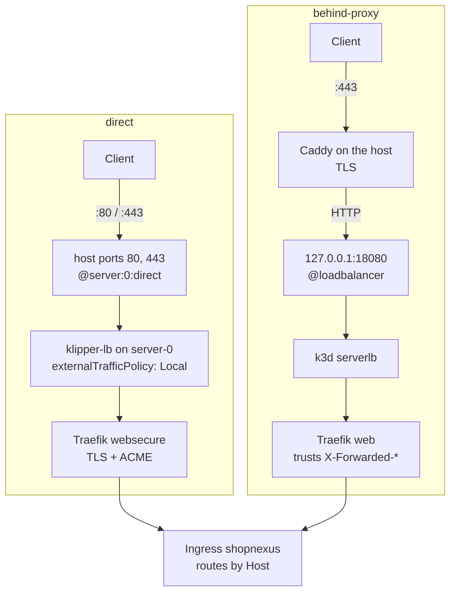
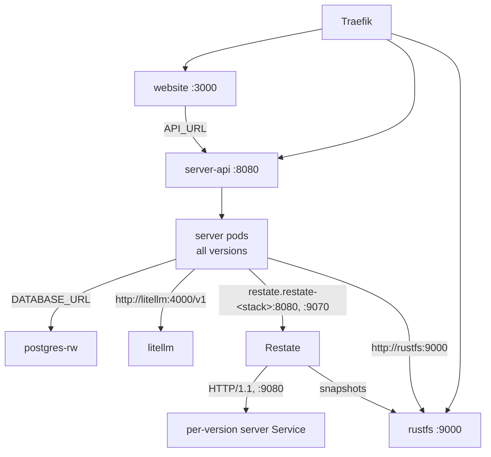
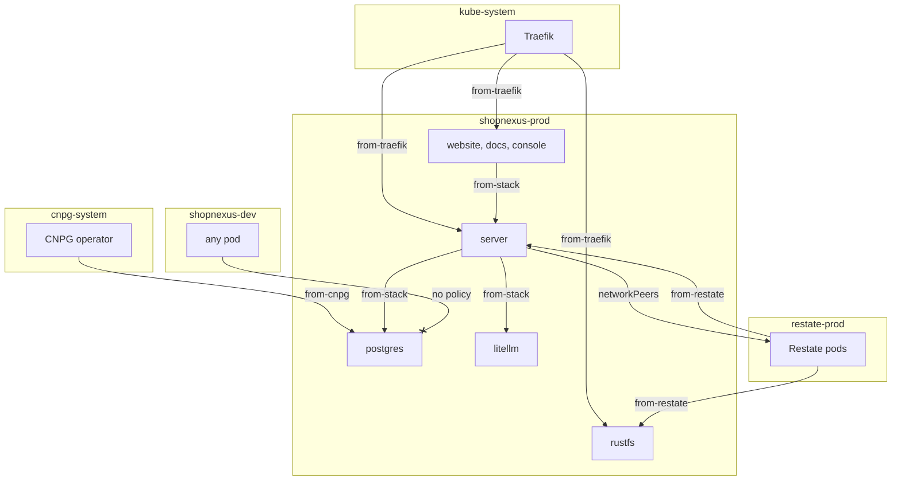

Each stack is a namespace, `shopnexus-dev` or `shopnexus-prod`, and each stack's hosts come from its `domain` value. Traefik, the ingress controller bundled with k3s, receives every request and routes it by its `Host` header. How a request reaches Traefik depends on the edge mode, which is the k3d config the cluster was created from.

## Edge modes

`infra/cluster/k3d-direct.yaml` and `infra/cluster/k3d-behind-proxy.yaml` differ in two things: the k3d port mapping, and the Traefik `HelmChartConfig` written inline in the config's `files:` list, which k3s applies at its first start. In both modes Traefik runs one replica, pinned to the control-plane node `server-0`.



<Tabs labels={["direct", "behind-proxy"]}>
<Tab>
Use `direct` on a machine where nothing else holds ports 80 and 443. Set `ACME_EMAIL`; k3d fills `${ACME_EMAIL}` in the config from the environment.

```bash
ACME_EMAIL=you@example.com k3d cluster create --config infra/cluster/k3d-direct.yaml
```

- The config maps ports `80:80` and `443:443` with the node filter `server:0:direct`. The ports go straight onto `server-0`, where Traefik runs, and skip k3d's serverlb, an nginx stream proxy that replaces the client's address with its own.
- Traefik's Service has `externalTrafficPolicy: Local`, so klipper-lb hands the connection to the Traefik pod on the same node and keeps the source address.
- The resolver `le` gets certificates from Let's Encrypt with the TLS-ALPN-01 challenge (`tlsChallenge: true`), which answers on port 443 itself. Certificates live in `/data/acme.json` on a 128Mi volume. Because one pod owns that volume, the Deployment uses `updateStrategy: Recreate`.
- The resolver uses Let's Encrypt's production directory. To try the setup against the staging directory, whose rate limits are higher and whose certificates browsers reject, add `caServer: https://acme-staging-v02.api.letsencrypt.org/directory` under `acme` in `k3d-direct.yaml` before you create the cluster.
- The `web` entrypoint redirects to `websecure` with `permanent: true`. Plain HTTP gets a 301.
- Access logs are on (`accessLog.enabled: true`).
</Tab>
<Tab>
Use `behind-proxy` when a proxy on the host already holds 80 and 443. The author's server runs this mode behind a Caddy shared with other projects.

```bash
k3d cluster create --config infra/cluster/k3d-behind-proxy.yaml
```

- The config maps port `127.0.0.1:18080:80` with the node filter `loadbalancer`. Only the host itself can reach port 18080.
- The outer proxy terminates TLS, redirects plain HTTP (Caddy answers 308) and sends HTTP to `127.0.0.1:18080`. On the author's server that proxy configuration is `conf.d/shopnexus.caddy`, which lists the hosts of both stacks.
- Traefik's `web` entrypoint trusts `X-Forwarded-*` headers from `10.0.0.0/8`, `172.16.0.0/12` and `192.168.0.0/16`, which covers the k3d Docker network. Traefik passes the client address from the outer proxy's `X-Forwarded-For` on to the pods.
- Traefik does no TLS and no redirect in this mode.
</Tab>
</Tabs>

### Ingress manifests in both modes

The chart's Ingress, `shopnexus` in `infra/stack/templates/ingress.yaml`, names hosts and Services and has no `tls` section. In `direct`, TLS is set on Traefik's `websecure` entrypoint (`tls.enabled: true`, `certResolver: le`), so every route on that entrypoint gets a certificate for its host. In `behind-proxy`, TLS ends before the cluster. The chart renders the same manifests for either mode, and `infra/check.sh` fails if the Ingress ever gains a `tls` key.

The server trusts `X-Forwarded-For` from `TRUSTED_PROXIES`, set to the pod network `10.42.0.0/16`, which is where Traefik's requests come from.

## Hosts

The helper `sn.host` builds every host from `domain`: an empty prefix gives the domain itself, and a prefix gives `<prefix>.<domain>`. The console route exists while `console.enabled` is true, which is the default.

| Host | Service | Port | prod | dev |
|---|---|---|---|---|
| `<domain>` | `website` | 3000 | `shopnexus.id.vn` | `dev.shopnexus.id.vn` |
| `api.<domain>` | `server-api` | 8080 | `api.shopnexus.id.vn` | `api.dev.shopnexus.id.vn` |
| `media.<domain>` | `rustfs` | 9000 | `media.shopnexus.id.vn` | `media.dev.shopnexus.id.vn` |
| `docs.<domain>` | `docs` | 80 | `docs.shopnexus.id.vn` | `docs.dev.shopnexus.id.vn` |
| `console.<domain>` | `console` | 80 | `console.shopnexus.id.vn` | `console.dev.shopnexus.id.vn` |

Every path (`/`, `pathType: Prefix`) of a host goes to the one Service. `infra/stack/tests/web_test.yaml`, which `infra/check.sh` runs, compares the rendered host lists of both stacks with these values.

## Traefik chart 41

k3s `v1.37.1-k3s1`, the image in both k3d configs, bundles Traefik chart 41.4.0. Its values schema refuses keys it does not know. The first draft of the direct Traefik config used older keys (`ports.web.redirections`, `ports.websecure.tls`, `logs`). The chart rejected them, and k3s ran Traefik with its default values (no ACME, no redirect, no access log) without an error on any resource.

The keys now in use are `ports.web.http.redirections`, `ports.websecure.http.tls`, `accessLog.enabled` and `certificatesResolvers.le.acme.tlsChallenge`. `infra/check.sh` takes the Traefik config out of each k3d config, renders it with `helm template` against chart 41.4.0 and looks for the resulting Traefik arguments:

- direct: `externalTrafficPolicy: Local`, `--entryPoints.websecure.http.tls.certResolver=le`, `--entryPoints.web.http.redirections.entryPoint.to=:443`, `--certificatesresolvers.le.acme.tlsChallenge=true`, `--accesslog=true`;
- behind-proxy: `--entryPoints.web.forwardedHeaders.trustedIPs=10.0.0.0/8,172.16.0.0/12,192.168.0.0/16`, and no redirection.

The check also pins the k3s image to `rancher/k3s:v1.37.1-k3s1`. A k3s upgrade that brings a different Traefik chart fails the check until the Traefik configs are rendered against the new chart.

<Callout type="warning" title="Client addresses in direct mode">
On the local k3d cluster, the serverlb route showed Traefik a pod address (`10.42.x`) and then the serverlb's own (`172.24.0.6`). With `@server:0:direct` and `externalTrafficPolicy: Local`, a request from the same machine still shows the Docker gateway, because Docker's userland proxy handles it. A request from another machine could not be tested, since the laptop's firewall blocked it. Whether `direct` keeps the address of an external client is checked on the first `direct` deployment; until then, logs may show the gateway address. `behind-proxy` is unaffected, because Caddy sets `X-Forwarded-For`.
</Callout>

## Traffic inside the cluster

Every in-cluster hop goes to a Kubernetes Service, which balances connections at L4 over the ready pods behind it on any node. The cluster has one server node and three agents. The apps prefer `agent-1` and `agent-2` (label `role=app`), so a Service usually spreads a stack's pods over two nodes.



- The server's `RestateDeployment` gives each pod template its own ReplicaSet and its own Service, and registers that Service with Restate. A config change or a reseal changes the template's checksums, so it starts a new version. The operator keeps an old version until its invocations finish.
- Restate invokes the server on the per-version Service, port 9080 (`restate`). An invocation that started on one version stays on it.
- `server-api` selects `app.kubernetes.io/name: server` and so spans every version. Public API traffic goes to any ready server pod.
- The server reaches Restate's ingress at `http://restate.restate-<stack>:8080` and its admin API at `:9070`. `RestateCluster` lives in its own namespace, `restate-dev` or `restate-prod`.

`useHttp11: true` makes Restate call the endpoint over HTTP/1.1. With HTTP/2, Restate would hold one long-lived connection and multiplex invocations over it, and an L4 Service balances connections, so every invocation could land on the same pod. Over HTTP/1.1, each invocation is a request of its own and the spread over pods is even.

## NetworkPolicy

`infra/stack/templates/networkpolicy.yaml` puts five policies in each stack namespace. `default-deny-ingress` selects every pod and admits nothing, and each of the other four admits one source.

| Policy | Pods it selects | Admits traffic from |
|---|---|---|
| `default-deny-ingress` | every pod | nothing |
| `from-stack` | every pod | any pod in the same namespace |
| `from-traefik` | `website`, `docs`, `console`, `server`, `rustfs` | pods `app.kubernetes.io/name: traefik` in `kube-system` |
| `from-cnpg` | `cnpg.io/cluster: postgres` | the namespace `cnpg-system` (the CloudNativePG operator) |
| `from-restate` | `server`, `rustfs` | the namespace `restate-<stack>` |



The restate-operator writes the policies for the Restate namespace from the `RestateCluster`:

- `spec.security.networkPeers.ingress` and `.admin` admit traffic to Restate's ingress and admin ports only from pods `app.kubernetes.io/name: server` in the stack's namespace.
- Restate pods may connect to pods that carry the label `allow.restate.dev/restate-<stack>: "true"`. The server's pod template and the `rustfs` StatefulSet carry it, for invocations and snapshots.

<KeyRules>
- `from-stack` has no `namespaceSelector`, so it admits pods of its own namespace only.
- No policy admits traffic from `shopnexus-dev` into `shopnexus-prod` or the reverse, and each stack's `from-restate` names only its own `restate-<stack>` namespace.
- Egress is open. The server calls Firebase, FCM and the language model upstream outside the cluster.
- `litellm` is reachable from every pod of its stack through `from-stack`. Only the server holds a virtual key for it.
</KeyRules>

The failover drill in the [Runbook](/en/operations/cluster/runbook#failover-drills) connects from a `shopnexus-dev` pod to `postgres-rw.shopnexus-prod`. The NetworkPolicy drops the packets, so the connection times out. The drill is planned for the live server and has not run yet.

## DNS records

Point these A records at the machine. With prod on `shopnexus.id.vn`, the four records cover both stacks.

| Name | Covers |
|---|---|
| `@` | `shopnexus.id.vn` (prod website) |
| `*` | `api.`, `media.`, `docs.`, `console.` of prod |
| `*.dev` | `api.`, `media.`, `docs.`, `console.` of dev |
| `dev` | `dev.shopnexus.id.vn` (dev website) |

<Callout type="warning" title="The dev record">
A `*` wildcard answers only for names that do not exist in the zone. Creating `*.dev` makes `dev` exist as a node of the zone, so `*` stops covering `dev.shopnexus.id.vn` and the dev website does not resolve. Add `dev` as its own record.
</Callout>

## Website and console API addresses

The website is Astro with server-side rendering, and it calls the API while it renders a page. It reads `API_URL` at runtime (`astro:env/server`), and the image sets `API_URL=http://server-api:8080/v1` in `website/Dockerfile`. A short Service name resolves in the pod's own namespace, so the same image calls the dev server in `shopnexus-dev` and the prod server in `shopnexus-prod`. That call stays inside the cluster and is admitted by `from-stack`.

The console is a static app that calls the API from the browser. `console/src/lib/api.ts` takes the page's own host, drops a leading `console.` and puts `api.` in front: a page on `console.shopnexus.id.vn` calls `https://api.shopnexus.id.vn/v1`, and one on `console.dev.shopnexus.id.vn` calls `https://api.dev.shopnexus.id.vn/v1`. `VITE_API_URL` overrides this for local development. Requests carry cookies (`credentials: 'include'`), and the server accepts them from `STAFF_CONSOLE_ORIGIN`, which the chart sets to `https://console.<domain>`.
