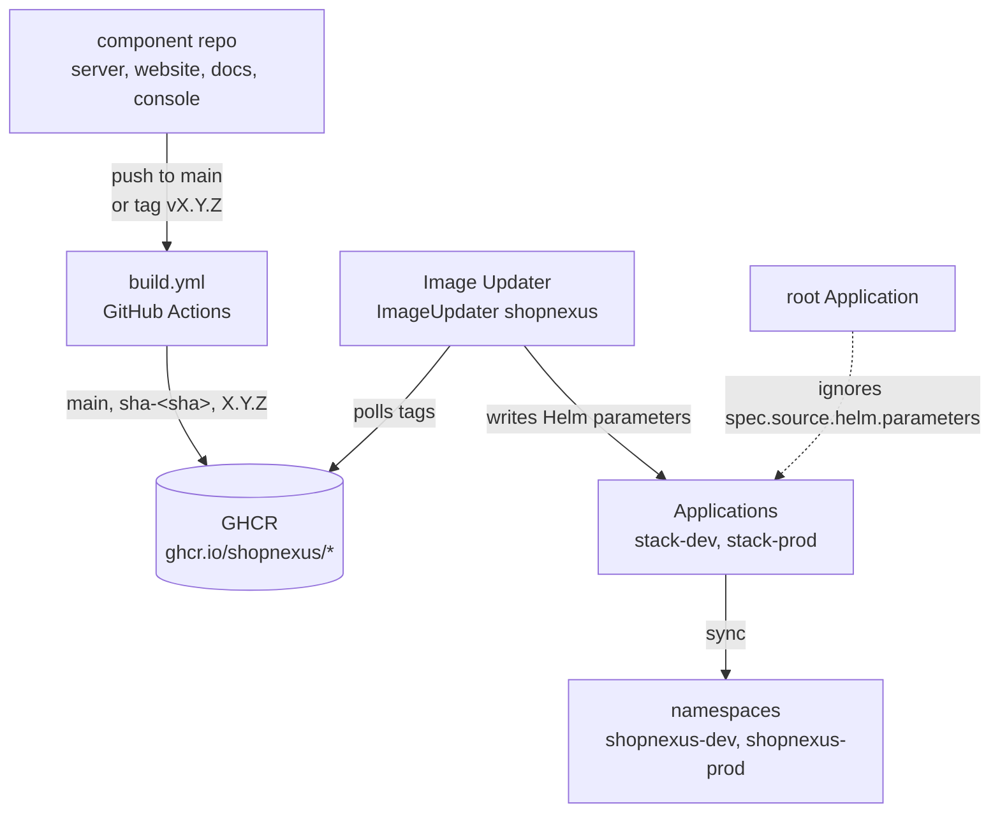
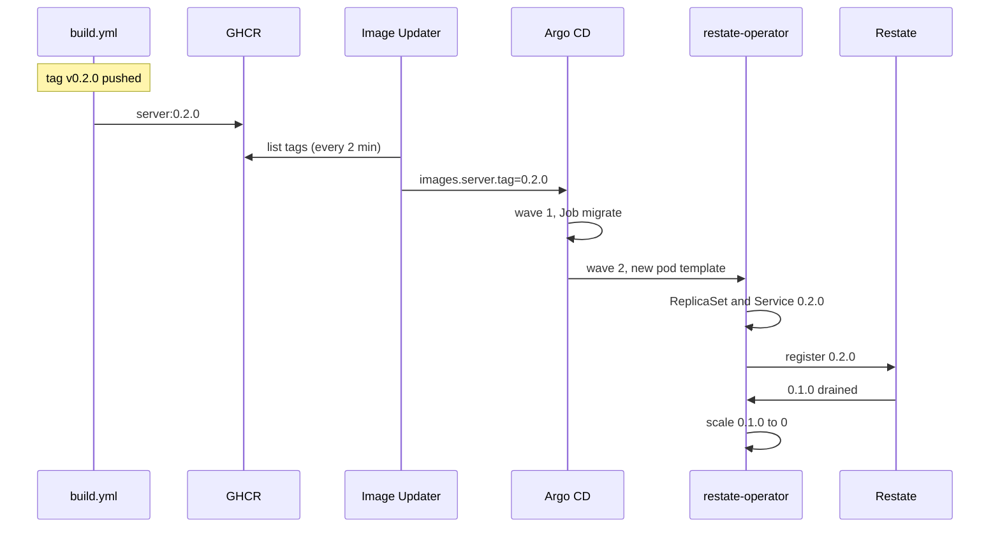

Four components run in each stack from images their own repos build: `server`, `website`, `docs` and `console`. A push to `main` in a component repo reaches dev. A tag `vX.Y.Z` reaches prod. Nobody edits an image tag in `infra/` for either: Argo CD Image Updater watches GHCR and writes the new tag into the stack's Argo CD Application, and Argo CD syncs it.



## Image tags

Each component repo has the same `.github/workflows/build.yml`. It runs on a push to `main`, on a push of a tag matching `v*`, and by hand (`workflow_dispatch`). It builds the repo's `Dockerfile` and pushes `ghcr.io/<owner>/<repo>` with the tags from `docker/metadata-action`:

| Event | Tags pushed |
|---|---|
| Push to `main` | `main` and `sha-<full commit sha>` |
| Tag `v0.2.0` | `0.2.0` |

The `v` prefix is dropped, so tag `v0.2.0` gives the image tag `0.2.0`. A tag that is not semver gives no version tag. Builds of the same ref share a concurrency group, and a newer push cancels the build in progress. The cluster pulls without credentials, so the four GHCR packages must stay public.

## Image Updater

`infra/argocd/stacks.yaml` holds one `ImageUpdater` resource, `shopnexus` in namespace `argocd`, with an entry per stack Application. The Image Updater chart is 1.4.0, installed by the `image-updater` Application in `infra/platform/image-updater.yaml`.

| | dev (`stack-dev`) | prod (`stack-prod`) |
|---|---|---|
| Image it watches | `ghcr.io/shopnexus/<component>:main` | `ghcr.io/shopnexus/<component>` |
| `updateStrategy` | `digest` | `semver` |
| Moves when | the digest behind `:main` changes | a higher `X.Y.Z` tag appears |
| Tag it writes | `main@sha256:…` | `X.Y.Z` |

For each of the four components it writes two Helm parameters on the Application, `images.<component>.repository` and `images.<component>.tag`. The other images in `values.yaml` (Postgres, Restate, RustFS, LiteLLM, curl) are pinned there and change only by a commit.

`semver` picks the highest version in the registry, whatever the order of the pushes. After `0.2.0` exists, a new tag `v0.1.9` never reaches prod. Image Updater's handling of pre-release tags such as `v0.3.0-rc.1` has not been checked, so release with plain `vX.Y.Z` tags.

## Parameters and the root Application

Argo CD gives Helm parameters precedence over value files. Once Image Updater has written `images.server.tag` on `stack-prod`, the `images.*.tag` lines in `values-prod.yaml` (`0.1.0` today) no longer decide what runs. They are the starting point for a fresh cluster, before Image Updater has written anything.

The stack Applications are themselves resources of the app-of-apps `root` (`infra/argocd/root.yaml`), which syncs `infra/platform` and `infra/argocd` with `selfHeal: true`. Self-heal would put each Application back to its definition in git and erase the parameters. Two settings in `root` keep them:

```yaml title="infra/argocd/root.yaml"
ignoreDifferences:
  - group: argoproj.io
    kind: Application
    jsonPointers: [/spec/source/helm/parameters]
syncPolicy:
  automated: { prune: true, selfHeal: true }
  syncOptions: [RespectIgnoreDifferences=true]
```

`ignoreDifferences` makes `root` report no drift on that path. `RespectIgnoreDifferences=true` makes a sync leave the path as it is in the cluster. With only the first, the next sync of `root` would still overwrite the parameters.

## Argo CD settings

`infra/cluster/up.sh` installs the `argo-cd` chart 10.11.7 with `infra/cluster/argocd-values.yaml` and applies `root.yaml` once. From then on Argo CD manages `root` from git.

| Setting | Where | Effect |
|---|---|---|
| `automated: { prune: true, selfHeal: true }` | every Application | a commit is applied without a click, a resource removed from git is deleted, and a hand edit in the cluster is reverted |
| `retry: { limit: -1, backoff: { duration: 30s, factor: 2, maxDuration: 5m } }` | every Application | a failed sync is retried forever, 30 s apart at first and at most 5 min apart |
| sync waves | platform Applications wave 0, `stack-dev`, `stack-prod` and the `ImageUpdater` wave 1 | the stacks start after the operators |
| Lua health check for `argoproj.io/Application` | `argocd-values.yaml` | `root` reads each child Application's health, so wave 1 waits for the platform Applications to be Healthy |

Argo CD stopped judging the health of Application resources in version 1.8. Without the Lua check, `root` would treat the platform Applications as healthy at once, and the stacks would start before CloudNativePG, Sealed Secrets and restate-operator had their CRDs. The `ImageUpdater` carries `SkipDryRunOnMissingResource=true`, because its CRD arrives with the `image-updater` Application in the same sync.

Inside a stack, each sync runs the waves of the chart again, including the Sync hook Jobs `migrate`, `objectstore-init` and `objectstore-init-snapshots` (wave 1) and `litellm-key` (wave 3). A new server image therefore runs its migrations before the new server pods start; the table of every wave is in [Postgres, Restate and RustFS](/en/operations/cluster/data#sync-waves-and-jobs).

## Ship to dev

<Steps>
<Step title="Push to main">
Merge or push to `main` in the component repo, for example `server`. `build.yml` builds the image and pushes `ghcr.io/shopnexus/server:main` and `sha-<sha>`.

```bash title="Terminal"
gh run watch --repo shopnexus/server
```
</Step>

<Step title="Wait for Image Updater">
Image Updater checks the registry every two minutes by default. When the digest behind `:main` has changed, it writes `images.server.tag` on `stack-dev` as `main@sha256:…`.

```bash title="Terminal"
kubectl -n argocd get application stack-dev \
  -o jsonpath='{range .spec.source.helm.parameters[*]}{.name}={.value}{"\n"}{end}'
```
</Step>

<Step title="Watch the rollout">
Argo CD syncs `stack-dev`. `migrate` runs with the new image, then restate-operator starts a new server version beside the old one, and the old version keeps running until its Restate invocations finish. Website, docs and console are plain Deployments and roll pod by pod.

```bash title="Terminal"
kubectl -n shopnexus-dev get rs -l app.kubernetes.io/name=server
```

You should see a new ReplicaSet with ready pods and the old one scaled to 0 once its invocations are done. The [data page](/en/operations/cluster/data) describes how restate-operator drains a version.
</Step>
</Steps>

## Release to prod

<Steps>
<Step title="Tag the commit">
In the component repo, tag the commit that dev has been running and push the tag. The version must be higher than the one prod runs.

```bash title="Terminal"
git switch main && git pull
git tag v0.2.0
git push origin v0.2.0
```

`build.yml` pushes `ghcr.io/shopnexus/server:0.2.0`.
</Step>

<Step title="Let Image Updater pick it up">
On its next check Image Updater sees `0.2.0` as the highest version and writes `images.server.tag=0.2.0` on `stack-prod`, and Argo CD syncs `stack-prod` with it.

```bash title="Terminal"
kubectl -n argocd get application stack-prod \
  -o jsonpath='{range .spec.source.helm.parameters[*]}{.name}={.value}{"\n"}{end}'
```
</Step>

<Step title="Check the new version">
```bash title="Terminal"
kubectl -n shopnexus-prod get rs -l app.kubernetes.io/name=server
infra/smoke.sh shopnexus.id.vn
```

Prod runs three server pods per version. You should see the new ReplicaSet at 3/3 and every smoke line `ok`.
</Step>
</Steps>

Each component is released on its own. A tag in `website` changes only the website.



<Callout type="warning" title="Migrations run first">
The `migrate` Job applies the new version's migrations while the old server pods still serve traffic, and a rollback does not undo them. A migration has to work with the version before it.
</Callout>

## Roll back prod

Because Image Updater follows the highest version, a release cannot be undone by pushing an older tag or by editing `values-prod.yaml` alone.

<Tabs labels={["Roll forward", "Pin a tag"]}>
<Tab>
Release a fixed version above the bad one. This needs no change in `infra/`.

<Steps>
<Step title="Revert in the component repo">
```bash title="Terminal"
git revert <bad commit>
git push origin main
```

Dev gets the revert first.
</Step>

<Step title="Tag a higher version">
```bash title="Terminal"
git tag v0.2.1
git push origin v0.2.1
```

Image Updater moves prod from `0.2.0` to `0.2.1`.
</Step>
</Steps>
</Tab>
<Tab>
Hold prod on a known version until a fix is ready. The Helm parameters win over the values file, so a tag pinned in `values-prod.yaml` changes nothing while Image Updater's parameters are on `stack-prod`. The steps below remove them; nobody has run them on a cluster yet.

<Steps>
<Step title="Stop Image Updater for prod">
In `infra/argocd/stacks.yaml`, delete the `stack-prod` entry under `applicationRefs` of the `ImageUpdater`, or only the image you are pinning.
</Step>

<Step title="Pin the tag">
In `infra/stack/values-prod.yaml`, set the version that worked:

```yaml title="infra/stack/values-prod.yaml"
images:
  server: { repository: ghcr.io/shopnexus/server, tag: 0.1.0 }
```

Run `infra/check.sh`, commit both files and push to the umbrella's `main`.
</Step>

<Step title="Remove the written parameters">
`root` ignores the parameters, so git will not remove them. Delete them on the Application:

```bash title="Terminal"
kubectl -n argocd patch application stack-prod --type json \
  -p '[{"op":"remove","path":"/spec/source/helm/parameters"}]'
```

Argo CD syncs `stack-prod` with the tags from `values-prod.yaml`. This removes the parameters of all four components, so pin each of them in `values-prod.yaml` to the version you want.
</Step>

<Step title="Resume">
When the fix is tagged, put the `stack-prod` entry back in `stacks.yaml`. Image Updater writes the new parameters on its next check.
</Step>
</Steps>
</Tab>
</Tabs>

## Change a config value

Non-secret settings live in `infra/stack/values.yaml` and the two stack files. Secrets go through `seal.sh` ([Secrets](/en/operations/cluster/secrets)).

<Steps>
<Step title="Edit the values file">
Change the value in `values-dev.yaml` or `values-prod.yaml`, for example `server.logLevel` or `replicas.server`. A value in `values.yaml` applies to both stacks unless a stack file sets it.
</Step>

<Step title="Check the chart">
```bash title="Terminal"
infra/check.sh
```

It renders the chart for both stacks and checks the result. It needs `helm`, `yq` and `kubeconform`, and CI runs it on every pull request under `infra/`.
</Step>

<Step title="Push to the umbrella">
Commit and push to `main`. Argo CD polls the repo every two to three minutes (`timeout.reconciliation` 120 s plus up to 60 s of jitter, the chart's defaults). To sync at once:

```bash title="Terminal"
kubectl -n argocd annotate application stack-prod argocd.argoproj.io/refresh=normal
```
</Step>

<Step title="Watch it roll">
The server's pod template carries `checksum/env`, a hash of the `server-env` ConfigMap, so a server setting starts a new server version. LiteLLM's Deployment carries `checksum/config` for its config.
</Step>
</Steps>

A `kubectl edit` on a resource of a stack lasts until the next self-heal, which puts the resource back to git.

## Check what version runs

<Tabs labels={["kubectl", "Argo CD UI"]}>
<Tab>
The tags Image Updater wrote:

```bash title="Terminal"
kubectl -n argocd get application stack-prod \
  -o jsonpath='{range .spec.source.helm.parameters[*]}{.name}={.value}{"\n"}{end}'
```

The image and digest each pod runs:

```bash title="Terminal"
kubectl -n shopnexus-prod get pods \
  -o custom-columns='POD:.metadata.name,IMAGE:.spec.containers[0].image,DIGEST:.status.containerStatuses[0].imageID'
```

The server versions restate-operator keeps, with their pod counts:

```bash title="Terminal"
kubectl -n shopnexus-prod get rs -l app.kubernetes.io/name=server
```
</Tab>
<Tab>
Forward the Argo CD server's port and read the initial admin password:

```bash title="Terminal"
kubectl -n argocd port-forward svc/argocd-server 8080:443
kubectl -n argocd get secret argocd-initial-admin-secret -o jsonpath='{.data.password}' | base64 -d
```

Open `https://localhost:8080`, accept the self-signed certificate, and sign in as `admin` with that password. Open the `stack-prod` Application, then <UI>App Details</UI> and the <UI>Parameters</UI> tab, which lists `images.<component>.tag`. The resource tree shows each ReplicaSet with its pods.
</Tab>
</Tabs>

<Callout type="note" title="Server health in Argo CD">
Argo CD has no health check for `RestateDeployment`, so a server that crash-loops still shows Healthy in Argo CD. Read the pods with `kubectl` after a release.
</Callout>

<KeyRules>
- Dev follows `:main` by digest. Prod follows the highest `X.Y.Z` tag.
- Image tags of `server`, `website`, `docs` and `console` are set by Image Updater, and the `images.*.tag` lines in the values files only apply where it writes none.
- A new prod release has a version higher than every tag already in GHCR.
- Every migration works with the server version before it.
- A change to the cluster goes through git. A hand edit is reverted by self-heal.
</KeyRules>

## Troubleshooting

<AccordionGroup>
<Accordion title="A new tag does not reach prod">
Check that the tag is semver with a `v` prefix and that the build pushed `X.Y.Z` to GHCR. Then compare it with the version prod runs: Image Updater only moves to a higher one. Its log names each image it checked:

```bash title="Terminal"
kubectl -n argocd logs deploy/image-updater-argocd-image-updater-controller --tail=100
```
</Accordion>

<Accordion title="Parameters disappear after a sync of root">
`root.yaml` must keep both the `ignoreDifferences` entry for `/spec/source/helm/parameters` and `RespectIgnoreDifferences=true`. `infra/check.sh` fails when the first is missing.
</Accordion>

<Accordion title="A stack Application stays OutOfSync or Unknown">
Read the condition with `kubectl -n argocd get application stack-prod -o jsonpath='{.status.conditions}'`. A ComparisonError that names `seal.sh` means `infra/stack/secrets/<stack>/` holds no SealedSecrets. Other errors come from the chart; reproduce them with `infra/check.sh`. Argo CD retries the sync with backoff up to 5 minutes, so a fix in git is picked up without a click.
</Accordion>
</AccordionGroup>
